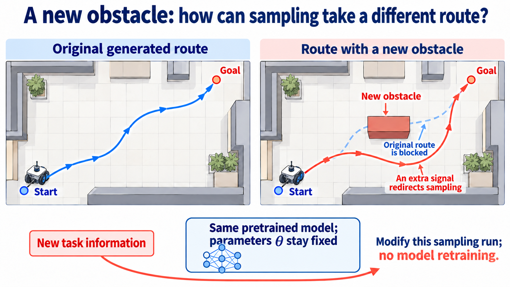

import Objectives from '../../../components/Objectives.astro';
import Prereq from '../../../components/Prereq.astro';
import Ask from '../../../components/Ask.astro';
import Question from '../../../components/Question.astro';
import Answer from '../../../components/Answer.astro';
import QuizBlock from '../../../components/QuizBlock.astro';
import Option from '../../../components/Option.astro';
import Explanation from '../../../components/Explanation.astro';
import Bridge from '../../../components/Bridge.astro';
import Ref from '../../../components/Ref.astro';

# The Model Is Trained. Can We Still Change What We Want?

<Objectives title="After reading, you can">
- **Identify what test-time steering changes:** this generation or selection procedure, with pretrained parameters fixed.
- **Distinguish conditioning, fine-tuning, and steering** through training information and parameter updates.
- **Explain why a new task needs a signal**, such as a condition, measurement, or reward.
</Objectives>

<Prereq items={frontmatter.prereqs} />

## Learning the data does not specify what we want this time

Earlier units learned distributions and transformed noise or source data into their samples.

Real requirements often arrive after training: a dog wearing a red hat, an image consistent with a blurry observation, a stable protein, or a robot trajectory avoiding a new obstacle. The pretrained model knows plausible data, but needs information about this particular request.

A navigation system already knows the roads. Asking for charging stops and less traffic should change route choices rather than require rebuilding the map.

The map corresponds to the pretrained model. Text, measurements, or a scoring rule provide the new requirement.

<Ask>
Can we guide sampling toward this task's preferred region without retraining the generator?
</Ask>

These methods are called **test-time guidance** or **test-time steering**. We use steering for the broader problem and guidance for methods that add an intermediate direction.

## When does the requirement enter?

Let $x_0$ denote clean data and $c$ a condition such as a class or text prompt.

### Conditional training: the requirement is part of training

Training on paired examples $(x_0,c)$ can directly learn

$$
p_\theta(x_0\mid c).
$$

For continuous data this is a conditional density, rather than the probability of a single point. Given a red-hat-dog prompt, compatible images should receive higher density.

Both diffusion and Flow Matching retain their regression labels and also provide $c$ to the network.

**Diffusion** predicts noise from the noisy state, time, and condition:

$$
\mathcal L_{\mathrm{diff,cond}}(\theta)
=\mathbb E_{x_0,c,t,\epsilon}
\left[
\left\|\epsilon-\epsilon_\theta(x_t,t,c)\right\|^2
\right].
$$

The expectation averages training pairs, noise levels, and corruption noise. The target remains the sampled noise.

**Flow Matching** predicts the reference velocity while receiving the condition:

$$
\mathcal L_{\mathrm{FM,cond}}(\theta)
=\mathbb E_{t,(X_0,X_1,c)}
\left[
\left\|
v_\theta(I_t,t,c)-\partial_t I_t
\right\|^2
\right].
$$

Here $I_t$ connects a source endpoint to a data endpoint, and $\partial_t I_t$ is its derivative. The expectation includes endpoint pairing, condition, and sampled time.

In both cases, conditions enter the original training and affect the learned parameters. This is **conditional training**.

### Fine-tuning: update parameters after pretraining

Suppose we later collect preferred generated examples. For an unconditional model, the preferred dataset contains clean samples; for a conditional model, it contains sample-condition pairs. These examples identify outcomes we want the model to generate more often.

A simple unconditional fine-tuning objective reuses denoising regression on preferred data:

$$
\mathcal L_{\mathrm{align}}(\theta;\mathcal D_{\mathrm{pref}})
=\mathbb E_{x_0\sim\mathcal D_{\mathrm{pref}},t,\epsilon}
\left[
\left\|\epsilon-\epsilon_\theta(x_t,t)\right\|^2
\right].
$$

The loss averages preferred samples, times, and corruption noise. Conditional models additionally receive $c$. Flow Matching can similarly fine-tune velocity regression. The data distribution driving parameter updates has changed.

Apply gradient descent:

$$
\theta
\leftarrow
\theta-\eta\nabla_\theta
\mathcal L_{\mathrm{align}}
\bigl(\theta;\mathcal D_{\mathrm{pref}}\bigr).
$$

The parameter gradient points uphill in loss, so its negative lowers the objective. The learning rate $\eta$ determines the update size.

Alignment methods may instead use comparisons or reward weighting. Their shared feature is writing preferences into model parameters. **Updating pretrained parameters places the procedure outside this unit's definition of test-time steering.**

### Test-time steering: change this sampling computation

Keep pretrained generator parameters fixed. Extra evaluators or scores may change intermediate computations or select completed candidates, but do not overwrite the generator's parameters.

For a score sampler, temporarily use

$$
\widetilde s_t(x_t)
=s_\theta(x_t,t)+g_t(x_t),
\qquad
\theta\ \text{fixed}.
$$

The base score is retained, while $g_t$ adds a task-dependent direction from a condition, observation, or reward. The sampler follows this combined field for the current request. The same unchanged model can use a different task signal next time.

Compare the three procedures:

| Procedure | When does the requirement enter? | Update generator parameters? | Generation |
|---|---|---|---|
| Conditional training | Original paired training data | Yes, during training | Supply a learned condition |
| Fine-tuning | New preference data after pretraining | Yes | Use the updated model |
| Test-time steering | Current sampling request | No | Modify sampling or selection using a task signal |

## New requirements need a signal

The interpolant framework unifies transport by diffusion and flow. Additional requirements still need additional information. A robot trajectory generator cannot infer the location of a newly placed obstacle without receiving that location or a collision-related score.

We will study how to turn such signals into modifications of generation or selection.

*Figure: task information changes this sampling run while pretrained parameters remain fixed.*

<Question label="Discussion" id="Q1">
Why not generate many candidates and simply return the highest-scoring one? Do we need to change intermediate sampling at all?

<Answer summary="Show the reasoning">
This valid baseline is **Best-of-$N$**. It needs neither reward gradients nor model internals. Selection changes the returned distribution even though each candidate was generated by the original procedure. We revisit it in <Ref to="dma-gradient-free-steering"/>.

The difficulty is a rare requirement. If one independent candidate succeeds with probability $p$, the chance of at least one success among $N$ is

$$
1-(1-p)^N.
$$

For small $p$, substantially increasing success can require $N$ on the order of $1/p$. Near-successes are discarded without using their scores to improve them along the way.

Selection is useful, but can be expensive. Can intermediate feedback spend the same computation more effectively?
</Answer>
</Question>

## Check your understanding

<QuizBlock id="w10-0-a">
Which procedure is test-time steering here?
<Option>Retrain on a new labeled dataset.</Option>
<Option correct>Keep parameters fixed and use the current reward to change sampling.</Option>
<Option>Replace the architecture and train from scratch.</Option>
<Explanation>Task-dependent computation changes, while pretrained generator parameters remain fixed.</Explanation>
</QuizBlock>

<QuizBlock id="w10-0-b">
Why is higher reward alone insufficient to establish better steering?
<Option>Rewards never have gradients.</Option>
<Option>Likelihood can never be estimated.</Option>
<Option correct>Outputs may become implausible or lose diversity.</Option>
<Explanation>Reward must be considered together with data fidelity and diversity. Reward tilting formalizes one such trade-off.</Explanation>
</QuizBlock>

<QuizBlock id="w10-0-c">
What does a trajectory model need to avoid a newly placed obstacle?
<Option>No extra information if it learned plausible routes.</Option>
<Option>Only more sampling steps.</Option>
<Option correct>The obstacle location or a task-related collision signal.</Option>
<Explanation>More computation alone does not reveal information absent from the request.</Explanation>
</QuizBlock>

<Bridge to="dma-classifier-guidance">
We can keep the model fixed and use new task information. Can we judge progress before an image is finished?

For a corgi snowboarding on a snowy mountain, a classifier might assess breed; an already conditional generator might compare its own predictions. Next we examine both sources of direction.
</Bridge>

## References

1. Dhariwal, P., Nichol, A. [*Diffusion Models Beat GANs on Image Synthesis.*](https://arxiv.org/abs/2105.05233) NeurIPS 2021.
2. Ho, J., Salimans, T. [*Classifier-Free Diffusion Guidance.*](https://arxiv.org/abs/2207.12598) 2022.
3. Singhal, R., et al. [*A General Framework for Inference-time Scaling and Steering of Diffusion Models.*](https://proceedings.mlr.press/v267/singhal25b.html) ICML 2025.
