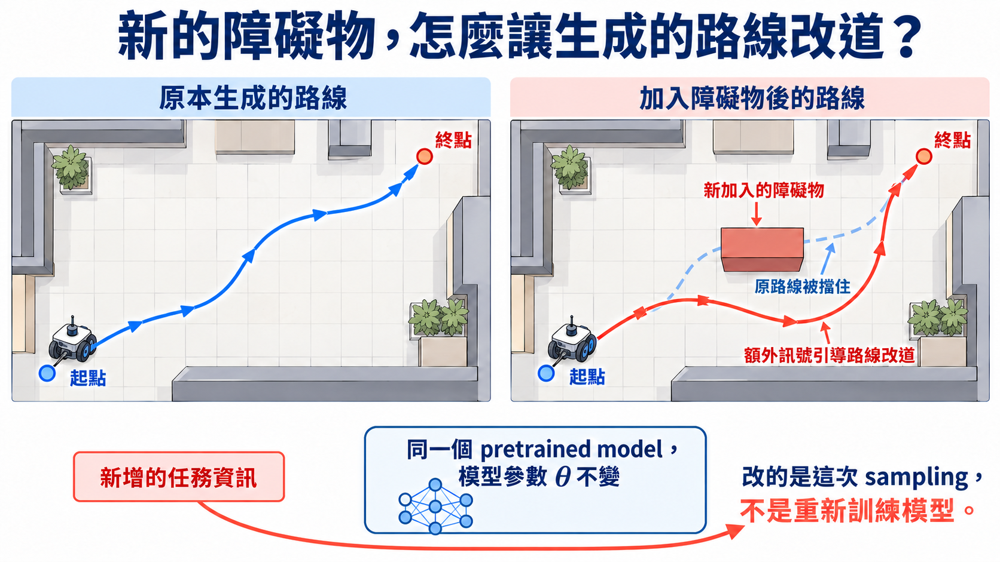

import Objectives from '../../../components/Objectives.astro';
import Prereq from '../../../components/Prereq.astro';
import Ask from '../../../components/Ask.astro';
import Question from '../../../components/Question.astro';
import Answer from '../../../components/Answer.astro';
import QuizBlock from '../../../components/QuizBlock.astro';
import Option from '../../../components/Option.astro';
import Explanation from '../../../components/Explanation.astro';
import Bridge from '../../../components/Bridge.astro';
import Ref from '../../../components/Ref.astro';

# 模型已經訓練好，現在才知道想要什麼，還來得及嗎？

<Objectives>
- **說出 test-time steering 要改的是什麼。** 保留 pretrained generative model 的參數，用條件、觀測或 reward 提供的訊號，調整這一次生成或挑選的結果。
- **分清 conditional training、fine-tuning 與 test-time steering。** 指出 condition 是否參與 training、模型參數是否更新，以及哪些操作只在 sampling 時發生。
- **說出修改 sampling 為什麼需要額外訊號。** 用機器人避開新障礙物的例子，說明 condition、observation 或 reward 如何引導生成結果。
</Objectives>

<Prereq items={frontmatter.prereqs} />

## 模型學會了資料，但不知道這一次我們需要怎樣的資料

前幾個單元都在探討同一類問題：怎麼學到一個 data distribution，再把 noise 或一筆給定的資料，逐步轉換成這個 distribution 裡的樣本。

但真正使用模型時，要求常常是在**模型訓練完之後**才出現的。使用者可能想要「一隻戴紅帽的狗」、修復一張模糊照片、生成穩定性更高的蛋白質，或要求機器人的路線不能撞到新放置的障礙物。原本訓練好的模型知道「合理的資料大概長什麼樣子」，卻不知道這一次任務中，應該要偏向哪一個可能。

想像一個已經學完整座城市道路的導航系統。出發時你才說：「我要去有充電站的路線，而且避開塞車。」我們不會為了這一次要求重畫整張地圖；比較自然的做法是保留道路資訊，**在每一個路口用新的要求改變選擇**。

這裡的道路資訊就是 pretrained model，新的要求可能是一段文字描述、一筆量測，或一個替生成結果打分的標準。我們要問的是：

<Ask>
不重新訓練 generative model， 
能不能只在 sampling 時把樣本帶向這一次想要的區域？
</Ask>

這一類做法通常稱為 **test-time guidance** 或 **test-time steering**。本單元統一使用 steering 來表示整個問題；guidance 則保留給「在每一步額外加上一個方向」的具體做法。

## 先分清楚：什麼時候才算 test-time？

我們先整理幾種能讓生成結果符合要求的方法。我們統一使用 $x_0$ 代表一筆乾淨資料，$c$ 是類別、文字 prompt 等一般的 condition。

### Conditional training：condition 從 training 時就存在

如果 training data 從一開始就以 $(x_0,c)$ 成對出現——$x_0$ 是資料，$c$ 是它附帶的類別或文字描述——我們就可以直接學一個 conditional distribution

$$
p_\theta(x_0\mid c).
$$

其中，$\theta$ 是 generative model 的參數。$p_\theta(x_0\mid c)$ 表示：**給定 condition $c$ 之後，模型認為資料 $x_0$ 出現的機率；若 $x_0$ 是連續資料，更精確地說是 probability density。** 例如給定 $c=$「戴紅帽的狗」，符合這段描述的圖片應該得到較高的 density。

要學到這個 conditional distribution，Diffusion 與 Flow Matching 做的修改其實很接近：**保留原本的 regression label，再把 $c$ 一起交給網路。**

**在 diffusion model 裡**，原本要預測的是加入 $x_0$ 的 noise。現在讓 noise predictor 同時看到 $c$，再沿用 U1 的 denoising regression：

$$
\mathcal L_{\mathrm{diff,cond}}(\theta)
=\mathbb E_{x_0,c,t,\epsilon}
\left[
\left\|\epsilon-\epsilon_\theta(x_t,t,c)\right\|^2
\right].
$$

其中，$x_t$ 是 $x_0$ 在 noise level $t$ 的 noisy version，$\epsilon$ 是實際加入的 noise，而 $\epsilon_\theta(x_t,t,c)$ 是網路根據 noisy data、時間與 condition 預測的 noise。expectation 同時平均 training pairs $(x_0,c)$、$t$ 與 $\epsilon$。

**在 Flow Matching 裡**，原本的 regression label 是 reference path $I_t$ 在這一刻的 velocity $\partial_t I_t$。若資料端點也附有 condition $c$，就把它交給 velocity network：

$$
\mathcal L_{\mathrm{FM,cond}}(\theta)
=\mathbb E_{t,(X_0,X_1,c)}
\left[
\left\|
v_\theta(I_t,t,c)-\partial_t I_t
\right\|^2
\right].
$$

這裡沿用 U2 的符號：$I_t=I_t(X_0,X_1)$ 是連接 source $X_0$ 與 data endpoint $X_1$ 的 reference path，$\partial_t I_t$ 是它的 reference velocity，而 $v_\theta(I_t,t,c)$ 是網路在看到位置、時間與 condition 後預測的 velocity。expectation 平均抽到的端點與 condition，以及 path 上的時間 $t$。

所以兩種模型做的是同一件事：diffusion model 根據 $c$ 學習不同的 noise prediction，Flow Matching 則根據 $c$ 學習不同的 velocity。因為 $c$ 在 training 時就進入網路，因此它會影響最後學到怎樣的參數 $\theta$；我們稱這個方法是 **conditional training**。

### Fine-tuning：模型訓練完後，再更新參數

另一種情況是，pretrained model 已經存在，我們才收集到使用者的偏好。想像請人從模型生成的圖片中挑出比較喜歡的結果，這些 preferred examples 記錄的就是「我們希望模型更常產生哪些資料」。如果原本是 unconditional model，收集到的資料會寫成 $\mathcal D_{\mathrm{pref}}=\{x_0^{(i)}\}_{i=1}^n$；如果模型本來就接收 condition $c$，我們會把收集到的資料寫成 $\mathcal D_{\mathrm{pref}}=\{(x_0^{(i)},c^{(i)})\}_{i=1}^n$。

先看不含 $c$ 的版本。最直接的做法是沿用 diffusion model 的 denoising regression，只是把 training examples 換成 $\mathcal D_{\mathrm{pref}}$：

$$
\mathcal L_{\mathrm{align}}(\theta;\mathcal D_{\mathrm{pref}})
=\mathbb E_{x_0\sim\mathcal D_{\mathrm{pref}},t,\epsilon}
\left[
\left\|\epsilon-\epsilon_\theta(x_t,t)\right\|^2
\right].
$$

這裡的 $\mathcal L_{\mathrm{align}}$ 衡量模型在 preferred examples 上預測 noise 的誤差；expectation 平均抽到的 $x_0$、noise level $t$ 與 noise $\epsilon$。如果原本是 conditional model，只要把資料換回 $(x_0,c)$，並讓網路使用 $\epsilon_\theta(x_t,t,c)$。不論有沒有 $c$，**改變的都是拿來更新模型的資料分布**。Flow Matching 也可以同樣沿用 velocity regression，改在 preferred examples 上 fine-tune。

有了能計算的 loss，就可以使用 gradient descent 更新模型：

$$
\theta
\leftarrow
\theta-\eta\nabla_\theta
\mathcal L_{\mathrm{align}}
\bigl(\theta;\mathcal D_{\mathrm{pref}}\bigr).
$$

$\theta$ 代表網路裡所有會被學習的參數；$\nabla_\theta\mathcal L_{\mathrm{align}}$ 告訴我們每個參數往哪裡改會讓 loss 上升，因此前面的負號讓參數往降低 loss 的方向走。$\eta$ 是 learning rate，決定這一次更新跨多大一步。

不同 alignment 方法可能使用成對比較、reward weighting 或其他 $\mathcal L_{\mathrm{align}}$；上面只是最簡單的一個具體例子。共同點是：新的要求會透過 gradient update 被寫進 $\theta$，因此這屬於 **fine-tuning** 或 alignment。**只要 $\theta$ 被更新，就不是我們這個單元要探討的 test-time steering。**

### Test-time Steering：不動參數，只改這一次 sampling 的方法

Test-time steering 的限制非常明確：模型已經訓練好了，在 sampling 的過程中，我們不更動 pretrained generative model 原本的參數 $\theta$。這不代表 sampling 時什麼都不能加：我們仍然可以使用額外的判斷或評分，調整生成時的計算，或挑選生成後的結果。**界線在於，這些操作只影響這一次生成與挑選；原本的 $\theta$ 沒有被更新或覆寫。**

以 score-based sampler 為例，它不更新 $s_\theta$ 的參數，而是在 sampling 時暫時改用

$$
\widetilde s_t(x_t)
=s_\theta(x_t,t)+g_t(x_t),
\qquad
\theta\ \text{fixed}.
$$

第一項 $s_\theta(x_t,t)$ 是 U1 已經學到的 base score；$g_t(x_t)$ 則是在 sampling 過程中，試圖加入 condition、observation 或 reward 額外提供的方向，讓生成的資料更符合 condition 或 observation，或得到更高的 reward。Sampler 只在這次生成中跟隨 $\widetilde s_t$；完成這次資料生成後，原本 model 的 $\theta$ 完全沒有改變。因此同一個 model 今天可以偏向紅色，明天用來符合另一筆量測，後天再換成專注於另一個 reward；新增的計算都發生在 sampling 時。

把三種方法放在一起看，差別在於：需求是何時進入模型，以及我們有沒有為了它更新參數。

| 方法 | 需求何時進入？ | 為了加入需求，是否訓練／更新 $\theta$？ | 生成時怎麼做？ |
| --- | --- | --- | --- |
| Conditional training | 原本的 training 就有 $(x_0,c)$ | 是，$c$ 參與原本的訓練 | 把 $c$ 交給已經學過它的模型 |
| Fine-tuning | 模型訓練完後，取得新的偏好資料 | 是，繼續更新 pretrained model | 使用更新後的模型生成；不一定需要 $c$ |
| Test-time steering | 這一次 sampling 時提供要求 | 否，保留 pretrained model 的參數 | 用額外訊號修改這次 sampling 的計算 |

## 要讓生成結果符合要求，得先取得這次任務的訊號

在 <Ref to="dma-unified-equation"/> 中，我們統一了 diffusion model 與 Flow Matching：兩者都在學怎麼把資料 transport 到目標 distribution。現在希望生成的資料還能滿足額外的 condition、observation 或 reward，就需要從這些要求取得訊號，幫原本的「導航改道」。例如生成機器人軌跡時，新加入的障礙物位置就應該能提供訊號，在生成的路線快要碰到它時，引導模型調整路線。

接下來這個單元會介紹各種方法，看看怎麼從這些要求取得訊號，再用它來調整生成或挑選的結果。

*圖：新增任務資訊只改變這次 sampling 的路線；pretrained model 的參數 $\theta$ 保持不變。*

<Question id="Q1">
既然模型已經會生成資料，最直接的做法是不是：**一次生成很多個樣本，最後只留下分數最高的那一個？** 這樣還需要改 sampling 過程嗎？

<Answer>
這個方法完全可行，通常叫 **Best-of-$N$**：抽 $N$ 個獨立樣本，再取 reward 最高者。**最後挑選也會改變回傳樣本的 distribution，只是沒有修改每個候選的生成過程。** 它不需要 gradient，也不需要知道模型內部怎麼運作，因此會是 <Ref to="dma-gradient-free-steering"/> 的第一個 baseline。

麻煩出現在目標很少見時。若一次 base sampling 命中要求的機率只有 $p$，$N$ 次至少命中一次的機率是

$$
1-(1-p)^N.
$$

當 $p$ 很小，想讓成功率明顯提高，$N$ 大概要和 $1/p$ 同一個量級。前面那些差一點就成功的樣本也全部被丟掉，reward 沒有幫它們在途中修正方向。

所以「最後再挑」是一個重要的起點，但不是所有問題都划算。後面的方法會問：**能不能在生成途中就利用訊號，讓有限的計算更常得到符合要求的樣本，而不是等全部生成完再挑？**
</Answer>
</Question>

## 消化一下

<QuizBlock id="w10-0-a">
下列哪個情況最符合本單元的 test-time steering？
<Option>蒐集新的 labeled dataset，重新訓練 conditional diffusion model。</Option>
<Option correct>固定 pretrained model 的參數，在每次 sampling 時使用這一次才給定的 reward 改變樣本走向。</Option>
<Option>把 U-Net 換成 Transformer，再從頭訓練。</Option>
<Explanation>
test-time 指的是需求在使用時進來，而 pretrained model 的參數不更新。可以使用額外的判斷或評分，調整生成過程或挑選結果；改的是這次 sampling 的計算，不是原本模型的參數。
</Explanation>
</QuizBlock>

<QuizBlock id="w10-0-b">
為什麼「reward 越高」不能單獨代表 steering 越好？
<Option>因為 reward 一定沒有 gradient。</Option>
<Option>因為 pretrained model 的 likelihood 永遠不能估計。</Option>
<Option correct>因為樣本可能離 data distribution 越來越遠，或全部集中到少數高分區域；還要一起看 data fidelity 與 diversity。</Option>
<Explanation>
steering 的目的不是產出 reward model 最喜歡、但不像資料的奇怪輸入。<Ref to="dma-reward-tilting"/> 會把 reward 與貼近 base distribution 的要求寫進同一個 objective。
</Explanation>
</QuizBlock>

<QuizBlock id="w10-0-c">
機器人軌跡模型訓練完後，場景裡新增了一個障礙物。要讓這次生成的路線避開它，sampling 時還需要什麼？
<Option>只要模型學過合理的軌跡，就會自動知道新障礙物的位置。</Option>
<Option>只增加 sampling 的步數，就能讓模型知道哪裡不能走。</Option>
<Option correct>提供新障礙物的位置或碰撞評分，作為引導路線調整的額外訊號。</Option>
<Explanation>
pretrained model 知道合理的軌跡大概長什麼樣子，但新的障礙物不在原本的訓練資訊裡。我們得提供這次任務的訊號，sampling 才能據此調整生成的路線。
</Explanation>
</QuizBlock>

<Bridge to="dma-classifier-guidance">
我們現在知道，不重新訓練模型，也能利用這次任務提供的訊號，改變生成結果。但如果不想等全部生成完才挑，接下來就得問：**圖片還只有模糊輪廓時，我們能不能就判斷它有沒有朝這次的要求前進？**

例如這次想畫雪山上滑雪板的柯基，這種修改線索可以從哪裡來？我們可以找能判斷品種的模型幫忙；如果 generative model 原本已經接收文字或類別，能不能只靠它自己的回答？下一篇 <Ref to="dma-classifier-guidance"/> 就從同一個要求，檢查這兩種情況。
</Bridge>

## 參考文獻

1. Dhariwal, P., Nichol, A. [*Diffusion Models Beat GANs on Image Synthesis.*](https://arxiv.org/abs/2105.05233) NeurIPS 2021.（Classifier guidance。）
2. Ho, J., Salimans, T. [*Classifier-Free Diffusion Guidance.*](https://arxiv.org/abs/2207.12598) 2022.（不依賴外部 classifier 的 guidance。）
3. Singhal, R. et al. [*A General Framework for Inference-time Scaling and Steering of Diffusion Models.*](https://proceedings.mlr.press/v267/singhal25b.html) ICML 2025.（任意 reward 與 particle-based steering。）
