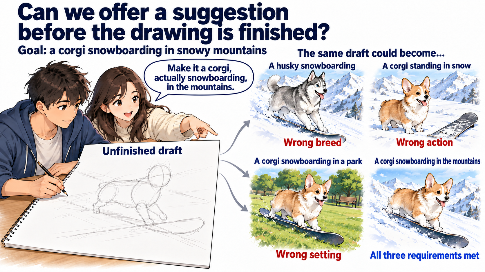
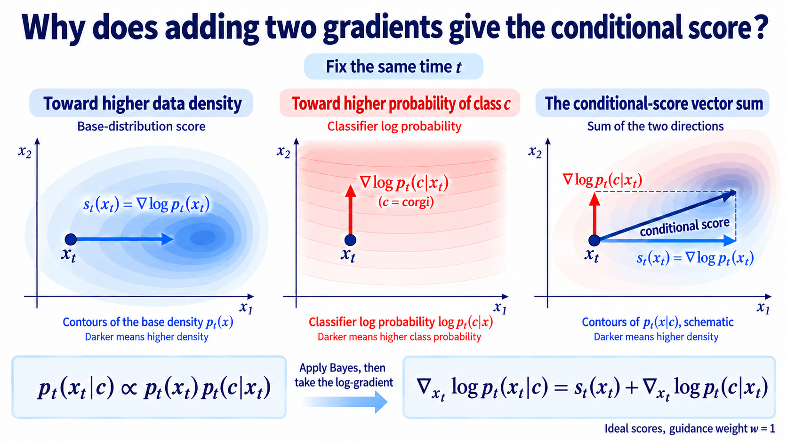
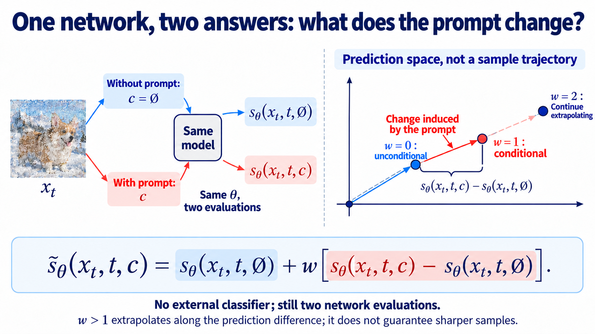

import Objectives from '../../../components/Objectives.astro';
import Prereq from '../../../components/Prereq.astro';
import Ask from '../../../components/Ask.astro';
import Remark from '../../../components/Remark.astro';
import Question from '../../../components/Question.astro';
import Answer from '../../../components/Answer.astro';
import QuizBlock from '../../../components/QuizBlock.astro';
import Option from '../../../components/Option.astro';
import Explanation from '../../../components/Explanation.astro';
import Bridge from '../../../components/Bridge.astro';
import Ref from '../../../components/Ref.astro';

# Where Can a Fixed Model Get a Guidance Direction?

<Objectives title="After reading, you can">
- **Derive the extra direction supplied by a condition**, distinguishing conditional image density from class probability.
- **Compare two estimators:** a noisy classifier's input gradient and the difference of conditional and unconditional predictions.
- **Convert guided scores to noise predictions**, identifying the strength convention and keeping model parameters fixed.
</Objectives>

<Prereq items={frontmatter.prereqs} />

## This time, draw a corgi snowboarding on a snowy mountain

Conditional training introduces requirements during training; fine-tuning changes parameters afterward. Test-time steering instead keeps parameters fixed and changes sampling computations.

An unconditional image model might generate many plausible animals and landscapes, while this request asks for one particular combination.

Even a text-to-image model may draw a husky, omit the snowboard, or replace the mountain with a park. Receiving a prompt does not guarantee perfect adherence.

<Ask>
Can we remind the model of the request while the image is still being formed?
</Ask>

Imagine a friend commenting on an unfinished sketch: the outline should look more like a corgi, the pose more like snowboarding, and the background more like mountains. We could revise before completing the whole drawing.

The helper need not generate images. A model judging how well the current state matches the request may provide a useful correction.

*Figure: feedback can address breed, action, and scene before a sketch is finished.*

## Which population of images do we want?

Begin with one part of the request: $c=$ corgi. We want the distribution of plausible photographs containing corgis, with diverse backgrounds and poses, rather than merely inputs that receive a high classifier score. Its clean-data law is $p_0(x_0\mid c)$.

During generation we have noisy $x_t$. We retain Unit 1's time direction: larger $t$ means more noise, and sampling moves toward zero. Corrupting all the corgi images gives $p_t(x_t\mid c)$.

This density describes where those corrupted images concentrate. Its conditional score is

$$
s_t(x_t\mid c)=\nabla_{x_t}\log p_t(x_t\mid c).
$$

The unconditional score describes all images. What extra direction appears after specifying corgi?

## Extract the direction supplied by the condition

Compare the densities using Bayes' rule:

$$
p_t(x_t\mid c)
=\frac{p_t(x_t)\,p_t(c\mid x_t)}{p(c)}.
$$

The base density is multiplied by the probability that this noisy image originated from class $c$. The denominator is the class frequency and does not depend on the image.

$p_t(x_t\mid c)$ fixes the class and describes noisy images. $p_t(c\mid x_t)$ fixes the noisy image and predicts its class. They are different quantities.

Take logarithms:

$$
\begin{aligned}
\log p_t(x_t\mid c)
&=\log p_t(x_t)\\
&\quad+\log p_t(c\mid x_t)\\
&\quad-\log p(c).
\end{aligned}
$$

Hold time and class fixed and differentiate with respect to the image:

$$
\boxed{
s_t(x_t\mid c)
=s_t(x_t)+\nabla_{x_t}\log p_t(c\mid x_t)
}.
$$

The directions add because Bayes' product becomes a sum after taking logs.

The extra gradient points toward the fastest local increase in class log-probability. It differentiates the current image, rather than model parameters.

Inserting the exact conditional score into matching reverse dynamics gives conditional generation, subject to the initialization and regularity conditions below.

<Ask>
Where can we obtain this additional direction?
</Ask>

<Remark label="Supplement" summary="An exact conditional score also needs the matching initial law">
Reversing the conditional forward process requires starting from its terminal law $p_T(x_T\mid c)$, not an arbitrary distribution.

The VP corruption formula is

$$
x_T=\sqrt{\bar\alpha_T}\,x_0+\sqrt{1-\bar\alpha_T}\,\epsilon,
\qquad \epsilon\sim\mathcal N(0,I).
$$

When signal retention is sufficiently small, all class-conditional terminal laws approach a standard Gaussian. Using that Gaussian accepts the remaining prior mismatch.

Learned scores and finite-step integration introduce additional, separate approximation errors.

Bayes' rule identifies the exact field; it does not eliminate initialization, estimation, or discretization error.
</Remark>

## Suppose we have a model that recognizes dog breeds

An unconditional generator estimates the base score. A separate **classifier** could predict breed probabilities from an image. Recognizing breed alone does not ensure the requested scene or action.

The classifier must understand noisy intermediate states, so it should be trained across noise levels and receive time as input.

Write it as $p_\phi(c\mid x_t,t)$. Combine its input gradient with the base estimate:

$$
\widetilde s_\theta(x_t,t,c)
=s_\theta(x_t,t)+\nabla_{x_t}\log p_\phi(c\mid x_t,t).
$$

This is **classifier guidance** [1]. With exact estimates, their sum is the conditional score. Both models stay fixed during sampling.

*Figure: the exact vector sum gives the conditional score; arrows and contours are schematic.*

<Remark label="Supplement" summary="How is a noisy classifier trained?">
Draw labeled clean data, time, and corruption noise, construct $x_t$, and minimize

$$
L_{\mathrm{cls}}(\phi)
=\mathbb E_{(x_0,c),t,\epsilon}
\left[-\log p_\phi(c\mid x_t,t)\right].
$$

Negative log-probability rewards correct class probabilities at each noise level. High-noise inputs can legitimately remain uncertain. Creating this supervision needs the forward corruption rule, not generated examples from the generator.
</Remark>

<Remark label="Supplement" summary="Does backpropagating through a classifier mean training it?">
Backpropagation computes derivatives. Training differentiates with respect to $\phi$ and updates it. Guidance keeps parameters fixed and differentiates with respect to $x_t$ to modify the sample.

The friend's judgment stays the same; the sketch changes. Check both the differentiation variable and the quantity actually updated.
</Remark>

<Remark label="Supplement" summary="Accurate log probabilities need not imply accurate gradients">
Two height maps can agree closely while having different slopes: small, rapidly varying ripples can change derivatives substantially. Guidance uses that derivative, so probability accuracy alone is insufficient.

Kawar and colleagues [3] study robust classifiers and the quality of their guidance. Classification accuracy alone does not guarantee visually meaningful input gradients.
</Remark>

## Could the generator supply the direction itself?

Now assume a pretrained conditional generator that already received paired data and conditions during training.

Conditional generation is already possible. The additional goal is the quality/diversity trade-off studied in [2], rather than introducing conditioning for the first time.

Ask the same model about the same sketch once with the condition and once without it. Could their difference isolate the request's contribution?

<Ask>
Can conditional minus unconditional prediction replace the classifier direction?
</Ask>

Recall the Bayes relation:

$$
s_t(x_t\mid c)
=s_t(x_t)+\nabla_{x_t}\log p_t(c\mid x_t).
$$

The conditional score already contains the base score plus the condition-specific correction.

Subtract the base score to isolate that correction:

$$
\nabla_{x_t}\log p_t(c\mid x_t)
=s_t(x_t\mid c)-s_t(x_t).
$$

Compare how to revise the sketch with and without a specified breed. Unconditional means considering all classes, rather than forbidding corgis.

Both answers concern the same state and time. Their exact difference is the classifier log-probability gradient; their learned difference estimates it.

But the identity assumes both answers are available. A network always trained with a condition need not handle an absent condition reliably.

How can one model learn both cases?

## Train the same model to answer both questions

**Conditioning dropout** [2] sometimes replaces $c$ with an explicit empty condition $\varnothing$. Let $\widetilde c$ denote the supplied condition:

$$
L_{\mathrm{drop}}(\theta)
=\mathbb E_{(x_0,c),t,\epsilon,\widetilde c}
\left[\left\|\epsilon_\theta(x_t,t,\widetilde c)-\epsilon\right\|^2\right].
$$

The corruption input and noise label remain unchanged. The added randomness only decides whether the model sees the condition. Dropping independently of the data teaches an unconditional prediction across all classes.

After training, convert its conditional and unconditional noise predictions into scores. Their difference estimates

$$
s_\theta(x_t,t,c)-s_\theta(x_t,t,\varnothing)
$$

One parameter set supplies two answers, but generally requires two corresponding model computations per sampling step. This capability must be established in training.

## Why use guidance if conditional generation already works?

An ideal conditional model already samples the conditional law. Guidance is an optional change of sampling behavior.

We may accept less diversity for stronger recognizable features or higher measured image quality, as investigated with class-conditional models in [2].

Start from the conditional prediction and add a multiple of its difference from the unconditional prediction. Our convention makes $w=1$ ordinary conditional generation:

$$
\begin{aligned}
\widetilde s_\theta(x_t,t,c)
&=s_\theta(x_t,t,c)\\
&\quad+(w-1)\big[s_\theta(x_t,t,c)-s_\theta(x_t,t,\varnothing)\big].
\end{aligned}
$$

At $w=1$ the extra term vanishes; at $w>1$ we strengthen it. This is **classifier-free guidance (CFG)** [2].

Expand and collect coefficients to obtain the familiar form:

$$
\begin{aligned}
\widetilde s_\theta(x_t,t,c)
&=s_\theta(x_t,t,\varnothing)\\
&\quad+w\big[s_\theta(x_t,t,c)-s_\theta(x_t,t,\varnothing)\big].
\end{aligned}
$$

Replacing the difference with a classifier estimate gives

$$
\begin{aligned}
\widetilde s_\theta(x_t,t,c)
&=s_\theta(x_t,t)\\
&\quad+w\nabla_{x_t}\log p_\phi(c\mid x_t,t).
\end{aligned}
$$

$w=0$ is unconditional, $w=1$ conditional, and $w>1$ stronger guidance. Classifier-free removes the external classifier, not the need for conditioning during training.

*Figure: both outputs use the same parameters, state, and time. The right panel depicts prediction space, not sample trajectories.*

<Question label="Discussion" id="Q1">
Does increasing $w$ beyond one make the conditional estimate more accurate?

<Answer summary="Show the reasoning">
No. It deliberately strengthens conditioning beyond the original conditional score.

This can improve some quality or adherence measures while reducing diversity and amplifying prediction errors. Excessive strength can create saturation or unnatural texture. It is a sampling choice, not an accuracy measure.
</Answer>
</Question>

<Remark label="Supplement" summary="Which density does stronger guidance describe?">
At a fixed time, exact score estimates imply

$$
\begin{aligned}
\widetilde s_t(x_t,c)
&=s_t(x_t)+w\nabla_{x_t}\log p_t(c\mid x_t)\\
&=\nabla_{x_t}\log\big[p_t(x_t)p_t(c\mid x_t)^w\big]\\
&=\nabla_{x_t}\log\big[p_t(x_t)^{1-w}p_t(x_t\mid c)^w\big].
\end{aligned}
$$

This is a power reweighting of class probability at that time. These reweighted densities need not jointly satisfy the original forward evolution. The identity alone therefore does not prove that reverse sampling reaches the similarly powered clean-data density.
</Remark>

## Convert the guided score to a noise prediction

The network commonly predicts noise. Use the same noise amplitude for both branches:

$$
s_\theta(x_t,t)=-\frac{\epsilon_\theta(x_t,t)}{\sigma_t}.
$$

Write the combined score as $-\widetilde\epsilon_\theta/\sigma_t$ to obtain a replacement for the sampler's noise input.

For classifier guidance, substitute

$$
\begin{aligned}
-\frac{\widetilde\epsilon_\theta(x_t,t,c)}{\sigma_t}
&=-\frac{\epsilon_\theta(x_t,t)}{\sigma_t}\\
&\quad+w\nabla_{x_t}\log p_\phi(c\mid x_t,t).
\end{aligned}
$$

and multiply by $-\sigma_t$:

$$
\begin{aligned}
\widetilde\epsilon_\theta(x_t,t,c)
&=\epsilon_\theta(x_t,t)\\
&\quad-w\sigma_t\nabla_{x_t}\log p_\phi(c\mid x_t,t).
\end{aligned}
$$

The minus sign and noise scale follow from coordinate conversion, rather than a new sampling assumption.

For CFG, all scores share the same factor:

$$
\begin{aligned}
-\frac{\widetilde\epsilon_\theta}{\sigma_t}
&=-\frac{\epsilon_\theta(x_t,t,\varnothing)}{\sigma_t}\\
&\quad-\frac{w}{\sigma_t}
\big[\epsilon_\theta(x_t,t,c)-\epsilon_\theta(x_t,t,\varnothing)\big].
\end{aligned}
$$

It cancels, giving

$$
\boxed{
\begin{aligned}
\widetilde\epsilon_\theta(x_t,t,c)
&=\epsilon_\theta(x_t,t,\varnothing)\\
&\quad+w\big[\epsilon_\theta(x_t,t,c)-\epsilon_\theta(x_t,t,\varnothing)\big].
\end{aligned}
}
$$

Use this guided noise in the original sampler. Generator parameters, and classifier parameters when present, remain fixed.

<Remark label="Supplement" summary="The original CFG paper uses a strength shifted by one">
This note uses zero for unconditional and one for conditional generation. The original paper measures strength beyond the conditional prediction:

$$
\begin{aligned}
\widetilde\epsilon_\theta
&=(1+w_{\mathrm{paper}})\epsilon_\theta(x_t,t,c)\\
&\quad-w_{\mathrm{paper}}\epsilon_\theta(x_t,t,\varnothing).
\end{aligned}
$$

The conventions satisfy $w=1+w_{\mathrm{paper}}$. Compare formulas rather than scale numbers alone.

Classifier guidance can also strengthen an already conditional generator [1]. Its additional-strength coefficient then starts at zero, so the baseline must be stated before comparing scales.
</Remark>

<Remark label="Supplement" summary="What baseline does a negative prompt change?">
Replace the empty condition by a negative prompt $c^-$ and combine

$$
\begin{aligned}
\widetilde\epsilon_\theta
&=\epsilon_\theta(x_t,t,c^-)\\
&\quad+w\big[\epsilon_\theta(x_t,t,c)-\epsilon_\theta(x_t,t,c^-)\big].
\end{aligned}
$$

This extrapolates from one conditional prediction toward another. It is a relative baseline, not a guaranteed exclusion list, and no longer the unconditional Bayes identity above.
</Remark>

<Remark label="Supplement" summary="Can Flow Matching learn both answers?">
Use the same reference velocity label and condition dropout:

$$
L_{\mathrm{drop,FM}}(\theta)
=\mathbb E\left[\left\|v_\theta(I_t,t,\widetilde c)-\partial_t I_t\right\|^2\right].
$$

Average over reference endpoints, time, and dropout. At sampling, combine

$$
\begin{aligned}
\widetilde v_\theta(x,t,c)
&=v_\theta(x,t,\varnothing)\\
&\quad+w\big[v_\theta(x,t,c)-v_\theta(x,t,\varnothing)\big].
\end{aligned}
$$

For the Gaussian-source affine setting of <Ref to="dma-linear-path"/>, shared score/velocity conversions connect the derivations. An arbitrary velocity difference cannot automatically be called a classifier gradient.
</Remark>

## Compare classifier guidance and CFG

Their practical requirements are

| Item | Classifier guidance | CFG |
|---|---|---|
| External model | Noisy classifier | None |
| Generator conditioning training | Not required for an unconditional baseline | Conditional and unconditional capability, commonly through dropout |
| Sampling computation | Base score plus scaled classifier input gradient | Conditional/unconditional predictions and their weighted difference |
| New condition type absent from generator training | May use a separately trained suitable classifier | No corresponding prediction without additional capability |
| Benefit | Generation and evaluation can be designed separately | No external classifier or classifier backpropagation |
| Limitation | Classifier training and gradient quality | Two prediction cases; difference errors can be amplified |

The conditioning-training row concerns the generator; the classifier still needs labeled data. A new condition type is different from a new prompt composed within a text model's learned input domain.

No classifier does not necessarily mean faster sampling: compare classifier differentiation with an additional generator prediction. Both methods can trade diversity for stronger guidance.

## Check your understanding

<QuizBlock id="w10-1-a">
Why does $-\log p(c)$ disappear from the score equation?
<Option>The class has probability one.</Option>
<Option correct>It is constant with respect to the image.</Option>
<Option>The classifier already used softmax.</Option>
<Explanation>It still normalizes the conditional density, but its input derivative vanishes.</Explanation>
</QuizBlock>

<QuizBlock id="w10-1-b">
In this convention, what is CFG at $w=1$?
<Option>Unconditional prediction.</Option>
<Option correct>The conditional prediction.</Option>
<Option>The mean of both branches.</Option>
<Explanation>Stronger guidance begins above one and intentionally changes the sampling behavior.</Explanation>
</QuizBlock>

<QuizBlock id="w10-1-c">
Why does classifier guidance acquire a coefficient $-w\sigma_t$ in noise coordinates?
<Option correct>Multiply the score equation by $-\sigma_t$.</Option>
<Option>Reverse time is negative.</Option>
<Option>Class labels are reversed.</Option>
<Explanation>The coefficient follows from the noise-score conversion.</Explanation>
</QuizBlock>

<QuizBlock id="w10-1-d">
What does conditioning dropout do?
<Option>Delete random image pixels.</Option>
<Option correct>Replace some conditions with an empty condition during training.</Option>
<Option>Choose guidance strength during training.</Option>
<Explanation>It teaches both input cases. Guidance strength is later chosen during sampling.</Explanation>
</QuizBlock>

<QuizBlock id="w10-1-e">
Which cost does CFG remove?
<Option correct>A separate noisy classifier and its input-gradient computation.</Option>
<Option>The second generator prediction.</Option>
<Option>The change in sampling distribution.</Option>
<Explanation>Standard CFG still evaluates conditional and unconditional branches.</Explanation>
</QuizBlock>

<Bridge to="dma-reward-tilting">
A suitable classifier or a conditionally trained generator can supply a task direction. Both require the relevant evaluation or prediction capability.

What if a newly available program only scores completed images? Calling its score $R(x_0)$, which distribution should we sample to favor high scores while retaining the base distribution? Next we formulate that target.
</Bridge>

## References

1. Dhariwal, P., Nichol, A. [*Diffusion Models Beat GANs on Image Synthesis.*](https://arxiv.org/abs/2105.05233) NeurIPS 2021.
2. Ho, J., Salimans, T. [*Classifier-Free Diffusion Guidance.*](https://arxiv.org/abs/2207.12598) 2022.
3. Kawar, B., Ganz, R., Elad, M. [*Enhancing Diffusion-Based Image Synthesis with Robust Classifier Guidance.*](https://arxiv.org/abs/2208.08664) 2022.
