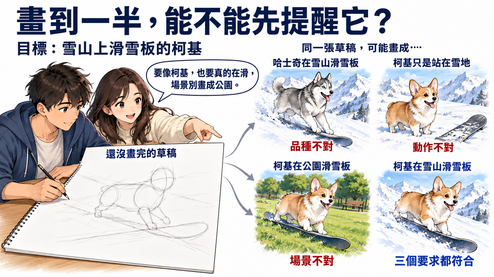
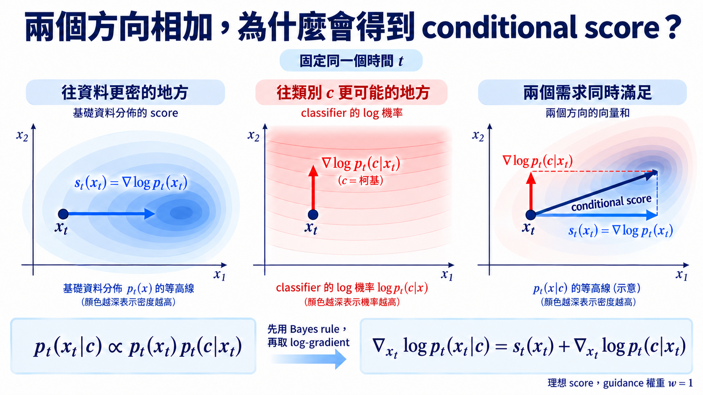

import Objectives from '../../../components/Objectives.astro';
import Prereq from '../../../components/Prereq.astro';
import Ask from '../../../components/Ask.astro';
import Remark from '../../../components/Remark.astro';
import Question from '../../../components/Question.astro';
import Answer from '../../../components/Answer.astro';
import QuizBlock from '../../../components/QuizBlock.astro';
import Option from '../../../components/Option.astro';
import Explanation from '../../../components/Explanation.astro';
import Bridge from '../../../components/Bridge.astro';
import Ref from '../../../components/Ref.astro';

# 只有一個 classifier，怎麼改變 diffusion 的生成方向？

<Objectives>
- **從 Bayes rule 推出 conditional score。** 寫出 $\nabla_{x_t}\log p_t(x_t\mid c)=s_t(x_t)+\nabla_{x_t}\log p_t(c\mid x_t)$，並逐項說明兩支方向的角色。
- **把 classifier gradient 換成 DDPM 的 noise prediction。** 由 $s_\theta=-\epsilon_\theta/\sigma_t$ 推出 guided noise predictor 的符號與縮放。
- **說出 classifier 的訊號從哪裡來。** 寫出 noisy classifier 的 training loss，分清對樣本求 gradient 與更新模型參數，並解釋 $w=1$ 與 $w>1$ 的差別。
</Objectives>

<Prereq items={frontmatter.prereqs} />

## 模型會生成圖片了，但這一次我想要它畫一隻在雪山上滑雪板的柯基

在 <Ref to="dma-test-time-steering"/> 裡，我們整理了讓生成結果符合要求的幾種方法：conditional training 在訓練時加入 condition，fine-tuning 則用新資料更新模型。但如果不想為這次需求重新訓練，我們就得保留原本的參數，只在 sampling 時想辦法引導它；這就是 test-time steering。

我們想一個具體的情況：模型學過各種動物、建築物、風景與風格的圖片，但這一次我們想要它畫一隻在雪山上滑雪板的柯基。如果照原本的方法，隨意給一個 noise 去抽樣，模型很可能生成其他動物或風景。

即使是 **text-to-image model**——也就是接收一段文字（text）描述，根據它生成圖片（image）的模型——也可能沒有完整照著我們的意思畫。例如畫成哈士奇在滑雪，或是有柯基和雪山，卻讓牠站在雪地；也可能畫出滑雪板，卻把場景換成公園。

<Ask>
那我們在不重新訓練模型的情況下， 
能不能在圖片還沒生成完時，就提醒它往「雪山上滑雪板的柯基」的方向改？
</Ask>

想像你正在畫這張圖，草稿還只有幾條模糊的線，品種、動作與場景都還沒確定；繼續畫下去，就可能出現剛才那幾種結果。旁邊的朋友不必替你畫，只要看看目前的草稿，提醒你「這樣比較像柯基」「這個姿勢比較像在滑雪板」「背景要是雪山」，我們就可以邊畫邊調整，不必等整張畫完才重來。

所以我們需要的，不一定是另一個會生成圖片的模型；**一個能判斷「現在這張圖有多符合要求」的模型，也可能提供修改的線索。**

*圖：草稿還沒畫完，品種、動作或場景都可能畫錯。朋友在畫的途中提醒，畫圖的人再繼續修改。*

## 只有「像不像柯基」的判斷，怎麼變成修改方向？

完整的要求包含品種、場景與動作，我們先從其中一項開始：**牠是不是柯基？** 我們可以找一個看圖片、判斷狗的品種的模型：給它一張圖，它就估計裡面是柯基、哈士奇或其他品種的機率。這種用來判斷輸入屬於哪個類別的模型，稱為**分類器（classifier）**。它不需要會畫圖，只需要提供判斷；不過，只判斷品種，也不保證場景與動作都畫對。

不過生成途中拿到的是 noisy image $x_t$，不是已經完成的乾淨圖片 $x_0$。這裡沿用 U1 的時間方向：$t$ 越大噪聲越多，sampling 從大的 $t$ 往 $0$ 走。

令 $c=$「柯基」。我們希望 classifier 去估計 $p_t(c\mid x_t)$，也就是「看到目前這張帶噪聲的圖 $x_t$，它原本來自有柯基（類別 $c$）的圖片的機率」。但這還只是個數值，沒有告訴我們該改哪裡。

那就看看：**稍微改動 $x_t$，哪個方向能讓這個機率上升？** 因為 log 不改變機率高低的順序，我們可以考慮使用 $\nabla_{x_t}\log p_t(c\mid x_t)$。在小小的改動幅度下，它指出 $\log p_t(c\mid x_t)$ 上升最快的方向；就像朋友指出目前的輪廓往哪裡改，會更像柯基。微分的對象是目前圖片 $x_t$，不是模型參數。

這跟我們在 diffusion model 裡學的 score function 有類似的感覺，只是 <Ref to="dma-tweedie-and-score"/> 的 $s_t(x_t)=\nabla_{x_t}\log p_t(x_t)$ 指向的是**所有資料加噪後，density $p_t(x_t)$ 上升最快的方向**，並不特別指定柯基。

相反地說，只顧 classifier 的評分和它指的方向 $\nabla_{x_t}\log p_t(c\mid x_t)$，也不代表最後就是一張合理的圖片，所以我們還得顧慮到比較有可能出現合理資料的方向。那麼現在有一支方向來自原本的資料 $\nabla_{x_t}\log p_t(x_t)$，另一支來自「這次要柯基」的要求 $\nabla_{x_t}\log p_t(c\mid x_t)$。**把兩支方向相加，真的就對應到有柯基的合理照片的 distribution 嗎？**

## 這樣改方向，真的會得到指定類別的 distribution 嗎？

我們想生成的是**合理資料中，有柯基的那一群照片**，而不只是讓 classifier 對某張圖給高分。想像先從相簿挑出所有有柯基的照片；其中仍有各種背景、姿勢與外觀。這一群乾淨照片的 distribution，就是 $p_0(x_0\mid c)$：固定 $c=$「柯基」，看照片 $x_0$ 如何分布。

不過生成途中拿到的是 $x_t$，不是乾淨照片。若把剛才那群柯基照片都按照 U1 的 forward process 加噪到時間 $t$，它們形成的 distribution 就是 $p_t(x_t\mid c)$。**它描述的是：已知原本的照片有柯基，帶噪聲的圖片會如何分布？** $p_t(x_t\mid c)$ 越大，表示帶有柯基的照片被加噪後，在 $x_t$ 附近越密集。那麼，若去噪時也維持「柯基」這個條件，我們的目標就是讓附近的 noisy images 回到有柯基的照片。

$p_t(x_t\mid c)$ 和 classifier 的 $p_t(c\mid x_t)$ 不同：前者**固定「柯基」，想看帶噪聲的圖片怎麼分布**；後者**固定目前帶噪聲的圖片，判斷它有多可能來自有柯基的照片**。

要確認剛才相加的兩個方向到底能不能得到我們想要的，我們可以看看它們跟 $p_t(x_t\mid c)$ 有什麼關係。沒錯！又是使用 Bayes rule 的時候：

$$
p_t(x_t\mid c)
=\frac{p_t(x_t)\,p_t(c\mid x_t)}{p(c)}.
$$

右邊先保留原本的 density $p_t(x_t)$，再乘上它來自 $c$ 的機率。分母 $p(c)$ 是資料中這個類別的比例，讓相乘後的 density 積分為 $1$；它不隨圖片 $x_t$ 改變。

先取 log，把乘法拆成加法：

$$
\log p_t(x_t\mid c)
=\log p_t(x_t)+\log p_t(c\mid x_t)-\log p(c).
$$

接著對 $x_t$ 微分。最後一項是常數，因此 gradient 為零：

$$
\boxed{
\nabla_{x_t}\log p_t(x_t\mid c)
=s_t(x_t)+\nabla_{x_t}\log p_t(c\mid x_t)
}.
$$

第一項保留原本資料 density 的方向，第二項增加指定類別的影響。**它們可以相加，不只是因為都是向量，而是因為 Bayes rule 中的乘法，取 log 後變成了加法。** 把這支 conditional score 放進 U1 的 reverse dynamics，才對應從 noise 回到指定類別的資料。

<Remark label="補充" summary="有了 conditional score，就一定抽到正確的 conditional distribution 嗎？">
剛才的 identity 說的是**每個位置的方向**。若要讓整個 reverse process 精確回到 $p_0(x_0\mid c)$，還需要從相應的 $p_T(x_T\mid c)$ 出發，使用精確的 conditional score，並精確解出對應的 reverse dynamics。

U1 把 noise 加到幾乎看不出類別時，才用同一個 Gaussian 近似各類別的起點。有限的 noise level、模型估計與有限步 sampling 都可能帶來誤差；Bayes identity 本身並沒有消除這些誤差。
</Remark>

## 生成途中還是噪聲，classifier 看得懂嗎？

剛才的推導需要 $p_t(c\mid x_t)$，但一般只看過乾淨圖片的 classifier，遇到接近純 noise 的 $x_t$ 時，未必能給出可靠的答案，更不用說可靠的 gradient。就像朋友若只會辨認完成的畫，卻看不懂草稿，也幫不上生成途中的修改。我們需要讓 classifier 看過不同程度的 noisy images。

Dhariwal 與 Nichol [1] 因此從有類別標籤的 training pair $(x_0,c)$ 出發，像 U1 一樣抽 $t$ 與 Gaussian noise $\epsilon$，算出 $x_t$，再訓練

$$
L_{\mathrm{cls}}(\phi)
=\mathbb E_{(x_0,c),t,\epsilon}
\left[-\log p_\phi(c\mid x_t,t)\right].
$$

$p_\phi(c\mid x_t,t)$ 是 classifier 對正確類別給的機率，$\phi$ 是它的參數。機率越高，負 log 就越小；這個 loss 讓它學不同 noise levels 下的類別機率。高 noise 時資訊不足，答案也可以是不確定的機率，不是要求每張圖都猜中。Expectation 平均資料 pair、抽到的時間與加入的 noise，並不更新 generative model 的參數 $\theta$。

有了這支 classifier，生成時就固定兩個模型：用 $s_\theta$ 估計 base score，再加上 classifier 提供的方向。但如果生成結果雖然有柯基，品種特徵卻還不夠明顯，我們也可能想把「更像柯基」的提醒加強一些。於是用 $w\ge0$ 控制這支額外方向的強度。Dhariwal 與 Nichol [1] 將這個做法稱為 **classifier guidance**：

$$
\widetilde s_\theta(x_t,t,c)
=s_\theta(x_t,t)
+w\,\nabla_{x_t}\log p_\phi(c\mid x_t,t).
$$

其中 $w$ 控制 classifier 方向的強度。$w=0$ 不使用它；兩個模型精確且 $w=1$ 時，回到剛才的 conditional score；$w>1$ 則刻意放大類別訊號，不代表估得更準。原論文 [1] 觀察到這能交換 sample fidelity 與 diversity；Kawar、Ganz 與 Elad [2] 也研究 classifier 的 robustness，因為分類正確不代表 gradient 一定是有意義的影像改動。

*圖：在同一個 $(x_t,t)$，base score 加上 classifier 的 log-probability gradient。兩者精確且 $w=1$ 時，合成方向就是 conditional score；箭頭與等高線為示意。*

## DDPM 手上是 $\epsilon_\theta$，要怎麼加入這支方向？

U1 的網路通常輸出 $\epsilon_\theta(x_t,t)$，估計實際加入的 noise，而不是直接輸出 score。令 $\sigma_t=\sqrt{1-\bar\alpha_t}$ 表示該時刻的 noise amplitude，<Ref to="dma-tweedie-and-score"/> 給出的換算是

$$
s_\theta(x_t,t)=-\frac{\epsilon_\theta(x_t,t)}{\sigma_t}.
$$

把 guided score 也寫成 $-\widetilde\epsilon_\theta/\sigma_t$：

$$
-\frac{\widetilde\epsilon_\theta(x_t,t,c)}{\sigma_t}
=-\frac{\epsilon_\theta(x_t,t)}{\sigma_t}
+w\,\nabla_{x_t}\log p_\phi(c\mid x_t,t).
$$

兩邊乘上 $-\sigma_t$，得到實作時可以直接放進原 sampler 的形式：

$$
\boxed{
\widetilde\epsilon_\theta(x_t,t,c)
=\epsilon_\theta(x_t,t)
-w\sigma_t\nabla_{x_t}\log p_\phi(c\mid x_t,t)
}.
$$

負號沒有反過來：$\epsilon_\theta$ 和 score 本來就差一個負號。classifier gradient 在 score 空間是相加；換到 noise prediction 空間後，就變成從 $\epsilon_\theta$ 減掉它。

<Remark label="補充" summary="$w>1$ 對應的是哪一個 density？">
若暫時把每個 $t$ 的兩個估計都視為精確，

$$
s_t(x_t)+w\nabla_{x_t}\log p_t(c\mid x_t)
=\nabla_{x_t}\log\Big[p_t(x_t)p_t(c\mid x_t)^w\Big].
$$

$w=1$ 回到標準 conditional score；$w>1$ 則在**固定的 $t$** 上對類別機率做 power reweighting。這說明方向如何改變，但這一族重新加權的 densities 未必滿足原 forward process 的演化方程；即使模型精確，也不能只靠這個 identity 宣稱終點一定是 $p_{\mathrm{data}}(x_0)p(c\mid x_0)^w$ 的正規化版本。
</Remark>

<Question id="Q1">
Sampling 時要對 classifier 做反向傳播，**這不就又是在訓練模型，違反 test-time steering 不改參數的限制嗎？**

<Answer>
反向傳播是計算微分的方法，不一定要更新參數。訓練 classifier 時，我們算 $\nabla_\phi L_{\mathrm{cls}}$ 並更新 $\phi$；sampling 時則固定 $\phi$ 與 $\theta$，只算 $\nabla_{x_t}\log p_\phi(c\mid x_t,t)$，把結果交給 sampler 改動 $x_t$。

就像朋友的判斷方式沒有改變，我們改的是他正在看的草稿。**要看的是微分對象與實際更新的量，不是有沒有做反向傳播。**
</Answer>
</Question>

## 消化一下

<QuizBlock id="w10-1-a">
classifier guidance 的 Bayes 推導中，$-\log p(c)$ 為什麼消失？
<Option>因為 $p(c)=1$。</Option>
<Option correct>因為我們對 $x_t$ 微分，而 $p(c)$ 不隨 $x_t$ 改變。</Option>
<Option>因為 classifier 已經做過 softmax。</Option>
<Explanation>
$p(c)$ 仍然負責 conditional density 的 normalization；只是 score 只看對 $x_t$ 的 log-gradient，因此和 $x_t$ 無關的常數會被繞過。
</Explanation>
</QuizBlock>

<QuizBlock id="w10-1-b">
若 score 與 classifier 都是精確的，哪個 $w$ 對應標準 conditional score $\nabla\log p_t(x_t\mid c)$？
<Option>$w=0$。</Option>
<Option correct>$w=1$。</Option>
<Option>任何 $w>1$ 都更精確。</Option>
<Explanation>
$w=0$ 是 unconditional score；$w=1$ 是 Bayes identity；$w>1$ 刻意放大 condition，改變了 sampling distribution。
</Explanation>
</QuizBlock>

<QuizBlock id="w10-1-c">
從 score 換成 noise prediction 後，classifier gradient 前面為什麼變成 $-w\sigma_t$？
<Option correct>因為 $s_\theta=-\epsilon_\theta/\sigma_t$；兩邊乘上 $-\sigma_t$ 會同時帶來負號與縮放。</Option>
<Option>因為 reverse process 的時間是負的。</Option>
<Option>因為 classifier 的 label 要反過來。</Option>
<Explanation>
這只是 U1 已經建立的 score／noise affine transformation，不是新增的 sampling 假設。
</Explanation>
</QuizBlock>

<Bridge to="dma-classifier-free-guidance">
現在我們知道，不必讓另一個模型替我們畫圖，也能用它對「像不像柯基」的判斷來引導生成：理想情況下，classifier gradient 和原本的 score 相加，就是 Bayes rule 給出的 conditional score。但取得這個方向，需要額外訓練 noisy classifier，每一步還得對輸入求 gradient。

回想 <Ref to="dma-test-time-steering"/> 的 conditional training：若 generative model 已經會根據 $c$ 預測 noise，它的答案本來就含有類別資訊。**能不能只用 generative model 的回答，把這支額外方向找出來？** 下一篇 <Ref to="dma-classifier-free-guidance"/> 就從這個問題出發。
</Bridge>

## 參考文獻

1. Dhariwal, P., Nichol, A. [*Diffusion Models Beat GANs on Image Synthesis.*](https://arxiv.org/abs/2105.05233) NeurIPS 2021.（Classifier guidance 的提出與 fidelity／diversity trade-off。）
2. Kawar, B., Ganz, R., Elad, M. [*Enhancing Diffusion-Based Image Synthesis with Robust Classifier Guidance.*](https://arxiv.org/abs/2208.08664) 2022.（Classifier gradient 的 robustness。）
