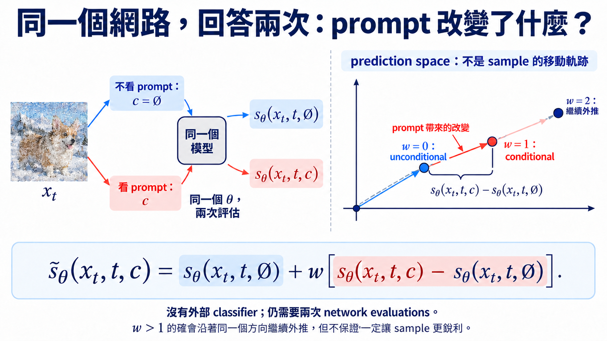

import Objectives from '../../../components/Objectives.astro';
import Prereq from '../../../components/Prereq.astro';
import Ask from '../../../components/Ask.astro';
import Remark from '../../../components/Remark.astro';
import Question from '../../../components/Question.astro';
import Answer from '../../../components/Answer.astro';
import QuizBlock from '../../../components/QuizBlock.astro';
import Option from '../../../components/Option.astro';
import Explanation from '../../../components/Explanation.astro';
import Bridge from '../../../components/Bridge.astro';
import Ref from '../../../components/Ref.astro';

# 不另外訓練 classifier，也能得到同一支 guidance 嗎？

<Objectives>
- **推出 conditional 與 unconditional score 的差。** 由 Bayes rule 得到 $s_t(x_t\mid c)-s_t(x_t)=\nabla_{x_t}\log p_t(c\mid x_t)$。
- **寫出 classifier-free guidance 的 sampling 公式。** 說明 conditioning dropout 如何讓同一個網路提供兩個 prediction，並在 score 與 noise 空間完成換算。
- **正確解讀 guidance strength。** 說出 $w=0$、$w=1$ 與 $w>1$ 分別對應的 sampling 行為，以及放大 condition 的代價。
</Objectives>

<Prereq items={frontmatter.prereqs} />

## 外部 classifier 給的方向，模型自己有沒有？

在 <Ref to="dma-classifier-guidance"/> 中，我們想生成指定類別 $c$，於是讓 classifier 提供「往哪裡改動 noisy image $x_t$，能讓它更可能來自 $c$」的方向。Bayes rule 告訴我們：

$$
\nabla_{x_t}\log p_t(x_t\mid c)
=s_t(x_t)+\nabla_{x_t}\log p_t(c\mid x_t).
$$

但取得這支方向需要額外訓練 noisy classifier，生成途中也要對它求 gradient。若 generative model 已經根據 $c$ 學會怎麼生成，condition 的影響其實也在它的回答裡。

想像上一章那張草圖，一次請人照著「柯基」這個要求修改，另一次不指定類別。比較兩次修改方向，也許就能看出「柯基」這個要求額外改變了什麼。**如果模型能回答有 condition 與沒有 condition 的兩種情況，我們能不能用兩個答案的差，取代 classifier？**

<Ask>
conditional 與 unconditional prediction 的差， 
會不會就是 classifier 原本要提供的方向？
</Ask>

## 把 Bayes identity 反過來讀

把 conditional score 記成 $s_t(x_t\mid c)=\nabla_{x_t}\log p_t(x_t\mid c)$，unconditional score 仍是 $s_t(x_t)=\nabla_{x_t}\log p_t(x_t)$。上一個 identity 移項後得到

$$
\boxed{
\nabla_{x_t}\log p_t(c\mid x_t)
=s_t(x_t\mid c)-s_t(x_t)
}.
$$

這裡相減的是**同一張 $x_t$、同一個時間 $t$** 上的兩支 score：一支考慮 $c$，另一支不考慮 $c$。在理想估計下，它們的差正好等於上一篇的 classifier gradient；不必真的訓練 classifier 才能算它。

## 同一個模型怎麼學會兩種回答？

只有 conditional model 還不夠：不能假設把 $c$ 拿掉後，它就知道怎麼回答。Ho 與 Salimans [1] 在 training 時偶爾把 $c$ 換成空 condition $\varnothing$，也就是明確告訴模型「這一次不提供類別或 prompt」。這個做法稱為 **conditioning dropout**。

把實際送進網路的 condition 記成 $\widetilde c$：有時保留 $c$，有時換成 $\varnothing$。沿用 U1 的 denoising regression，就能寫成

$$
L_{\mathrm{drop}}(\theta)
=\mathbb E_{(x_0,c),t,\epsilon,\widetilde c}
\left[\left\|\epsilon_\theta(x_t,t,\widetilde c)-\epsilon\right\|^2\right].
$$

每次仍從 training pair $(x_0,c)$ 抽資料，抽 $t$ 與 noise $\epsilon$ 算出 $x_t$；label 仍是加入的 $\epsilon$，多出的隨機動作只有「要不要把 $c$ 給模型」。保留 $c$ 時，它學這個 condition 下的 noise prediction；拿掉 $c$ 時，它要對所有類別的資料學 unconditional prediction。

因此訓練完後，同一個模型能提供 $\epsilon_\theta(x_t,t,c)$ 與 $\epsilon_\theta(x_t,t,\varnothing)$，也能用上一篇的 $s_\theta=-\epsilon_\theta/\sigma_t$ 換成兩支 score。**參數是同一套，但 sampling 時仍需要兩次模型計算，才取得這兩個答案。**

這也是使用 CFG 的前提：模型在 training 時已經學過這兩種回答。我們不能對任意一個訓練好的 conditional model，直接拿掉 $c$，就當它的輸出是可靠的 unconditional prediction。

## 模型已經收到 condition，為什麼還要加強它？

收到「柯基」這個要求後，模型仍可能畫得不夠像我們想要的樣子。就像上一章加強朋友的提醒，我們可以保留 unconditional 方向，再把 condition 額外提供的改動放大 $w$ 倍。把剛才的 score 差代回 classifier guidance，得到 **classifier-free guidance**（CFG）：

$$
\boxed{
\begin{aligned}
\widetilde s_\theta(x_t,t,c)
&=s_\theta(x_t,t,\varnothing)\\
&\quad+w\Big[s_\theta(x_t,t,c)-s_\theta(x_t,t,\varnothing)\Big]
\end{aligned}
}.
$$

這條式子可以讀成兩個動作：先站在 unconditional prediction 上，再沿著「看見 $c$ 後改變的方向」走 $w$ 倍。

<Remark label="補充" summary="原論文的 guidance strength 和這裡差了 $1$">
本篇沿用 U7.1：$w=0$ 是 unconditional，$w=1$ 是 conditional。Ho 與 Salimans [1] 則把「超出 conditional 的強度」記成 $w_{\mathrm{paper}}$，其 noise prediction 寫成

$$
\begin{aligned}
\widetilde\epsilon_\theta
&=(1+w_{\mathrm{paper}})\epsilon_\theta(x_t,t,c)\\
&\quad-w_{\mathrm{paper}}\epsilon_\theta(x_t,t,\varnothing).
\end{aligned}
$$

兩者是同一個組合，只是本篇的 $w=1+w_{\mathrm{paper}}$。閱讀其他論文或程式時，要對照公式，而不是只比較 guidance scale 的數字。
</Remark>

*圖：同一套 $\theta$ 對相同 noisy state 回答兩次，CFG 再沿兩個 prediction 的差值外推。右圖是 prediction space，不是生成軌跡。*

實作時，模型給的是 noise prediction。我們把三支 score 都換成上一篇的 $-\epsilon/\sigma_t$：

$$
-\frac{\widetilde\epsilon_\theta}{\sigma_t}
=-\frac{\epsilon_\theta(x_t,t,\varnothing)}{\sigma_t}
+w\left[-\frac{\epsilon_\theta(x_t,t,c)}{\sigma_t}
+\frac{\epsilon_\theta(x_t,t,\varnothing)}{\sigma_t}\right].
$$

兩邊乘上 $-\sigma_t$，相同的縮放消去，就得到

$$
\boxed{
\begin{aligned}
\widetilde\epsilon_\theta(x_t,t,c)
&=\epsilon_\theta(x_t,t,\varnothing)\\
&\quad+w\Big[\epsilon_\theta(x_t,t,c)-\epsilon_\theta(x_t,t,\varnothing)\Big]
\end{aligned}
}.
$$

$w=0$ 完全忽略 condition；$w=1$ 剛好回到 conditional prediction；$w>1$ 則越過 conditional prediction，繼續沿同一個差值方向外推。生成時把 $\widetilde\epsilon_\theta$ 放進原本 sampler，兩次回答都不需要更新 $\theta$。**Classifier-free 拿掉的是外部 classifier，不是 training 時的 condition。**

<Remark label="補充" summary="CFG 在 density 上做了什麼？">
若兩個 score 都精確，

$$
\begin{aligned}
\widetilde s_t
&=(1-w)\nabla\log p_t(x_t)
+w\nabla\log p_t(x_t\mid c)\\
&=\nabla\log\Big[p_t(x_t)^{1-w}p_t(x_t\mid c)^w\Big].
\end{aligned}
$$

所以 $w=1$ 是 conditional score；$w>1$ 則在固定 $t$ 上放大兩種 density 的差異。但這些重新加權的 densities 未必構成原 forward process 下的一致 probability path，不能只由這個 identity 推出精確的終點 density。這個限制即使 score 精確也存在，實際模型與有限步 sampler 的誤差則是另外兩層問題。
</Remark>

<Question id="Q1">
如果 $s_\theta(x_t,t,c)$ 已經是 conditional model 的答案，**為什麼不永遠取 $w=1$？把 $w$ 調大，是不是代表 condition 估得更準？**

<Answer>
$w=1$ 的確是理論上對應 conditional score 的位置。$w>1$ 做的是另一件事：刻意讓 condition 對 sampling 的影響比 training distribution 裡更強。

這種外推在 Ho 與 Salimans [1] 的實驗裡帶來 quality／diversity 的取捨，但不是把模型估計修正得更精確。把 condition 的差值放大，也可能同時放大估計誤差：

- sampling 更集中在部分符合 condition 的結果，diversity 可能下降；
- $w$ 太大時，樣本可能過度飽和、出現重複紋理或離開模型熟悉的區域；
- 每個 noise level 的 approximation error 也一起被放大。

所以要看的是生成結果是否更符合要求、又少了哪些可能答案，而不是把 $w$ 當成 accuracy 的刻度。比較時也要記錄使用的 $w$，否則可能只是比較了不同的 sampling 規則。
</Answer>
</Question>

<Remark label="補充" summary="Negative prompt 改變的是哪個比較基準？">
實作上還可以把空 condition 換成一個 **negative prompt** $c^-$，例如希望避免的「模糊」。同一個模型分別看正向 prompt $c$ 與 $c^-$，再做

$$
\widetilde\epsilon_\theta
=\epsilon_\theta(x_t,t,c^-)
+w\Big[\epsilon_\theta(x_t,t,c)-\epsilon_\theta(x_t,t,c^-)\Big].
$$

這條式子從 $c^-$ 的 prediction 出發，沿著兩者的差往 $c$ 外推。它提供的是相對基準，不是保證某個物件絕不出現的禁止清單；也不再是剛才 conditional 減 unconditional 的 Bayes identity。
</Remark>

<Remark label="補充" summary="Flow Matching 也能學兩種回答嗎？">
可以沿用 <Ref to="dma-flows-and-continuity"/> 的 regression：reference process 仍寫成 $I_t$，label 仍是 $\partial_t I_t$，只把網路收到的 condition 隨機換成 $\widetilde c$：

$$
L_{\mathrm{drop,FM}}(\theta)
=\mathbb E\left[\left\|v_\theta(I_t,t,\widetilde c)-\partial_t I_t\right\|^2\right].
$$

Expectation 平均時間、reference path 的端點配對與 condition dropout。生成時同樣能組合 $v_\theta(x,t,\varnothing)+w[v_\theta(x,t,c)-v_\theta(x,t,\varnothing)]$。在 <Ref to="dma-linear-path"/> 那種 Gaussian 起點的 affine interpolation 下，velocity 與 score 有共同的轉換公式，可以對照上述推導；對任意 path，則不能直接把 velocity 的差叫作 classifier gradient。
</Remark>

## 消化一下

<QuizBlock id="w10-2-a">
conditioning dropout 在 training 時做了什麼？
<Option>隨機刪掉 $x_t$ 的 pixels。</Option>
<Option correct>把一部分 training examples 的 condition 換成 $\varnothing$，讓同一個網路同時學 conditional 與 unconditional prediction。</Option>
<Option>隨機把 guidance strength 設成零。</Option>
<Explanation>
CFG 需要同一個 $x_t$ 下的兩種 prediction。conditioning dropout 在 training 時建立這兩種輸入情況；$w$ 則是在 sampling 時才使用。
</Explanation>
</QuizBlock>

<QuizBlock id="w10-2-b">
在本篇的 convention 下，$w=1$ 時 CFG 的 noise prediction 等於什麼？
<Option>unconditional prediction。</Option>
<Option correct>conditional prediction $\epsilon_\theta(x_t,t,c)$。</Option>
<Option>兩個 prediction 的平均。</Option>
<Explanation>
代入公式：$\epsilon_{\varnothing}+[\epsilon_c-\epsilon_{\varnothing}]=\epsilon_c$。有些論文使用平移過的 scale convention；閱讀公式時要先確認 $w=0$ 與 $w=1$ 各自落在哪裡。
</Explanation>
</QuizBlock>

<QuizBlock id="w10-2-c">
CFG 拿掉了 classifier guidance 的哪個成本？
<Option correct>不必另訓一個 time-dependent noisy classifier，也不必對它做 backpropagation。</Option>
<Option>只需一次 diffusion-model forward pass。</Option>
<Option>不再改變 sampling distribution。</Option>
<Explanation>
標準 CFG 每一步通常仍要算 conditional 與 unconditional 兩次 prediction。它拿掉的是外部 classifier，不是第二次 model evaluation，也不是 guidance 帶來的 reweighting。
</Explanation>
</QuizBlock>

<Bridge to="dma-reward-tilting">
現在我們能比較「有 condition」與「沒有 condition」的回答，在 sampling 時調整它們的差。但這要求模型訓練時就學過如何接收這類 condition，不能隨便把一個新評分程式當成 $c$ 塞進去。

假如模型訓練完後，我們才拿到一個程式，能替每張圖片打美感分數，卻沒有對應的 conditional prediction 呢？先把分數記成 $R(x_0)$：它越大，代表乾淨樣本越符合這次要求。**既要保留合理資料，又要讓高分結果更常出現，我們應該改成抽哪個 distribution？** 下一篇 <Ref to="dma-reward-tilting"/> 先把這個目標寫清楚。
</Bridge>

## 參考文獻

1. Ho, J., Salimans, T. [*Classifier-Free Diffusion Guidance.*](https://arxiv.org/abs/2207.12598) 2022.（CFG、conditioning dropout 與 quality／diversity trade-off。）
2. Dhariwal, P., Nichol, A. [*Diffusion Models Beat GANs on Image Synthesis.*](https://arxiv.org/abs/2105.05233) NeurIPS 2021.（CFG 所取代的 classifier guidance。）
