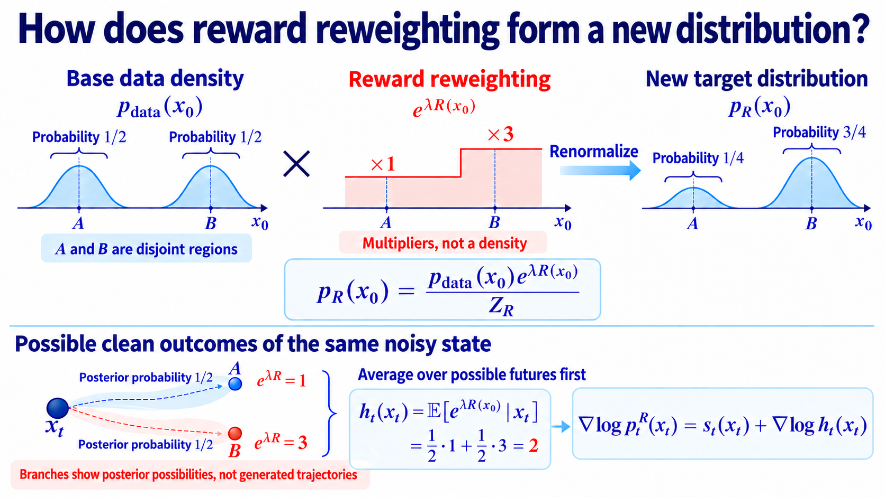

import Objectives from '../../../components/Objectives.astro';
import Prereq from '../../../components/Prereq.astro';
import Ask from '../../../components/Ask.astro';
import Remark from '../../../components/Remark.astro';
import Question from '../../../components/Question.astro';
import Answer from '../../../components/Answer.astro';
import QuizBlock from '../../../components/QuizBlock.astro';
import Option from '../../../components/Option.astro';
import Explanation from '../../../components/Explanation.astro';
import Bridge from '../../../components/Bridge.astro';
import Ref from '../../../components/Ref.astro';

# High Reward and Plausible Data: Which Distribution Should We Sample?

<Objectives title="After reading, you can">
- **Derive the tilted law** $p_R\propto p_{\mathrm{data}}e^{\lambda R}$ by combining reward, base density, and entropy.
- **Derive the noisy-state correction** through the posterior average of reward weights.
- **Separate exact tilting from plug-in guidance**, identifying what replacing the posterior by one denoised estimate omits.
</Objectives>

<Prereq items={frontmatter.prereqs} />

## One high-scoring sample, or a distribution of good samples?

Suppose a new aesthetic-scoring program evaluates completed images, but offers neither a noisy classifier nor a matching conditional generator prediction.

Its output $R(x_0)$ is a **reward**: larger values mean better agreement with this task. It need not be a probability or differentiable.

First determine how the score should change the desired sampling distribution.

Reward alone can favor implausible inputs that exploit the evaluator. We also want **data fidelity**, meaning that outputs retain plausible features and structure from the base data. We therefore consider

- The task score $R(x_0)$.
- Base log density $\log p_{\mathrm{data}}(x_0)$, describing how densely data occurs nearby.

<Remark label="Supplement" summary="Why log density rather than density?">
For independent observations, likelihood multiplies model densities:

$$
\begin{aligned}
L(\theta)&=\prod_{i=1}^n p_\theta(x_0^{(i)}),\\
\log L(\theta)&=\sum_{i=1}^n\log p_\theta(x_0^{(i)}).
\end{aligned}
$$

The logarithm converts this product into a sum without changing its maximizer. Summing log densities also avoids underflow from multiplying many small values.

Dividing by sample count gives average log-likelihood:

$$
\begin{aligned}
\frac1n\log L(\theta)
&=\frac1n\sum_{i=1}^n\log p_\theta(x_0^{(i)})\\
&\approx\mathbb E_{x_0\sim p_{\mathrm{data}}}[\log p_\theta(x_0)].
\end{aligned}
$$

The expectation fixes the real-data law and evaluates model log density. Under integrability, its sample average converges. Expanding KL gives

$$
\begin{aligned}
&\mathbb E_{p_{\mathrm{data}}}[\log p_\theta(x_0)]\\
&\quad=\mathbb E_{p_{\mathrm{data}}}[\log p_{\mathrm{data}}(x_0)]\\
&\qquad-D_{\mathrm{KL}}(p_{\mathrm{data}}\|p_\theta).
\end{aligned}
$$

The first term is independent of model parameters, so expected log-likelihood maximization minimizes this KL.

However, monotonicity of log does not make expectation of log equivalent to expectation of density. For two outcomes with true proportions 0.9 and 0.1,

| Objective | Optimal model probability of the first outcome |
|---|---|
| Mean probability: $0.9q+0.1(1-q)$ | $1$ |
| Mean log probability: $0.9\log q+0.1\log(1-q)$ | $0.9$ |

The first concentrates everything on the common outcome. The logarithmic objective recovers the true proportions and strongly penalizes assigning negligible probability to real outcomes.

MLE varies a model while fixing the data law. Here we fix the base law and choose a new sampling distribution. The log-density score is shared, but the optimization variable differs.
</Remark>

For one point, we could maximize $\lambda R+\log p_{\mathrm{data}}$. We instead want varied plausible answers, so choose a new density $\widetilde p$.

<Ask>
Which distribution-level objective favors reward while retaining the base distribution's influence?
</Ask>

## Combine fidelity, reward, and diversity

A first attempt compares average sample scores across candidate distributions.

Choose the distribution with the best expected combined score:

$$
\max_{\widetilde p}\;
\mathbb E_{x_0\sim \widetilde p}
\big[\lambda R(x_0)+\log p_{\mathrm{data}}(x_0)\big].
$$

Reward, base density, and $\lambda$ are fixed. Only the sampling law changes. Does this alone preserve alternatives?

Take two equally probable plausible images $A,B$, with rewards zero and one. If the new law chooses $B$ with probability $q$, the objective is

$$
\begin{aligned}
&(1-q)(0+\log\tfrac12)\\
&\quad+q(\lambda+\log\tfrac12)\\
&=-\log2+\lambda q.
\end{aligned}
$$

For positive strength it chooses $B$ every time. Plausibility alone did not require preserving $A$.

Add entropy to discourage excessive concentration, assuming the terms exist:

$$
\max_{\widetilde p}\;
\mathbb E_{\widetilde p}\big[\lambda R(x_0)+\log p_{\mathrm{data}}(x_0)\big]
+H(\widetilde p).
$$

Expand entropy and combine logarithms:

$$
\begin{aligned}
&\mathbb E_{\widetilde p}\big[\lambda R(x_0)+\log p_{\mathrm{data}}(x_0)\big]+H(\widetilde p)\\
&\qquad=\mathbb E_{\widetilde p}\left[
\log\frac{p_{\mathrm{data}}(x_0)e^{\lambda R(x_0)}}{\widetilde p(x_0)}
\right].
\end{aligned}
$$

The numerator suggests multiplying base density by the exponential reward. Normalize it:

$$
Z_R=\int p_{\mathrm{data}}(x_0)e^{\lambda R(x_0)}\,\mathrm dx_0,
\qquad
p_R(x_0)=\frac{1}{Z_R}p_{\mathrm{data}}(x_0)e^{\lambda R(x_0)}.
$$

Substitute this definition back into the objective:

$$
\begin{aligned}
\mathbb E_{\widetilde p}\left[
\log\frac{p_{\mathrm{data}}e^{\lambda R}}{\widetilde p}
\right]
&=\log Z_R+\mathbb E_{\widetilde p}\left[\log\frac{p_R}{\widetilde p}\right]\\
&=\log Z_R-D_{\mathrm{KL}}(\widetilde p\|p_R).
\end{aligned}
$$

If $0<Z_R<\infty$, the normalizer is fixed and KL is minimized at equality. The optimal distribution is

$$
\boxed{
p_R(x_0)=\frac{1}{Z_R}p_{\mathrm{data}}(x_0)e^{\lambda R(x_0)}
}.
$$

This is **exponential tilting** or **reward tilting**. Relative weight depends on both base density and reward, rather than reward alone.

The two-image weights become $1:e^\lambda$. The higher-reward image is more common, but the other retains positive probability at finite strength.

The ideal base is $p_{\mathrm{data}}$. In practice, steering a pretrained model targets its learned base law; existing model error does not disappear.

<Question label="Discussion" id="Q1">
Why not remove entropy and simply maximize expected reward plus expected base log density?

<Answer summary="Show the reasoning">
Without entropy the objective is linear in the sampling law. Writing its pointwise score as $F$ gives

$$
\max_{\widetilde p}\ \mathbb E_{\widetilde p}[F(x_0)]
$$

In a discrete space it places all mass on maximizers. In continuous spaces a density may only approach the concentrated limit. This optimizes a location rather than preserving other answers.

Entropy is what changes this problem into the finite-strength tilted law derived above.
</Answer>
</Question>

<Remark label="Supplement" summary="Other common formulations of the same target">
Expand the objective into three terms:

$$
\begin{aligned}
\max_{\widetilde p}\quad
&\lambda\mathbb E_{\widetilde p}[R(x_0)]\\
&+\mathbb E_{\widetilde p}[\log p_{\mathrm{data}}(x_0)]\\
&+H(\widetilde p).
\end{aligned}
$$

Assume finite relevant expectations and entropy, and a finite positive normalizer. We can compare the following forms.

**KL-regularized reward maximization：**

Combine base log density and entropy using KL:

$$
\begin{aligned}
&D_{\mathrm{KL}}(\widetilde p\|p_{\mathrm{data}})\\
&\quad=\mathbb E_{\widetilde p}\left[
\log\frac{\widetilde p(x_0)}{p_{\mathrm{data}}(x_0)}
\right]\\
&\quad=-H(\widetilde p)\\
&\qquad-\mathbb E_{\widetilde p}[\log p_{\mathrm{data}}(x_0)].
\end{aligned}
$$

Divide the objective by positive $\lambda$:

$$
\begin{aligned}
\max_{\widetilde p}\quad
&\mathbb E_{\widetilde p}[R(x_0)]\\
&-\frac1\lambda D_{\mathrm{KL}}(\widetilde p\|p_{\mathrm{data}}).
\end{aligned}
$$

Thus log density plus entropy is a KL penalty against departing from the base. Increasing $\lambda$ reduces the relative penalty.

**Constrained formulation：**

A related problem maximizes reward under a permitted KL budget:

$$
\begin{aligned}
\max_{\widetilde p}\quad&\mathbb E_{\widetilde p}[R(x_0)]\\
\text{subject to}\quad&D_{\mathrm{KL}}(\widetilde p\|p_{\mathrm{data}})\leq\delta.
\end{aligned}
$$

Use a positive Lagrange multiplier $1/\lambda$ to penalize violation:

$$
\begin{aligned}
&\mathbb E_{\widetilde p}[R(x_0)]\\
&\quad-\frac1\lambda D_{\mathrm{KL}}(\widetilde p\|p_{\mathrm{data}})\\
&\quad+\frac\delta\lambda.
\end{aligned}
$$

The final term is constant in the sampling law. But the constraint budget and penalty strength must match; arbitrary choices are not automatically equivalent.

Choose $\delta=D_{\mathrm{KL}}(p_R\|p_{\mathrm{data}})$. Optimality of the penalized solution implies, for any feasible competitor,

$$
\begin{aligned}
\mathbb E_{\widetilde p}[R(x_0)]
&\le\mathbb E_{p_R}[R(x_0)]\\
&\quad+\frac1\lambda\bigl(
D_{\mathrm{KL}}(\widetilde p\|p_{\mathrm{data}})-\delta
\bigr)\\
&\le\mathbb E_{p_R}[R(x_0)].
\end{aligned}
$$

The first inequality rearranges penalized optimality; the second uses feasibility. This establishes the particular matched constrained solution.

**Bayesian posterior：**

For an observation $y$ and a measurement likelihood, choose

$$
R(x_0)=\log p(y\mid x_0).
$$

Substitute into the tilt:

$$
\begin{aligned}
p_R(x_0)
&\propto p_{\mathrm{data}}(x_0)e^{R(x_0)}\\
&=p_{\mathrm{data}}(x_0)p(y\mid x_0)\\
&\propto p(x_0\mid y).
\end{aligned}
$$

The exponential becomes the likelihood, and Bayes' rule identifies the posterior. Its normalizer is

$$
\begin{aligned}
Z_R
&=\int p_{\mathrm{data}}(x_0)p(y\mid x_0)\,\mathrm dx_0\\
&=p(y).
\end{aligned}
$$

For finite positive evidence, the target is posterior sampling. The observation $y$ is tied to a measurement model; general classes and prompts remain $c$.

**RLHF：**

For a language model, fix a prompt and treat responses as $x_0$. A response law is also called a **policy**. Let $p_{\mathrm{ref}}$ be the reference policy.

The reward/KL component of RLHF [4] takes the form

$$
\begin{aligned}
\max_{\widetilde p}\quad
&\mathbb E_{\widetilde p}[R(x_0)]\\
&-\beta D_{\mathrm{KL}}(\widetilde p\|p_{\mathrm{ref}}),
\qquad\beta>0.
\end{aligned}
$$

Expand KL and divide by positive $\beta$:

$$
\begin{aligned}
\max_{\widetilde p}\quad
&\frac1\beta\mathbb E_{\widetilde p}[R(x_0)]\\
&+\mathbb E_{\widetilde p}[\log p_{\mathrm{ref}}(x_0)]\\
&+H(\widetilde p).
\end{aligned}
$$

This has the same entropy term, base law $p_{\mathrm{ref}}$, and strength $\lambda=1/\beta$. The ideal policy is its exponential tilt.

This compares objective structure only. The cited PPO-ptx objective includes another pretraining term, and practical RLHF updates parameters. Our test-time procedure keeps them fixed.
</Remark>

## If reward is differentiable, can we directly add its gradient?

At the clean endpoint, the tilted score is

$$
\nabla_{x_0}\log p_R(x_0)
=\nabla_{x_0}\log p_{\mathrm{data}}(x_0)
+\lambda\nabla_{x_0}R(x_0).
$$

Here the reward gradient modifies clean data. Classifier conditioning is a special case with log class probability as reward.

Intermediate diffusion states are noisy, while reward is defined on clean outcomes. One ambiguous sketch can lead to several differently scored completions. We must consider their possibilities rather than pretend the sketch is finished.

Corrupt clean tilted samples using the original forward kernel:

$$
p_t^R(x_t)=\int q(x_t\mid x_0)p_R(x_0)\,\mathrm dx_0.
$$

Substitute the tilted density:

$$
p_t^R(x_t)
=\frac{1}{Z_R}\int q(x_t\mid x_0)
p_{\mathrm{data}}(x_0)e^{\lambda R(x_0)}\,\mathrm dx_0.\tag{1}
$$

We want to express the resulting density using the base marginal and an additional factor.

Multiply and divide inside the integral by $p_t(x_t)$. Bayes' rule gives

$$
\frac{q(x_t\mid x_0)p_{\mathrm{data}}(x_0)}{p_t(x_t)}
=p(x_0\mid x_t).\tag{2}
$$

This posterior describes possible clean origins and their relative probabilities given the current noisy observation.

A natural estimate of eventual reward would average $R$ over this posterior:

$$
\mathbb E[R(x_0)\mid x_t]
=\int R(x_0)p(x_0\mid x_t)\,\mathrm dx_0.
$$

But tilting reweights by $e^{\lambda R}$, so its required average is instead

$$
h_t(x_t):=\int e^{\lambda R(x_0)}p(x_0\mid x_t)\,\mathrm dx_0
=\mathbb E\!\left[e^{\lambda R(x_0)}\mid x_t\right].
$$

Return to the target integral:

$$
p_t^R(x_t)
=\frac{1}{Z_R}\int q(x_t\mid x_0)
p_{\mathrm{data}}(x_0)e^{\lambda R(x_0)}\,\mathrm dx_0.
$$

Use the posterior identity and factor out the base marginal:

$$
p_t^R(x_t)=\frac{p_t(x_t)}{Z_R}\int e^{\lambda R(x_0)}p(x_0\mid x_t)\,\mathrm dx_0=\frac{p_t(x_t)h_t(x_t)}{Z_R}.
$$

Take logs and differentiate, eliminating the constant normalizer:

$$
\boxed{
\nabla_{x_t}\log p_t^R(x_t)
=s_t(x_t)+\nabla_{x_t}\log h_t(x_t)
}.
$$

Exact guidance is the log-gradient of this posterior-averaged weight. Combined with a matching initial law and exact reverse dynamics, it gives the tilted marginal path.

*Figure: branches represent posterior possibilities, not generated trajectories.*

<Remark label="Supplement" summary="Exact tilted sampling needs the matching terminal noisy law">
At the starting noise level, the same identity gives

$$
p_T^R(x_T)=\frac{p_T(x_T)h_T(x_T)}{Z_R}.
$$

If corruption completely forgets the clean image, the terminal kernel no longer depends on $x_0$.

The terminal posterior then reduces to the base data law:

$$
p(x_0\mid x_T)=p_{\mathrm{data}}(x_0).
$$

Its averaged reward weight is consequently

$$
\begin{aligned}
&h_T(x_T)\\
&=\int e^{\lambda R(x_0)}p_{\mathrm{data}}(x_0)\,\mathrm dx_0\\
&=Z_R.
\end{aligned}
$$

Substitution cancels the normalizer:

$$
p_T^R(x_T)=\frac{p_T(x_T)Z_R}{Z_R}=p_T(x_T).
$$

Only under such independence can we reuse the original terminal law exactly. Looking nearly Gaussian does not itself prove independence from clean data.

Finite-noise initialization can therefore introduce a prior mismatch separate from guidance-estimation error.
</Remark>

## What does practical guidance approximate?

The exact factor requires an integral over all compatible clean origins:

$$
\begin{aligned}
h_t(x_t)
&=\mathbb E\!\left[e^{\lambda R(x_0)}\mid x_t\right]\\
&=\int e^{\lambda R(x_0)}p(x_0\mid x_t)\,\mathrm dx_0.
\end{aligned}
$$

A pretrained score or noise predictor does not directly provide the complete posterior density needed for this integral.

Can we approximate it?

At nonzero retained signal, Tweedie's formula gives the clean posterior mean from the ideal score:

$$
\mathbb E[x_0\mid x_t]
=\frac{x_t+\sigma_t^2s_t(x_t)}{\sqrt{\bar\alpha_t}}.
$$

Replace that score with the model estimate:

$$
\hat x_0(x_t,t)
=\frac{x_t-\sigma_t\epsilon_\theta(x_t,t)}{\sqrt{\bar\alpha_t}}.
$$

Subtract predicted noise, then undo signal scaling.

Approximate the posterior by this single denoised estimate:

$$
h_t(x_t)
\approx e^{\lambda R(\hat x_0(x_t,t))}.
$$

This is a **plug-in approximation**, common in test-time guidance [1,5].

Its log-gradient becomes

$$
\nabla_{x_t}\log h_t(x_t)
\approx\lambda\nabla_{x_t}R(\hat x_0(x_t,t)),
$$

Bansal and colleagues [1] call this **forward universal guidance**.

The chain rule connects changes to the noisy state, its denoised prediction, and reward:

$$
\nabla_{x_t}R(\hat x_0(x_t,t))
=\left(\frac{\partial\hat x_0}{\partial x_t}\right)^{\!\top}
\nabla_{x_0}R(\hat x_0(x_t,t)).
$$

The denoiser Jacobian maps the clean reward gradient into input coordinates. Differentiating through a fixed network does not update its parameters.

This does not guarantee the exact tilt, because generally

$$
\begin{aligned}
h_t(x_t)
&=\mathbb E\!\left[e^{\lambda R(x_0)}\mid x_t\right]\\
&\neq e^{\lambda R(\mathbb E[x_0\mid x_t])}.
\end{aligned}
$$

Nor does its derivative necessarily match the exact log-gradient. The following results address different parts of this gap.

<Remark label="Supplement" summary="How do later methods address the exact-target gap?">
Practical procedures can approximate the posterior, its averaged weights, and the sampling dynamics separately.

The following reading follows the source note's conference and preprint distinctions. For inverse problems, exponential reward can be a measurement likelihood, but guarantees for a particular likelihood do not automatically cover arbitrary rewards.

**First: average weights of several possible outcomes rather than score only a mean image.**

LGD-MC [6] draws multiple candidates from an approximate posterior and averages their exponential weights:

$$
\begin{aligned}
x_0^{(i)}&\sim\hat p_{0\mid t}(\cdot\mid x_t),\\
\hat h_t(x_t)&=\frac1K\sum_{i=1}^K e^{\lambda R(x_0^{(i)})}.
\end{aligned}
$$

Its Gaussian candidate law is centered on a denoised prediction with a specified variance. More candidates improve integration under that approximate law, without making the law itself exact. Its weight-error bound is not automatically a log-gradient bound.

Calibrated Bayesian Guidance [2] instead analyzes candidates from the actual clean posterior. Differentiable sampling supports weight-gradient estimates; otherwise weighted candidates estimate the tilted score:

$$
\begin{aligned}
\omega_i&=e^{\lambda R(x_0^{(i)})},\\
\bar x_{0,R}&=\frac{\sum_i\omega_i x_0^{(i)}}{\sum_i\omega_i},\\
s_t^R(x_t)&\approx
\frac{\sqrt{\bar\alpha_t}\,\bar x_{0,R}-x_t}{\sigma_t^2}.
\end{aligned}
$$

Subtract the base score to obtain guidance. With correct posterior draws and suitable integrability, increasing candidate count yields consistency. Finite self-normalized ratios can remain biased, and approximate inner sampling introduces another error and computation cost.

**Second: represent posterior uncertainty more carefully.**

Free Hunch [7] estimates denoising covariance. For a linear Gaussian measurement model, integrating a Gaussian posterior approximation gives

$$
\begin{aligned}
p(y\mid x_t)&\approx\mathcal N(y;A\hat x_0,C_t),\\
C_t&=\tau^2I+A\Sigma_tA^\top.
\end{aligned}
$$

Measurement noise and uncertainty about the clean origin contribute separate covariance terms. Covariance updates improve linear inverse-problem guidance, but do not reconstruct arbitrary multimodal posteriors or guarantee exact sampling for every reward.

Midpoint Guidance [8] introduces a less noisy intermediate state and a Gaussian bridge. A variational approximation balances a simpler measurement approximation against a harder intermediate conditional. It samples a surrogate posterior, rather than eliminating all approximation.

**Third: correct approximate proposals during sampling.**

Sequential Monte Carlo maintains multiple trajectories, called particles, updates their importance weights, and resamples according to those weights. Resampling does not mean retaining only the highest reward.

Twisted Diffusion Samplers [9] use approximate guidance to propose transitions, then retain model/proposal corrections in importance weights. Their consistency result requires assumptions including a matching terminal likelihood, controlled positive weights, bounded twisting gradients, and suitable proposal variance. It concerns the pretrained model's conditional law as particle count grows, rather than exact finite-particle sampling or elimination of model error.

Feynman–Kac steering [10] extends this idea to general rewards and discrete diffusion. Its incremental potentials must satisfy

$$
\prod_{t=0}^{T}G_t(x_{T:t})=e^{\lambda R(x_0)}.
$$

The product over the whole path gives the intended terminal reward weight. Changed proposals require the appropriate ratio corrections. Approximate intermediate rewards can be used, but total target weights cannot be chosen arbitrarily. Finite particles can still miss rare modes or lose path diversity.

Feynman–Kac Correctors [11] address consistency between designed intermediate densities and sampling dynamics. Mixing exact scores can still omit terms in the density-evolution equation. Weighted dynamics and SMC supply corrections under their assumptions; finite steps, particles, and score errors remain separate.

Reverse Diffusion SMC [13] also corrects proposal error, but assumes an evaluable unnormalized target density. A pretrained score plus reward alone does not generally satisfy that assumption.

**Fourth: separate likelihood and prior sampling instead of estimating the guidance factor.**

PnP-DM [12] introduces auxiliary variables and alternates likelihood-related sampling with a Gaussian denoising-posterior sampling step. Exact conditional updates and assumptions are needed. A fixed positive splitting parameter defines an extended target, approaching the original posterior only in an appropriate limit. Finite iterations, approximate scores, and numerical integration remain distinct errors.

**Further reading: choosing the right mode need not give the exact tilt.**

*Are We Really Tilting?* [3] is identified here as a 2026 preprint. It analyzes finite conditional-particle guidance, distinguishing mode selection from displacement and narrowing within a mode. Corrections for special Gaussian examples are not general-purpose guarantees.

For each result, ask which approximation it corrects, what limit or assumptions support its guarantee, and whether the target uses the true data law or a learned model law. Higher reward and correct distributional sampling are different claims.
</Remark>

## Check your understanding

<QuizBlock id="w10-3-a">
Why retain the base density in reward tilting?
<Option>To constrain reward to the unit interval.</Option>
<Option correct>To reweight the base population rather than use reward alone.</Option>
<Option>To calculate classifier labels.</Option>
<Explanation>Base density and exponential reward jointly determine relative weights. A sufficiently strong reward can still amplify a low-density region.</Explanation>
</QuizBlock>

<QuizBlock id="w10-3-b">
What is exact noisy-state reward guidance?
<Option>$\lambda\nabla R(x_t)$.</Option>
<Option>The reward of the posterior mean.</Option>
<Option correct>$\nabla_{x_t}\log\mathbb E[e^{\lambda R(x_0)}\mid x_t]$.</Option>
<Explanation>The exponential weight must first be averaged over compatible clean outcomes.</Explanation>
</QuizBlock>

<QuizBlock id="w10-3-c">
What does the denoised plug-in approximation primarily remove?
<Option>The base score.</Option>
<Option correct>The posterior integral over possible clean outcomes.</Option>
<Option>A normalizer that otherwise remains in the score.</Option>
<Explanation>The constant normalizer already disappears under input differentiation. The omitted posterior uncertainty is the substantive approximation.</Explanation>
</QuizBlock>

<Bridge to="dma-gradient-free-steering">
Our desired tilted law is

$$
p_R(x_0)=\frac{1}{Z_R}p_{\mathrm{data}}(x_0)e^{\lambda R(x_0)}.
$$

It balances reward with the base data law. Differentiable reward can supply approximate intermediate guidance.

What if reward is a closed scoring API or collision simulator, with unavailable, costly, or unreliable gradients?

Next we use reward evaluations and comparisons to approximate tilted sampling without differentiating reward.
</Bridge>

## References

1. Bansal, A. et al. [*Universal Guidance for Diffusion Models.*](https://arxiv.org/abs/2302.07121) 2023, §3.1, Eq. (6).
2. Geyfman, D. et al. [*Calibrated Test-Time Guidance for Bayesian Inference.*](https://proceedings.mlr.press/v306/geyfman26a.html) ICML 2026, §5, Eqs. (16), (20).
3. Dandapanthula, S., Boffi, N. M. [*Are We Really Tilting? The Mechanics of Reward Guidance in Flow and Diffusion Models.*](https://arxiv.org/abs/2606.02884) 2026, preprint.
4. Ouyang, L. et al. [*Training Language Models to Follow Instructions with Human Feedback.*](https://arxiv.org/abs/2203.02155) NeurIPS 2022, §3.5, Eq. (2).
5. Chung, H. et al. [*Diffusion Posterior Sampling for General Noisy Inverse Problems.*](https://arxiv.org/abs/2209.14687) ICLR 2023, §3.1.
6. Song, J. et al. [*Loss-Guided Diffusion Models for Plug-and-Play Controllable Generation.*](https://proceedings.mlr.press/v202/song23k.html) ICML 2023, §4.3, Eq. (9), Proposition 4.1.
7. Rissanen, S., Heinonen, M., Solin, A. [*Free Hunch: Denoiser Covariance Estimation for Diffusion Models Without Extra Costs.*](https://proceedings.iclr.cc/paper_files/paper/2025/hash/e0bc6dbcbcc957b2aeadb20c39ba7f05-Abstract-Conference.html) ICLR 2025, §§3.1–3.7.
8. Moufad, B. et al. [*Variational Diffusion Posterior Sampling with Midpoint Guidance.*](https://proceedings.iclr.cc/paper_files/paper/2025/hash/ed524bb14de1b52c8522b977ded241d3-Abstract-Conference.html) ICLR 2025, §3, Lemma 3.1.
9. Wu, L. et al. [*Practical and Asymptotically Exact Conditional Sampling in Diffusion Models.*](https://proceedings.neurips.cc/paper_files/paper/2023/hash/63e8bc7bbf1cfea36d1d1b6538aecce5-Abstract.html) NeurIPS 2023, §3, Appendix A.5, Theorem 2.
10. Singhal, R. et al. [*A General Framework for Inference-time Scaling and Steering of Diffusion Models.*](https://proceedings.mlr.press/v267/singhal25b.html) ICML 2025, §3.3, Eq. (5), Algorithm 1.
11. Skreta, M. et al. [*Feynman-Kac Correctors in Diffusion: Annealing, Guidance, and Product of Experts.*](https://proceedings.mlr.press/v267/skreta25a.html) ICML 2025, §§2.2–3.2.
12. Wu, Z. et al. [*Principled Probabilistic Imaging using Diffusion Models as Plug-and-Play Priors.*](https://proceedings.neurips.cc/paper_files/paper/2024/hash/d65c4ce22241138c1784ff753d4c746c-Abstract-Conference.html) NeurIPS 2024, §§2–3, Theorem 3.1.
13. Wu, L. et al. [*Reverse Diffusion Sequential Monte Carlo Samplers.*](https://proceedings.neurips.cc/paper_files/paper/2025/hash/6490ab6ef8eb7116c6c1889795d21748-Abstract-Conference.html) NeurIPS 2025, §§2–3.
