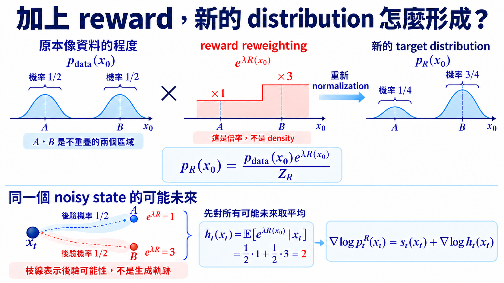

import Objectives from '../../../components/Objectives.astro';
import Prereq from '../../../components/Prereq.astro';
import Ask from '../../../components/Ask.astro';
import Remark from '../../../components/Remark.astro';
import Question from '../../../components/Question.astro';
import Answer from '../../../components/Answer.astro';
import QuizBlock from '../../../components/QuizBlock.astro';
import Option from '../../../components/Option.astro';
import Explanation from '../../../components/Explanation.astro';
import Bridge from '../../../components/Bridge.astro';
import Ref from '../../../components/Ref.astro';

# 既要像資料，又要 reward 高：我們真正想抽哪個 distribution？

<Objectives>
- **從「reward 高又像資料」推出 tilted distribution。** 將 entropy 與 log density 一起考慮，推得 $p_R(x_0)\propto p_{\mathrm{data}}(x_0)e^{\lambda R(x_0)}$。
- **寫出 noisy state 上真正需要的 guidance。** 從所有可能的乾淨結果出發，推導 $p_t^R(x_t)=p_t(x_t)h_t(x_t)/Z_R$，說明 $h_t$ 平均什麼、條件固定什麼。
- **分清 exact tilt 與常見 plug-in approximation。** 說出對 $R(\hat x_0)$ 求 gradient 為什麼不等於精確的 $\nabla\log h_t$，以及 approximation 可能造成的偏差。
</Objectives>

<Prereq items={frontmatter.prereqs} />

## 一個高分樣本，還是一個高分 distribution？

在 <Ref to="dma-classifier-guidance"/> 中，我們用外部 classifier 的判斷，或模型「有 condition」與「沒有 condition」的兩個回答，調整生成方向。但假如模型訓練完後，我們才拿到一個美感評分程式，它只能看完成的圖片並打分，既沒有對應的 noisy classifier，也沒有 conditional prediction，該怎麼辦？

我們把這個打出的分數記成 $R(x_0)$，稱為 **reward**：輸入是乾淨資料，而輸出是一個數字，數字越大代表越符合這次的要求。它不一定要是個機率，也不一定能微分。

我們首先要釐清的是：**它應該如何改變我們想抽的 distribution？** 這才能幫助我們決定 sampling 可以怎麼做。

我們一方面希望 reward 越高越好，但又不能只顧 reward。若產生出一張 reward model 給滿分、在人眼看來卻完全不像資料的影像，這就不是一個好的 steering。這裡把「生成結果仍像原本的資料、保有合理的特徵與結構」這個要求稱為 **data fidelity**。如果用數學的語言說，我們同時在乎

- reward function $R(x_0)$：這個樣本有多符合這次的要求；
- log density $\log p_{\mathrm{data}}(x_0)$：值越大，表示原本資料在這個樣本附近越密集。

<Remark label="補充" summary="為什麼使用 log density，而不直接用 density？">
回想 <Ref to="ml-maximum-likelihood"/> 中的 maximum likelihood。若乾淨樣本 $x_0^{(1)},\ldots,x_0^{(n)}$ 獨立取自 $p_{\mathrm{data}}$，模型是 $p_\theta$，整批資料的 likelihood 與取 log 後的分數分別是

$$
\begin{aligned}
L(\theta)&=\prod_{i=1}^n p_\theta(x_0^{(i)}),\\
\log L(\theta)&=\sum_{i=1}^n\log p_\theta(x_0^{(i)}).
\end{aligned}
$$

**log 把乘法變成加法，而且不改變最大 likelihood 的解。** 因為 log 嚴格遞增，$\arg\max_\theta L(\theta)=\arg\max_\theta\log L(\theta)$。實作時直接累加 log density，也能避免先算出很小的乘積而造成數值下溢，微分則變成逐筆加總。

再除以樣本數，就從整批 likelihood 變成每筆資料的平均表現：

$$
\begin{aligned}
\frac1n\log L(\theta)
&=\frac1n\sum_{i=1}^n\log p_\theta(x_0^{(i)})\\
&\approx\mathbb E_{x_0\sim p_{\mathrm{data}}}[\log p_\theta(x_0)].
\end{aligned}
$$

這個 expectation 固定真實資料的分布，平均它們在模型下的 log density；若 log density 可積分，隨著獨立樣本數增加，左邊的平均會逼近右邊。它還有一個統計上的意義：在相關期望有限時，展開 KL 的定義可得

$$
\begin{aligned}
&\mathbb E_{p_{\mathrm{data}}}[\log p_\theta(x_0)]\\
&\quad=\mathbb E_{p_{\mathrm{data}}}[\log p_{\mathrm{data}}(x_0)]\\
&\qquad-D_{\mathrm{KL}}(p_{\mathrm{data}}\|p_\theta).
\end{aligned}
$$

第一項與 $\theta$ 無關，所以最大化 expected log-likelihood，等於讓模型最小化這個 KL。

但 **log 的單調性不能直接穿過期望值**：$\mathbb E[\log p_\theta(x_0)]$ 與 $\mathbb E[p_\theta(x_0)]$ 是不同目標。例如真實資料只有 $A,B$，比例是 $0.9:0.1$，模型給它們的機率是 $q,1-q$：

| 目標（對真實資料取平均） | 最佳 $q$ |
| --- | --- |
| 平均 probability   $0.9q+0.1(1-q)$ | $1$ |
| 平均 log probability   $0.9\log q+0.1\log(1-q)$ | $0.9$ |

前者只希望 $q$ 越大越好；後者在模型還原真實比例、KL 為零時最大。**真實會出現、卻被模型分配極低機率的事件，會受到 log 很強的懲罰。**

這裡的 MLE 固定資料分布、調整模型 $p_\theta$；正文則固定 $p_{\mathrm{data}}$，選擇新的抽樣分布。兩個問題使用同一個 log density 分數，但最佳化的對象不同。
</Remark>

用 $\lambda>0$ 控制 reward 在兩個要求中的影響。如果只想找**一個點**，可以最大化 $\lambda R(x_0)+\log p_{\mathrm{data}}(x_0)$。但我們希望每次生成仍能得到不同的合理答案，所以要決定的應該是一個新的 distribution，用它的 density 同時反映 reward 與 data fidelity。我們用 $\widetilde p$ 來表示這個 distribution。

<Ask>
要讓整個 distribution 同時偏向高 reward、 
又保留原本 data distribution 的影響，我們該最大化什麼？
</Ask>

## 把 data fidelity、reward 與 diversity 放進同一個 objective

最自然的嘗試，是比較不同 distributions 生成的結果，哪一個平均表現最好。想像我們反覆從 $\widetilde p$ 生成圖片，替每張計算 $\lambda R(x_0)+\log p_{\mathrm{data}}(x_0)$，再把分數取平均。換一個 distribution，各種結果出現的頻率就會不同，平均分數也會跟著改變。

所以，**我們要找的是讓整批平均分數最高的 $\widetilde p$，而不是某一個最高分的樣本：**

$$
\max_{\widetilde p}\;
\mathbb E_{x_0\sim \widetilde p}
\big[\lambda R(x_0)+\log p_{\mathrm{data}}(x_0)\big].
$$

這裡 $R$、$p_{\mathrm{data}}$ 與 $\lambda$ 都先固定，改變的是 $\widetilde p$。Expectation 是對它抽出的 $x_0$ 取平均：我們希望平均 reward 高，平均 log density 也高。但這樣就會保留多種答案嗎？

先把相簿簡化成兩張都合理的照片 $A$、$B$：原本各以 $1/2$ 機率出現，reward 分別是 $0$、$1$。若新的抽樣方法以機率 $q$ 選 $B$，剛才的 objective 就是

$$
\begin{aligned}
&(1-q)(0+\log\tfrac12)\\
&\quad+q(\lambda+\log\tfrac12)\\
&=-\log2+\lambda q.
\end{aligned}
$$

只要 $\lambda>0$，它就希望 $q$ 越大越好，最後每次都回傳 $B$。**兩張照片原本都合理，但這個 objective 沒有要求保留另一個答案。**

少掉的要求是不要過度集中。我們用 entropy $H(\widetilde p)=-\mathbb E_{\widetilde p}[\log \widetilde p(x_0)]$ 表示這件事：過度集中在少數結果時，entropy 會較低。在期望與 entropy 有定義的情況下，把它加進目標：

$$
\max_{\widetilde p}\;
\mathbb E_{\widetilde p}\big[\lambda R(x_0)+\log p_{\mathrm{data}}(x_0)\big]
+H(\widetilde p).
$$

因為 expectation 是 linear 的，把 entropy 展開後，三項可以放進同一個 log：

$$
\begin{aligned}
&\mathbb E_{\widetilde p}\big[\lambda R(x_0)+\log p_{\mathrm{data}}(x_0)\big]+H(\widetilde p)\\
&\qquad=\mathbb E_{\widetilde p}\left[
\log\frac{p_{\mathrm{data}}(x_0)e^{\lambda R(x_0)}}{\widetilde p(x_0)}
\right].
\end{aligned}
$$

分子已經告訴我們如何重新加權：原本的 data density 乘上 $e^{\lambda R(x_0)}$。但乘完後不一定積分為 $1$，所以先把總量記成 $Z_R$，再除掉它，定義

$$
Z_R=\int p_{\mathrm{data}}(x_0)e^{\lambda R(x_0)}\,\mathrm dx_0,
\qquad
p_R(x_0)=\frac{1}{Z_R}p_{\mathrm{data}}(x_0)e^{\lambda R(x_0)}.
$$

把 $p_{\mathrm{data}}e^{\lambda R}=Z_Rp_R$ 代回去：

$$
\begin{aligned}
\mathbb E_{\widetilde p}\left[
\log\frac{p_{\mathrm{data}}e^{\lambda R}}{\widetilde p}
\right]
&=\log Z_R+\mathbb E_{\widetilde p}\left[\log\frac{p_R}{\widetilde p}\right]\\
&=\log Z_R-D_{\mathrm{KL}}(\widetilde p\|p_R).
\end{aligned}
$$

$Z_R$ 由 base distribution、reward 與 $\lambda$ 決定，不隨我們正在選的 $\widetilde p$ 改變。假設 $0<Z_R<\infty$，KL 非負且在 $\widetilde p=p_R$ 時為零，所以這個 objective 的最佳解是

$$
\boxed{
p_R(x_0)=\frac{1}{Z_R}p_{\mathrm{data}}(x_0)e^{\lambda R(x_0)}
}.
$$

我們把原本的 data density $p_{\mathrm{data}}(x_0)$ 乘上 reward 決定的係數 $e^{\lambda R(x_0)}$，再除以 $Z_R$，得到新的 density $p_R(x_0)$。**Reward 越高，乘上的係數就越大；但新的相對權重仍由 $p_{\mathrm{data}}(x_0)e^{\lambda R(x_0)}$ 共同決定，而不是只挑 reward 最大的點。** 這個做法稱為 **exponential tilting** 或 **reward tilting**。

回到剛才兩張照片的例子，tilting 後的相對權重成為 $1:e^\lambda$，所以 $B$ 被抽中的機率是 $e^\lambda/(1+e^\lambda)$。它更常出現，但有限的 $\lambda$ 沒有把 $A$ 完全刪掉。連續資料做的是同一件事，只是對整片 density 重新加權。

這裡的 $p_{\mathrm{data}}$ 是理想的 base distribution。實作時，我們只能使用 pretrained model 學到的 $p_\theta$ 或它的 score；因此 steering 能逼近的是以 learned model 為 base 的 tilted distribution，原本的 model error 並不會因此消失。

<Question id="Q1">
既然我們在乎的就是 reward 與 log density，**把 entropy $H(\widetilde p)$ 拿掉，直接最大化兩個 expectation，不是更單純嗎？**

<Answer>
拿掉 entropy 後，objective 對 $\widetilde p$ 是 linear 的。令 $F(x_0)=\lambda R(x_0)+\log p_{\mathrm{data}}(x_0)$，則

$$
\max_{\widetilde p}\ \mathbb E_{\widetilde p}[F(x_0)]
$$

在離散情況會把全部 mass 放到 $F$ 最大的點；若有多個並列最大點，才可能分到它們上面。在連續 density 的情況，則可能只能越來越集中、逼近這個極限。這是在找最高分區域，不是在保留其他合理答案。

剛才 $A$、$B$ 的例子已經看到這個差別。**只最大化平均分數，不會得到正文的 $p_R$；加入 entropy，才把「保留其他可能答案」一起放進我們要解的問題。**
</Answer>
</Question>

<Remark label="補充" summary="同一個 tilted distribution，在論文裡還有哪些常見寫法？">
先把正文的 objective 展成三項。固定 reward、base distribution 與 $\lambda>0$，我們要在不同的 $\widetilde p$ 之間最大化

$$
\begin{aligned}
\max_{\widetilde p}\quad
&\lambda\mathbb E_{\widetilde p}[R(x_0)]\\
&+\mathbb E_{\widetilde p}[\log p_{\mathrm{data}}(x_0)]\\
&+H(\widetilde p).
\end{aligned}
$$

下面的比較沿用正文的條件：相關期望與 entropy 有限，且 $0<Z_R<\infty$。我們逐一看，它們如何回到這三項。

**KL-regularized reward maximization：**

這個寫法把「原本的 log density」與「新 distribution 的 entropy」合成一個 KL 項。把 KL 的定義展開，就看得到：

$$
\begin{aligned}
&D_{\mathrm{KL}}(\widetilde p\|p_{\mathrm{data}})\\
&\quad=\mathbb E_{\widetilde p}\left[
\log\frac{\widetilde p(x_0)}{p_{\mathrm{data}}(x_0)}
\right]\\
&\quad=-H(\widetilde p)\\
&\qquad-\mathbb E_{\widetilde p}[\log p_{\mathrm{data}}(x_0)].
\end{aligned}
$$

因此，正文後兩項就是 $-D_{\mathrm{KL}}(\widetilde p\|p_{\mathrm{data}})$。再把整個 objective 除以正的常數 $\lambda$，不會改變最佳的 $\widetilde p$，就得到

$$
\begin{aligned}
\max_{\widetilde p}\quad
&\mathbb E_{\widetilde p}[R(x_0)]\\
&-\frac1\lambda D_{\mathrm{KL}}(\widetilde p\|p_{\mathrm{data}}).
\end{aligned}
$$

所以它不是另外一個目標：**正文的「log density + entropy」，正好就是限制新 distribution 偏離 base 的 KL penalty。** $\lambda$ 越大，這個寫法中的 KL 懲罰係數 $1/\lambda$ 越小，相對上更重視 reward。

**Constrained formulation：**

另一個問法是：先指定「最多能偏離 base 多少」，再在這個範圍內提高 reward。用 $\delta\ge0$ 表示可接受的 KL 上限：

$$
\begin{aligned}
\max_{\widetilde p}\quad
&\mathbb E_{\widetilde p}[R(x_0)]\\
\text{條件：}\quad
&D_{\mathrm{KL}}(\widetilde p\|p_{\mathrm{data}})\le\delta.
\end{aligned}
$$

要把限制放進 objective，可以用 $1/\lambda$ 作為 **Lagrange multiplier**，也就是限制的懲罰係數，扣掉 $\frac1\lambda(D_{\mathrm{KL}}-\delta)$。展開後是

$$
\begin{aligned}
&\mathbb E_{\widetilde p}[R(x_0)]\\
&\quad-\frac1\lambda D_{\mathrm{KL}}(\widetilde p\|p_{\mathrm{data}})\\
&\quad+\frac\delta\lambda.
\end{aligned}
$$

對固定的 $\lambda,\delta$，最後一項不隨 $\widetilde p$ 改變，拿掉它就回到前一種 objective。但 **$\delta$ 與 $\lambda$ 必須匹配，不能任意指定後就說兩個問題相同**。

一個具體的對應是取 $\delta=D_{\mathrm{KL}}(p_R\|p_{\mathrm{data}})$。因為 $p_R$ 已是 KL-regularized objective 的最佳解，對任何符合 KL 上限的 $\widetilde p$，都有

$$
\begin{aligned}
\mathbb E_{\widetilde p}[R(x_0)]
&\le\mathbb E_{p_R}[R(x_0)]\\
&\quad+\frac1\lambda\bigl(
D_{\mathrm{KL}}(\widetilde p\|p_{\mathrm{data}})-\delta
\bigr)\\
&\le\mathbb E_{p_R}[R(x_0)].
\end{aligned}
$$

第一個不等式是把前一種 objective 的最佳性移項；第二個用到 $D_{\mathrm{KL}}\le\delta$。所以在這個對應下，$p_R$ 也讓 constrained problem 的 reward 最大。這是懲罰強度與偏離上限之間的關係，不是任意 constraint 都自動得到同一個 $p_R$。

**Bayesian posterior：**

假如手上只有一張模糊照片 $y$，候選的清楚照片是 $x_0$，我們還希望它經過量測後能符合 $y$。此時 $p(y\mid x_0)$ 描述這個候選對觀測的支持程度；選它的 log-likelihood 當 reward，並令 $\lambda=1$：

$$
R(x_0)=\log p(y\mid x_0).
$$

現在把這個選擇代進正文的 tilted density，而不是另外假設一個 posterior：

$$
\begin{aligned}
p_R(x_0)
&\propto p_{\mathrm{data}}(x_0)e^{R(x_0)}\\
&=p_{\mathrm{data}}(x_0)p(y\mid x_0)\\
&\propto p(x_0\mid y).
\end{aligned}
$$

第二行用 $e^{\log p(y\mid x_0)}=p(y\mid x_0)$，第三行就是 Bayes rule：**base distribution 在這裡是 prior，reward 的指數變成 measurement likelihood。** 正文的 normalization 也變成

$$
\begin{aligned}
Z_R
&=\int p_{\mathrm{data}}(x_0)p(y\mid x_0)\,\mathrm dx_0\\
&=p(y).
\end{aligned}
$$

因此在 $0<p(y)<\infty$ 時，正規化後恰好是 $p_R(x_0)=p(x_0\mid y)$，也就是 posterior sampling。這個解釋使用指定的量測模型；$y$ 是 observation，一般的類別或文字 condition 仍寫成 $c$。

**RLHF：**

把情境換成語言模型。RLHF（Reinforcement Learning from Human Feedback）用人類偏好提供 reward 訊號；固定一個 prompt 後，$x_0$ 是 response，$p_{\mathrm{ref}}$ 是固定的 reference model 產生回答的 distribution。這種產生回答的分布也稱為 **policy**，我們要調整的 policy 仍記成 $\widetilde p$；下面省略固定 prompt 的條件。

Ouyang 等人 [4] 的目標包含提高 reward、同時限制偏離 reference policy 的部分。以我們的符號寫成

$$
\begin{aligned}
\max_{\widetilde p}\quad
&\mathbb E_{\widetilde p}[R(x_0)]\\
&-\beta D_{\mathrm{KL}}(\widetilde p\|p_{\mathrm{ref}}),
\qquad\beta>0.
\end{aligned}
$$

用前面展開的 KL 定義，再把整個 objective 除以 $\beta$，就得到

$$
\begin{aligned}
\max_{\widetilde p}\quad
&\frac1\beta\mathbb E_{\widetilde p}[R(x_0)]\\
&+\mathbb E_{\widetilde p}[\log p_{\mathrm{ref}}(x_0)]\\
&+H(\widetilde p).
\end{aligned}
$$

逐項和最上面的正文 formulation 比較：**base 換成 $p_{\mathrm{ref}}$，reward 係數換成 $\lambda=1/\beta$，entropy 項沒有變。** 因此在理想的分布最佳化下，最佳 policy 同樣滿足 $\widetilde p(x_0)\propto p_{\mathrm{ref}}(x_0)e^{R(x_0)/\beta}$。

這裡只比較 reward 與 KL 的部分；原論文的 PPO-ptx 還加入預訓練資料項。實際 RLHF 會訓練 policy 的參數，本單元則固定 pretrained model、在 sampling 時 steering；**共同的是 objective 的結構，不是訓練與取樣的流程**。
</Remark>

## 若 reward 可以微分，直接把 gradient 加上去嗎？

在乾淨資料 $x_0$ 端（$t=0$），tilted distribution $p_R$ 的 score functions 可以寫成：

$$
\nabla_{x_0}\log p_R(x_0)
=\nabla_{x_0}\log p_{\mathrm{data}}(x_0)
+\lambda\nabla_{x_0}R(x_0).
$$

這裡 $\nabla_{x_0}R$ 指向「稍微改動乾淨樣本，reward 上升最快」的方向。它可以加到乾淨資料的 score；例如在乾淨空間用 score 建立抽樣 dynamics 時，這就是要用的方向。Classifier guidance 在 $\lambda=1$ 時，也可看成選 $R(x_0)=\log p(c\mid x_0)$ 的特例。

但 diffusion sampling 大部分時間拿到的是 noisy $x_t$，reward 卻通常定義在 clean sample $x_0$。回想 U7.1 那張尚未畫完的草稿：同一個模糊輪廓，可能完成為不同的品種、動作與場景；它們最後的 reward 也不同。**要判斷這張草稿值不值得保留，就得一起考慮這些可能結果，而不是假裝它已經是一張完成的圖片。**

我們想知道的，是高 reward 的乾淨結果加噪後，會如何分布在這些 $x_t$ 上。從 $p_R$ 抽乾淨資料，再沿用 U1 的 forward process 加噪，就得到目標 noisy density $p_t^R$。若 $q(x_t\mid x_0)$ 是原本加噪的 conditional density，這個平均寫成

$$
p_t^R(x_t)=\int q(x_t\mid x_0)p_R(x_0)\,\mathrm dx_0.
$$

把 $p_R$ 的定義代進去：

$$
p_t^R(x_t)
=\frac{1}{Z_R}\int q(x_t\mid x_0)
p_{\mathrm{data}}(x_0)e^{\lambda R(x_0)}\,\mathrm dx_0.\tag{1}
$$

接下來，我們希望把目標 density $p_t^R$ 和原本的 base density $p_t$ 接起來。Pretrained model 已經在近似 $p_t$ 的 score；我們想看看，能不能利用模型學到的東西，再結合 reward，算出 $p_t^R$ 的 score。

我們可以先在積分裡乘除 $p_t(x_t)$。被積分的前兩項 $q(x_t\mid x_0)p_{\mathrm{data}}(x_0)$ 除以它，Bayes rule 就給出

$$
\frac{q(x_t\mid x_0)p_{\mathrm{data}}(x_0)}{p_t(x_t)}
=p(x_0\mid x_t).
$$

$p(x_0\mid x_t)$ 的意思是：**看到目前的 noisy state $x_t$ 後，原本可能來自哪些乾淨資料 $x_0$，以及各個來源有多可能。** 這是對乾淨來源的 conditional density，也叫 **posterior density**。

有了它，如果想估計目前這個 $x_t$ 的 reward，最自然的方法就是考慮所有可能的乾淨來源 $x_0$，把它們的 $R(x_0)$ 按照 $p(x_0\mid x_t)$ 加權取平均：

$$
\mathbb E[R(x_0)\mid x_t]
=\int R(x_0)p(x_0\mid x_t)\,\mathrm dx_0.
$$

不過，我們現在要算的是 tilted density $p_t^R$，它用 $e^{\lambda R(x_0)}$，而不是 $R(x_0)$ 來重新加權。因此，回到剛才的積分，同樣的 posterior 平均要作用在這個係數上：

$$
h_t(x_t):=\int e^{\lambda R(x_0)}p(x_0\mid x_t)\,\mathrm dx_0
=\mathbb E\!\left[e^{\lambda R(x_0)}\mid x_t\right].
$$

回到前面得到的 $p_t^R$ 積分式（1）：

$$
p_t^R(x_t)
=\frac{1}{Z_R}\int q(x_t\mid x_0)
p_{\mathrm{data}}(x_0)e^{\lambda R(x_0)}\,\mathrm dx_0.
$$

利用 Bayes rule，再把不隨 $x_0$ 改變的 $p_t(x_t)$ 提到積分外，就能接上 $h_t$ 的定義：

$$
p_t^R(x_t)=\frac{p_t(x_t)}{Z_R}\int e^{\lambda R(x_0)}p(x_0\mid x_t)\,\mathrm dx_0=\frac{p_t(x_t)h_t(x_t)}{Z_R}.
$$

$h_t$ 大，表示目前這個 noisy state 相容的乾淨結果，在 reward 加權後整體較有份量。**先平均 reward，再取 exponential，一般不等於直接平均 $e^{\lambda R(x_0)}$。** 現在像 U7.1 一樣取 log、對 $x_t$ 微分；$Z_R$ 不隨 $x_t$ 改變，所以

$$
\boxed{
\nabla_{x_t}\log p_t^R(x_t)
=s_t(x_t)+\nabla_{x_t}\log h_t(x_t)
}.
$$

這裡真正需要的 guidance 不是 $\nabla R(x_t)$，而是 **posterior 平均權重 $h_t$ 的 log-gradient**：稍微改動目前的 $x_t$，哪個方向能讓它相容的高 reward 結果整體更有份量？

*圖：reward 重加權乾淨端的機率；在 noisy state 上，$h_t$ 先對所有可能來源的 $e^{\lambda R}$ 取 posterior average。枝線表示後驗可能性，不是生成軌跡。*

<Remark label="補充" summary="Exact tilted sampling 還需要匹配起始的 noisy distribution">
和 U7.1 一樣，精確方向還需要配合正確的起始 distribution。剛才的推導在 $t=T$ 也成立：

$$
p_T^R(x_T)=\frac{p_T(x_T)h_T(x_T)}{Z_R}.
$$

若 forward process 已完全忘掉 $x_0$，$x_T$ 與乾淨資料獨立，則 $h_T=\mathbb E[e^{\lambda R(x_0)}]=Z_R$，起點才仍是原本的 $p_T$。有限的 noise level 未必做到這件事；直接沿用原 Gaussian 起點，也可能是另一個 approximation，而不只是 guidance 的估計問題。
</Remark>

## 實作上的近似，近似的是哪一項？

$h_t$ 要積分所有可能的 $x_0$，通常無法直接算。比較容易的做法，是先沿用 U1 的 denoiser，估計目前圖片去噪後會是什麼：

$$
\hat x_0(x_t,t)
=\frac{x_t-\sigma_t\epsilon_\theta(x_t,t)}{\sqrt{\bar\alpha_t}}.
$$

分子先扣掉預測 noise，分母再還原 signal amplitude；理想上它是 $\mathbb E[x_0\mid x_t]$。Bansal 等人的 Universal Guidance [1] 在 denoised prediction 上評估可微的要求，使用這類 plug-in 方向。用正文的 reward 語言寫，就是先近似

$$
h_t(x_t)
\approx e^{\lambda R(\hat x_0(x_t,t))}.
$$

取 log-gradient 後，guidance 變成

$$
\nabla_{x_t}\log h_t(x_t)
\approx\lambda\nabla_{x_t}R(\hat x_0(x_t,t)),
$$

這是在問：「稍微改動 $x_t$，它的去噪結果會怎麼變，reward 又會怎麼變？」Chain rule 把這兩個變化接起來：

$$
\nabla_{x_t}R(\hat x_0(x_t,t))
=\left(\frac{\partial\hat x_0}{\partial x_t}\right)^{\!\top}
\nabla_{x_0}R(\hat x_0(x_t,t)).
$$

右邊先算乾淨結果的 reward gradient，再用 $\partial\hat x_0/\partial x_t$ 這個 Jacobian——各個輸入座標改動對去噪結果的影響——換回 noisy image 的方向。這裡會對固定網路的輸入微分，並不更新 $\theta$。

但它不是 exact tilt，因為一般來說

$$
\mathbb E\!\left[e^{\lambda R(x_0)}\mid x_t\right]
\neq e^{\lambda R(\mathbb E[x_0\mid x_t])}.
$$

左邊先替每個可能結果算權重，再平均；右邊先把結果平均成一張圖，再算權重。就像兩張可能的清楚照片，平均後可能是一張模糊照片；替這張平均圖片算出的 reward 權重，不等於替兩張清楚照片各自算權重後的平均。**近似省掉的是 posterior 的不確定性，不只是少算一個常數。**

<Remark label="補充" summary="近期研究如何處理實作 guidance 與精確 target 的差距？">
Geyfman 等人 [2] 分析常見 guidance 的 posterior 偏差，提出在其理論條件下與目標 posterior 一致的替代估計。Dandapanthula 與 Boffi [3] 則在 Gaussian／mixture 的例子中，分開分析 mode selection 與 mode 內的過度最佳化，並研究 reward damping schedule。

這些結果都要連同各自的假設閱讀：在可分析的例子中減少偏差，不代表任意 reward、模型與 sampler 都有相同保證。**Reward 上升，是評分變好；是否抽到指定 $p_R$，則是另一個要檢查的問題。**
</Remark>

## 消化一下

<QuizBlock id="w10-3-a">
為什麼 reward-tilted distribution 要含有 $p_{\mathrm{data}}(x_0)$？
<Option>讓 reward 的數值永遠介於 0 與 1。</Option>
<Option correct>在原本 data density 的權重上偏向高 reward，而不是只看 reward 大小。</Option>
<Option>用來計算 classifier 的 label。</Option>
<Explanation>
$e^{\lambda R}$ 負責重新加權，$p_{\mathrm{data}}$ 保留 base 的影響；兩者相乘後還要除以 $Z_R$。但這不是「每個結果都合理」的保證：reward 的差距夠大時，原本 density 很低的區域也可能被大幅放大。
</Explanation>
</QuizBlock>

<QuizBlock id="w10-3-b">
在 noisy state $x_t$ 上，exact reward guidance 是哪一項？
<Option>$\lambda\nabla R(x_t)$。</Option>
<Option>$R(\mathbb E[x_0\mid x_t])$。</Option>
<Option correct>$\nabla_{x_t}\log\mathbb E[e^{\lambda R(x_0)}\mid x_t]$。</Option>
<Explanation>
reward 定義在 clean outcome。給定 $x_t$ 後仍有很多可能的 $x_0$，exact tilted marginal 必須先對這個 posterior 取 expectation。
</Explanation>
</QuizBlock>

<QuizBlock id="w10-3-c">
將 $h_t$ 近似成 $e^{\lambda R(\hat x_0)}$ 時，最主要省掉了什麼？
<Option>base score $s_t$。</Option>
<Option correct>給定 $x_t$ 後，對所有可能 clean outcomes 的 posterior expectation。</Option>
<Option>normalizing constant $Z_R$。</Option>
<Explanation>
$Z_R$ 原本就會在 score 中消失。plug-in approximation 真正省掉的是 future outcomes 的積分；也因此可能漏掉 modes 或造成 reward over-optimization。
</Explanation>
</QuizBlock>

<Bridge to="dma-gradient-free-steering">
現在我們知道要怎麼讓高 reward 的結果更常出現：在 base distribution 上乘以 $e^{\lambda R}$，而不是只追一個最高分點。在 noisy state 上，精確方向還要平均所有可能的乾淨結果；用單一去噪估計代替它，是實作上的近似。

但假如評分程式只能回答「這張圖幾分」，或機器人模擬器只能回報「有沒有碰撞」，根本不能告訴我們輸入稍微改動後分數怎麼變呢？**只靠比較候選的分數，也能讓高分結果更常被生成嗎？** 下一篇 <Ref to="dma-gradient-free-steering"/> 從多抽幾次、再挑選的做法開始。
</Bridge>

## 參考文獻

1. Bansal, A. et al. [*Universal Guidance for Diffusion Models.*](https://arxiv.org/abs/2302.07121) 2023.（對 denoised prediction 使用任意 differentiable guidance。）
2. Geyfman, D. et al. [*Calibrated Test-Time Guidance for Bayesian Inference.*](https://proceedings.mlr.press/v306/geyfman26a.html) ICML 2026.（常見 guidance 與 calibrated posterior sampling 的差異。）
3. Dandapanthula, S., Boffi, N. M. [*Are We Really Tilting? The Mechanics of Reward Guidance in Flow and Diffusion Models.*](https://arxiv.org/abs/2606.02884) 2026.（有限 particle plug-in 對 mode selection 與 reward hacking 的分析。）
4. Ouyang, L. et al. [*Training Language Models to Follow Instructions with Human Feedback.*](https://arxiv.org/abs/2203.02155) NeurIPS 2022, §3.5, Eq. (2).（RLHF 的 reward 與 KL 部分；PPO-ptx 另包含預訓練資料項。）
