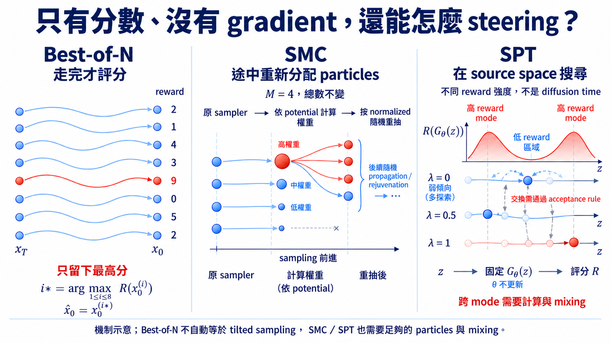

import Objectives from '../../../components/Objectives.astro';
import Prereq from '../../../components/Prereq.astro';
import Ask from '../../../components/Ask.astro';
import Remark from '../../../components/Remark.astro';
import Question from '../../../components/Question.astro';
import Answer from '../../../components/Answer.astro';
import QuizBlock from '../../../components/QuizBlock.astro';
import Option from '../../../components/Option.astro';
import Explanation from '../../../components/Explanation.astro';
import Bridge from '../../../components/Bridge.astro';
import Ref from '../../../components/Ref.astro';

# Reward 只會打分、不會給方向，還能怎麼引導？

<Objectives>
- **分清挑最高分與依權重抽樣。** 寫出 Best-of-$N$ 的 argmax 與 normalized reward weights，說明它們為什麼不是同一個 sampling 規則。
- **從三個候選說明 SMC 的操作與 target。** 解釋 propagate、weight、resample，再用各段權重的消去說明 Feynman–Kac 如何保留指定的終點 tilt。
- **比較不同方法在哪裡使用 reward。** 分清 BoNG 改動途中方向、SPT 搜尋起點，以及有限 candidates、錯誤的中途估計與不充分搜尋帶來的限制。
</Objectives>

<Prereq items={frontmatter.prereqs} />

## 只知道結果好不好，沒有「往哪裡走」

在 <Ref to="dma-reward-tilting"/> 中，我們希望高 reward 的結果更常出現，但仍保留 base distribution 中合理的資料，因此定義了 $p_R(x_0)\propto p_{\mathrm{data}}(x_0)e^{\lambda R(x_0)}$。若 reward 可以微分，還能用去噪結果近似途中該往哪裡改動。

但很多 reward 比較像一位評審：作品完成後，他能打出 0 到 10 分，卻說不出每一個 pixel、token 或分子座標該往哪裡移。人類偏好、外部模擬器、compiler 是否通過、碰撞檢查與 hard constraint 都可能是這種 **black-box reward**。

這時沒有可用的微分方向，但仍能比較兩個結果誰比較好。最自然的想法是多生成幾個候選，再用分數決定留下哪一些。下面先把 base model 視為精確的 $p_{\mathrm{data}}$；實作時換成模型真正抽出的 distribution，不能靠 steering 消除原本的 model error。

<Ask>
Reward 只能比較候選的好壞時， 
我們怎麼把有限的 sampling compute 移向高分區域？
</Ask>

## 最直接的方法：多抽幾次，再挑最好的

抽 $N$ 個獨立樣本 $x_0^{(1)},\ldots,x_0^{(N)}\sim p_{\mathrm{data}}$，再輸出

$$
i^\star=\arg\max_{1\le i\le N}R(x_0^{(i)}),
\qquad \widehat x_0=x_0^{(i^\star)}.
$$

也就是先找出分數最高的編號 $i^\star$，再回傳那個樣本。這就是 **Best-of-$N$**：不需要 reward gradient，也不改每一條 sampling path，但要付出生成 $N$ 個完整樣本與 $N$ 次評分的成本。

<Ref to="dma-test-time-steering"/> 已算過：若符合要求的機率是 $p$，至少命中一次的機率就是 $1-(1-p)^N$。例如 $p=0.001$、$N=1000$ 時也只有約 $0.632$；rare target 需要很多候選，而且每個候選都要走完才能評分。

Best-of-$N$ 選的是最大值，也不等於抽 $p_R$。若要依 reward 權重抽樣，可以改用

$$
\bar\omega^{(i)}
=\frac{e^{\lambda R(x_0^{(i)})}}{\sum_{j=1}^N e^{\lambda R(x_0^{(j)})}}.
$$

按這些機率選候選，才是在有限樣本上近似 tilted distribution：高分較常被選中，但不是永遠選冠軍。不過它仍等到終點才評分。**能不能更早知道哪一條路有希望，把計算留給那些候選？**

## 能不能讓比較有希望的候選繼續生成？

想像同時畫幾張草稿，不必等到每張都完成才請評審看。畫到一半時，先估計各張草稿有多值得繼續：比較有希望的多留幾份，較沒希望的停止，把接下來的計算分給留下來的草稿。

例如目前有三張草稿，這一段的正權重是 $1,2,7$。我們不直接選最高分，而是每次以 $0.1,0.2,0.7$ 的機率抽一張，抽出三張後繼續畫。第三張可能被抽到不只一次，也可能保留其他草稿；若後續生成有隨機性，同一張草稿的複本還能畫出不同結果。

把生成中的候選稱為 **particle**，同時保留 $M$ 個。沿用 U1 的時間方向，選幾個檢查點 $T=t_K>\cdots>t_0=0$；從 $t_k$ 走到 $t_{k-1}$，做三件事：

1. **Propagate：** 每個 particle 用原 reverse sampler 走下一段，記住新位置與它的來路。
2. **Weight：** 替這一段算出正權重 $\omega_{k-1}^{(i)}$，估計第 $i$ 個候選應該分到多少計算。
3. **Resample：** 用 $\bar\omega_{k-1}^{(i)}=\omega_{k-1}^{(i)}/\sum_j\omega_{k-1}^{(j)}$ 當選中機率，重新抽出 $M$ 個候選，再繼續生成。

這就是 **Sequential Monte Carlo（SMC）** 的基本操作。這裡先假設每輪都 resample 成等權重；我們改的是哪些候選有後代，不是模型的參數。但還有一個問題：**這一段的權重到底要怎麼算，才不只是憑分數留下喜歡的草稿？**

## 每次都乘分數，會不會重複計算？

途中拿到的 noisy state 不能直接當完成品評分。我們可以先去噪，或試著完成幾條可能的後續路徑，估計它最後的 reward 權重。把這個正的估計記成 $H_k(x_{t_k})$：它估計目前候選的未來有多值得保留，不一定等於上一篇精確的 $h_{t_k}$。

但若每走一段就把 $H_k$ 再乘一次，同一個高分訊號就會被重複計算。比較自然的做法是只乘**新舊估計的比值**：例如估計從 $2$ 變成 $6$，這一段新增的倍率是 $3$，不是再乘一次 $6$。於是定義這一段的權重函數，也稱為 **potential**：

$$
\begin{aligned}
G_{k-1}(x_{t_{k-1}},x_{t_k})
&=\frac{H_{k-1}(x_{t_{k-1}})}{H_k(x_{t_k})},\\
\omega_{k-1}^{(i)}&=G_{k-1}(x_{t_{k-1}}^{(i)},x_{t_k}^{(i)}).
\end{aligned}
$$

我們希望整條路最後只被乘上 $e^{\lambda R(x_0)}$，所以取 $H_K\equiv1$、$H_0(x_0)=e^{\lambda R(x_0)}$。中間的 $H_k>0$ 可以使用便宜的估計；把各段相乘，就看到它們前後消去：

$$
\prod_{k=1}^K G_{k-1}(x_{t_{k-1}},x_{t_k})
=\frac{H_0(x_0)}{H_K(x_T)}=e^{\lambda R(x_0)}.
$$

這樣，所有抵達同一個 $x_0$ 的 base paths，都只乘上它的 terminal reward weight。把途中狀態積分掉後，終點就是我們要的 $p_R(x_0)\propto p_{\mathrm{data}}(x_0)e^{\lambda R(x_0)}$。**中途估計影響有限計算怎麼分配；在這個構造裡，它不改變理想的 terminal target。**

這種用 potentials 重新加權路徑的架構，稱為 **Feynman–Kac（FK）model**；SMC 則用有限 particles 去近似它。Singhal 等人的 **FK steering** [1] 研究這些中途評分與權重的設計；Kim、Kim 與 Park 的 **DAS（Diffusion Alignment as Sampling）** [2] 則結合 SMC 與 reward tempering，逐步增加 reward 的影響。

<Remark label="補充" summary="把整條路徑的重新加權正式寫下來">
令 $P$ 表示原 sampler 產生整條路徑的 distribution；$\mathrm d x_{t_K:0}$ 表示這些檢查點上整組狀態的取值。FK 的重新加權寫成

$$
\begin{aligned}
P_R(\mathrm d x_{t_K:0})
&=\frac{1}{Z_R}P(\mathrm d x_{t_K:0})\prod_{k=1}^K G_{k-1}\\
&=\frac{e^{\lambda R(x_0)}}{Z_R}P(\mathrm d x_{t_K:0}).
\end{aligned}
$$

最後的權重只依賴 $x_0$，所以把其餘時刻積分掉，原路徑的 terminal density 乘上同一個權重即可。若 $P$ 的終點是 $p_{\mathrm{data}}$，結果就是 $p_R$；若使用有限步、近似模型，base 則是該 sampler 實際產生的 output distribution，不能直接換成真實資料分布。

上述權重假設 particle 沿原 sampler 前進。DAS 等方法還會改動 proposal，也就是「這一段如何提出新狀態」的 distribution；此時權重必須補上 base transition 與 proposal 的機率比，不能直接照抄正文的簡化式。
</Remark>

<Remark label="分清楚" summary="Feynman–Kac 與 SMC 不是兩個同義詞">
Feynman–Kac model 是**數學上的 target**：它說一條 base path 要乘上哪些 potentials，才形成新的 path distribution。

SMC 是**計算上的 approximation**：有限 particles 透過 propagate、weight、resample 近似那個 target。即使 potentials 的乘積精確，有限 particles 仍有抽樣誤差；中途估計很差時也會讓結果不穩定。如果任意選 potentials、連 terminal 乘積都變了，則連理想 target 也已經不是原本的 $p_R$。
</Remark>

<Question id="Q1">
既然要把計算集中到高 reward 區域，**每個 checkpoint 都只保留當下分數最高的 particle，再把它複製成 $M$ 份，不是最有效率嗎？**

<Answer>
這樣會很快失去 diversity，而且越早期越危險。高 noise 時，一個 particle 的 clean outcome 還有很多可能；當下看起來最好的 denoised estimate，未必是最後 reward 最高的那條路。

若每次只留下最大值，第一次判斷稍微偏掉，所有 particles 就會變成同一個祖先。後面即使還有很多 network evaluations，也只是在很窄的區域重複搜尋。這個現象叫 **particle degeneracy**。

SMC 使用 normalized weights 做隨機 resampling，而不是只複製冠軍；但這也不能完全防止退化。Reward tempering 逐步增加 reward 的影響，也是在避免一次 weighting 就只剩一個祖先。

此外，複製後若使用有隨機性的 sampler，後代仍有機會分開探索；若沿同一個 deterministic ODE 走，完全相同的複本會繼續走同一條路，需要另外設計能保留 target 的探索動作。複製份數本身不等於新增不同候選。

所以 particles 的目的不是每一步都立刻選出贏家，而是**在集中計算與保留多種可能未來之間取得平衡**。
</Answer>
</Question>

<Remark label="補充" summary="一定要每一段都 resample 嗎？">
不必。常用 effective sample size（ESS）量權重有多集中：

$$
\mathrm{ESS}=\frac{1}{\sum_{i=1}^M(\bar\omega^{(i)})^2}.
$$

等權重時 ESS 是 $M$；一個權重接近 $1$ 時，ESS 則接近 $1$。可以等它低於某個門檻才 resample。若這一輪不 resample，下輪須保留舊權重，再乘新增的 $G$，而不是每段都從等權重重新開始。
</Remark>

## 不只複製，能不能讓其他候選也參考它？

Kim 等人的 **Best-of-$N$ Guidance（BoNG）** [4] 先對每個 noisy particle 算去噪估計 $\hat x_0^{(i)}$，再選

$$
i^\star=\arg\max_i R(\hat x_0^{(i)}).
$$

就像評審挑出一張最有希望的草稿，其他人不必把自己的畫丟掉，可以參考那張草稿的結果來修改。BoNG 不只是保留冠軍，而是用它的去噪結果引導其他 particles：希望把第 $i$ 張的去噪估計，往 $\hat x_0^{(i^\star)}$ 移動。

沿用 U1 的 VP 符號，$\hat x_0^{(i)}=(x_t^{(i)}+\sigma_t^2s_\theta(x_t^{(i)},t))/\sqrt{\bar\alpha_t}$。固定目前的 $x_t^{(i)}$，去噪估計的改動就是 score 改動的 $\sigma_t^2/\sqrt{\bar\alpha_t}$ 倍；因此想把 clean estimate 往冠軍拉，就能換算出要加入的 score，再用 $\epsilon=-\sigma_t s$ 換回 noise prediction：

$$
\widetilde\epsilon_\theta^{(i)}
=\epsilon_\theta(x_t^{(i)},t)
-w_{\mathrm B}\frac{\sqrt{\bar\alpha_t}}{\sigma_t}
\left(\hat x_0^{(i^\star)}-\hat x_0^{(i)}\right).
$$

其中 $w_{\mathrm B}\ge0$ 控制這次 guidance 的強度，並非原模型參數。括號是「目前去噪結果離最好結果的位移」；換到 score 空間後，正號把其他候選往它拉，再把改過的 noise prediction 交給 sampler。這不需要對 reward 微分，但也不是 SMC resampling，更不自動保證精確抽到 $p_R$。

<Remark label="補充" summary="BoNG 的位移怎麼換成 U1 的 noise prediction？">
令 $\Delta s^{(i)}$ 表示要加到 base score 的方向。固定 $x_t^{(i)}$，Tweedie 的 affine 換算給出

$$
\widetilde{\hat x}_0^{(i)}-\hat x_0^{(i)}
=\frac{\sigma_t^2}{\sqrt{\bar\alpha_t}}\Delta s^{(i)}.
$$

若希望左邊等於 $w_{\mathrm B}(\hat x_0^{(i^\star)}-\hat x_0^{(i)})$，就得到

$$
\Delta s^{(i)}
=w_{\mathrm B}\frac{\sqrt{\bar\alpha_t}}{\sigma_t^2}
\left(\hat x_0^{(i^\star)}-\hat x_0^{(i)}\right).
$$

最後 $\widetilde\epsilon_\theta^{(i)}=\epsilon_\theta(x_t^{(i)},t)-\sigma_t\Delta s^{(i)}$，正是正文的式子。原文 [4] 使用 signal amplitude 為 $1$ 的 Gaussian kernel；這裡保留 $\sqrt{\bar\alpha_t}$，是為了換成 U1 的 VP 表示，而不是把兩套 noise schedule 混用。$w_{\mathrm B}=1$ 時，改過的去噪估計剛好等於冠軍。
</Remark>

## 能不能直接改抽哪些起點？

還有另一個想法：與其改動生成途中的樣本，不如改抽哪些起點。若 <Ref to="dma-flow-map"/> 的 deterministic generator 把 source $z\sim p_Z$ 送成 $x_0=G(z)$，每個 $z$ 都有一個確定的結果與 reward $R(G(z))$。所以可以在 source space 定義

$$
p_Z^R(z)\propto p_Z(z)e^{\lambda R(G(z))}.
$$

$p_Z$ 是原本起點的 density；新權重讓會生成高分結果的起點更常被抽到。把這個 distribution 經同一個 $G$ 搬到資料端，就得到以 generator 的 output law 為 base 的 reward tilt；不需要先計算資料端的 density。

但只在高 reward 區域附近找，可能一直找到相似的答案。我們可以同時考慮幾個強度 $\lambda_j$：小的 $\lambda_j$ 不那麼排斥低分候選，較容易探索不同區域；大的 $\lambda_j$ 則偏向這次想要的高分結果。Wang 等人的 **Source Parallel Tempering（SPT）** [3] 就在 source space 同時探索這些 targets：

$$
p_Z^{\lambda_j}(z)\propto p_Z(z)e^{\lambda_jR(G(z))}.
$$

每一條 **chain** 是一連串 source 候選：從目前的 $z$ 提出 $z'$，生成 $G(z')$ 並評分，再依新舊 target 權重決定接受它，還是留在原處。不是永遠選高分者，而是用機率接受或拒絕，使這個 Markov transition 保留指定 target；這類抽樣稱為 **Markov chain Monte Carlo（MCMC）**。

接著，不同強度的 chains 也可以交換候選，讓較容易探索的 chain 把結果帶到目標強度 $\lambda$。交換同樣有接受機率，不能想換就換。SPT 不需要 reward gradient，但每個新起點都要經過生成與評分；有限搜尋也不代表已充分探索 target。

<Remark label="補充" summary="接受新起點與交換候選，為什麼不改掉指定 target？">
先看一種簡單的 local proposal：$z$ 提出 $z'$ 和反向提出的機率相同。Metropolis 接受機率就是新舊 target 的比值，超過 $1$ 時取 $1$：

$$
P_{\mathrm{accept}}(z,z')
=\min\!\left\{1,\frac{p_Z(z')}{p_Z(z)}
e^{\lambda_j[R(G(z'))-R(G(z))]}\right\}.
$$

Normalizing constant 在比值中消去。這裡比較的是 **prior 乘 reward weight**，不是只比較 reward；對稱 proposal 配上這個接受機率，正反向的 probability flux 相等，因此保留 $p_Z^{\lambda_j}$。非對稱 proposal 則還要乘反向與正向的 proposal 機率比。

再看兩條 chains 的交換。強度為 $\lambda_i,\lambda_j$、目前位置為 $z_i,z_j$，它們的 joint target 是兩個 targets 的乘積。交換前後取比值，$p_Z$ 因子互相消去，得到

$$
\begin{aligned}
P_{\mathrm{swap}}
=\min\bigl\{1,\exp\bigl(& (\lambda_i-\lambda_j)\\
&\cdot[R(G(z_j))-R(G(z_i))]\bigr)\bigr\}.
\end{aligned}
$$

在對稱選擇交換 pair 的情況下，這個機率保留各 chain targets 的乘積。Local sampling 與交換都保留它，並不表示有限步就已到達它；還要檢查 chains 是否探索到不同高分區域。
</Remark>

*圖：Best-of-$N$ 在終點挑選；SMC 按 normalized weights 重抽 particles；SPT 在 source space 提案與交換。後兩者示意 sampling 機制，不表示有限計算下已精確抽到 $p_R$。*

這些方法的差別可以縮成一張表：

| 方法 | Reward 在哪裡使用？ | 主要好處 | 主要限制 |
|---|---|---|---|
| Best-of-$N$ | 完整樣本的終點 | 最單純、完全 model-agnostic | rare target 需要很大的 $N$ |
| FK steering／DAS | 多個中間 checkpoints | 途中重新分配 compute | 需要設計 intermediate potentials，可能 particle degeneracy |
| BoNG | reverse diffusion 的 particle population | Best sample 能在途中影響其他 particles | 不是自動等於 exact tilted sampling |
| SPT | deterministic generator 的 source space | gradient-free，能用 tempering 跨越 modes | 每個 proposal 都要生成並評分 |

## 消化一下

<QuizBlock id="w10-4-a">
對同一批完整候選，挑 reward 最大的結果，和依 $e^{\lambda R}$ 的 normalized weights 抽一個結果，有什麼差別？
<Option>沒有差別，兩者都只會回傳最高分候選。</Option>
<Option correct>前者總是挑最高分；後者讓高分較常出現，但仍可能選到其他候選。</Option>
<Option>後者會更新原模型的參數。</Option>
<Explanation>
Best-of-$N$ 是 argmax；按權重抽樣才是在這批有限候選上近似 reward tilt。有限的 $N$ 仍有抽樣誤差，不能把這個操作直接當成 exact $p_R$ sampling。
</Explanation>
</QuizBlock>

<QuizBlock id="w10-4-b">
SMC 的 resampling 改變了什麼？
<Option>pretrained diffusion model 的參數。</Option>
<Option>每個 particle 的 reward function。</Option>
<Option correct>下一段 sampling compute 分配給哪些 particle lineages。</Option>
<Explanation>
高權重 particles 被複製後，會有更多後代繼續走；低權重者則少走或停止。模型與 reward 都不必重新訓練。
</Explanation>
</QuizBlock>

<QuizBlock id="w10-4-c">
SPT 為什麼特別適合 deterministic flow map？
<Option correct>每個 source $z$ 會對到確定的 $G(z)$，因此可以把 reward-tilted density 拉回 source space 做 MCMC 與 tempering。</Option>
<Option>因為 deterministic model 的 reward 一定可微。</Option>
<Option>因為 source distribution 沒有 density。</Option>
<Explanation>
SPT 不需要 reward gradient。它利用的是 source space 通常較簡單，而且 deterministic map 讓每個 proposal 的 output 與 reward 都能明確計算。
</Explanation>
</QuizBlock>

<Bridge to="dma-guidance-applications">
沒有 reward gradient，仍然能引導：我們可以比較完整候選，也可以在途中用權重分配後續計算，或回到 source space 搜尋。重要的是分清「最後只挑最高分」與「近似某個 target distribution」，兩者並不是同一件事。

接下來回到具體任務。假如手上不是美感分數，而是一張模糊照片：**我們要怎麼替候選清楚圖片打分，才不是隨便生成一張好看的圖，而是真的和這張照片相容？** 下一篇 <Ref to="dma-guidance-applications"/> 從量測過程出發，再看同樣的思路如何用在天氣、機器人與科學設計。
</Bridge>

## 參考文獻

1. Singhal, R. et al. [*A General Framework for Inference-time Scaling and Steering of Diffusion Models.*](https://proceedings.mlr.press/v267/singhal25b.html) ICML 2025.（FK steering 與 interacting particles。）
2. Kim, S., Kim, M., Park, D. [*Test-time Alignment of Diffusion Models without Reward Over-optimization.*](https://arxiv.org/abs/2501.05803) 2025.（DAS、SMC 與 reward tempering。）
3. Wang, S.-H. et al. [*Test-Time Guidance for Flow-Based Generative Models via Parallel Tempering on Source Distributions.*](https://proceedings.mlr.press/v306/wang26da.html) ICML 2026.（Source Parallel Tempering。）
4. Kim, R. L. et al. [*Best-of-$N$ Guidance for Test-time Diffusion Alignment.*](https://arxiv.org/abs/2610.05108) 2026.（BoNG；近期 preprint。）
