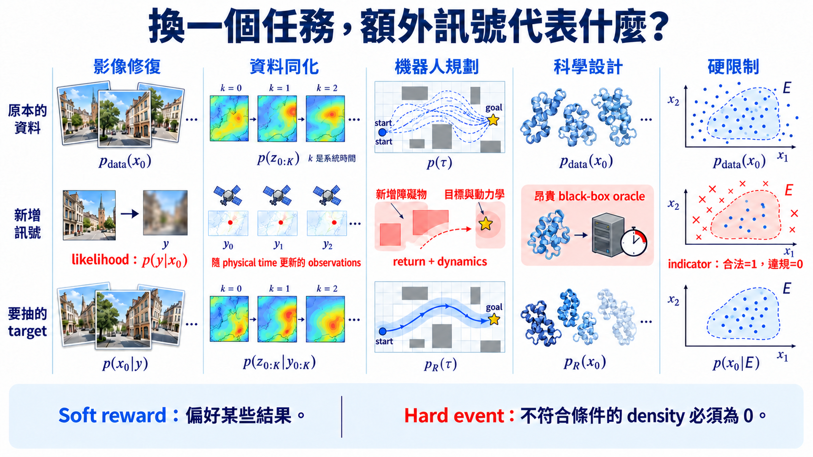

import Objectives from '../../../components/Objectives.astro';
import Prereq from '../../../components/Prereq.astro';
import Ask from '../../../components/Ask.astro';
import Remark from '../../../components/Remark.astro';
import Question from '../../../components/Question.astro';
import Answer from '../../../components/Answer.astro';
import QuizBlock from '../../../components/QuizBlock.astro';
import Option from '../../../components/Option.astro';
import Explanation from '../../../components/Explanation.astro';
import Bridge from '../../../components/Bridge.astro';
import Ref from '../../../components/Ref.astro';

# 當 reward 變成觀測、目標與限制，我們到底在抽什麼？

<Objectives>
- **把 inverse problem 寫成 reward tilting。** 由 observation model 推出 posterior $p(x_0\mid y)\propto p_{\mathrm{data}}(x_0)p(y\mid x_0)$，並辨認 data fidelity term。
- **分清 diffusion time 與系統的 physical time。** 說出 data assimilation 為什麼要處理一串會隨 $k$ 演化的 states，而不只是一張固定的未知圖片。
- **比較 planning、scientific design 與 hard constraints 的 reward 結構。** 判斷 reward 是否可微、是否昂貴、是否只在終點可得，以及 soft tilting 能不能保證 constraint 一定成立。
</Objectives>

<Prereq items={frontmatter.prereqs} />

## 要修復這張照片，怎麼知道生成結果有沒有符合要求？

在 <Ref to="dma-gradient-free-steering"/> 中，只要能替候選打分，即使沒有 gradient，也能重新分配 sampling 的計算。但分數不能隨便定：例如拿到一張模糊照片，我們要的是它可能的清楚版本，不是任何一張好看的圖片。

先回顧 <Ref to="dma-reward-tilting"/> 的目標：

$$
p_R(x_0)\propto p_{\mathrm{data}}(x_0)e^{\lambda R(x_0)}.
$$

Base distribution 保留原本資料的權重，$e^{\lambda R}$ 決定哪些結果要更常出現。因此在每個應用裡，我們得先決定：**一筆資料是什麼？我們已經知道什麼？要用什麼量檢查它符合要求？** 下面從照片修復開始，再看天氣、機器人與科學設計多出了什麼結構。

<Ask>
怎麼把「符合這次任務」寫成能計算的分數， 
又不漏掉原本需要遵守的限制？
</Ask>

## Inverse problem：哪些清楚圖片能產生同一張觀測？

想像清楚影像 $x_0$ 經過模糊或降解析度，只留下我們收到的照片。沿用本單元的約定，把這種由資料產生的 **observation 記成 $y$**，不和文字或類別 condition $c$ 混在一起。若我們知道相機如何把清楚圖片變成觀測，就可以寫

$$
y=A(x_0)+\eta,
\qquad
\eta\sim\mathcal N(0,\sigma_y^2I).
$$

$A$ 是已知的 measurement operator：把候選清楚圖片送進去，得到它應該產生的觀測；$\eta$ 是量測誤差，$\sigma_y$ 表示誤差的標準差。這裡的 $\sigma_y$ 不是 U1 的 diffusion noise schedule。

現在固定我們真的收到的 $y$，問每張候選 $x_0$ 有多相容。Gaussian 誤差假設給出

$$
p(y\mid x_0)=\mathcal N\!\left(y;A(x_0),\sigma_y^2I\right).
$$

它是「假如清楚圖片是 $x_0$，觀測會如何分布」的 density；固定 $y$ 後，把它當成候選 $x_0$ 的評分，稱為 **likelihood**。取 log 後，

$$
\log p(y\mid x_0)
=-\frac{\|y-A(x_0)\|^2}{2\sigma_y^2}+C.
$$

其中 $C$ 不隨候選 $x_0$ 改變。$\|y-A(x_0)\|^2$ 是候選經過量測後和原照片的差距；越小，likelihood 越高，這就是這裡的 **data fidelity**。但只符合觀測還不夠，候選也要像合理的清楚圖片。用 $p_{\mathrm{data}}$ 當 prior，再由 Bayes rule 合起來：

$$
\boxed{
p(x_0\mid y)
\propto
p_{\mathrm{data}}(x_0)
\exp\!\left(-\frac{\|y-A(x_0)\|^2}{2\sigma_y^2}\right)
}.
$$

左邊的 posterior 是**已經知道觀測為 $y$ 後，清楚圖片有哪些可能、各有多合理**。它正是 $\lambda=1$、$R(x_0)=\log p(y\mid x_0)$ 的 reward tilt；量測丟掉資訊越多，相容的清楚圖片就可能越多。

<Remark label="補充" summary="這裡的 data fidelity，和 reward tilting 的要求有什麼不同？">
<Ref to="dma-reward-tilting"/> 用 base log-likelihood 表達「仍要像原本資料」的需求；inverse problem 文獻中的 data fidelity，通常指**候選經過量測後，是否符合收到的 $y$**。因此這裡的 data fidelity 是 observation log-likelihood，而合理資料的 prior 仍由 $p_{\mathrm{data}}$ 提供。

兩者都重要：一張好看的清楚照片可能和觀測不符；一張符合觀測的影像，也未必像合理資料。Posterior 把這兩個要求一起考慮。
</Remark>

生成途中仍只有 noisy $x_t$。Chung 等人的 **Diffusion Posterior Sampling（DPS）** [1] 使用 denoiser 的 $\hat x_0(x_t,t)$ 估計清楚結果，再以量測差距近似額外方向；對上述 Gaussian likelihood，這類方向寫成

$$
g_t(x_t)\approx-\nabla_{x_t}
\frac{\|y-A(\hat x_0(x_t,t))\|^2}{2\sigma_y^2}.
$$

負號表示往量測誤差下降的方向改動 $x_t$，微分會經過固定的 denoiser 與 $A$。這是 <Ref to="dma-reward-tilting"/> 的 plug-in approximation，不是精確 posterior 的保證；若這些計算不可微，也可以用同一個 likelihood 替 particles 算權重。

<Question id="Q1">
既然 observation 已經固定，**找出 data fidelity 最小、又最像資料的那一張重建結果，不就完成了嗎？為什麼還要 sample posterior？**

<Answer>
如果量測丟掉了資訊，同一個 $y$ 可能對應很多合理的 $x_0$。一張低解析度人臉無法決定每一根頭髮；一塊被遮住的影像可能有多種補法。最大化 $\log p_{\mathrm{data}}(x_0)+\log p(y\mid x_0)$ 找到的是最大後驗估計（MAP），也就是 posterior 中最密的點；它沒有呈現其他可能答案。

Posterior sampling 回答的是另一個問題：**哪些答案和 observation 相容，而且各有多可能？** 若真的抽到指定 posterior，多次抽樣的散布才反映這個模型與觀測假設下的 uncertainty：可能結果很接近的部分，較確定；可能結果差很多的部分，則較不確定。

但只看到 samples 都很像，還不能斷言它很確定。近似 guidance 或搜尋不足，也可能只留下同一種答案，漏掉 posterior 的其他可能。

在 data assimilation 與 scientific inference 裡，這種 uncertainty 不是視覺上的多樣性，而會直接影響後續預測與決策。只有任務明確只要一個 point estimate 時，才可以把 sampling 問題改成 optimization；兩者不能用同一個指標互相代替。
</Answer>
</Question>

## Data assimilation：觀測與 hidden state 都隨 physical time 前進

想像我們各自生成了今天與明天的天氣圖：兩張看起來都合理，但今天的風向與溫度，卻不可能按照大氣的運動變成明天那張圖。**每張都像資料，還不等於前後接得起來。**

Data assimilation 要把先前 forecast 與新收到的衛星、測站 observations 合起來，修正對大氣 state 的判斷。它不只修復一張圖，還要考慮 state 怎麼隨物理時間演化。為了不和 diffusion time $t$ 混在一起，這裡用 $k$ 表示 **physical time**：

$$
z_{k+1}=F(z_k)+\xi_k,
\qquad
y_k=H(z_k)+\eta_k.
$$

$z_k$ 是物理時刻 $k$ 的大氣 state，例如各位置的溫度與風速；$F$ 描述它怎麼演化，$H$ 描述測站能看到哪些量。$\xi_k$ 是 dynamics 的不確定性，$\eta_k$ 是量測誤差；$y_k$ 就是在這個時刻收到的 observation。

若 state 只依賴前一個 state，且各時刻的觀測在給定 states 後獨立，一整段的 posterior 可以寫成

$$
\begin{aligned}
p(z_{0:K}\mid y_{0:K})
&\propto p(z_0)\prod_{k=0}^{K-1}p(z_{k+1}\mid z_k)\\
&\qquad\cdot\prod_{k=0}^{K}p(y_k\mid z_k).
\end{aligned}
$$

$z_{0:K}$ 表示整段 states。前兩項是起點與 dynamics 給的 prior，後面的 likelihoods 則逐筆檢查它們和觀測是否相容：**不能只讓每張天氣圖像資料，還要讓前後接得起來。**

<Remark label="補充" summary="整段 states 的 posterior，也能寫成 reward tilt 嗎？">
可以，只是這次的一筆資料是整段 $z_{0:K}$。把 state dynamics 定義的 joint prior 記成 $p_{\mathrm{base}}$，把所有 observation log-likelihoods 加起來作為 reward：

$$
\begin{aligned}
p_{\mathrm{base}}(z_{0:K})
&=p(z_0)\prod_{k=0}^{K-1}p(z_{k+1}\mid z_k),\\
R(z_{0:K})&=\sum_{k=0}^{K}\log p(y_k\mid z_k).
\end{aligned}
$$

取 $\lambda=1$，$e^R$ 就是正文的 likelihood 乘積，因此

$$
p(z_{0:K}\mid y_{0:K})
\propto p_{\mathrm{base}}(z_{0:K})e^{R(z_{0:K})}.
$$

這裡的 base 不只是每個 state 各自的 density，而是前後 states 的 joint distribution；也因此能保留它們之間的 dynamics 關係。
</Remark>

只用截至目前的 observations $y_{0:k}$ 推估 $z_k$，叫 **filtering**；等後面的觀測也到齊，再回頭修正先前 states，叫 **smoothing**。Diffusion model 可以提供合理 states 或整段 trajectories 的 prior，但 $t$ 描述的是生成中的 noise level，**不是天氣真的往前走的 physical time $k$**。

Huang 等人的 DiffDA [2] 把 diffusion model 用在 weather-scale data assimilation。這類問題的重點不只是 observation guidance，還要讓 samples 與 system dynamics 相容；若每個 $k$ 各自重建，可能得到一串每張都合理、接起來卻不符合物理的 states。

## Planning：生成的不是圖片，而是一整段決策

假如機器人已經學會常見的走法，但這次路上多了一個新障礙物，我們需要的不是一張「到得了終點」的圖，而是一整段可以執行、又不碰撞的決策。把機器人的 state 記成 $z_k$、動作記成 $a_k$，一筆生成資料就可以寫成

$$
\tau=(z_0,a_0,z_1,a_1,\ldots,z_K).
$$

這裡 $k$ 仍是物理時間；整條 $\tau$ 才對應前面的一筆乾淨資料 $x_0$。例如想快點到目的地，又不要靠近新障礙物，可以把每個 physical step 的任務回報加總：

$$
R(\tau)=\sum_{k=0}^{K-1}r(z_k,a_k).
$$

$r$ 替一個 state／action 打分，$R$ 評估完整路線；它和 sampling 過程查詢幾次網路是不同的時間尺度。從 demonstration data 學到的 $p_{\mathrm{data}}(\tau)$ 保留常見行為，再以任務分數重新加權：

$$
p_R(\tau)\propto p_{\mathrm{data}}(\tau)e^{\lambda R(\tau)}.
$$

Janner 等人的 **Diffuser** [3] 把 planning 寫成 trajectory 的 diffusion sampling：用 reward guidance 增加任務回報，也可以固定已知的起點或目標 states，只生成其餘部分。這種固定部分資料、補出其他部分的做法稱為 **inpainting**。學到的 prior 能偏向資料裡可執行的行為，但不是對新障礙物或 dynamics 的硬性保證；生成後仍需檢查是否碰撞、是否真的能執行。

若模擬器只能回報整條路線成功／失敗，則連每一步的 $r$ 都沒有。這時可以沿用 <Ref to="dma-gradient-free-steering"/> 的候選比較與 particles；但能否提供途中訊號，取決於我們能否可靠地評估目前候選的可能完成結果。

## Scientific design：評分一次可能就很貴

想像我們想找一個穩定、又能和目標分子結合的蛋白質，但要判斷一個候選好不好，就得跑模擬或做實驗。這時不只生成有成本，**替候選打一次分，也可能很昂貴。**

分子、蛋白質、DNA 與材料設計裡，一筆 $x_0$ 是完整候選結構。Base model 學哪些結構像資料中的可行設計，reward 則回答它是否符合這次目標。提供分數的模擬器或實驗，常稱為 **oracle**；它是評分來源，不必是另一個神經網路。

這裡常同時遇到不可微的分數、昂貴的 evaluation 與多個互相取捨的目標。Uehara 等人 [4] 以 **test-time iterative refinement** 處理 protein 與 DNA design：把目前候選重新加一些 noise，再做 reward-guided denoising，反覆改善結果，而不是每次都從純 noise 重新開始。這是使用分數重新搜尋的方式，不代表任何 oracle 都便宜，或每輪都一定改善。

因此 scientific design 不能只問「哪個方法 reward 最高」。還要記錄用了幾次 oracle evaluations、候選是否滿足基本結構 constraints，以及不同 high-reward modes 有沒有被保留下來。

## Hard constraint 與 rare event：高分還不等於一定成立

例如「路線不能撞到障礙物」，並不是碰撞少一點就好。把所有合法結果組成的集合記成事件 $E$，並假設 base model 命中它的機率大於 $0$，真正要抽的是

$$
p(x_0\mid E)
=\frac{p_{\mathrm{data}}(x_0)\mathbf 1_E(x_0)}{\mathbb P_{p_{\mathrm{data}}}(E)}.
$$

$\mathbf 1_E(x_0)$ 在合法時是 $1$、違規時是 $0$，所以它真的把違規區域的 density 刪掉，再除以命中機率重新 normalization。反過來，如果只設 $R=\mathbf 1_E$ 做有限強度的 tilt，合法者乘 $e^\lambda$，違規者仍乘 $1$，**提高合法比例並不等於保證每次合法。**

雖然 indicator 本身沒有一般可用的 gradient，途中仍可能有另一個可微的量：$h_t^E(x_t)=\mathbb P(x_0\in E\mid x_t)$，也就是目前狀態最後得到合法結果的機率。它和 <Ref to="dma-reward-tilting"/> 的 future weight 扮演相同角色。Guo、Tang 與 Xu [5] 用這種 conditioning function 的 log-gradient 修正 dynamics，並分析估計誤差；理想條件下的 constraint 保證不能直接當成有限步、近似 guidance 的實作保證。

Rare-event simulation 也有相同結構：事件越少見，Best-of-$N$ 越浪費；particles 與 tempering 能把計算逐步集中到事件附近，但要避免早期把尚未顯露的成功 trajectories 淘汰掉。

*圖：不同任務的額外訊號分別是 likelihood、觀測、reward 或 indicator。有限的 soft reward 不會把違規區域的 density 變成 $0$。*

<Remark label="檢查" summary="把應用翻成 steering 時，先回答四個問題">
1. Base distribution 是單一 state、整段 trajectory，還是 source variables？
2. 目標是提高平均 reward、sample posterior，還是讓 hard constraint 以機率一成立？
3. Condition／reward 在 clean sample 才能算，還是在 noisy state 也有可靠訊號？
4. 它能不能微分？一次 evaluation 的成本是多少？

前兩問決定 target distribution，後兩問決定 gradient guidance、particles、search 或專門的 constrained sampler 哪一個比較合適。
</Remark>

## 消化一下

<QuizBlock id="w10-5-a">
Gaussian-noise inverse problem 中，$-\|y-A(x_0)\|^2/(2\sigma_y^2)$ 扮演什麼角色？
<Option>Diffusion noise schedule。</Option>
<Option correct>Observation log-likelihood，也就是 data fidelity reward。</Option>
<Option>Posterior entropy。</Option>
<Explanation>
它衡量候選 $x_0$ 經過 measurement operator 後和 observation 的差距。與 data prior 相乘後才得到 posterior。
</Explanation>
</QuizBlock>

<QuizBlock id="w10-5-b">
Data assimilation 裡的 physical time $k$ 和 diffusion time $t$ 有什麼差別？
<Option>沒有差別，兩者都是天氣往前演化的時間。</Option>
<Option correct>$k$ 描述系統真的如何演化與接收 observations；$t$ 描述 diffusion noise level，生成時從大的 $t$ 往 $0$ 走。</Option>
<Option>$t$ 只能是離散的，$k$ 只能是連續的。</Option>
<Explanation>
一個 physical state trajectory 的每個 $k$，都可能各自需要一段 diffusion／flow sampling。把兩個時間混用會把 model dynamics 與 sampler dynamics 混在一起。
</Explanation>
</QuizBlock>

<QuizBlock id="w10-5-c">
若 reward 是 $R(x_0)=\mathbf 1_E(x_0)$，有限的 $\lambda$ 做 exponential tilting 可以保證每個樣本都在 $E$ 嗎？
<Option>可以，因為 $e^{\lambda}>1$。</Option>
<Option correct>不可以；它只會提高 $E$ 的相對權重，$E^c$ 仍有非零 density。Hard constraint 需要真正 condition on $E$ 或專門的 constrained sampler。</Option>
<Option>可以，但只限 deterministic sampler。</Option>
<Explanation>
Soft reward 與 probability-one constraint 是不同的目標。有限權重不會把違規區域的 mass 自動消成零。
</Explanation>
</QuizBlock>

<Bridge to="dma-lab-guidance">
從照片到機器人，先寫清楚的都是同一件事：我們已經有哪些資訊，要抽出的答案又必須符合什麼要求。Likelihood 保留和觀測相容的答案，reward 提高高分答案的比例，hard constraint 則要真正排除違規結果；成功標準不同，不能只用平均分數比較。

那把這些 sampling 規則放到同一個 base model 上，真的各自改變了什麼？下一篇 <Ref to="dma-lab-guidance"/> 會在 2D 例子中固定模型，記錄生成與評分的計算成本，再觀察符合要求的程度、資料合理性與多樣性如何改變。
</Bridge>

## 參考文獻

1. Chung, H., Kim, J., McCann, M. T., Klasky, M. L., Ye, J. C. [*Diffusion Posterior Sampling for General Noisy Inverse Problems.*](https://arxiv.org/abs/2209.14687) 2022.
2. Huang, L., Gianinazzi, L., Yu, Y., Dueben, P. D., Hoefler, T. [*DiffDA: a Diffusion Model for Weather-scale Data Assimilation.*](https://proceedings.mlr.press/v235/huang24h.html) ICML 2024.
3. Janner, M., Du, Y., Tenenbaum, J., Levine, S. [*Planning with Diffusion for Flexible Behavior Synthesis.*](https://proceedings.mlr.press/v162/janner22a.html) ICML 2022.
4. Uehara, M. et al. [*Reward-Guided Iterative Refinement in Diffusion Models at Test-Time with Applications to Protein and DNA Design.*](https://proceedings.mlr.press/v267/uehara25a.html) ICML 2025.
5. Guo, Z., Tang, W., Xu, R. [*Conditional Diffusion Guidance under Hard Constraint: A Stochastic Analysis Approach.*](https://arxiv.org/abs/2602.05533) 2026.
