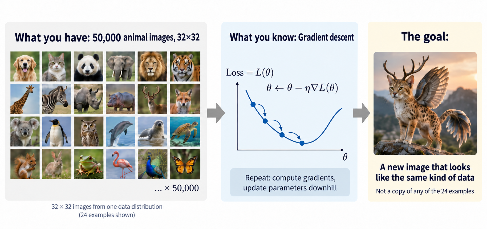
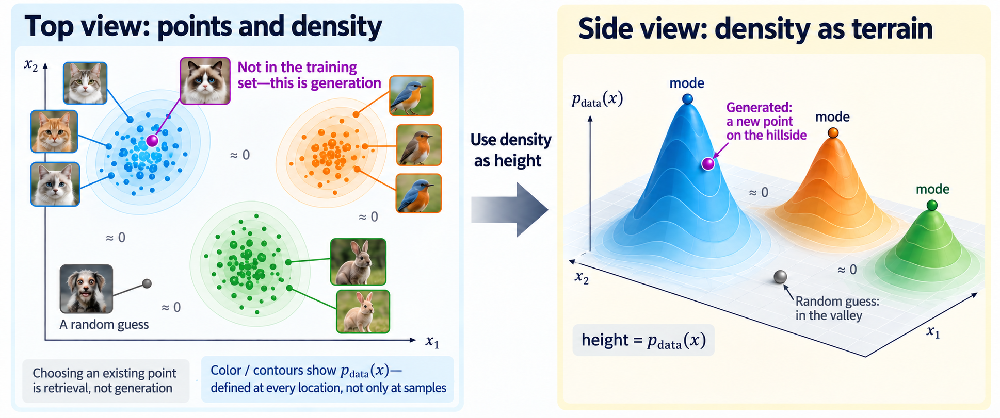

import Objectives from '../../../components/Objectives.astro';
import Prereq from '../../../components/Prereq.astro';
import Question from '../../../components/Question.astro';
import Answer from '../../../components/Answer.astro';
import QuizBlock from '../../../components/QuizBlock.astro';
import Option from '../../../components/Option.astro';
import Explanation from '../../../components/Explanation.astro';
import Bridge from '../../../components/Bridge.astro';
import Ref from '../../../components/Ref.astro';
import Ask from '../../../components/Ask.astro';
import Remark from '../../../components/Remark.astro';

# What Is a Generative Model Learning?

<Objectives title="After reading, you can">
- **State the distribution-level goal.** Generation means learning a distribution close to $p_{\text{data}}$ and drawing new samples from it.
- **Explain the difficulty of learning density directly.** Derive an energy-based model from positivity and normalization, and identify the model-sampling term in its likelihood gradient.
- **Explain why we construct intermediate states.** Independent-pair regression learns a mean; normalizing flows pay for exact likelihood with invertibility and tractable log-determinants. A forward process instead constructs noisy states and training pairs.
</Objectives>

<Prereq items={frontmatter.prereqs} />

## A request that sounds simple

We have 50,000 `32×32` images. We already know a familiar recipe from machine learning: define a loss and reduce it with gradient descent. Now someone asks for something different: can these tools produce an image the model has never seen, yet looks as though it belongs to the same dataset?

**Figure: the problem we face.** We have samples and know how to optimize a loss. What we want at the end is a new, plausible sample.

We will turn this intuitive request into a mathematical problem that we can implement. First we need to ask:

<Ask>
What does it mean to generate an image? 
And what does it mean to look as though it came from the same dataset?
</Ask>

## Generating an image from the same source

A `32×32` RGB image contains $32\times32\times3=3072$ numbers. Treat each number as a coordinate: an image is **one point** in $\mathbb R^{3072}$.

<Remark label="Supplement" summary="What is a point in 3072 dimensions?">
A vector containing 3072 numbers. In the more familiar $\mathbb R^3$, a point is three numbers, such as $(1,2,-0.5)$. We simply replace three coordinates with 3072.
</Remark>

Every possible image corresponds to a point in this space. Real images are not spread uniformly through it: some are common, others rare, and many points represent noise or implausible images.

A **distribution** describes which regions are more or less likely to contain data. We call this real but unknown distribution $p_{\text{data}}$.

In a continuous model, $p_{\text{data}}(x)$ is a **probability density**: how densely data occurs near $x$, rather than the probability of exactly $x$. Higher density means nearby images are more common when we sample from this source.

<Remark label="Supplement" summary="Why density rather than probability?">
For a continuous density, a single point has probability zero, and a density value may exceed one. Multiplying by a small volume gives $p_{\text{data}}(x)\,\mathrm dx$, approximately the probability of landing in that small region. Integrating over the whole space gives one.
</Remark>

Thus $p_{\text{data}}$ is a **function over the entire space**. If density were height, common regions would form hills and rare regions valleys. A local density peak is a **mode**.

Our 50,000 images are not the distribution itself; they are **samples** from it, or observed points in $\mathbb R^{3072}$. They usually reveal some structure: many samples in some regions, few in others, and none in large parts of the space.

**Figure: from samples to a distribution.** The left panel shows similar images clustered together. Density has a value **at every location**, including locations without an observed sample. The right panel uses density as height, with modes at the peaks. This low-dimensional picture illustrates data that actually lives in $\mathbb R^{3072}$.

We can now explain generation and resemblance together.

**Generation** means drawing a new point from $p_{\text{data}}$. Selecting one of the existing images would be retrieval; we want a previously unseen sample.

Why should it resemble the dataset? **It comes from the same distribution.** High-density regions are sampled more often, so most samples fall in plausible regions.

There is no rule that forbids a sample from entering a low-density region. It is simply less likely to do so.

More precisely, resembling the original data means:

> **The new point also looks like a draw from the same $p_{\text{data}}$.**

Here is the difficulty: **we cannot observe the distribution that generates the data.** We see 50,000 points, but want to learn the landscape behind them.

## Could a neural network represent the density directly?

A natural approach is to represent $p_\theta(x)$ with a network, fit it to $p_{\text{data}}$, and then sample from it.

Before choosing a loss, its output must be a **valid density**, satisfying both:

- **Nonnegativity:** $p_\theta(x)\geq0$ everywhere.
- **Normalization:** $\int p_\theta(x)\,dx=1$.

An ordinary network can output any real number, so neither condition holds automatically. We need to enforce each mathematically.

Let the network output $E_\theta(x)$ and exponentiate its negative:

$$
\tilde p_\theta(x)=e^{-E_\theta(x)}>0.
$$

This enforces positivity. Lower energy gives higher unnormalized density, but the total need not be one. Compute the total $Z_\theta$ and divide by it:

$$
Z_\theta=\int \tilde p_\theta(x)\,dx,
\qquad
p_\theta(x)=\frac{\tilde p_\theta(x)}{Z_\theta}.
$$

Provided $Z_\theta$ is finite, this enforces normalization. **A model that assigns energies and converts them into a distribution this way is an energy-based model** [1].

<Remark label="Supplement" summary="Why call it energy?">
The name comes from statistical physics, where the probability of a state often takes the form

$$
p(x)\propto e^{-E(x)}.
$$

Lower $E(x)$ makes $e^{-E(x)}$ larger and the state more likely. An energy-based model uses the same mathematical form, assigning lower energy to states it considers more plausible.

This need not be physical energy. It is a numerical measure of compatibility with the data; exponentiation and normalization still turn it into a density.
</Remark>

With a density in hand, we can maximize likelihood, assigning higher density where data occurs. Expanding the negative log-likelihood gives

$$
\mathcal L_{\text{density}}(\theta)
=-\mathbb E_{x\sim p_{\text{data}}}\log p_\theta(x)
=\mathbb E_{x\sim p_{\text{data}}}E_\theta(x)+\log Z_\theta .
$$

The first term lowers energy near training data. The second is difficult: $Z_\theta$ integrates over the full 3072-dimensional space and cannot be computed from our images alone.

Training actually needs the gradient rather than the value of $Z_\theta$. Differentiating gives

$$
\nabla_\theta\mathcal L_{\text{density}}
=
\mathbb E_{x\sim p_{\text{data}}}\!\left[\nabla_\theta E_\theta(x)\right]
-
\mathbb E_{x'\sim p_\theta}\!\left[\nabla_\theta E_\theta(x')\right].
$$

We can estimate the first expectation using training data. The second averages over **the model's own distribution**, requiring draws $x'$ from the current $p_\theta$. We wanted to train a distribution we could sample from, yet its training gradient already requires model samples.

An expression that we can write but cannot compute directly is often called **intractable**. Energy-based models can be trained with approximate sampling; the issue is that direct density learning couples normalization to sampling.

## Could we learn a function that produces samples instead?

Do we already know a distribution we can sample from? Yes: the standard Gaussian $\mathcal N(0,I)$.

<Remark label="Notation" summary="Why is Gaussian sampling easy?">
$\mathcal N(0,I)$ is the standard Gaussian on $\mathbb R^d$. Established algorithms directly generate Gaussian random numbers, without training another model or taking many iterative steps through the space.

In $d$ dimensions, the coordinates are independent:

$$
z_i\overset{\text{iid}}{\sim}\mathcal N(0,1),\qquad
p_z(z)=(2\pi)^{-d/2}\exp\!\Big(-\tfrac{1}{2}\|z\|^2\Big).
$$

A $d$-dimensional draw is just $d$ independent one-dimensional draws. This is what `torch.randn(d)` does.
</Remark>

Gaussian samples are readily available raw material. We want images from $p_{\text{data}}$, so the question becomes:

> **Can a processing machine turn Gaussian raw material into the data we want?**

Write this machine as a function $G$: draw $z\sim\mathcal N(0,I)$ and compute $x=G(z)$. If the outputs collectively follow $p_{\text{data}}$, we have solved the generation problem:

$$
z\sim\mathcal N(0,I)\quad\Longrightarrow\quad G(z)\sim p_{\text{data}}.
$$

Generation now means **draw $z$, then transform it with $G$**. The resulting transformation of a distribution is its **pushforward**. A function $G$ that sends one distribution to another is a **transport map**.

<Remark label="Definition" summary="Pushforward">
For a distribution $p_z$ and measurable function $G$, the distribution of transformed samples is $G_\#p_z$. For any measurable set $A$,

$$
\big(G_\#p_z\big)(A)\;=\;p_z\big(G^{-1}(A)\big),
$$

The chance that $G(z)$ lands in $A$ equals the chance that $z$ lies in its preimage. Equivalently, for an integrable function $f$,

$$
\mathbb E_{x\sim G_\#p_z}\big[f(x)\big]=\mathbb E_{z\sim p_z}\big[f(G(z))\big].
$$

Our goal is therefore **find $G$ such that $G_\#\mathcal N(0,I)=p_{\text{data}}$**.
</Remark>

**How do we learn $G$?** We have real samples and generated samples; we need a loss differentiable with respect to $\theta$.

<Question label="Discussion" id="Q1">
Why not use ordinary prediction? Draw $z$, compute $G(z)$, and compare it with a training image using $L_2$:

$$
\mathcal L(\theta)=\mathbb E_{z,\,x}\big\|G_\theta(z)-x\big\|^2 .
$$

**What happens if we train this way?**

<Answer summary="Show the reasoning">
$L_2$ requires **pairs**, but nobody has told us which noise should produce which image. Here $z$ and $x$ are sampled independently.

We can calculate the optimum. Fix $z$; independence gives

$$
\arg\min_v\mathbb E_x\|v-x\|^2=\mathbb E[x]
\quad\Longrightarrow\quad
G_\theta(z)\equiv\mathbb E_{x\sim p_{\text{data}}}[x]\quad\text{for all }z.
$$

**Every input produces the same mean training image**: a blurry, gray result with low $L_2$ but no diversity. This is regression to the mean when a prediction has multiple possible targets.

The loss asks the wrong question. We need the **distribution** of $G(z)$ to match $p_{\text{data}}$, while independent-pair $L_2$ asks whether a particular output matches a particular image. Two sets can follow the same distribution without independently drawn pairs being close. This objective therefore learns the mean.

There are two natural directions:

- Use a **distribution-level objective** to compare the generated and real distributions.
- **Construct the pairing ourselves.** If a noise input has an assigned endpoint, perhaps even a whole path, samplewise regression can make sense again.

Let us examine the first direction before returning to constructed pairs.
</Answer>
</Question>

## If $G_\theta$ is invertible, can we recover its density?

We need a distribution-level objective. Since $G_\theta$ produces samples, perhaps we can calculate their density and train by likelihood.

Knowing how to compute $G_\theta(z)$ does not tell us the density at $x$. We need to recover its source $z$ and account for local stretching or compression of space.

If $G_\theta$ is **invertible and sufficiently smooth**, the inverse recovers $z$ and the Jacobian determinant measures volume change. Change of variables gives

$$
\log p_\theta(x)=\log p_z\!\big(G_\theta^{-1}(x)\big)+\log\Big|\det\frac{\partial G_\theta^{-1}}{\partial x}(x)\Big| .
$$

The first term evaluates the Gaussian density at the recovered source. The second corrects for local volume change. **Models that compose invertible transformations to turn simple distributions into complex ones are normalizing flows** [2, 3].

If the inverse and log-determinant are tractable, we can evaluate $p_\theta(x)$ and train by maximum likelihood:

$$
\min_\theta\ \mathcal L(\theta)=-\,\mathbb E_{x\sim p_{\text{data}}}\big[\log p_\theta(x)\big].
$$

<Remark label="Supplement" summary="Why does maximum likelihood help?">
Think of $p_\theta$ as distributing a fixed supply of betting chips over the data space. The fixed total corresponds to

$$
\int p_\theta(x)\,dx=1 .
$$

It can put more chips in some regions and fewer in others.

For each observed image $x^{(i)}$, we ask how much density it assigned there. Its contribution to log-likelihood is $\log p_\theta(x^{(i)})$.

Normalization prevents assigning high density everywhere. Mass wasted in regions without data leaves less for data-rich regions. Improving likelihood therefore encourages the model to place mass where data occurs.

For $N$ independent samples,

$$
\frac1N\sum_{i=1}^N \log p_\theta\big(x^{(i)}\big)\;\approx\;\mathbb E_{x\sim p_{\text{data}}}\big[\log p_\theta(x)\big],
$$

Maximum likelihood maximizes average log density at the observations.

It is a distribution-level objective because

$$
\mathrm{KL}\big(p_{\text{data}}\,\|\,p_\theta\big)=\mathbb E_{p_{\text{data}}}\big[\log p_{\text{data}}(x)\big]-\mathbb E_{p_{\text{data}}}\big[\log p_\theta(x)\big],
$$

The first term is independent of $\theta$. Maximizing likelihood therefore minimizes $\mathrm{KL}(p_{\text{data}}\|p_\theta)$, which is zero exactly when the distributions agree; see <Ref to="math-kl"/>.
</Remark>

This supplies a distribution-level loss, but every training image requires an inverse and a Jacobian determinant. An arbitrary network has no cheap inverse, and a generic $d\times d$ determinant costs $O(d^3)$, expensive at $d=3072$.

Normalizing flows consequently restrict their layer structures to make both calculations tractable. Their exchange for exact likelihood is:

> **The transformation must be invertible, with a tractable Jacobian determinant.**

## The same destination can be reached in many ways

Many different maps can produce the same final distribution:

$$
G_\#p_z=p_{\text{data}} .
$$

Imagine moving boxes between warehouses. Success means the correct final number of boxes at every location. It does not specify which box goes where or which route it follows.

Transport is therefore **underdetermined**. Likelihood evaluates the final distribution without selecting a unique pairing or path; normalizing flows restrict the map to calculate that likelihood.

<iframe loading="lazy" src="/personal_website/notes/research_areas/diffusion-models-applications/w3-0-many-maps.en.html" class="demo-frame" title="Different transport maps with the same endpoint distribution" style="height: 880px; width: 100%; border: none;"></iframe>

**Interactive demo: the same endpoints, different transport.** Change the pairing. The Gaussian at $t=0$ and target distribution at $t=1$ stay fixed; pointwise assignments and intermediate paths change.

## Could we construct the missing pairs ourselves?

Each approach has a difficulty: direct density learning requires normalization, independent-pair regression learns a mean, and exact flow likelihood restricts the transformation.

But $L_2$ itself was not the problem; arbitrary pairing was. **Regression may become useful if we construct meaningful training pairs.**

Instead of guessing which image a Gaussian input should become, reverse the direction. Training provides clean data $x_0$. A rule that gradually adds noise constructs $x_1,\ldots,x_T$ ourselves.

This resembles recording a video of boxes being scattered. We know how each frame was created. Learning to reverse it can begin with a local question: **given this frame, how should we move toward the preceding one?**

This noise-adding rule is the **forward process**. It does not automatically solve the reverse direction, but supplies noisy states we can sample and separates generation into learning problems at different noise levels.

> **Diffusion begins by designing a forward process that constructs training pairs from data.**

How should we add noise so that any $x_t$ is easy to generate and $x_T$ approaches a familiar distribution we can sample?

## Check your understanding

<QuizBlock id="w3-0-a">
What is the optimum of $\mathbb E_{z,x}\|G_\theta(z)-x\|^2$ when $z$ and $x$ are independent?
<Option correct>The data mean for every $z$.</Option>
<Option>A correct transport map to the data distribution.</Option>
<Option>Memorization of a few training images.</Option>
<Explanation>For fixed $z$, the optimum is $\mathbb E[x]$. The issue is the objective and independent pairing, rather than model capacity or overfitting.</Explanation>
</QuizBlock>

<QuizBlock id="w3-0-b">
Why do normalizing flows require invertibility and tractable Jacobian determinants?
<Option>To make sampling possible.</Option>
<Option>To make the transport map unique.</Option>
<Option correct>To compute exact likelihood through change of variables.</Option>
<Explanation>Sampling only needs $G(z)$. The inverse and determinant are needed to evaluate density, and do not make the map unique.</Explanation>
</QuizBlock>

<QuizBlock id="w3-0-c">
Which term makes the energy-based likelihood gradient difficult?
<Option>The data expectation, because training data is unavailable.</Option>
<Option correct>The model expectation, because estimating it requires samples from the current model.</Option>
<Option>The requirement that energy must be positive.</Option>
<Explanation>Training data estimates the first term. Energy may have either sign; its exponential is positive. The difficult term averages over $p_\theta$.</Explanation>
</QuizBlock>

<QuizBlock id="w3-0-d">
Why construct a noise-adding forward process?
<Option>Data has no underlying distribution.</Option>
<Option correct>It constructs noisy training inputs and turns generation into local learning tasks.</Option>
<Option>It automatically supplies an exact reverse process.</Option>
<Explanation>We control the noisy-state construction, but must still learn the reverse direction.</Explanation>
</QuizBlock>

<Bridge to="dma-forward-process">
Generation asks for new draws from a distribution close to $p_{\text{data}}$. Direct density learning needs model samples in its gradient; independent-pair regression learns the mean; normalizing flows obtain exact likelihood by restricting transformations.

These difficulties suggest constructing our own intermediate states and training pairs from real data.

DDPM starts with data and gradually adds Gaussian noise. Next we design this forward process and check whether arbitrary intermediate states are easy to sample and the endpoint approaches a Gaussian.
</Bridge>

## References

1. LeCun, Y., Chopra, S., Hadsell, R., Ranzato, M., Huang, F. [*A Tutorial on Energy-Based Learning.*](http://yann.lecun.com/exdb/publis/pdf/lecun-06.pdf) 2006.
2. Papamakarios, G., Nalisnick, E., Rezende, D. J., Mohamed, S., Lakshminarayanan, B. [*Normalizing Flows for Probabilistic Modeling and Inference.*](https://arxiv.org/abs/1912.02762) JMLR 2021.
3. Rezende, D. J., Mohamed, S. [*Variational Inference with Normalizing Flows.*](https://arxiv.org/abs/1505.05770) ICML 2015.
