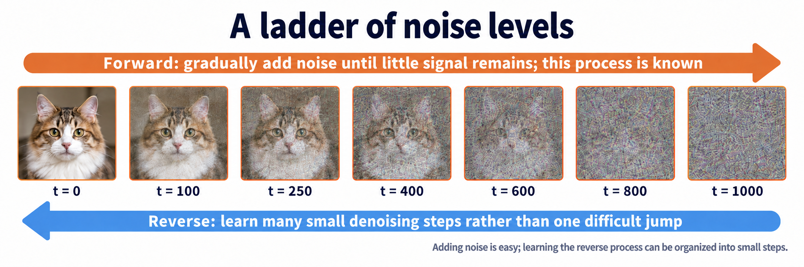

import Objectives from '../../../components/Objectives.astro';
import Prereq from '../../../components/Prereq.astro';
import Ask from '../../../components/Ask.astro';
import Remark from '../../../components/Remark.astro';
import Question from '../../../components/Question.astro';
import Answer from '../../../components/Answer.astro';
import QuizBlock from '../../../components/QuizBlock.astro';
import Option from '../../../components/Option.astro';
import Explanation from '../../../components/Explanation.astro';
import Bridge from '../../../components/Bridge.astro';
import Ref from '../../../components/Ref.astro';

# Choosing a Path: The Forward Process

<Objectives title="After reading, you can">
- **Explain the forward-process design.** The Markov property makes each step depend only on the present; linear Gaussian transitions make conditional distributions tractable; variance preservation and the schedule control how noise replaces signal.
- **Sample any $x_t$ directly.** Use Gaussian closure to derive $q(x_t\mid x_0)$ and distinguish the accumulated noise $\epsilon$ from a single-step noise $\epsilon_t$.
</Objectives>

<Prereq items={frontmatter.prereqs} />

## We know how to move in one direction

The previous note suggested choosing a path before designing regression targets. How should we choose it?

A path from pure noise to an image is still difficult: we do not know what the noise should become in the next step.

What about the opposite direction? Start with a real image and add a small Gaussian perturbation. Repeat until little image structure remains. **Data to noise is a direction we know how to construct.**

Think of shuffling an ordered deck. Repeated small shuffles make it random; restoring an arbitrary random deck in one move is hard. Undoing a small amount of disorder sounds more manageable.

Diffusion uses this familiar direction to construct many small corruption steps and learn how to reverse them. A difficult generation task becomes a sequence of denoising problems.

**Figure: a ladder of noise levels.** Moving right only requires Gaussian draws, scaling, and addition. We want to learn the steps going left.

Let us describe this construction mathematically.

$x_0$ is a real image sampled from $p_{\text{data}}$. The state after $t$ corruption steps is $x_t$, where $t$ is also called time. The endpoint $x_T$ should be nearly pure noise.

The path from $x_0$ to $x_T$ is the **forward process**. We design it ourselves, so we can choose a convenient construction.

We want to answer these questions:

<Ask>
Does the endpoint really approach pure noise? 
What is the distribution of $x_t$ given $x_0$? 
What do we need to reverse a step, and how do we do it?
</Ask>

This note answers the first two. The required reverse-step information appears in <Ref to="dma-denoising-regression"/> and <Ref to="dma-tweedie-and-score"/>; sampling is developed in <Ref to="dma-reverse-process"/>.

## What should the forward process accomplish?

Repeated small noise additions give us a direction. To turn it into a usable method, we should work backward from what we need.

First, the endpoint must have a distribution we can sample, here $\mathcal N(0,I)$. Reverse generation needs a starting state. An inaccessible terminal distribution would prevent us from even beginning.

Second, we want to calculate the distribution at any time $t$, preferably without simulating all preceding steps. A Gaussian closed form for $q(x_t\mid x_0)$ would be particularly convenient.

Here $q$ denotes the probability law induced by our forward construction. The conditional density $q(x_t\mid x_0)$ describes where the process lies after $t$ steps when the clean starting image $x_0$ is known.

The endpoint is simply the special case $t=T$, so a general formula would answer both requirements.

Imagine traveling from Taipei to Pingtung by either the west or east coast. The start is $x_0$ and intermediate stops are $x_t$. A one-step transition describes the next stop; $q(x_t\mid x_0)$ describes the location after $t$ legs, regardless of the intermediate route.

Ignoring the route means integrating over every possible intermediate state:

$$
q(x_t\mid x_0)=\int q(x_1,\dots,x_t\mid x_0)\;\mathrm dx_1\cdots\mathrm dx_{t-1}.
$$

The joint density describes a particular sequence of intermediate states given $x_0$. Integration sums their contributions while keeping only the final state.

Can we deliberately design the process so this integration is easy?

## First design: let the next step depend only on the present

Require each transition to depend only on the preceding state:

$$
q(x_t\mid x_{t-1},x_{t-2},\dots,x_0)=q(x_t\mid x_{t-1}).
$$

This makes the process a **Markov chain**. We impose this property by constructing $x_t$ from $x_{t-1}$ and a fresh noise $\epsilon_t$ independent of the past.

<Remark label="Supplement" summary="The Markov property">
A stochastic process

$$
x_0\rightarrow x_1\rightarrow x_2\rightarrow\cdots\rightarrow x_T
$$

is a Markov chain if knowing the present is sufficient to predict the next state. Once $x_{t-1}$ is known, earlier states provide no additional predictive information about $x_t$.

This resembles an admissions rule that uses only a final exam score, regardless of how the student's scores developed over previous years.

The past still matters: its relevant effects are already encoded in the present state. In our forward process, $x_{t-1}$ already contains the accumulated earlier noise.

Mathematically,

$$
q(x_t\mid x_{t-1},x_{t-2},\dots,x_0)=q(x_t\mid x_{t-1}).
$$

See <Ref to="math-markov-chain"/> for transition matrices and long-term behavior.
</Remark>

The Markov property factors the density of an entire route into transitions:

$$
q(x_1,\dots,x_t\mid x_0)=\prod_{s=1}^{t}q(x_s\mid x_{s-1}).
$$

The density of a specified journey is the product of its leg-by-leg transition densities. Each factor only needs the previous stop.

But this solves only part of the difficulty.

> **Factoring a route does not make its integral tractable.**

We also need simple transition forms whose composition leaves a closed-form $q(x_t\mid x_0)$.

## Second design: linear Gaussian transitions

A linear transformation of a Gaussian plus independent Gaussian noise is still Gaussian. Choose small $\beta_1,\ldots,\beta_T\in(0,1)$ and define

$$
q(x_t\mid x_{t-1})=\mathcal N\!\big(\sqrt{1-\beta_t}\,x_{t-1},\ \beta_t I\big),
$$

The two arguments of $\mathcal N$ are the mean and covariance. The mean slightly shrinks $x_{t-1}$; the covariance sets the added spread. Equivalently, sample by

$$
x_t=\sqrt{1-\beta_t}\,x_{t-1}+\sqrt{\beta_t}\,\epsilon_t,\qquad \epsilon_t\sim\mathcal N(0,I).
$$

**Shrink the previous state slightly, then add fresh Gaussian noise.** The parameter $\beta_t$ controls the new noise at step $t$.

The noise-and-reverse idea dates to Sohl-Dickstein and colleagues [1]. These Gaussian transitions with scaling $\sqrt{1-\beta_t}$ are the forward process of Ho, Jain, and Abbeel's **DDPM** [2], our default construction.

The coefficients also encode two design choices.

**Why shrink by $\sqrt{1-\beta_t}$?** Adding noise without shrinking makes variance accumulate. Such processes are called variance-exploding (VE) [4] and appear in <Ref week="dma-week-consistency"/>. Here, if $\operatorname{Var}(x_{t-1})=I$,

$$
\operatorname{Var}(x_t)=(1-\beta_t)\,I+\beta_t I=I .
$$

The removed signal variance is replaced by noise variance, leaving the total unchanged. This is **variance-preserving (VP)**. It keeps input scales controlled and allows a terminal distribution close to $\mathcal N(0,I)$.

**Why choose small $\beta_t$?** Small forward changes make the local reverse task easier. We divide the task into many simpler steps.

<Remark label="Notation" summary="Signal retention, accumulated noise, and SNR">
We will repeatedly use these quantities:

- $\alpha_t=1-\beta_t$: one-step signal variance retention.
- $\bar\alpha_t=\prod_{s=1}^t\alpha_s$: cumulative retention, decreasing from one toward zero.
- $\sigma_t^2=1-\bar\alpha_t$: cumulative noise variance, with $\bar\alpha_t+\sigma_t^2=1$.
- $\mathrm{SNR}(t)=\bar\alpha_t/(1-\bar\alpha_t)$: signal-to-noise ratio, decreasing as noise increases.

The dependence of $\beta_t$ on time is the **schedule**. DDPM [2] uses a linear schedule; Nichol and Dhariwal [3] propose a cosine schedule. It determines how quickly signal is replaced along the path.
</Remark>

Repeated substitution constructs the full path:

$$
\begin{aligned}
x_1&=\sqrt{\alpha_1}\,x_0+\sqrt{1-\alpha_1}\,\epsilon_1,\\
x_2&=\sqrt{\alpha_2}\,x_1+\sqrt{1-\alpha_2}\,\epsilon_2,\\
&\ \ \vdots\\
x_t&=\sqrt{\alpha_t}\,x_{t-1}+\sqrt{1-\alpha_t}\,\epsilon_t .
\end{aligned}
$$

Every line depends on the previous one and draws fresh noise. Following this definition literally takes $t$ transitions to obtain $x_t$.

## Must we really run $t$ transitions?

<Question label="Discussion" id="Q1">
Training needs many $(x_0,x_t)$ pairs, possibly with $t=800$. Running 800 transitions for every example would be expensive.

**Can we jump directly to $x_t$?**

<Answer summary="Show the reasoning">
Yes. **Independent Gaussians add to a Gaussian, and their covariances add**; see <Ref to="math-gaussian"/>.

Substitute the expression for $x_{t-1}$ into the transition:

$$
\begin{aligned}
x_t&=\sqrt{\alpha_t\alpha_{t-1}}x_{t-2}\\
&\quad+\underbrace{\sqrt{\alpha_t(1-\alpha_{t-1})}\epsilon_{t-1}+\sqrt{1-\alpha_t}\epsilon_t}_{\text{independent Gaussian terms}}.
\end{aligned}
$$

The last two terms combine into a Gaussian with variance

$$
\alpha_t(1-\alpha_{t-1})+(1-\alpha_t)=1-\alpha_t\alpha_{t-1},
$$

Again, the squared coefficients sum to one. Induction gives the direct-sampling formula:

$$
\boxed{\;q(x_t\mid x_0)=\mathcal N\!\big(\sqrt{\bar\alpha_t}\,x_0,\ (1-\bar\alpha_t)I\big),
\qquad x_t=\sqrt{\bar\alpha_t}\,x_0+\sigma_t\,\epsilon,\quad \sigma_t^2=1-\bar\alpha_t .\;}
$$

A training sample now requires **drawing $t$, drawing $\epsilon\sim\mathcal N(0,I)$, and applying the formula**, rather than simulating 800 transitions.

At every time, $x_t$ is shrunken data plus Gaussian noise, with squared coefficients summing to one.

We can also view this as interpolation with coefficients $(\sqrt{\bar\alpha_t},\sqrt{1-\bar\alpha_t})$. Their squared-sum constraint comes from VP, rather than interpolation in general. <Ref to="dma-fm-vs-diffusion"/> uses linear coefficients, and <Ref to="dma-unified-equation"/> considers a general form.

Here $\epsilon$ is **the combined, rescaled noise from the first $t$ steps**, independent of $x_0$. It is not the individual noise $\epsilon_t$ added at step $t$. The training objective will use this accumulated noise.
</Answer>
</Question>

The two design choices work together: the Markov property factors the path into transitions, and linear Gaussian transitions make their composition tractable. Consequently we can sample $x_t=\sqrt{\bar\alpha_t}x_0+\sigma_t\epsilon$ directly.

At $t=T$, the conditional mean is $\sqrt{\bar\alpha_T}x_0$ and covariance is $(1-\bar\alpha_T)I$. If the schedule makes $\bar\alpha_T$ sufficiently small, the data contribution becomes negligible and the endpoint approaches a standard Gaussian.

<Remark label="Supplement" summary="Is the terminal distribution exactly standard Gaussian?">
Generally it is only close. A small nonzero $\bar\alpha_T$ leaves a residual contribution from $x_0$.

Generation starts from an exact $\mathcal N(0,I)$, accepting this difference as **prior mismatch**. DDPM's $\bar\alpha_T\approx4\times10^{-5}$ makes it small, but not zero; this is one reason the schedule must remove enough signal.
</Remark>

## What does this path look like?

<iframe loading="lazy" src="/personal_website/notes/research_areas/diffusion-models-applications/w3-1-forward.en.html" class="demo-frame" title="Explore the forward-process noise schedule" style="height: 1060px; width: 100%; border: none;"></iframe>

**Interactive demo.** Move $t$ to inspect $x_t$, retained signal, accumulated noise, and SNR. Structure fades toward noise. Switch schedules to compare the intermediate timing: the linear schedule removes structure early, while cosine retains more of the intermediate regime. Their terminal laws are approximately Gaussian, rather than necessarily identical at finite $T$.

## Check your understanding

<QuizBlock id="w3-1-a">
If $\operatorname{Var}(x_0)=I$, what is the VP variance at time $t$?
<Option>$\bar\alpha_t I$</Option>
<Option correct>$I$</Option>
<Option>$(1-\bar\alpha_t)I$</Option>
<Option>$tI$</Option>
<Explanation>The covariance is $\bar\alpha_t I+(1-\bar\alpha_t)I=I$.</Explanation>
</QuizBlock>

<QuizBlock id="w3-1-b">
What does $\epsilon$ in the direct-sampling formula represent?
<Option>The last single-step noise $\epsilon_t$.</Option>
<Option>A variable with variance $\sigma_t^2I$.</Option>
<Option correct>The accumulated noise, rescaled to a standard Gaussian independent of $x_0$.</Option>
<Explanation>The coefficient $\sigma_t$ sits outside the standard Gaussian. The variable combines all earlier independent noises.</Explanation>
</QuizBlock>

<QuizBlock id="w3-1-c">
What happens if all $\beta_t$ increase tenfold while remaining in $(0,1)$ and $T$ stays fixed?
<Option correct>The endpoint is closer to standard Gaussian, but individual reverse steps become harder.</Option>
<Option>The endpoint moves farther from standard Gaussian.</Option>
<Option>The conditional law stops being Gaussian.</Option>
<Explanation>Cumulative signal retention decreases faster, reducing prior mismatch while increasing individual corruption steps.</Explanation>
</QuizBlock>

<Bridge to="dma-denoising-regression">
The forward process now supplies $(x_0,x_t,\epsilon,t)$ training tuples directly.

Generation needs the reverse direction: given $x_t$, where should we sample $x_{t-1}$? The true reverse conditional depends on the unknown data distribution.

Next we exploit the extra $x_0$ known during training, derive $q(x_{t-1}\mid x_t,x_0)$, and turn it into a regression objective for the learned reverse transition.
</Bridge>

## References

1. Sohl-Dickstein, J., Weiss, E. A., Maheswaranathan, N., Ganguli, S. [*Deep Unsupervised Learning using Nonequilibrium Thermodynamics.*](https://arxiv.org/abs/1503.03585) ICML 2015.
2. Ho, J., Jain, A., Abbeel, P. [*Denoising Diffusion Probabilistic Models.*](https://arxiv.org/abs/2006.11239) NeurIPS 2020. VP forward process and linear schedule.
3. Nichol, A., Dhariwal, P. [*Improved Denoising Diffusion Probabilistic Models.*](https://arxiv.org/abs/2102.09672) ICML 2021. Cosine schedule.
4. Song, Y., et al. [*Score-Based Generative Modeling through Stochastic Differential Equations.*](https://arxiv.org/abs/2011.13456) ICLR 2021. VP and VE formulations.
