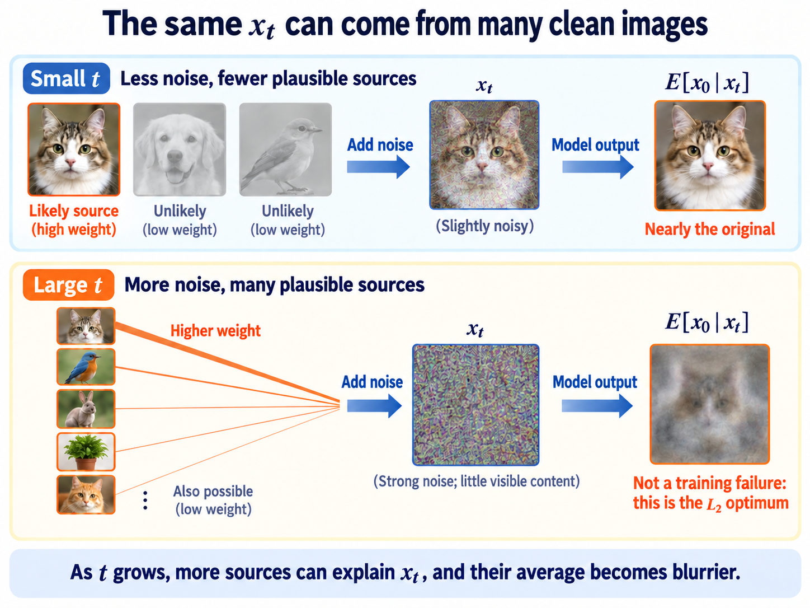

import Objectives from '../../../components/Objectives.astro';
import Prereq from '../../../components/Prereq.astro';
import Ask from '../../../components/Ask.astro';
import Remark from '../../../components/Remark.astro';
import Try from '../../../components/Try.astro';
import Question from '../../../components/Question.astro';
import Answer from '../../../components/Answer.astro';
import QuizBlock from '../../../components/QuizBlock.astro';
import Option from '../../../components/Option.astro';
import Explanation from '../../../components/Explanation.astro';
import Bridge from '../../../components/Bridge.astro';
import Ref from '../../../components/Ref.astro';

# Denoising: How Do We Learn a Reverse Step?

<Objectives title="After reading, you can">
- **Turn a reverse step into regression.** Conditioning the target on the clean training example changes the KL objective only by a parameter-independent constant. A fixed-variance Gaussian model then reduces it to weighted MSE.
- **Use the trained model to generate.** Convert data, noise, or $v$ predictions into a reverse mean, while distinguishing equivalent representations from different training weights.
</Objectives>

<Prereq items={frontmatter.prereqs} />

## How can we sample a reverse step?

We can move forward and sample any $x_t$ directly from $x_0$. Now, given $x_t$, we want a draw from $q(x_{t-1}\mid x_t)$.

<Remark label="Review" summary="Why a distribution rather than one answer?">
The reverse conditional describes the density of possible previous states given the present $x_t$.

On our trip to Pingtung, the preceding stop could have been Kaohsiung on the west coast or Taitung on the east coast. A conditional distribution assigns probabilities to both possibilities.

Corruption loses information: many preceding states can lead to the same present state. A distribution represents that uncertainty. How we later use this information, through stochastic or deterministic generation, is developed in <Ref to="dma-reverse-process"/>.
</Remark>

The forward Gaussian perturbation leaves a range of plausible preceding states. We need their conditional density.

<Question label="Discussion" id="Q1">
Why not invert the corruption formula? We know

$$
x_t=\sqrt{\alpha_t}\,x_{t-1}+\sqrt{\beta_t}\,\epsilon_t ,
$$

so perhaps we can draw a fresh $\epsilon_t\sim\mathcal N(0,I)$ and solve

$$
x_{t-1}=\big(x_t-\sqrt{\beta_t}\,\epsilon_t\big)\big/\sqrt{\alpha_t}
$$

After all, the noise was random.

**Why does this fail?**

<Answer summary="Show the reasoning">
Noise is independent when we construct the forward step, but not after conditioning on its result.

Forward construction first fixes $x_{t-1}$ and independently draws $\epsilon_t$. The observed $x_t$ depends on that particular hidden noise, so observing $x_t$ gives information about $\epsilon_t$.

Their covariance makes the dependence explicit. Since $\epsilon_t$ and $x_{t-1}$ are independent,

$$
\operatorname{Cov}(\epsilon_t,\,x_t)
=\operatorname{Cov}\big(\epsilon_t,\ \sqrt{\alpha_t}\,x_{t-1}+\sqrt{\beta_t}\,\epsilon_t\big)
=\sqrt{\beta_t}\,I\;\ne\;0 .
$$

Nonzero covariance rules out independence. Fresh independent noise cannot replace the original noise after observing $x_t$.

The marginal law of $\epsilon_t$ remains standard Gaussian. Its conditional law given $x_t$ is different, and that is the law inversion would require.

A shuffled deck gives the same intuition. Although the shuffle was random, its observed result constrains what that particular shuffle did.

Applying an unrelated random shuffle backward does not undo the original one. Likewise, we cannot independently redraw the hidden $\epsilon_t$.

</Answer>
</Question>

Could we calculate the reverse conditional directly instead?

We know the forward transition, so Bayes' rule suggests

$$
q(x_{t-1}\mid x_t)=\frac{q(x_t\mid x_{t-1})\,p_{t-1}(x_{t-1})}{p_t(x_t)} .
$$

The forward factor is known. But $p_{t-1}$ and $p_t$ are noisy-data marginal densities, averaging over all possible clean data. They depend on the unknown $p_{\text{data}}$. This is an **intractable** expression: we can write it, but cannot directly evaluate it.

## If we cannot calculate it, can we learn it?

We did not expect every quantity to be analytically available. Otherwise there would be little need for learning.

Let a network parameterize $p_\theta(x_{t-1}\mid x_t)$. Our goal is to adjust $\theta$ until this conditional distribution approximates the true reverse law.

Then we would no longer need to calculate the true conditional explicitly.

The question changes from

> **How do we calculate this distribution?**

to

> **What learning problem would teach a network this distribution?**

We first define closeness using KL divergence (<Ref to="math-kl"/>), averaging over the random input $x_t$:

$$
\mathcal J(\theta)=\mathbb E_{p_t(x_t)}\Big[D_{\mathrm{KL}}\big(q(x_{t-1}\mid x_t)\,\big\|\,p_\theta(x_{t-1}\mid x_t)\big)\Big].
$$

We have an objective, but its target is still intractable. We cannot yet evaluate the loss or its gradient.

<Question label="Discussion" id="Q2">
What information do we actually have? **What did the forward process give us?**

Training draws $x_0$, $t$, and $\epsilon$, then constructs $x_t$. We know the full tuple, rather than only $x_t$.

**Which extra information might make the target, or an equivalent loss, tractable?**

<Answer summary="Show the reasoning">
$x_0$。

The difficult marginals average over all possible clean origins. During training, however, we know the particular $x_0$ that produced this input.

Let us condition on that $x_0$ first.
</Answer>
</Question>

## Training gives us one extra piece of information

Recall how the noisy input was constructed.

Training begins with clean data and adds noise, so its origin $x_0$ is known. Generation only has the current state, and cannot use this extra information.

Would knowing the clean origin simplify the target? Instead of the first conditional, consider the second:

$$
q(x_{t-1}\mid x_t)\qquad\text{versus}\qquad q(x_{t-1}\mid x_t,x_0).
$$

The second is tractable. This suggests the training objective

$$
\widetilde{\mathcal J}(\theta)=\mathbb E_{p_{\text{data}}(x_0)}\ \mathbb E_{q(x_t\mid x_0)}
\Big[D_{\mathrm{KL}}\big(q(x_{t-1}\mid x_t,x_0)\,\big\|\,p_\theta(x_{t-1}\mid x_t)\big)\Big].
$$

The target sees $x_0$, but the learned model does not.

That restriction is necessary: generation has no clean endpoint available. Training may use extra information to construct a target, while the predictor still only receives $x_t$ and $t$.

Are we still learning the original reverse conditional despite this asymmetry?

**Yes: this change of objective is an exact identity up to a constant.**

For fixed $x_t$, many clean images could have produced it. The model cannot distinguish their identities, so it must fit their conditional distributions collectively, weighted by how likely each origin is given $x_t$.

Their mixture is

$$
\mathbb E_{p(x_0\mid x_t)}\big[q(x_{t-1}\mid x_t,x_0)\big]=q(x_{t-1}\mid x_t).
$$

Thus fitting all the tractable conditional targets averages them into the intractable marginal target.

A squared-error analogy helps. If $\bar a=(a_1+a_2+a_3)/3$, fitting all three labels has the same optimum as fitting their mean, because completing the square gives

$$
\frac13\sum_{i=1}^3(x-a_i)^2
=(x-\bar a)^2+\underbrace{\frac13\sum_{i=1}^3(a_i-\bar a)^2}_{\text{independent of }x}.
$$

This suggests the corresponding KL identity:

$$
\widetilde{\mathcal J}(\theta)=\mathcal J(\theta)+C
\quad\Longrightarrow\quad
\arg\min_\theta\ \widetilde{\mathcal J}(\theta)=\arg\min_\theta\ \mathcal J(\theta),
$$

$C$ does not depend on $\theta$. In an unrestricted conditional family, the optimum is the mixture above, namely $q(x_{t-1}\mid x_t)$.

We have exchanged an intractable objective for a tractable one with the same minimizers, without directly evaluating the marginal target.

<Try label="Try it" summary="Derive the parameter-independent difference between the objectives">
We want to show that conditioning the training target on $x_0$ preserves the original optimization problem.

Fix $x_t$ and consider

$$
D_{\mathrm{KL}}\big(q(x_{t-1}\mid x_t,x_0)\,\big\|\,p_\theta(x_{t-1}\mid x_t)\big).
$$

Expand the KL definition:

$$
\begin{aligned}
&D_{\mathrm{KL}}\big(q(x_{t-1}\mid x_t,x_0)\,\big\|\,p_\theta(x_{t-1}\mid x_t)\big)\\[4pt]
&=\int q(x_{t-1}\mid x_t,x_0)\log q(x_{t-1}\mid x_t,x_0)\,\mathrm dx_{t-1}\\[2pt]
&\quad-\int q(x_{t-1}\mid x_t,x_0)\log p_\theta(x_{t-1}\mid x_t)\,\mathrm dx_{t-1}.
\end{aligned}
$$

The first term is

$$
\int q(x_{t-1}\mid x_t,x_0)\log q(x_{t-1}\mid x_t,x_0)\,\mathrm dx_{t-1}.
$$

It contains no $\theta$ and remains constant after averaging over clean and noisy states.

Only the second term affects learning:

$$
-\int q(x_{t-1}\mid x_t,x_0)\log p_\theta(x_{t-1}\mid x_t)\,\mathrm dx_{t-1}.
$$

Average over clean origins compatible with $x_t$:

$$
-\,\mathbb E_{p(x_0\mid x_t)}\Big[\int q(x_{t-1}\mid x_t,x_0)\log p_\theta(x_{t-1}\mid x_t)\,\mathrm dx_{t-1}\Big].
$$

The model log density does not depend on $x_0$, so we can average the target density first:

$$
-\int\Big[\int q(x_{t-1}\mid x_t,x_0)\,p(x_0\mid x_t)\,\mathrm dx_0\Big]\log p_\theta(x_{t-1}\mid x_t)\,\mathrm dx_{t-1}.
$$

The bracketed expression is

$$
\int q(x_{t-1}\mid x_t,x_0)\,p(x_0\mid x_t)\,\mathrm dx_0 .
$$

Marginalizing over possible clean origins, weighted by their posterior probabilities, gives

$$
q(x_{t-1}\mid x_t).
$$

The second term therefore becomes

$$
-\int q(x_{t-1}\mid x_t)\log p_\theta(x_{t-1}\mid x_t)\,\mathrm dx_{t-1},
$$

This is the cross-entropy of the marginal reverse law and the model.

Expanding the original KL produces exactly the same parameter-dependent cross-entropy. Its remaining entropy term is also independent of $\theta$.

The objectives therefore differ only by a constant:

$$
\widetilde{\mathcal J}(\theta)=\mathcal J(\theta)+C
\quad\Longrightarrow\quad
\arg\min_\theta\ \widetilde{\mathcal J}(\theta)=\arg\min_\theta\ \mathcal J(\theta).
$$

With sufficient model expressiveness, the optimum is

$$
p_\theta(x_{t-1}\mid x_t)=q(x_{t-1}\mid x_t).
$$

Extra training information thus teaches the reverse distribution we originally wanted.
</Try>

We call this recurring construction the **conditional trick**: make a marginal target tractable by conditioning, and let the loss perform the remaining averaging. Lai and colleagues [2] organize its diffusion variants. This note uses KL; <Ref to="dma-tweedie-and-score"/> uses MSE, and <Ref week="dma-week-flow-matching"/> applies it to velocity.

## Calculate the conditional posterior

Now derive the tractable target using Bayes' rule:

$$
q(x_{t-1}\mid x_t,x_0)
=\frac{q(x_t\mid x_{t-1},x_0)\,q(x_{t-1}\mid x_0)}{q(x_t\mid x_0)}
=\frac{q(x_t\mid x_{t-1})\,q(x_{t-1}\mid x_0)}{q(x_t\mid x_0)} .
$$

The second equality uses the Markov property: the next forward step only depends on the current state. All three factors are known forward-process Gaussian densities.

The first is a transition; the other two use the direct-sampling formula from <Ref to="dma-forward-process"/>:

$$
\begin{aligned}
q(x_t\mid x_{t-1})&=\mathcal N(\sqrt{\alpha_t}x_{t-1},\beta_t I),\\
q(x_{t-1}\mid x_0)&=\mathcal N(\sqrt{\bar\alpha_{t-1}}x_0,(1-\bar\alpha_{t-1})I),\\
q(x_t\mid x_0)&=\mathcal N(\sqrt{\bar\alpha_t}x_0,(1-\bar\alpha_t)I).
\end{aligned}
$$

These are products and ratios of **densities**, not random variables. Gaussian exponents are quadratic; combining them and completing the square gives another Gaussian.

> **Does the resulting posterior variance depend on $x_0$?**

<Try label="Try it" summary="Complete the square to obtain the posterior mean and variance">
Only $x_{t-1}$ varies; $x_t$ and $x_0$ are fixed. The denominator is constant with respect to $x_{t-1}$, so consider the product in the numerator:

$$
q(x_{t-1}\mid x_t,x_0)\ \propto\ q(x_{t-1}\mid x_0)\,q(x_t\mid x_{t-1})
\ \propto\ \exp\Big[-\frac{\|x_t-\sqrt{\alpha_t}\,x_{t-1}\|^2}{2\beta_t}
-\frac{\|x_{t-1}-\sqrt{\bar\alpha_{t-1}}\,x_0\|^2}{2(1-\bar\alpha_{t-1})}\Big].
$$

Collect the quadratic coefficient:

$$
A=\frac{\alpha_t}{\beta_t}+\frac{1}{1-\bar\alpha_{t-1}},
$$

Writing the linear term as $-2b^\top x_{t-1}$ gives

$$
b=\frac{\sqrt{\alpha_t}}{\beta_t}\,x_t+\frac{\sqrt{\bar\alpha_{t-1}}}{1-\bar\alpha_{t-1}}\,x_0 .
$$

The exponent becomes $-A\|x_{t-1}-b/A\|^2/2$ plus a constant. Comparing with a Gaussian gives variance $1/A$ and mean $b/A$.

Simplify using $\alpha_t+\beta_t=1$ and $\alpha_t\bar\alpha_{t-1}=\bar\alpha_t$:

$$
\alpha_t-\alpha_t\bar\alpha_{t-1}+\beta_t=(\alpha_t+\beta_t)-\bar\alpha_t=1-\bar\alpha_t ,
$$

Thus $\tilde\beta_t=(1-\bar\alpha_{t-1})\beta_t/(1-\bar\alpha_t)$. Multiplying this by $b$ gives the two mean coefficients below.
</Try>

Substitution yields

$$
q(x_{t-1}\mid x_t,x_0)=\mathcal N\big(\tilde\mu_t(x_t,x_0),\ \tilde\beta_t I\big),
$$

and

$$
\tilde\mu_t=\frac{\sqrt{\bar\alpha_{t-1}}\,\beta_t}{1-\bar\alpha_t}\,x_0
+\frac{\sqrt{\alpha_t}\,(1-\bar\alpha_{t-1})}{1-\bar\alpha_t}\,x_t,
\qquad
\tilde\beta_t=\frac{1-\bar\alpha_{t-1}}{1-\bar\alpha_t}\,\beta_t .
$$

The mean is a schedule-dependent linear combination of $x_0$ and $x_t$. Its coefficients need not sum to one. The variance depends on the schedule alone, not on either observed value.

## Training DDPM

We can now evaluate the training target:

$$
q(x_{t-1}\mid x_t,x_0)=\mathcal N\big(\tilde\mu_t(x_t,x_0),\ \tilde\beta_t I\big)
$$

Only the mean depends on the image values. The model lacks $x_0$, so keep the variance and mean formula, replacing the clean image with $\hat x_\theta(x_t,t)$:

$$
p_\theta(x_{t-1}\mid x_t)=\mathcal N\Big(\tilde\mu_t\big(x_t,\ \hat x_\theta(x_t,t)\big),\ \tilde\beta_t I\Big).
$$

The network receives only information available during generation: the present state and timestep. <Ref to="dma-reverse-process"/> examines the cost of this Gaussian assumption.

With equal fixed covariances, KL reduces to a distance between means:

$$
\begin{aligned}
D_{\mathrm{KL}}\big(q(x_{t-1}\mid x_t,x_0)\,\big\|\,p_\theta(x_{t-1}\mid x_t)\big)
&=\frac{1}{2\tilde\beta_t}\Big\|\tilde\mu_t(x_t,x_0)-\tilde\mu_t\big(x_t,\hat x_\theta(x_t,t)\big)\Big\|^2 .
\end{aligned}
$$

Equal Gaussian normalizers cancel. Expanding the quadratic forms leaves precisely the squared difference of the means.

The posterior mean is affine in $x_0$, with the displayed schedule coefficient. Consequently its error is proportional to clean-image prediction error:

$$
\Big\|\tilde\mu_t(x_t,x_0)-\tilde\mu_t\big(x_t,\hat x_\theta\big)\Big\|^2=\Big(\frac{\sqrt{\bar\alpha_{t-1}}\,\beta_t}{1-\bar\alpha_t}\Big)^{2}\big\|x_0-\hat x_\theta\big\|^2 .
$$

The full objective becomes weighted squared error:

$$
\widetilde{\mathcal J}(\theta)=\mathbb E_{t,\,x_0,\,\epsilon}\Big[w(t)\,\big\|\hat x_\theta(x_t,t)-x_0\big\|^2\Big],
\qquad w(t)=\frac{\bar\alpha_{t-1}\,\beta_t}{2(1-\bar\alpha_t)(1-\bar\alpha_{t-1})},
$$

The input is sampled directly from $x_t=\sqrt{\bar\alpha_t}x_0+\sigma_t\epsilon$. We have arrived at regression, without an adversary or an intractable normalizing constant.

But this raises a familiar concern:

<Ask>
Did we not just reject $L_2$?<br />
Why does it work here?
</Ask>

<Question label="Discussion" id="Q3">
In <Ref to="dma-what-are-we-learning"/>, independent-pair $L_2$ learned one mean image. This is also squared error against real clean data.

**Why does it avoid the same problem?**

<Answer summary="Show the reasoning">
The difference is **pairing**.

Previously, noise and data were independent, so the optimum was a constant. Now the forward process couples $x_t$ to $x_0$. The optimum is a conditional expectation (<Ref to="math-mse-conditional-expectation"/>):

$$
\hat x^{\star}(x_t,t)=\mathbb E\big[x_0\mid x_t\big].
$$

This is a function of the observed $x_t$. At low noise it is close to the original image; at high noise many origins are plausible, so their weighted average is appropriately blurry.

> **The old optimum was constant; this optimum depends on the observed state.**

Think of reading an eye-chart symbol. When it is clear, its orientation is obvious. When it is almost unreadable, uncertainty over several orientations is appropriate. The information in the input determines the conditional average.

A positive weight $w(t)$ depends only on time, so it does not change the unrestricted optimum at each fixed noise level.
</Answer>
</Question>

Substituting the optimal predictor into the reverse mean gives

$$
\mu^\star(x_t,t)=\tilde\mu_t\big(x_t,\ \mathbb E[x_0\mid x_t]\big),
$$

This is the true reverse conditional's mean. In our Gaussian approximation, the schedule specifies spread and the learned conditional clean mean specifies the center. It need not equal the true reverse conditional's variance.

We have used the conditional-mean property here. Its proof and implications are developed in <Ref to="dma-tweedie-and-score"/>.



**Figure: one noisy state, several clean origins.** A broad posterior produces a blurry conditional mean. That blur can be the correct regression answer.

## Watch a point being denoised

<iframe loading="lazy" src="/personal_website/notes/research_areas/diffusion-models-applications/w3-2-posterior.en.html" class="demo-frame" title="Denoising a point with posterior weights" style="height: 890px; width: 100%; border: none;"></iframe>

**Interactive demo.** Choose $x_t$ and vary the noise level. Point sizes encode posterior weights proportional to $\exp(-\|x_t-\sqrt{\bar\alpha_t}x_0\|^2/(2\sigma_t^2))$. The arrow points to the conditional mean. At high noise, many candidates contribute.

## How do we generate after training?

Given a trained network and current state $x_t$, we want to generate $x_{t-1}$.

Our reverse model is

$$
p_\theta(x_{t-1}\mid x_t),
$$

We parameterize it as a Gaussian, substitute the predicted clean image into the posterior mean, and sample:

$$
x_{t-1}
=
\tilde\mu_t
\big(
x_t,\ \hat x_\theta(x_t,t)
\big)
+
\sqrt{\tilde\beta_t}\,z,
\qquad
z\sim\mathcal N(0,I).
$$

This completes one reverse step.

Start from

$$
x_T\sim\mathcal N(0,I)
$$

and repeat:

$$
x_T\to x_{T-1}\to\cdots\to x_1\to x_0,
$$

The final state is a generated sample.

We now have both a training procedure and a generation procedure.

## Why should regression improve generation?

Our practical objective is regression. How does it connect to the distribution of generated data?

We can follow three steps.

**First, start with likelihood.** Marginalizing the latent path makes $p_\theta(x_0)$ difficult to evaluate. Introducing the forward path and applying Jensen's inequality gives

$$
-\log p_\theta(x_0)\ \le\ \mathbb E_{q(x_{1:T}\mid x_0)}\!\left[-\log\frac{p_\theta(x_{0:T})}{q(x_{1:T}\mid x_0)}\right].
$$

This supplies an upper bound on negative log-likelihood, corresponding to the negative **ELBO**; see <Ref to="ml-latent-variables-elbo" mode="title"/>.

**Second, compare distributions over complete paths.** Averaging over real data yields

$$
D_{\mathrm{KL}}\big(q(x_{0:T})\,\big\|\,p_\theta(x_{0:T})\big)+\text{constant}.
$$

We are fitting the model's reverse-path law to the forward-path law induced by data.

**Third, factor the path-level KL through the Markov structure.** Its parameter-dependent transition terms are

$$
\sum_t\mathbb E_{p_t(x_t)}\Big[D_{\mathrm{KL}}\big(q(x_{t-1}\mid x_t)\,\big\|\,p_\theta(x_{t-1}\mid x_t)\big)\Big].
$$

These are the reverse-step objectives we converted into regression. The terminal prior term is fixed when the prior is fixed; the boundary reconstruction term is handled separately.

The connection is therefore

$$
\begin{aligned}
\text{regression loss}&\longrightarrow\text{reverse-step KL}\\
&\longrightarrow\text{path KL}\\
&\longrightarrow\text{negative log-likelihood bound}.
\end{aligned}
$$

Regression is thus connected to generative likelihood rather than chosen arbitrarily.

This does not imply exact reverse transitions: our single-Gaussian model family generally cannot express the true reverse conditional.

How accurate is this approximation? Must sampling add noise? What changes as timesteps become smaller?

We will discuss these questions in <Ref to="dma-reverse-process"/>.

## A reverse step need not predict clean data directly

Given $x_t=\sqrt{\bar\alpha_t}x_0+\sigma_t\epsilon$, knowing either clean data or accumulated noise determines the other:

$$
x_0=\frac{x_t-\sigma_t\epsilon}{\sqrt{\bar\alpha_t}}
\qquad\Longleftrightarrow\qquad
\epsilon=\frac{x_t-\sqrt{\bar\alpha_t}x_0}{\sigma_t}.
$$

A network may predict noise and convert it to a clean estimate. This choice of output representation is its **parametrization**.

Three common choices are clean-data prediction, noise prediction, and $v$ prediction.

**Clean-data prediction** outputs $\hat x_0$, as in the derivation above.

**Noise prediction**, used in DDPM [1], estimates the accumulated noise:

$$
\mathcal L_\epsilon=\mathbb E\big[\|\epsilon_\theta(x_t,t)-\epsilon\|^2\big],
\qquad \hat x_0=\frac{x_t-\sigma_t\epsilon_\theta}{\sqrt{\bar\alpha_t}} .
$$

**$v$ prediction**, introduced by Salimans and Ho [3], writes the coefficients as cosine and sine and defines

$$
v=\sqrt{\bar\alpha_t}\,\epsilon-\sigma_t\,x_0 .
$$

In the coefficient plane, $v$ is perpendicular to the $x_t$ direction. It approaches noise at one end and negative clean data at the other. This useful endpoint behavior returns in <Ref to="dma-progressive-distillation"/>.

<Remark label="Notation" summary="In what sense is v perpendicular?">
Since $\bar\alpha_t+\sigma_t^2=1$, write the coefficients as $\cos\phi_t$ and $\sin\phi_t$:

$$
x_t=\cos\phi_t\,x_0+\sin\phi_t\,\epsilon,\qquad
v=\cos\phi_t\,\epsilon-\sin\phi_t\,x_0 .
$$

These form orthogonal coordinates in the two-dimensional coefficient space of clean data and noise; this does not assert that the realized image vectors are perpendicular. The $v$ expression is the derivative of $x_t$ with respect to $\phi_t$.
</Remark>

At nondegenerate noise levels, the three predictions are related by time-dependent affine transformations. A trained output can be converted algebraically without retraining.

Does training each representation with the same-looking MSE produce the same model?

## Equivalent representations, different training objectives

Suppose each representation uses MSE:

$$
\mathbb E\big[\|\text{prediction}-\text{target}\|^2\big],
$$

Converting errors back to the same quantity introduces noise-level-dependent weights.

Substitute the clean/noise conversion:

$$
\|\hat x_0-x_0\|^2=\frac{\sigma_t^2}{\bar\alpha_t}\,\|\epsilon_\theta-\epsilon\|^2
=\frac{1}{\mathrm{SNR}(t)}\,\|\epsilon_\theta-\epsilon\|^2,
\qquad \mathrm{SNR}(t)=\frac{\bar\alpha_t}{1-\bar\alpha_t}.
$$

The derived weighted objective becomes, in noise coordinates,

$$
\begin{aligned}
\widetilde{\mathcal J}(\theta)
&=\mathbb E_t\left[\frac{w(t)}{\mathrm{SNR}(t)}\,\mathcal L_{\epsilon,t}\right],\\
\frac{w(t)}{\mathrm{SNR}(t)}
&=\frac{\beta_t}{2\alpha_t(1-\bar\alpha_{t-1})}.
\end{aligned}
$$

Thus interconvertible outputs do not imply identical unweighted training objectives.

With unrestricted functions and positive weights, the pointwise optimal predictors correspond under conversion. Finite model capacity and training time make the relative emphasis across noise levels matter:

$$
\boxed{\text{representation equivalent} \;\neq\; \text{optimization equivalent}}
$$

Different parametrizations prioritize errors at different noise levels.

DDPM makes an additional practical choice.

It discards the derived noise-space weighting and uses uniform noise MSE:

$$
\mathcal L_{\text{simple}}(\theta)=\mathbb E_{t,\,x_0,\,\epsilon}\big[\|\epsilon_\theta(x_t,t)-\epsilon\|^2\big].
$$

This separates two design decisions:

> **The forward process determines the noisy training data.**<br />
> **Loss weighting determines the relative training emphasis.**

Changing weights leaves the ideal predictor at each time unchanged, but changes practical optimization. The particular likelihood bound derived above no longer follows unchanged. Kingma and Gao [4] study the broader relationship between diffusion objectives and ELBOs. We return to this distinction when comparing diffusion with Flow Matching.

## The core DDPM training loop

```
repeat
  x0 ← a batch of training data
  t  ← Uniform{1,…,T}
  ε  ← N(0, I)
  xt ← √ᾱ_t · x0 + √(1-ᾱ_t) · ε
  loss ← ‖ε_θ(xt, t) − ε‖²
  take a gradient step
```

Implementation still requires batch size, $T$, schedule, architecture, and optimizer choices, but this is the central loop.

<Ref to="dma-lab-diffusion"/> implements it. Its loss need not approach zero; <Ref to="dma-tweedie-and-score"/> explains why a positive residual can be unavoidable.

## Check your understanding

<QuizBlock id="w3-2-a">
What changes when we condition the training target on $x_0$ and average over examples?
<Option>An approximation whose error shrinks with $\beta_t$.</Option>
<Option correct>Only a parameter-independent constant in the objective.</Option>
<Option>Only an upper bound is available.</Option>
<Explanation>The parameter-dependent cross-entropy averages the conditional targets into their marginal. The remaining entropy difference is constant.</Explanation>
</QuizBlock>

<QuizBlock id="w3-2-b">
Which step restricts the attainable reverse distribution?
<Option>Conditioning on $x_0$.</Option>
<Option>Completing the Gaussian square.</Option>
<Option correct>Restricting the model to a fixed-variance Gaussian.</Option>
<Explanation>The true reverse law is generally a mixture of Gaussians, which need not be a single Gaussian. Conditioning and the posterior calculation are exact identities.</Explanation>
</QuizBlock>

<QuizBlock id="w3-2-c">
How do we obtain a clean estimate from a trained noise predictor?
<Option>Retrain as a clean-data predictor.</Option>
<Option correct>Use $\hat x_0=(x_t-\sigma_t\epsilon_\theta)/\sqrt{\bar\alpha_t}$.</Option>
<Option>Numerically integrate the noise network.</Option>
<Explanation>The representations are algebraically convertible at nondegenerate noise levels.</Explanation>
</QuizBlock>

<QuizBlock id="w3-2-d">
How does DDPM's simple loss relate to the derived loss?
<Option>They are identical.</Option>
<Option>They are unrelated.</Option>
<Option correct>It removes the derived time weighting, preserving ideal pointwise optima but changing practical training.</Option>
<Explanation>Positive weights do not alter unrestricted conditional means. They do affect finite-capacity optimization across times.</Explanation>
</QuizBlock>

<QuizBlock id="w3-2-e">
What should an optimal clean predictor output at high noise?
<Option>A sharp but incorrect image.</Option>
<Option correct>A possibly blurry weighted average of plausible clean origins.</Option>
<Option>A diverging output.</Option>
<Explanation>The optimum is $\mathbb E[x_0\mid x_t]$. A broad posterior can make this mean blurry without indicating training failure.</Explanation>
</QuizBlock>

<Bridge to="dma-tweedie-and-score">
The reverse-learning problem has become weighted MSE. Clean data, noise, and $v$ predictions encode convertible information, while their training weights differ.

What exactly does the network learn, especially after removing the theoretically derived weighting?

Next we solve regression at a fixed noise level. Its optimum is a conditional mean, which Tweedie's formula connects to the score of the noisy-data distribution.
</Bridge>

## References

1. Ho, J., Jain, A., Abbeel, P. [*Denoising Diffusion Probabilistic Models.*](https://arxiv.org/abs/2006.11239) NeurIPS 2020.
2. Lai, C.-H., Song, Y., Kim, D., Mitsufuji, Y., Ermon, S. [*The Principles of Diffusion Models.*](https://arxiv.org/abs/2510.21890) 2025, Section 2.2.
3. Salimans, T., Ho, J. [*Progressive Distillation for Fast Sampling of Diffusion Models.*](https://arxiv.org/abs/2202.00512) ICLR 2022.
4. Kingma, D. P., Gao, R. [*Understanding Diffusion Objectives as the ELBO with Simple Data Augmentation.*](https://arxiv.org/abs/2303.00848) NeurIPS 2023.
