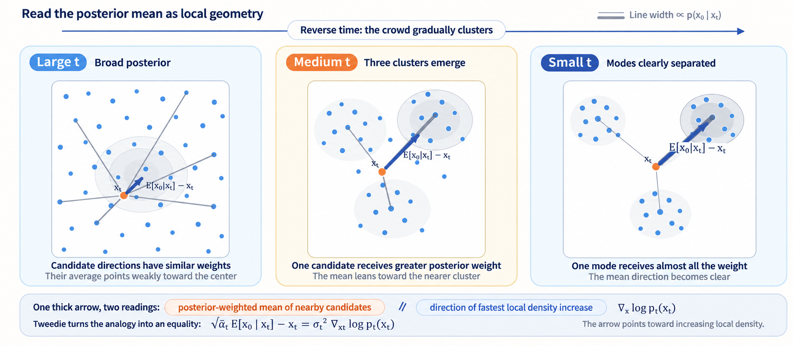
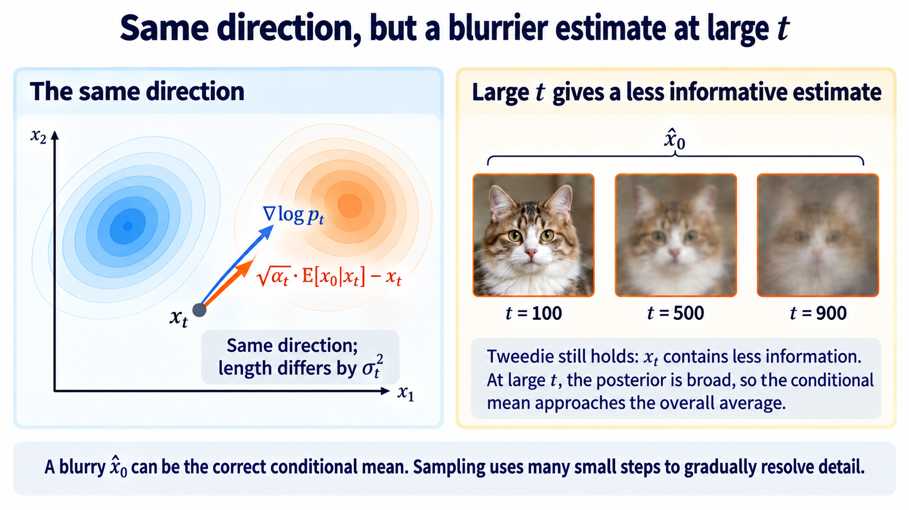

import Objectives from '../../../components/Objectives.astro';
import Prereq from '../../../components/Prereq.astro';
import Ask from '../../../components/Ask.astro';
import Remark from '../../../components/Remark.astro';
import Question from '../../../components/Question.astro';
import Answer from '../../../components/Answer.astro';
import QuizBlock from '../../../components/QuizBlock.astro';
import Option from '../../../components/Option.astro';
import Explanation from '../../../components/Explanation.astro';
import VizPlan from '../../../components/VizPlan.astro';
import Bridge from '../../../components/Bridge.astro';
import Ref from '../../../components/Ref.astro';

# Tweedie's Formula: How Does a Denoiser Describe the Data Distribution?

<Objectives title="After reading, you can">
- **Identify what simple MSE learns.** Its optimum is $\mathbb E[\epsilon\mid x_t]=-\sigma_t\nabla\log p_t(x_t)$, describing local structure of the noisy-data distribution.
- **Explain why scores are useful.** Input differentiation removes the normalizing constant. Scores support sampling without directly providing density or likelihood.
</Objectives>

<Prereq items={frontmatter.prereqs} />

## What does simple MSE learn?

The reverse-KL and ELBO derivations produced weighted MSE. DDPM instead trains with

$$
\mathcal L_{\text{simple}}(\theta)=\mathbb E_{t,\,x_0,\,\epsilon}\big[\|\epsilon_\theta(x_t,t)-\epsilon\|^2\big].
$$

The ELBO explained the original weights. **What does the unweighted regression actually estimate?**

We have only ever used training pairs, without explicitly representing $p_{\text{data}}$.

<Ask>
How much information about a distribution can a denoising regression learn?
</Ask>

Fix a noise level and first solve its regression problem.

## What is the optimum at a fixed noise level?

Expand the simple objective:

$$
\begin{aligned}
\mathcal L_{\text{simple}}(\theta)
&=\mathbb E_t\left[\mathbb E_{x_0,\epsilon}\|\epsilon_\theta(x_t,t)-\epsilon\|^2\right],\\
x_t&=\sqrt{\bar\alpha_t}x_0+\sigma_t\epsilon.
\end{aligned}
$$

At the unrestricted function level, predictions at different times can be optimized separately. Shared finite network parameters may couple their practical optimization.

A positive time weight rescales each fixed-time objective without changing its ideal minimizer. We can therefore ask:

> **For fixed $t$, which function minimizes expected squared noise-prediction error?**

For random variables $(X,Y)$, the general answer is

$$
\arg\min_f\mathbb E_{(X,Y)}\|f(X)-Y\|^2=\mathbb E[Y\mid X].
$$

Imagine locating a shop to minimize customers' squared walking distances. The best location is their mean, rather than the most crowded point: distant customers exert a larger pull under squared cost. If information $X$, such as the neighborhood or weather, changes the customer distribution, the best location becomes a function of that information.

The left expectation averages over the joint law and produces a scalar loss. The right averages over $Y$ conditional on $X$ and produces a function. The proof decomposes $Y$ into its conditional mean and a zero-conditional-mean residual; see <Ref to="math-mse-conditional-expectation"/>.

For DDPM, $X=x_t$ and $Y=\epsilon$, with their joint law defined by the forward construction. At the ideal optimum,

$$
\epsilon_\theta(x_t,t)\ \longrightarrow\ \mathbb E[\epsilon\mid x_t].
$$

The model estimates the posterior average of all noises compatible with $x_t$, rather than memorizing the particular sampled training noise.

Linearity of conditional expectation gives the corresponding clean-data predictor:

$$
\mathbb E[x_0\mid x_t]=\frac{x_t-\sigma_t\,\mathbb E[\epsilon\mid x_t]}{\sqrt{\bar\alpha_t}} .
$$

The conditional-mean result follows from squared error, without assuming a Gaussian posterior. It applies to the simple loss as well as positive time-weighted versions.

The posterior averages over possible clean origins and therefore depends on the entire data distribution, not only one training pair.

<Remark label="Supplement" summary="Why can the optimal loss remain positive?">
The same decomposition separates prediction bias from irreducible residual uncertainty. At the optimum, the remaining term is

$$
\min_\theta\ \mathbb E\big[\|\epsilon_\theta(x_t,t)-\epsilon\|^2\big]
=\mathbb E_{t,\,x_t}\big[\operatorname{tr}\operatorname{Var}(\epsilon\mid x_t)\big].
$$

When this conditional variance is positive, even ideal regression cannot reach zero loss. It measures uncertainty about the noise after observing $x_t$. The lab plots this reference level.

This is the MSE version of the **conditional trick** from <Ref to="dma-denoising-regression"/>: conditional supervision implicitly averages into a marginal quantity.
</Remark>

## How does this posterior mean relate to the distribution?

Let $p_t$ be the distribution of the noisy state. It is given by

$$
p_t(x_t)=\int q(x_t\mid x_0)\,p_{\text{data}}(x_0)\,\mathrm dx_0 ,
$$

This is the marginal density that made Bayes' rule in the previous note intractable.

Our question becomes:

> **How is $\mathbb E[\epsilon\mid x_t]$ related to $p_t(x_t)$?**

## Differentiate the noisy density

At fixed $t$, write the known Gaussian conditional inside the marginal:

$$
p_t(x_t)=\int \mathcal N\!\big(x_t;\,\sqrt{\bar\alpha_t}\,x_0,\ \sigma_t^2 I\big)\,p_{\text{data}}(x_0)\,\mathrm dx_0 .
$$

Under conditions allowing differentiation inside the integral, only that Gaussian factor depends on $x_t$:

$$
\begin{aligned}
\nabla_{x_t} p_t(x_t)
&=\int \nabla_{x_t}\mathcal N\!\big(x_t;\,\sqrt{\bar\alpha_t}\,x_0,\ \sigma_t^2I\big)\,p_{\text{data}}(x_0)\,\mathrm dx_0\\
&=\int -\frac{x_t-\sqrt{\bar\alpha_t}\,x_0}{\sigma_t^2}\,\mathcal N\!\big(x_t;\,\sqrt{\bar\alpha_t}\,x_0,\ \sigma_t^2I\big)\,p_{\text{data}}(x_0)\,\mathrm dx_0 .
\end{aligned}
$$

Divide by $p_t(x_t)$. The left becomes its log-density gradient, and Bayes' rule identifies a posterior on the right:

$$
\frac{\mathcal N\!\big(x_t;\,\sqrt{\bar\alpha_t}\,x_0,\ \sigma_t^2I\big)\,p_{\text{data}}(x_0)}{p_t(x_t)}
=\frac{q(x_t\mid x_0)\,p_{\text{data}}(x_0)}{p_t(x_t)}
=p(x_0\mid x_t).
$$

We obtain

$$
\nabla_{x_t}\log p_t(x_t)
=\int -\frac{x_t-\sqrt{\bar\alpha_t}\,x_0}{\sigma_t^2}\,p(x_0\mid x_t)\,\mathrm dx_0 .
$$

Rearranging the forward construction identifies the residual:

$$
\frac{x_t-\sqrt{\bar\alpha_t}\,x_0}{\sigma_t}=\epsilon ,
$$

It is the noise that produced the observation. The integrand is therefore $-\epsilon/\sigma_t$, averaged over compatible origins:

$$
\boxed{\;\nabla_{x_t}\log p_t(x_t)=-\frac{\mathbb E[\epsilon\mid x_t]}{\sigma_t}\;}
$$

This is exactly the regression optimum. In clean-data coordinates,

$$
\mathbb E[x_0\mid x_t]=\frac{x_t+\sigma_t^2\,\nabla\log p_t(x_t)}{\sqrt{\bar\alpha_t}} ,
$$

The two identities are related by the affine prediction conversion. Consequently a trained noise network estimates the gradient through

$$
s_\theta(x_t,t):=-\frac{\epsilon_\theta(x_t,t)}{\sigma_t}\;\approx\;\nabla\log p_t(x_t).
$$

That gradient is the **score function**. The opening question now has an answer:

> **After the appropriate scaling, the ideal denoiser estimates the score $\nabla_{x_t}\log p_t(x_t)$.**

The connection between the posterior mean of a noisy observation and its marginal score is **Tweedie's formula**; see Efron [1].

## A denoiser learns local geometry

Rearrange Tweedie's formula in clean-data coordinates:

$$
\underbrace{\sqrt{\bar\alpha_t}\mathbb E[x_0\mid x_t]-x_t}_{\text{denoising direction}}
=\sigma_t^2\nabla\log p_t(x_t).
$$

The directions agree, with lengths differing by $\sigma_t^2$. We can read the arrow through a crowd analogy.

After a concert, people disperse into nearby streets. As time passes, their original exits become harder to identify.

At a street corner, following one person's route backward is unreliable: many origins may be compatible with the same location. Average the possible origins using posterior weights. The factor $\sqrt{\bar\alpha_t}$ places that mean on the noisy state's signal scale.

For the Gaussian corruption model, Tweedie's identity says this average return direction agrees with increasing local density. Regression learns an appropriate arrow at every location and noise level.

An arrow is not a complete route. Step size, repeated updates, and additional randomness require a reverse dynamical system.

*Figure: gray routes represent possible origins, with widths indicating posterior weights. The thick arrow points toward the scaled posterior mean and agrees with the score direction.*

How far should we follow the arrow, and will repeated updates recover the data distribution?

## Why learn the score rather than the density?

Could we learn $p_t$ itself and differentiate it afterward?

<Question label="Discussion" id="Q1">
Suppose we train a network to represent $p_t$, then differentiate its log density.

**What difficulty returns?**

<Answer summary="Show the reasoning">
We return to the normalization problem from <Ref to="dma-what-are-we-learning"/>.

A valid density must integrate to one. For an energy model, differentiating its log normalizer with respect to parameters requires a model expectation, which in turn needs model samples. The exact sign depends on whether we differentiate energy or negative energy; the sampling difficulty is the same.

The score instead differentiates with respect to the input. Write $p_\theta=\tilde p_\theta/Z_\theta$:

$$
\nabla_x\log p_\theta(x)=\nabla_x\log\tilde p_\theta(x)-\underbrace{\nabla_x\log Z_\theta}_{=\,0},
$$

$Z_\theta$ is constant in $x$, so its input gradient vanishes.

Tweedie's formula gives a regression route to precisely this normalization-independent quantity. Hyvärinen [2] developed score matching for unnormalized models; Song and Ermon [3] used learned scores for generation.
</Answer>
</Question>

<Remark label="Caution" summary="Bypassing normalization does not calculate it">
We learn a log-density gradient without directly representing the normalized density. This does not by itself provide density values or likelihood. Additional constructions are needed for likelihood evaluation; the score identity alone does not recover the normalizing constant.
</Remark>

## What does the score field look like?

**Figure: aligned arrows and diminishing information.** At high noise, the clean estimate becomes a broad average. The formula remains valid; the observation contains less information.

<iframe loading="lazy" src="/personal_website/notes/research_areas/diffusion-models-applications/w3-3-score.en.html" class="demo-frame" title="Score field and denoising direction" style="height: 940px; width: 100%; border: none;"></iframe>

**Interactive demo.** Arrows show the exact score of a Gaussian mixture based on the data samples. Switching to the denoising direction preserves direction and changes magnitude by $\sigma_t^2$. At high noise, the field approaches the standard-Gaussian score $-x$.

## Check your understanding

<QuizBlock id="w3-3-a">
What does an ideal noise predictor output?
<Option>The particular noise sampled for one training example.</Option>
<Option correct>$\mathbb E[\epsilon\mid x_t]$.</Option>
<Option>The score without any scaling.</Option>
<Explanation>The score is $-\mathbb E[\epsilon\mid x_t]/\sigma_t$.</Explanation>
</QuizBlock>

<QuizBlock id="w3-3-b">
Why does input score estimation bypass the normalizing constant?
<Option>It assumes the normalizer equals one.</Option>
<Option>It estimates the normalizer by Monte Carlo.</Option>
<Option correct>The normalizer is constant with respect to the input.</Option>
<Explanation>Its input derivative vanishes. This bypass does not compute likelihood.</Explanation>
</QuizBlock>

<QuizBlock id="w3-3-c">
What is the score at sufficiently high noise?
<Option correct>Approximately $-x$, since the marginal approaches standard Gaussian.</Option>
<Option>Approximately zero because the density is flat.</Option>
<Option>Always directed toward the nearest clean sample.</Option>
<Explanation>The standard Gaussian has log-density gradient $-x$.</Explanation>
</QuizBlock>

<Bridge to="dma-reverse-process">
Simple MSE estimates a conditional mean that converts into the noisy-data score.

The reverse Gaussian already gives a stepwise generator. Can the same denoiser move farther per step?

We next examine dynamics that transport the noisy marginals backward, asking whether several stochastic and deterministic routes can share those marginals.
</Bridge>

## References

1. Efron, B. [*Tweedie's Formula and Selection Bias.*](https://efron.ckirby.su.domains/papers/2011TweediesFormula.pdf) JASA 2011. See also <Ref to="math-tweedie"/>.
2. Hyvärinen, A. [*Estimation of Non-Normalized Statistical Models by Score Matching.*](https://jmlr.org/papers/v6/hyvarinen05a.html) JMLR 2005.
3. Song, Y., Ermon, S. [*Generative Modeling by Estimating Gradients of the Data Distribution.*](https://arxiv.org/abs/1907.05600) NeurIPS 2019.
