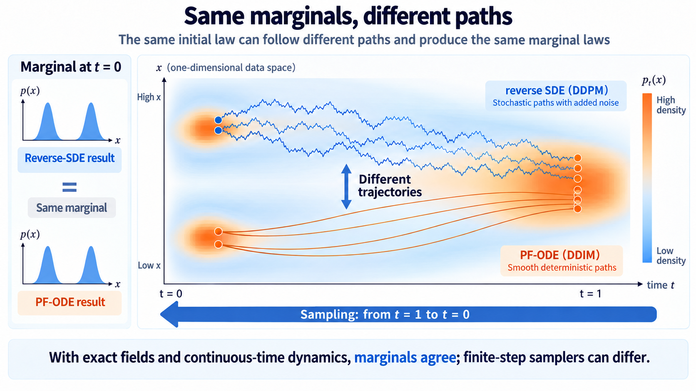

import Objectives from '../../../components/Objectives.astro';
import Prereq from '../../../components/Prereq.astro';
import Ask from '../../../components/Ask.astro';
import Remark from '../../../components/Remark.astro';
import Question from '../../../components/Question.astro';
import Answer from '../../../components/Answer.astro';
import QuizBlock from '../../../components/QuizBlock.astro';
import Option from '../../../components/Option.astro';
import Explanation from '../../../components/Explanation.astro';
import Bridge from '../../../components/Bridge.astro';
import Ref from '../../../components/Ref.astro';

# From Discrete Steps to Forward and Reverse Dynamics

<Objectives title="After reading, you can">
- **Explain why enlarging a DDPM step is problematic.** A single Gaussian misses the spread between possible reverse branches.
- **Identify what training leaves free.** Denoising fixes single-time conditionals, leaving room to change the cross-time joint and construct DDIM.
- **Separate score, dynamics, and numerical solution.** Derive the forward SDE and compare reverse SDE and probability-flow ODE marginals.
</Objectives>

<Prereq items={frontmatter.prereqs} />

## Reversing one frame does not yet give fast playback

Our reverse Gaussian generates one state per network call. A thousand forward levels originally meant a thousand sequential reverse calls. Can we accelerate generation?

<Ask>
How can we change the playback speed while preserving the desired distributions?
</Ask>

Recall DDPM's sampling update [1]:

$$
x_{t-1}=\tilde\mu_t\big(x_t,\ \hat x_\theta(x_t,t)\big)+\sqrt{\tilde\beta_t}\,z,
\qquad z\sim\mathcal N(0,I).
$$

The true reverse conditional is generally a mixture over possible clean origins, rather than a single Gaussian.

<Question label="Discussion" id="Q1">
Why not replace $t-1$ with a much earlier $s$ and sample a Gaussian centered using the predicted clean image?

The true large-step reverse law is

$$
q(x_s\mid x_t)
=\int q(x_s\mid x_t,x_0)\,p(x_0\mid x_t)\,\mathrm dx_0,
$$

a mixture of conditional Gaussians over possible clean origins.

Suppose a blurry observation could come from a clean point on either side. For a small reverse step, the branch centers remain close. A larger step separates them. Substituting their mean preserves the center but may discard substantial variance.

**How much uncertainty does the single-Gaussian approximation omit?**

<Answer summary="Show the reasoning">
Take two equally likely origins $-a$ and $+a$. If the reverse mean's clean-data coefficient is $c_{t,s}$, their branch centers differ from the mean by $\pm c_{t,s}a$, giving variance

$$
\frac{(-c_{t,s}a)^2+(c_{t,s}a)^2}{2}=c_{t,s}^2a^2.
$$

The omitted variance grows quadratically with the clean-data coefficient, which can become substantial over a large jump.

More generally, the conditional mean is affine in $x_0$. Let its coefficient be $c_{t,s}$ and its within-branch covariance be $\tilde\beta_{t\to s}I$. Total variance gives

$$
\mathbb E[x_s\mid x_t]
=\tilde\mu_{t\to s}\big(x_t,\mathbb E[x_0\mid x_t]\big),
\qquad
\operatorname{Var}[x_s\mid x_t]
=\tilde\beta_{t\to s}I
+c_{t,s}^2\operatorname{Var}[x_0\mid x_t].
$$

Substituting the clean conditional mean gets the center right. The variance contains both within-branch spread and spread between branch means. The plug-in Gaussian omits the latter.

Away from singular boundary regimes, an adjacent-step coefficient is $O(\beta_t)$, so the omitted term is higher order. Large jumps can separate modes substantially, making one Gaussian a poor representation.

> **A correct mean does not capture separated reverse branches. Large steps can make the omitted variance substantial.**
</Answer>
</Question>

Acceleration therefore requires more than enlarging an adjacent update. What part of the construction did training leave unspecified?

<Ask>
Did the denoiser ever observe how the whole Markov chain was connected?
</Ask>

## Did training observe complete trajectories?

Write the simple denoising objective again:

$$
\mathcal L_{\text{simple}}
=\mathbb E_{x_0,t,\epsilon}
\left[\left\|\epsilon_\theta(x_t,t)-\epsilon\right\|^2\right],
\qquad
x_t=\sqrt{\bar\alpha_t}x_0+\sqrt{1-\bar\alpha_t}\,\epsilon.
$$

Each example samples one clean image, one time, and one noise. Intermediate states are never calculated. Training observes noisy snapshots:

$$
q(x_t\mid x_0)=\mathcal N\!\left(\sqrt{\bar\alpha_t}x_0,(1-\bar\alpha_t)I\right),
$$

It does not observe a whole path from the forward joint.

Aerial photographs of a dispersing crowd at several times show how many people occupy each street, without identifying the same person across photographs. Many cross-time assignments could fit the same snapshots.

**Keep the snapshots, but redefine their cross-time pairing.**

## Preserve snapshots while redrawing their connections

During generation we only know $x_t$. The reverse law we want to model has the form

$$
q_\lambda(x_s\mid x_t)
=\int q_\lambda(x_s\mid x_t,x_0)\,p(x_0\mid x_t)\,\mathrm dx_0,
$$

The denoiser already estimates the clean posterior mean. To construct a new connection, first ask the easier question: if both $x_t$ and $x_0$ were known, how could we generate $x_s$?

Different choices of $q_\lambda(x_s\mid x_t,x_0)$ define different pairings.

These pairings must preserve the required noisy marginals.

The clean-data law is fixed, and

$$
p_s(x_s)
=\int q(x_s\mid x_0)\,p_{\text{data}}(x_0)\,\mathrm dx_0,
$$

so preserving $q(x_s\mid x_0)$ suffices. Integrating out $x_t$ must recover

$$
\int q_\lambda(x_s\mid x_t,x_0)\,q(x_t\mid x_0)\,\mathrm dx_t
=q(x_s\mid x_0).
$$

We need a directly sampleable conditional satisfying that constraint.

Given the origin and present state, recover a reusable Gaussian marker:

$$
\epsilon_t:=\frac{x_t-\sqrt{\bar\alpha_t}x_0}{\sqrt{1-\bar\alpha_t}}.
$$

Here $\epsilon_t$ denotes the accumulated standardized residual at time $t$, not the individual transition noise from the earlier DDPM notation. Its conditional law given $x_0$ is standard Gaussian.

To preserve noise variance at $s$, reuse part of this marker and fill the remaining variance with fresh independent Gaussian noise.

Choose $0\leq\lambda_{t,s}^2\leq1-\bar\alpha_s$, draw independent $z\sim\mathcal N(0,I)$, and define

$$
x_s
=\sqrt{\bar\alpha_s}x_0
+\sqrt{1-\bar\alpha_s-\lambda_{t,s}^2}\,\epsilon_t
+\lambda_{t,s}z.
$$

The second term reuses the residual and the third adds new randomness. This changes the coupling; the original Markov chain does not generally share the same residual across times.

Independence makes the total noise variance

$$
\big(1-\bar\alpha_s-\lambda_{t,s}^2\big)I
+\lambda_{t,s}^2I
=(1-\bar\alpha_s)I.
$$

The mean and variance therefore recover the original conditional marginal:

$$
q_\lambda(x_s\mid x_0)
=\mathcal N\!\left(\sqrt{\bar\alpha_s}x_0,(1-\bar\alpha_s)I\right).
$$

Given both $x_0$ and $x_t$, only the newly drawn $z$ remains random, so

$$
q_\lambda(x_s\mid x_t,x_0)
=\mathcal N\!\left(
\sqrt{\bar\alpha_s}x_0
+\sqrt{1-\bar\alpha_s-\lambda_{t,s}^2}\,
\frac{x_t-\sqrt{\bar\alpha_t}x_0}{\sqrt{1-\bar\alpha_t}},
\ \lambda_{t,s}^2I
\right).
$$

The new forward/inference joint is generally **non-Markovian**, because this conditional still depends directly on $x_0$. This does not mean the reverse network needs the entire sampling history.

<Remark label="Supplement" summary="Why can we reuse the denoiser?">
Substitute the clean-data identity into the conditional mean and define

$$
c_{t,s}
:=\sqrt{1-\bar\alpha_s-\lambda_{t,s}^2}
-\sqrt{\frac{\bar\alpha_s}{\bar\alpha_t}}\sqrt{1-\bar\alpha_t}.
$$

The target conditional and reverse model then take the forms

$$
\begin{aligned}
q_\lambda(x_s\mid x_t,x_0)
&=\mathcal N\!\left(
\sqrt{\frac{\bar\alpha_s}{\bar\alpha_t}}x_t
+c_{t,s}\epsilon_t,
\lambda_{t,s}^2I
\right),\\
p_\theta(x_s\mid x_t)
&:=\mathcal N\!\left(
\sqrt{\frac{\bar\alpha_s}{\bar\alpha_t}}x_t
+c_{t,s}\epsilon_\theta(x_t,t),
\lambda_{t,s}^2I
\right).
\end{aligned}
$$

The new variational objective again decomposes into transition KL terms, plus boundary terms:

$$
J_\lambda(\theta)
=\sum_{t\to s}\mathbb E\!\left[
D_{\mathrm{KL}}\!\left(
q_\lambda(x_s\mid x_t,x_0)
\,\|\,
p_\theta(x_s\mid x_t)
\right)
\right]+C.
$$

Their Gaussian covariances agree; their means differ only through the true versus predicted noise. Hence

$$
D_{\mathrm{KL}}
=\frac{c_{t,s}^2}{2\lambda_{t,s}^2}
\left\|\epsilon_t-\epsilon_\theta(x_t,t)\right\|^2
=\gamma_{t,s}\left\|\epsilon_t-\epsilon_\theta(x_t,t)\right\|^2.
$$

The schedule-dependent coefficient is positive, giving

$$
J_\lambda(\theta)=\mathcal L_\gamma(\theta)+C.
$$

Thus these variational objectives reduce to weighted denoising MSE. The ordinary Gaussian-KL derivation assumes positive $\lambda_{t,s}$; deterministic sampling is considered as a limit.

Positive time weights leave the ideal fixed-time predictor unchanged.

**Training determines an optimal denoiser for each snapshot without uniquely determining the cross-time joint.** The same denoiser can therefore be reused, although finite-step plug-in sampling is still approximate.
</Remark>

## Follow the new connections backward

Generation cannot inspect $x_0$. Instead use the denoiser's prediction

$$
\hat\epsilon_t:=\epsilon_\theta(x_t,t)
\approx\mathbb E[\epsilon_t\mid x_t]
=-\sqrt{1-\bar\alpha_t}\,\nabla\log p_t(x_t).
$$

Substitute the clean-data identity and replace hidden noise by its prediction:

$$
x_s
=\sqrt{\frac{\bar\alpha_s}{\bar\alpha_t}}x_t
+\left(
\sqrt{1-\bar\alpha_s-\lambda_{t,s}^2}
-\sqrt{\frac{\bar\alpha_s}{\bar\alpha_t}}\sqrt{1-\bar\alpha_t}
\right)\hat\epsilon_t
+\lambda_{t,s}z,
\qquad z\sim\mathcal N(0,I).
$$

The update now needs only the current state, its predicted noise, and optional fresh noise.

To check that this includes DDPM, set $s=t-1$ and choose

$$
\lambda_{t,t-1}^2=\tilde\beta_t
=\frac{1-\bar\alpha_{t-1}}{1-\bar\alpha_t}\,\beta_t.
$$

Using the schedule identities, the coefficients simplify to

$$
\begin{aligned}
\sqrt{\frac{\bar\alpha_{t-1}}{\bar\alpha_t}}
&=\frac{1}{\sqrt{\alpha_t}},\\[2pt]
\sqrt{1-\bar\alpha_{t-1}-\tilde\beta_t}
-\frac{\sqrt{1-\bar\alpha_t}}{\sqrt{\alpha_t}}
&=-\frac{\beta_t}{\sqrt{\alpha_t}\sqrt{1-\bar\alpha_t}}.
\end{aligned}
$$

and the update becomes

$$
x_{t-1}
=\frac{1}{\sqrt{\alpha_t}}
\left(
x_t-\frac{\beta_t}{\sqrt{1-\bar\alpha_t}}\,\hat\epsilon_t
\right)
+\sqrt{\tilde\beta_t}\,z,
$$

the familiar DDPM update. Preserving marginals does not require choosing only that coupling.

Setting $\lambda_{t,s}=0$ instead gives

$$
x_s
=\sqrt{\frac{\bar\alpha_s}{\bar\alpha_t}}x_t
+\left(
\sqrt{1-\bar\alpha_s}
-\sqrt{\frac{\bar\alpha_s}{\bar\alpha_t}}\sqrt{1-\bar\alpha_t}
\right)\hat\epsilon_t.
$$

This is deterministic given the current state and score estimate. Infinitesimal steps lead to the ODE described below.

We are not asserting that DDPM's hidden noise is identical at two times. We have defined a new joint. After reaching $x_s$, we evaluate the network again rather than retaining the first prediction forever.

Given the initial noise draw, the entire trajectory is now deterministic. Song, Meng, and Ermon [2] call this construction a **Denoising Diffusion Implicit Model (DDIM)**.

We may choose a shorter timestep subsequence

$$
0=\tau_0<\tau_1<\cdots<\tau_S=T,
$$

and generate along its reverse order.

<Remark label="Notation" summary="The usual eta parametrization">
The literature commonly writes

$$
\lambda_{t,s}
=\eta\sqrt{\frac{1-\bar\alpha_s}{1-\bar\alpha_t}}
\sqrt{1-\frac{\bar\alpha_t}{\bar\alpha_s}}.
$$

$\eta=0$ gives deterministic DDIM. With the full adjacent schedule, $\eta=1$ recovers DDPM posterior variance. On a skipped schedule, it defines a stochastic shortened sampler rather than the original full chain.
</Remark>

## Compare the two routes

<iframe loading="lazy" src="/personal_website/notes/research_areas/diffusion-models-applications/w3-4-samplers.en.html" class="demo-frame" title="DDPM and DDIM trajectories" style="height: 980px; width: 100%; border: none;"></iframe>

**Interactive demo.** Both panels use the same exact mixture score and initial samples. Adjust $\eta$ and the number of steps. Removing fresh noise smooths trajectories; reducing steps reveals finite-step errors. Equal ideal marginals do not guarantee identical finite-step endpoints, and deterministic paths can still bend.

The exact-score setting removes neural estimation error. The lab adds learned scores to examine that separate source of error.

## Move from a fixed grid to continuous time

DDIM can skip scheduled levels. To separate distribution evolution from the computational grid entirely, we turn to continuous dynamics.

Refine the timestep toward zero and identify the limiting rule.

## Write corruption as continuous motion

Divide a unit time interval into $T$ pieces of width $\Delta t=1/T$. Noise per step must shrink with the interval, so replace discrete $\beta_t$ by $\beta(t)\Delta t$.

The forward transition becomes

$$
x_{t+\Delta t}
=\sqrt{1-\beta(t)\Delta t}\,x_t
+\sqrt{\beta(t)\Delta t}\,\xi_t,
\qquad \xi_t\sim\mathcal N(0,I),
$$

where $\xi_t$ is fresh Gaussian noise. For small $\Delta t$,

$$
\sqrt{1-\beta(t)\Delta t}
=1-\tfrac12\beta(t)\Delta t+O(\Delta t^2),
$$

subtracting the current state gives

$$
x_{t+\Delta t}-x_t
=-\tfrac12\beta(t)x_t\,\Delta t
+\sqrt{\beta(t)}\big(\sqrt{\Delta t}\,\xi_t\big)
+O(\Delta t^2).
$$

The noise scales as $\sqrt{\Delta t}$ because independent variances add. After $1/\Delta t$ steps, total variance remains order one. Scaling noise by $\Delta t$ would make its accumulated variance vanish.

Define

$$
\Delta W_t:=\sqrt{\Delta t}\,\xi_t,
\qquad \Delta W_t\sim\mathcal N(0,\Delta t\,I).
$$

a Brownian increment. Passing to the continuous limit gives

$$
dx=-\tfrac12\beta(t)\,x\,dt+\sqrt{\beta(t)}\,dW_t,\qquad t:0\to1 .
$$

The drift shrinks toward the origin and the diffusion injects Gaussian noise, retaining the same forward construction without a fixed grid.

Drift describes systematic motion; diffusion describes injected randomness. For VP,

$$
f_t=-\tfrac12\beta(t),\qquad g_t=\sqrt{\beta(t)}.
$$

The score alone does not determine reverse dynamics. It gives a local log-density gradient, while the forward noise intensity determines how strongly that information enters the reverse rule.

## How does the score reverse time?

Under suitable regularity, Anderson [3] gives a reverse-time SDE with a score correction:

$$
dx=\Big[-\tfrac12\beta(t)\,x-\beta(t)\,\nabla\log p_t(x)\Big]dt+\sqrt{\beta(t)}\,d\bar W_t,\qquad t:1\to0 .
$$

The forward drift and noise scale combine with the learned score. Here time runs backward, so the sign of $dt$ must be interpreted accordingly.

Song and colleagues [4] give a deterministic ODE with the same single-time marginals under exact scores and suitable regularity:

$$
\frac{dx}{dt}=-\tfrac12\beta(t)\,x-\tfrac12\beta(t)\,\nabla\log p_t(x)
\qquad\text{(probability-flow ODE)} .
$$

The score coefficient in the ODE is half the reverse-SDE coefficient.

<Remark label="Notation" summary="The general forward and reverse equations">
The equations above substitute the VP schedule. More generally, for a linear forward drift,

$$
dx=f_t\,x\,dt+g_t\,dW_t ,
$$

the reverse SDE and probability-flow ODE are

$$
\begin{aligned}
dy_t&=\big[f_t\,y_t-g_t^2\,s_\theta(y_t,t)\big]dt+g_t\,d\bar W_t ,\\[2pt]
\frac{dy_t}{dt}&=f_t\,y_t-\tfrac12\,g_t^2\,s_\theta(y_t,t)\qquad\text{(PF-ODE)} .
\end{aligned}
$$

$y_t$ denotes the process followed backward, $s_\theta=-\epsilon_\theta/\sigma_t$ is the learned score, and $\bar W$ is reverse-time Brownian motion. A general nonlinear drift can be written $f(x,t)$; here $f_t x$ suffices.

For VP, $f_t=-\beta(t)/2$ and $g_t^2=\beta(t)$. Other forward processes change these coefficients while retaining the structure. <Ref to="dma-unified-equation"/> develops a common interpolation framework.
</Remark>

<Remark label="Supplement" summary="Where did half the score correction go?">
In the Fokker–Planck equation (<Ref to="math-fokker-planck"/>), diffusion can be rewritten as a divergence:

$$
\tfrac12\beta\,\Delta p_t=\nabla\cdot\Big(\tfrac12\beta\,p_t\,\nabla\log p_t\Big),
$$

This lets us represent diffusion through a score-dependent drift. Removing stochastic diffusion while adjusting drift preserves density evolution.

Substitution combines the terms into

$$
\partial_t p_t+\nabla\cdot\big(p_t\,u_t\big)=0,\qquad
u_t(x)=-\tfrac12\beta(t)\,x-\tfrac12\beta(t)\,\nabla\log p_t(x) .
$$

The velocity $u_t$ is the probability-flow ODE field. This is a **continuity equation**: density changes through incoming and outgoing mass flux $p_tu_t$.

The equal marginals follow from the same density-evolution equation, rather than identical sample paths. <Ref to="dma-flows-and-continuity"/> uses this logic to construct a velocity for a prescribed path.

<Ref to="dma-unified-equation"/> extends this exchange into a family of stochastic samplers.
</Remark>

Compare the three constructions:

| | Forward SDE | Reverse SDE | PF-ODE |
|---|---|---|---|
| Direction | $p_0\to p_T$ | $p_T\to p_0$ | $p_T\to p_0$ |
| Marginals | $p_t$ | Same path, reversed | Same path, reversed |
| Individual trajectory | Random | Random | Deterministic given its start |
| Discrete connection | Forward corruption | DDPM | Deterministic DDIM |

**Figure: equal marginals, different paths.** Equality concerns the population distribution, not whether a particular initial point reaches the same endpoint.

In the VP continuous limit, DDPM connects to the reverse SDE and deterministic DDIM to the PF-ODE. Exact numerical forms depend on coordinates. The network supplies the score, dynamics specify motion, and the numerical method approximates it on a grid.

## A sampler combines dynamics and a numerical method

Choose reverse dynamics, then a timestep grid and solver. The number of computational steps is a numerical choice.

Keep two errors separate: Gaussian approximation of a mixture reverse kernel, and numerical discretization of continuous dynamics. They have different definitions even when larger steps worsen both.

Equal continuous-time marginals do not imply equal finite-step quality. Euler freezes velocity within a step; SDE solvers also approximate drift and stochastic effects. The balance between score error and numerical error determines the practical comparison.

Gaussian corruption, a Gaussian prior, and a schedule are design choices. <Ref to="dma-why-not-diffusion"/> asks how to construct paths with more freedom.

## Check your understanding

<QuizBlock id="w3-4-a">
Why does the PF-ODE use half the reverse-SDE score coefficient?
<Option>The learning rate absorbs the other half.</Option>
<Option correct>Removing diffusion requires a corresponding drift adjustment to preserve density evolution.</Option>
<Option>ODE time moves twice as fast.</Option>
<Explanation>The Fokker–Planck equation rewrites diffusion as a score-dependent flux.</Explanation>
</QuizBlock>

<QuizBlock id="w3-4-b">
Why is a large plug-in reverse Gaussian problematic?
<Option>The network cannot read nonadjacent timesteps.</Option>
<Option correct>It can preserve the mean while missing substantial between-branch variance.</Option>
<Option>It changes the training objective's ideal minimizer.</Option>
<Explanation>Separated possible origins produce a mixture that one Gaussian may represent poorly.</Explanation>
</QuizBlock>

<QuizBlock id="w3-4-c">
What is non-Markovian about DDIM?
<Option>The network must read the entire generated history.</Option>
<Option correct>The forward/inference joint changes its cross-time coupling while preserving the single-time conditionals.</Option>
<Option>The noisy conditional stops being Gaussian.</Option>
<Explanation>The reverse sampler can still use only the present state and time.</Explanation>
</QuizBlock>

<Bridge to="dma-lab-diffusion">
The denoiser supports several sampling rules and shorter grids. Next we cross learned versus exact scores with DDPM versus DDIM to distinguish estimation error from finite-step error.
</Bridge>

## References

1. Ho, J., Jain, A., Abbeel, P. [*Denoising Diffusion Probabilistic Models.*](https://arxiv.org/abs/2006.11239) NeurIPS 2020.
2. Song, J., Meng, C., Ermon, S. [*Denoising Diffusion Implicit Models.*](https://arxiv.org/abs/2010.02502) ICLR 2021.
3. Anderson, B. D. O. [*Reverse-time diffusion equation models.*](https://doi.org/10.1016/0304-4149(82)90051-5) 1982.
4. Song, Y., et al. [*Score-Based Generative Modeling through Stochastic Differential Equations.*](https://arxiv.org/abs/2011.13456) ICLR 2021.
5. Lai, C.-H., et al. [*The Principles of Diffusion Models.*](https://arxiv.org/abs/2510.21890) 2025, Section 4.1.
