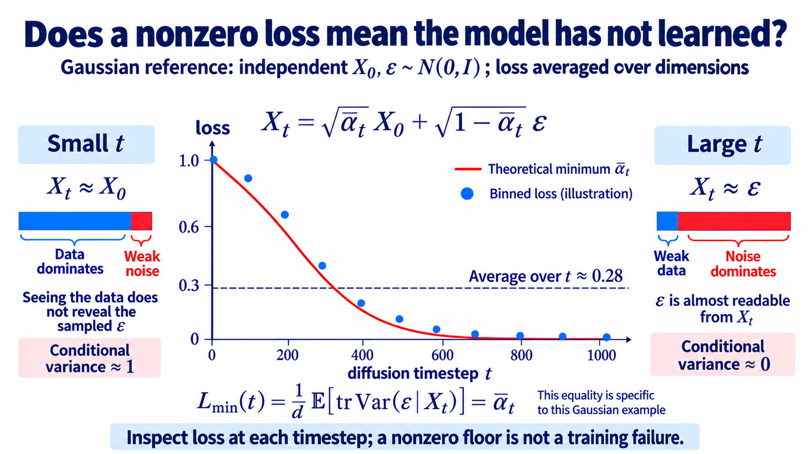

import Objectives from '../../../components/Objectives.astro';
import Prereq from '../../../components/Prereq.astro';
import Ask from '../../../components/Ask.astro';
import Remark from '../../../components/Remark.astro';
import Question from '../../../components/Question.astro';
import Answer from '../../../components/Answer.astro';
import QuizBlock from '../../../components/QuizBlock.astro';
import Option from '../../../components/Option.astro';
import Explanation from '../../../components/Explanation.astro';
import Bridge from '../../../components/Bridge.astro';
import Ref from '../../../components/Ref.astro';

# Lab: Build a Toy Diffusion Experiment

<Objectives title="After reading, you can">
- **Use a tractable 2D reference.** Gaussian-mixture scores and posterior means let us compare a learned network with exact answers.
- **Check the theory experimentally.** Implement noise prediction and sampling, inspect fields and trajectories, verify prediction conversions, and separate irreducible uncertainty from model error.
</Objectives>

<Prereq items={frontmatter.prereqs} />

## Start where we can inspect every part

We will turn the unit into a small experiment that can be rerun quickly.

Later units return to the same experimental setting. Two dimensions offer three advantages:

- **Exact references.** A finite empirical distribution becomes a Gaussian mixture after corruption, with tractable density, score, and posterior mean.
- **Visible behavior.** We can plot fields and trajectories directly.
- **Short experiments.** A small model makes changes inexpensive to investigate; runtime depends on hardware and training budget.

For the learned-model experiment, use 2,000 two-moons points with noise 0.05, standardized per coordinate. Use a three-layer width-128 MLP with sinusoidal time embeddings, $T=1000$, and a linear schedule from $10^{-4}$ to $0.02$.

[Download the Gaussian diffusion and analytic-score notebook](/personal_website/notes/notebooks/diffusion-models-applications/dma-w3-lab.ipynb)

**Notebook scope.** This analytic 2D Gaussian-mixture notebook implements corruption, exact scores, and Tweedie posterior means, with fixed seeds and visualization exercises. It requires no checkpoint. The learned-network experiments below extend that analytic reference rather than describing a pretrained model supplied in the download.

## Step 1: corruption and training

```python
def q_sample(x0, t, eps):                 # closed-form forward sampling
    ab = alpha_bar[t][:, None]
    return ab.sqrt() * x0 + (1 - ab).sqrt() * eps

for step in range(n_steps):
    x0 = sample_data(batch)
    t = torch.randint(1, T + 1, (batch,))
    eps = torch.randn_like(x0)
    xt = q_sample(x0, t, eps)
    loss = ((model(xt, t) - eps) ** 2).mean()
    loss.backward(); opt.step(); opt.zero_grad()
```

The loss may decrease from roughly one and then plateau at a positive value. The level depends on the data, schedule, reduction convention, and model.

<Ask>
Does a loss plateau far above zero mean the code is wrong?
</Ask>

<Question label="Discussion" id="Q1">
A natural response is to widen the network, adjust the learning rate, or train ten times longer.

**Can these changes remove every source of residual loss?**

<Answer summary="Show the reasoning">
They may reduce approximation or optimization error, but cannot remove the theoretical conditional-variance floor.

The ideal predictor is $\mathbb E[\epsilon\mid x_t]$, not the particular sampled noise. Even its loss is

$$
\min_\theta \mathcal L=\mathbb E_{t,x_t}\Big[\operatorname{tr}\operatorname{Var}\big(\epsilon\mid x_t\big)\Big].
$$

Extra capacity cannot go below this population floor. Its dependence on time is informative.

- At high noise, $x_t$ largely reveals $\epsilon$, so conditional noise uncertainty becomes small.
- At low noise, the result depends on the clean-data law. For a smooth Gaussian source, the floor approaches one per dimension; a finite discrete empirical source can behave differently as noise vanishes.

For independent standard-Gaussian clean data and noise, the per-coordinate floor is exactly $\bar\alpha_t$. Averaging it over DDPM's linear schedule gives roughly 0.28. This is an analytic reference, not a universal two-moons loss value.

> **Inspect loss by noise level, and compare it with the correct conditional-variance reference.**

Bin timesteps, for example in groups of 100, and compare learned error with the analytic optimum. This reveals where the network has excess error beyond unavoidable uncertainty.
</Answer>
</Question>



**Figure: a Gaussian reference.** The red line is $\bar\alpha_t$ for standard-Gaussian data, and the blue dots are illustrative rather than notebook measurements. The dashed average near 0.28 is not a common floor for every timestep. Two-moons data requires its own posterior-uncertainty calculation.

## Step 2: plot the score field

On a grid over $[-3,3]^2$, compare fields at $t\in\{50,300,700,950\}$:

- Learned score: $-\epsilon_\theta(x,t)/\sigma_t$.
- Reference: `exact_score(x, t)`.

At high noise, arrows approach the Gaussian field toward the origin. At low noise, they reflect the moons. Compare agreement in data-rich regions and errors in rarely visited corners.

Errors away from training data can matter during sampling.

## Step 3: verify prediction conversions

Without retraining, convert noise predictions on a batch:

$$
\hat x_0=\frac{x_t-\sigma_t\epsilon_\theta}{\sqrt{\bar\alpha_t}},
\qquad
\hat v=\sqrt{\bar\alpha_t}\,\epsilon_\theta-\sigma_t\,\hat x_0 ,
$$

Recover predicted noise from $\hat v$ and $x_t$, checking agreement up to floating-point error, roughly $10^{-6}$ in a well-conditioned float32 calculation. This tests the algebraic equivalence.

Then compare $\hat x_0$ with `exact_posterior_mean` and plot error against time.

At high noise, converting a noise error to clean-data error divides by small $\sqrt{\bar\alpha_t}$ and can amplify it. Algebraic equivalence does not guarantee numerical conditioning. Direct $v$-to-data conversion avoids that particular division.

## Step 4: compare DDPM and DDIM trajectories

Place DDPM [1] and DDIM [2] in the same update function:

```python
def ddim_step(xt, t, s, eta=0.0):
    eps = model(xt, t)
    x0_hat = (xt - sig[t] * eps) / ab[t].sqrt()
    sigma_s = eta * ((1 - ab[s]) / (1 - ab[t]) * (1 - ab[t] / ab[s])).sqrt()
    dir_xt = (1 - ab[s] - sigma_s**2).sqrt() * eps
    return ab[s].sqrt() * x0_hat + dir_xt + sigma_s * torch.randn_like(xt)
```

$\eta=0$ gives deterministic DDIM. With adjacent steps, $\eta=1$ recovers the DDPM posterior-variance update; on a shortened grid it is a stochastic skipped-step sampler. Fix 32 initial points and compare 10, 50, and 1000 steps.

Inspect whether coarse deterministic paths miss the moons and whether increased resolution improves endpoints. Even a well-resolved deterministic trajectory can be curved; retain this plot for the next unit.

<Remark label="Supplement" summary="A learned score adds a separate source of error">
The earlier interactive demo used exact scores. A learned network may be inaccurate in low-density regions, and numerical drift into those regions can compound estimation error.

Compare stochastic and deterministic samplers to test whether injected noise and score drift help with these errors in this setting.

> **Exact-score and learned-score comparisons answer different questions. Noise is not universally beneficial, even when score error exists.**
</Remark>

## Exercises

1. **Parametrization.** Train separate clean-data, noise, and $v$ predictors. Convert their outputs and compare 50-step DDIM endpoints using $W_2$. Explain differences through weighting and finite training capacity.
2. **Weighting.** Multiply noise MSE by $1/\mathrm{SNR}(t)$. Compare the distribution of score error across noise levels with uniform weighting.
3. **Quantify sampler error.** Compare $\eta=0$ and $\eta=1$ over 5, 10, 20, 50, 100, and 1000 steps. Run exact-score and learned-score versions separately. Predict the behavior first, then report the measured curves without assuming one sampler must always win.
4. **Optional: reverse SDE.** Read Section 2 of Anderson [3]. Identify the conditional-expectation mechanism behind the score correction and connect it to Tweedie's formula.

## Check your understanding

<QuizBlock id="w3-5-a">
For independent standard-Gaussian clean data and noise, how does the per-coordinate optimal noise MSE vary with time?
<Option>It is constant.</Option>
<Option>It increases from zero toward one.</Option>
<Option correct>It decreases from near one toward zero as $\bar\alpha_t$ decreases.</Option>
<Explanation>This Gaussian example has conditional variance $\bar\alpha_t$. Other clean-data distributions need their own reference.</Explanation>
</QuizBlock>

<QuizBlock id="w3-5-b">
When can score errors in low-density corners matter?
<Option>Only during early training.</Option>
<Option correct>When sampling trajectories drift into those corners and estimation error compounds numerical error.</Option>
<Option>Never, because no training data lies there.</Option>
<Explanation>A sampler can visit regions with weak training coverage.</Explanation>
</QuizBlock>

<QuizBlock id="w3-5-c">
Why can the same update function compare DDPM-style and DDIM sampling?
<Option>They need different network weights.</Option>
<Option>DDPM is merely a different training schedule.</Option>
<Option correct>The same denoiser supports updates with different amounts of fresh noise.</Option>
<Explanation>Sampling randomness and timestep selection are sampler choices. Exact DDPM recovery additionally requires the adjacent schedule.</Explanation>
</QuizBlock>

<Bridge to="dma-why-not-diffusion">
We have connected Gaussian corruption, regression, Tweedie's identity, and reverse sampling.

This construction also selected a prior, path, and pairing structure. Which of these are essential to generation, and which are design choices?

The next unit separates those choices through Flow Matching.
</Bridge>

## References

1. Ho, J., Jain, A., Abbeel, P. [*Denoising Diffusion Probabilistic Models.*](https://arxiv.org/abs/2006.11239) NeurIPS 2020.
2. Song, J., Meng, C., Ermon, S. [*Denoising Diffusion Implicit Models.*](https://arxiv.org/abs/2010.02502) ICLR 2021.
3. Anderson, B. D. O. [*Reverse-time diffusion equation models.*](https://doi.org/10.1016/0304-4149(82)90051-5) 1982.
