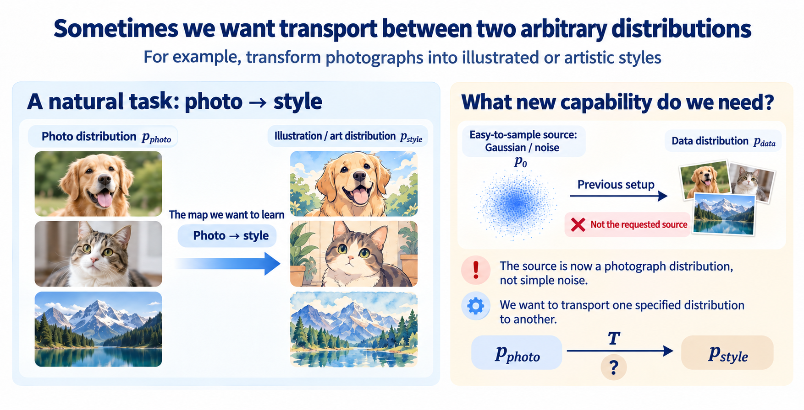

import Objectives from '../../../components/Objectives.astro';
import Prereq from '../../../components/Prereq.astro';
import Ask from '../../../components/Ask.astro';
import QuizBlock from '../../../components/QuizBlock.astro';
import Option from '../../../components/Option.astro';
import Explanation from '../../../components/Explanation.astro';
import Bridge from '../../../components/Bridge.astro';
import Ref from '../../../components/Ref.astro';

# Is a Forward Corruption Process Necessary?

<Objectives title="After reading, you can">
- **Identify a restriction of the DDPM/DDIM setup.** Its generative source is Gaussian; arbitrary prescribed endpoints need a different construction.
- **Express gradual transport as an ODE.** Interpret velocity as the local direction and speed of motion.
</Objectives>

<Prereq items={frontmatter.prereqs} />

## One endpoint of our diffusion construction is Gaussian

In <Ref week="dma-week-diffusion"/>, Gaussian noise made sampling and conditional calculations convenient. We generated data by reversing a chosen corruption process.

What if we instead want to transport one prescribed distribution directly into another?

<Ask>
If the input is a real photograph and the output should have a cartoon style, 
why should the source have to be Gaussian noise?
</Ask>

Our diffusion setup was

$$
X_T\sim\mathcal N(0,I)\longrightarrow X_0\sim p_{\mathrm{data}},
$$

Now we want to handle

$$
X_0\sim p_0\longrightarrow X_1\sim p_1,
$$

where neither endpoint must be Gaussian. This motivates a different setup; it does not claim diffusion methods cannot be adapted to such applications.

## Revisit the strategy from Unit 1

We first sought a one-shot transport map, then constructed intermediate noisy states and learned local corrections. DDIM showed that local movements can form a deterministic flow.

This suggests a natural question:

> **Given endpoint random variables, can we choose intermediate positions and learn a flow between them?**

Imagine rearranging sand from one shape into another. Each grain's position changes with time; velocity describes that change.

We therefore seek a velocity field:

$$
\frac{\mathrm d x_t}{\mathrm d t}=v_t(x_t).
$$

$v_t(x_t)$ answers a local question: **where should a particle at this position and time move, and how fast?** Repeating this motion transports the population.

The ODE explains how to move once we know the field, but does not yet provide it.

Lipman and colleagues' **Flow Matching** [1] addresses this gap by constructing reference paths and learning their marginal velocity field.

## Check your understanding

<QuizBlock id="w4-0-a">
What does $v_t(x)$ describe?
<Option>The complete probability density.</Option>
<Option correct>A particle's local direction and speed at time $t$.</Option>
<Option>The total endpoint distance.</Option>
<Explanation>Integrating the local rule produces a complete trajectory.</Explanation>
</QuizBlock>

<QuizBlock id="w4-0-b">
Why does the existing DDPM setup not directly specify arbitrary-to-arbitrary transport?
<Option>It requires a U-Net.</Option>
<Option correct>Its generative source was fixed to a Gaussian prior.</Option>
<Option>ODEs cannot act on images.</Option>
<Explanation>The Gaussian endpoint is a design choice we now want to relax.</Explanation>
</QuizBlock>

<Bridge to="dma-flows-and-continuity">
We need a velocity field. If reference endpoints are known during training, can their paths teach a common movement rule that generation can use without knowing its endpoint?
</Bridge>

## References

1. Lipman, Y., Chen, R. T. Q., Ben-Hamu, H., Nickel, M., Le, M. [*Flow Matching for Generative Modeling.*](https://arxiv.org/abs/2210.02747) ICLR 2023.
