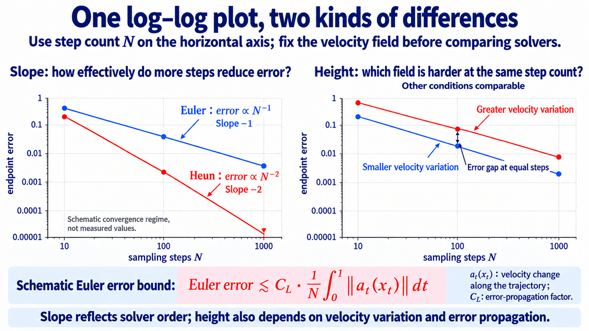

import Objectives from '../../../components/Objectives.astro';
import Prereq from '../../../components/Prereq.astro';
import Ask from '../../../components/Ask.astro';
import Remark from '../../../components/Remark.astro';
import QuizBlock from '../../../components/QuizBlock.astro';
import Option from '../../../components/Option.astro';
import Explanation from '../../../components/Explanation.astro';
import Bridge from '../../../components/Bridge.astro';
import Ref from '../../../components/Ref.astro';

# Lab: From Reference Paths to a Flow ODE

<Objectives title="After reading, you can">
- **Implement linear CFM** by constructing position and velocity labels from endpoint pairs.
- **Integrate with Euler and Heun**, separating model error from numerical error.
- **Verify prediction conversion on a Gaussian path**, aligning both the path and time direction.
</Objectives>

<Prereq items={frontmatter.prereqs} />

## Fix the other experimental choices

Reuse the two-moons data, MLP, and random seed. Change the reference path, target, and sampler while controlling unrelated settings.

Our notation is

$$
x_0=\text{source noise},\qquad x_1=\text{data},\qquad t:0\to1.
$$

This is the opposite time direction to Unit 1.

[Download the Flow Matching and ODE sampling notebook](/personal_website/notes/notebooks/diffusion-models-applications/dma-w4-lab.ipynb)

## Step 1: construct reference paths

Use linear Conditional Flow Matching [1]:

$$
x_t=(1-t)x_0+tx_1,\qquad \dot I_t=x_1-x_0.
$$

The training loop is

```python
for step in range(n_steps):
    x0 = torch.randn(batch, 2)       # source
    x1 = sample_data(batch)          # target
    t = torch.rand(batch, 1)
    xt = (1 - t) * x0 + t * x1
    loss = ((model(xt, t) - (x1 - x0)) ** 2).mean()
    loss.backward(); opt.step(); opt.zero_grad()
```

The model receives position and time, with the reference velocity as its label. No density or explicit posterior weights are needed; regression performs the averaging.

A positive loss can remain because compatible reference labels disagree. The conditional-variance term is independent of the predictor. A nonzero CFM loss therefore does not by itself indicate a wrong marginal field.

## Step 2: follow the learned velocity

Euler sampling uses

```python
@torch.no_grad()
def euler_sample(model, x0, n_steps):
    x, h = x0, 1.0 / n_steps
    trajectory = [x]
    for i in range(n_steps):
        t = torch.full((x.shape[0], 1), i * h, device=x.device)
        x = x + h * model(x, t)
        trajectory.append(x)
    return torch.stack(trajectory)
```

Fix initial points and compare 10, 50, and 1000 steps. Check:

1. Does the endpoint distribution stabilize with resolution?
2. Do generated trajectories coincide with training reference lines?

Usually the second answer is no. Reference lines may cross, while trajectories of a regular unique ODE follow the average field without merging and separating.

## Step 3: measure the cost of velocity changes

Use an exact field to remove neural estimation error and isolate numerical behavior.

<iframe loading="lazy" src="/personal_website/notes/research_areas/diffusion-models-applications/w4-5-steps.en.html" class="demo-frame" title="Sampling error versus step count" style="height: 830px; width: 100%; border: none;"></iframe>

On a log-log plot:

- **Slope** reflects convergence order in the asymptotic regime: approximately $-1$ for Euler and $-2$ for Heun under appropriate smoothness.
- **Height** reflects the error scale, including velocity variation and amplification along the trajectory.



**Figure: slope and height.** The horizontal axis is step count $N$, with $h=1/N$. These are schematic curves, not measured results. <Ref to="dma-error-theory"/> derives a more precise error bound.

<Remark label="Measurement" summary="Separate different-mode endpoints from smooth convergence">
A coarse solver can send some particles toward a different mode. On practical coarse grids, those endpoint differences may obscure the expected convergence slope; this does not override convergence under regularity as the grid is refined.

Inspect both median and mean error. The median helps reveal typical numerical behavior, while the mean retains large deviations. Also inspect the affected trajectories directly.
</Remark>

## Step 4: convert the diffusion denoiser to velocity

Load the VP-trained noise predictor and use the conversion from <Ref to="dma-linear-path"/>:

```python
def eps_to_velocity(eps_model, x, t):
    a, s = vp_alpha(t), vp_sigma(t)
    da, ds = vp_alpha_dot(t), vp_sigma_dot(t)
    eps = eps_model(x, to_ddpm_time(t))
    return (da / a) * x + (ds - da * s / a) * eps
```

Integrate this field and compare with deterministic DDIM. As the grids are refined, the trajectories should approach the same continuous dynamics, assuming aligned time and coefficient conventions.

<Ask>
Can output conversion also replace the VP path with a linear path?
</Ask>

No. The coefficients in `eps_to_velocity` must match training. Output coordinates may change without retraining; an arbitrary intermediate distribution generally may not.

## Exercises

1. **Non-Gaussian source.** Use a uniform source on $[-2,2]^2$, retrain, and identify which training and sampling code remains unchanged.
2. **Coupling.** Fix endpoint marginals and compare independent with position-based batch pairing. Plot reference paths, generated trajectories, and coarse-step errors.
3. **Path.** Fix pairing and compare linear with time-reversed VP interpolation. Measure marginal trajectories rather than inferring them from individual references.
4. **Solver.** Compare Euler and Heun on the same field and estimate convergence slopes. Also compare at equal network-evaluation budgets.

## Check your understanding

<QuizBlock id="w4-5-a">
Why can ideal CFM training have positive loss?
<Option>ODEs cannot generate data.</Option>
<Option correct>The loss contains conditional variance from conflicting reference labels.</Option>
<Option>Straight lines cannot be differentiated.</Option>
<Explanation>Assess the learned marginal field and generated law rather than requiring zero error against random reference labels.</Explanation>
</QuizBlock>

<QuizBlock id="w4-5-b">
Which change generally requires retraining?
<Option>The ODE solver.</Option>
<Option>Output parametrization on the same path.</Option>
<Option correct>The training probability path.</Option>
<Explanation>A changed path generally changes both input distributions and optimal conditional means.</Explanation>
</QuizBlock>

<Bridge to="dma-fm-vs-diffusion">
Straight training references can yield curved generated trajectories, and coarse steps can move their endpoints away from the target. The next unit explains this conflict and asks how to straighten the learned transport.
</Bridge>

## References

1. Lipman, Y., et al. [*Flow Matching for Generative Modeling.*](https://arxiv.org/abs/2210.02747) ICLR 2023.
2. Karras, T., Aittala, M., Aila, T., Laine, S. [*Elucidating the Design Space of Diffusion-Based Generative Models.*](https://arxiv.org/abs/2206.00364) NeurIPS 2022.
