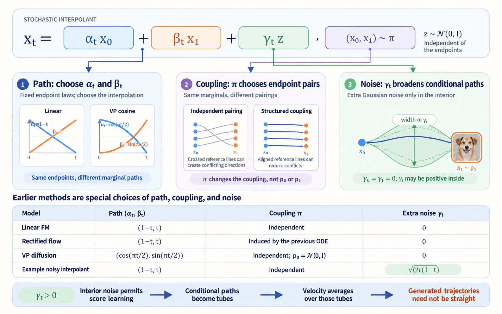

import Objectives from '../../../components/Objectives.astro';
import Prereq from '../../../components/Prereq.astro';
import Ask from '../../../components/Ask.astro';
import Remark from '../../../components/Remark.astro';
import Details from '../../../components/Details.astro';
import Question from '../../../components/Question.astro';
import Answer from '../../../components/Answer.astro';
import QuizBlock from '../../../components/QuizBlock.astro';
import Option from '../../../components/Option.astro';
import Explanation from '../../../components/Explanation.astro';
import Bridge from '../../../components/Bridge.astro';
import Ref from '../../../components/Ref.astro';

# Stochastic Interpolants: Unifying Flows and Diffusions

<Objectives title="After reading, you can">
- **Define a probability path through a stochastic interpolant**, distinguishing endpoint coupling, reference paths, and marginal laws.
- **Derive velocity, score, ODEs, and SDEs** from the same random construction.
- **State what regression error controls.** Under suitable assumptions, velocity error controls ODE Wasserstein error; drift error controls an SDE KL bound.
</Objectives>

<Prereq items={frontmatter.prereqs} />

We have connected reference paths, velocity regression, and ideal ODE transport. With a Gaussian source, denoising and score predictions can also provide velocity.

A trained network is only approximate. The practical question is now:

> **How much distribution error can small local velocity errors cause?**

Can an SDE follow the same marginals as the ODE, and would it yield a different error guarantee?

We need a framework connecting the intermediate law, training target, generation dynamics, and resulting error.

<Ask>
Can one framework describe both flows and diffusions and control their distribution errors?
</Ask>

## Turn reference paths into a random process

Start with endpoint random variables having laws

$$
X_0\sim p_0,\qquad X_1\sim p_1.
$$

Their joint distribution specifies how to draw a pair:

$$
(X_0,X_1)\sim\pi.
$$

This joint $\pi$ is a **coupling**.

<Remark label="Supplement" summary="A precise coupling definition">
A coupling of $p_0$ and $p_1$ is a probability law on the product space with those marginals. For measurable sets $A$ and $B$,

$$
\pi(A\times\mathcal X_1)=p_0(A),
\qquad
\pi(\mathcal X_0\times B)=p_1(B).
$$

The set of such laws is $\Pi(p_0,p_1)$. Coupling changes endpoint dependence without changing either endpoint distribution.
</Remark>

Our earlier choice drew endpoints independently:

$$
\pi_{\mathrm{ind}}(x_0,x_1)=p_0(x_0)p_1(x_1),
$$

This is the **independent coupling**, but alternatives exist.

In the crowd example, source density specifies starting positions and target density specifies station occupancy. Independent pairing randomly assigns stations without considering location, creating many crossings.

A different assignment could favor nearby stations while maintaining every station's required occupancy. The marginal populations stay fixed; only individual pairings change.

After choosing the joint, choose a reference path, for example

$$
I_t(x_0,x_1)=(1-t)x_0+tx_1.
$$

Draw endpoints and evaluate the path:

$$
(X_0,X_1)\sim\pi,\qquad X_t=I_t(X_0,X_1).
$$

With fixed endpoints the path is deterministic; random endpoints make its position a random variable. Albergo, Boffi, and Vanden-Eijnden [1] call the resulting random process a **stochastic interpolant**, extending their earlier flow construction [2].

The distribution of all positions at time $t$ is

$$
p_t
=
\operatorname{Law}_{(X_0,X_1)\sim\pi}
\bigl(I_t(X_0,X_1)\bigr)
=\operatorname{Law}(X_t).
$$

**Coupling determines who goes where; the reference map determines how each pair is connected. Together they determine the intermediate marginals.**

Keep these objects distinct:

| Object | Crowd interpretation | Mathematical role |
|---|---|---|
| Coupling | Assign each person a destination | $(X_0,X_1)\sim\pi$ |
| Reference path | A route for fixed endpoints | $I_t(x_0,x_1)$ |
| Stochastic interpolant | Position after drawing random endpoints | $X_t=I_t(X_0,X_1)$ |
| Marginal path | Population snapshot at each time | $p_t=\operatorname{Law}(X_t)$ |
| ODE trajectory | Route following the averaged crowd field | $dY_t/dt=v_t(Y_t)$ |

Reference paths supply labels; the interpolant is a random process; marginals are its snapshots. Generated ODE trajectories generally do not retrace individual references.

<Remark label="Terminology" summary="Why distinguish a reference path from a stochastic interpolant?">
A reference path emphasizes a curve for fixed endpoints.

A stochastic interpolant emphasizes the random process obtained after drawing endpoints and studying its laws over time. They describe different levels of the same construction.
</Remark>

## Add controlled randomness around the reference path

A legal endpoint connection need not be easy to learn.

Many routes may concentrate through a narrow crossing. Intermediate density can become sharp or singular, and velocity can change rapidly.

To spread intermediate positions without changing endpoints, introduce independent Gaussian $Z$:

$$
\boxed{
X_t
=
\sigma_tX_0+\alpha_tX_1+\gamma_tZ,
\qquad
(X_0,X_1)\sim\pi,\qquad Z\sim\mathcal N(0,I).
}
$$

Use the same source-to-target time convention and endpoint conditions:

$$
\sigma_0=1,\quad \alpha_0=0,
\qquad
\sigma_1=0,\quad \alpha_1=1,
\qquad
\gamma_0=\gamma_1=0.
$$

The term $\gamma_tZ$ gives each reference route some width. Its endpoint values vanish, preserving the source and target while changing intermediate snapshots.

<Remark label="Research results" summary="What can extra Gaussian randomness help with?">
If $p_t^{(0)}$ denotes the unsmoothed intermediate law, independence gives

$$
p_t^{(\gamma)}
=
p_t^{(0)}*\mathcal N(0,\gamma_t^2I).
$$

This is Gaussian convolution. Under their assumptions, [1] establishes spatial regularity of the intermediate densities and velocity, providing a basis for more stable numerical integration.

Related work investigates several different benefits:

- **Flow stability.** In related Gaussian-endpoint settings, Gao and colleagues [5] establish velocity regularity, flow well-posedness, and Wasserstein stability under perturbations.
- **Supervision coverage.** For empirical endpoints, noise fills a neighborhood around each reference line. Su and colleagues [7] analyze smoothing and a $W_1$ generalization gap. Their full stochastic-injection method reports image-to-image improvements, with ablations assessing interpolant noise separately; this is setting-specific evidence rather than a universal guarantee.
- **Memorization.** Reu and colleagues [6] analyze memorizing fields in a straight-path setting and report improved generalization with added noise in their experiments. Crossing reference lines alone need not ensure generalization.

The extra Gaussian also supplies an observed training label $Z$. Its conditional mean converts into the marginal score, enabling score regression for arbitrary endpoint laws.

These results do not imply that more noise always helps. Its schedule changes the path and can matter substantially [7]. Bertrand and colleagues [8] study target stochasticity in a different setting, finding that conditional-mean targets need not harm generalization. **Interpolant smoothing, sampling randomness, and stochastic regression targets are different mechanisms.**
</Remark>

This affine family contains our diffusion and Flow Matching examples. More general interpolants replace the endpoint combination with an arbitrary reference map; we use the affine form below.

There are three design choices:

- **Path:** the endpoint coefficients $(\sigma_t,\alpha_t)$.
- **Coupling:** the joint law $\pi$ of the endpoints.
- **Extra randomness:** the scale $\gamma_t$.

A positive intermediate $\gamma_t$ thickens each reference line into a channel, while zero endpoint scales preserve both marginals.

## Place DDPM, DDIM, and Flow Matching in this framework

The constructions we already know correspond to

| Method | Endpoint coefficients | Coupling | Extra randomness |
|---|---|---|---|
| Linear Flow Matching | $(1-t,t)$ | Independent | $\gamma_t=0$ |
| DDPM/DDIM marginals | VP: $\sigma_t^2+\alpha_t^2=1$ | Independent Gaussian noise and data | $\gamma_t=0$ |

The earlier notes derived linear interpolation and the VP signal/noise amplitudes; see <Ref to="dma-flows-and-continuity"/> and <Ref to="dma-forward-process"/>.

DDPM and DDIM share this row because it records single-time marginals, not their different sampling rules.

SiT [3] applies interpolant-based choices of path, objective, and deterministic or stochastic sampling to large-scale image generation.

Setting $\gamma_t=0$ does not remove source noise. In diffusion, $X_0$ itself is Gaussian; $Z$ would be an additional independent variable.

This framework unifies how endpoint pairing, reference interpolation, and added randomness define a probability path. We now derive dynamics for following it.

## The same regression trick learns velocity

For a known training triple, differentiate:

$$
\dot X_t
=
\dot\sigma_tX_0+\dot\alpha_tX_1+\dot\gamma_tZ.
$$

Use position and time as input and the directly computable derivative as label:

$$
\mathcal L_v(\theta)
=
\mathbb E\!\left[
\left\|v_\theta(X_t,t)-\dot X_t\right\|^2
\right].
$$

Squared error averages compatible labels, giving

$$
v_t^*(x)
=
\mathbb E[\dot X_t\mid X_t=x].
$$

This extends Flow Matching with the term $\dot\gamma_tZ$. We now omit the star from the ideal velocity.

## Why does this field follow the same marginals?

Apply the conditional-average proof from <Ref to="dma-conditional-flow-matching"/>, extending the reference variables to include $Z$:

$$
v_t(x)=\mathbb E[\dot X_t\mid X_t=x],
\qquad
p_t=\operatorname{Law}(X_t).
$$

The field and marginal law satisfy

$$
\partial_t p_t+\nabla\cdot(p_tv_t)=0.
$$

Starting from $Y_0\sim p_0$, solve

$$
\frac{\mathrm dY_t}{\mathrm dt}=v_t(Y_t)
$$

Under suitable regularity and uniqueness, the ODE law equals the interpolant snapshot at every time and reaches $p_1$.

## Extra Gaussian noise also supplies a score target

Since the training triple includes $Z$, regress it as well:

$$
\mathcal L_Z(\theta)
=
\mathbb E\!\left[
\left\|\eta_\theta(X_t,t)-Z\right\|^2
\right],
\qquad
\eta_t^*(x)=\mathbb E[Z\mid X_t=x].
$$

Given the endpoints,

$$
X_t\mid X_0,X_1
\sim
\mathcal N\!\left(
\sigma_tX_0+\alpha_tX_1,
\gamma_t^2I
\right).
$$

For $\gamma_t>0$, the Gaussian posterior identity gives

$$
\boxed{
\nabla_x\log p_t(x)
=
-\frac{1}{\gamma_t}\,
\mathbb E[Z\mid X_t=x]
=
-\frac{\eta_t^*(x)}{\gamma_t}.
}
$$

Predicting displacement from a channel's center therefore estimates the local log-density gradient.

<Remark label="Connection" summary="Does a Gaussian source already give a score identity?">
Yes. With an independent Gaussian source and no extra noise, the earlier construction gives

$$
\mathbb E[X_0\mid X_t=x]
=-\sigma_t\nabla_x\log p_t(x).
$$

and velocity can be written

$$
\begin{aligned}
v_t^*(x)
&=\frac{\dot\alpha_t}{\alpha_t}x
+\left(\dot\sigma_t-
\frac{\dot\alpha_t}{\alpha_t}\sigma_t\right)
\mathbb E[X_0\mid X_t=x]\\
&=\frac{\dot\alpha_t}{\alpha_t}x
-\sigma_t\left(\dot\sigma_t-
\frac{\dot\alpha_t}{\alpha_t}\sigma_t\right)
\nabla_x\log p_t(x).
\end{aligned}
$$

Both quantities depend on the same conditional source-noise mean.

Arbitrary endpoint laws need not offer such a Gaussian direction. Independent $Z$ restores one:

$$
\mathbb E[Z\mid X_t=x]
=-\gamma_t\nabla_x\log p_t(x).
$$

This extends the Gaussian identity to arbitrary endpoint couplings. If the source is already independent Gaussian, extra $Z$ is unnecessary merely to obtain a score; its role can instead be to change and smooth the path.

For arbitrary endpoints, the score alone generally does not determine velocity. Velocity also averages both endpoint contributions.
</Remark>

Set $m_t=\sigma_tX_0+\alpha_tX_1$. Conditional on the endpoints, the displacement is $\gamma_tZ$, so

$$
\nabla_x\log p_t(x\mid X_0,X_1)
=
-\frac{x-m_t}{\gamma_t^2}
=
-\frac{Z}{\gamma_t}.
$$

Average conditional scores over the endpoint posterior:

$$
\begin{aligned}
\nabla_x\log p_t(x)
&=
\mathbb E\!\left[
\nabla_x\log p_t(x\mid X_0,X_1)
\mid X_t=x
\right]\\
&=
-\frac{1}{\gamma_t}
\mathbb E[Z\mid X_t=x].
\end{aligned}
$$

Dividing by the marginal density produces precisely the posterior weights, as in Unit 1.

## Follow the same probability path with an ODE or SDE

The interpolant provides

$$
v_t(x),\qquad s_t(x):=\nabla_x\log p_t(x).
$$

For fixed $\varepsilon>0$, combine velocity and score into a drift:

$$
\boxed{
b_t^\varepsilon(x)
:=
v_t(x)+\varepsilon s_t(x).
}
$$

We need not train two separate networks if only this drift is required. Since

$$
s_t(x)
=-\frac{1}{\gamma_t}\mathbb E[Z\mid X_t=x],
$$

we have

$$
b_t^\varepsilon(x)
=
\mathbb E\!\left[
\dot X_t-\frac{\varepsilon}{\gamma_t}Z
\,\middle|\,X_t=x
\right],
\qquad \gamma_t>0.
$$

so directly regress the combined label:

$$
\mathcal L_b(\theta)
=
\mathbb E\!\left[
\left\|
b_\theta(X_t,t)
-\left(\dot X_t-\frac{\varepsilon}{\gamma_t}Z\right)
\right\|^2
\right].
$$

Its optimum is $b_t^\varepsilon$, which defines the SDE

$$
\boxed{
\mathrm dY_t
=
b_t^\varepsilon(Y_t)\,\mathrm dt
+\sqrt{2\varepsilon}\,\mathrm dW_t.
}
$$

The density of this SDE evolves according to the **Fokker–Planck equation**:

$$
\begin{aligned}
\partial_t p_t
&=-\nabla\cdot\bigl(b_t^\varepsilon p_t\bigr)
+\varepsilon\Delta p_t\\
&=-\nabla\cdot\bigl((v_t+\varepsilon s_t)p_t\bigr)
+\varepsilon\Delta p_t.
\end{aligned}
$$

<Remark label="Supplement" summary="Derive the Fokker–Planck equation">
For a smooth test function, Itô's lemma gives

$$
\frac{\mathrm d}{\mathrm dt}\mathbb E[\phi(Y_t)]
=
\mathbb E\!\left[
\nabla\phi(Y_t)\cdot b_t^\varepsilon(Y_t)
+\varepsilon\Delta\phi(Y_t)
\right].
$$

Write the expectations as density integrals and integrate by parts:

$$
\begin{aligned}
\frac{\mathrm d}{\mathrm dt}\int\phi(x)p_t(x)\,\mathrm dx
&=\int
\left[
\nabla\phi\cdot b_t^\varepsilon
+\varepsilon\Delta\phi
\right]p_t\,\mathrm dx\\
&=\int\phi(x)
\left[
-\nabla\cdot(b_t^\varepsilon p_t)
+\varepsilon\Delta p_t
\right]\mathrm dx.
\end{aligned}
$$

Since this holds for all suitable test functions, the bracketed expression is the density derivative. The Laplacian is the additional contribution of Brownian diffusion.
</Remark>

Because $s_tp_t=\nabla p_t$, the added terms cancel:

$$
-\nabla\cdot(\varepsilon\nabla p_t)
+\varepsilon\Delta p_t=0.
$$

What remains is the same continuity equation. **The interpolant specifies the marginal path; ODE or SDE dynamics specify how samples traverse it.**

<Remark label="Supplement" summary="The sampling diffusion may vary with time">
More generally choose a time-dependent $\varepsilon_t\geq0$:

$$
\mathrm dY_t
=
\bigl[v_t(Y_t)+\varepsilon_t s_t(Y_t)\bigr]\,\mathrm dt
+\sqrt{2\varepsilon_t}\,\mathrm dW_t.
$$

It is independent of position, so

$$
-\nabla\cdot(\varepsilon_t s_t p_t)
+\varepsilon_t\Delta p_t
=0.
$$

With exact fields and exact continuous dynamics, these choices preserve the same marginals. They change trajectories and the response to model and numerical errors.
</Remark>

<Remark label="Implementation" summary="When do we need both velocity and score?">
For one fixed diffusion scale, directly learn the combined drift. To switch between ODE and several SDE scales, or analyze their errors separately, obtain both fields, perhaps using a shared backbone with two heads.

A score describes a density's spatial shape but generally does not determine its temporal evolution. Diffusion is a special case where known forward dynamics and a Gaussian construction supply the missing relation.
</Remark>

## Does smaller regression error imply a closer final distribution?

So far we have used exact fields. Now replace them with learned approximations.

ODEs and SDEs naturally yield different kinds of stability bounds.

### ODE: velocity error controls Wasserstein distance

Let $\hat p_1$ be the terminal law of the learned ODE and assume the learned field is $L$-Lipschitz in space. Define integrated velocity error along the exact marginals:

$$
\mathcal E_v
:=
\int_0^1
\mathbb E_{X_t\sim p_t}
\big[\|v_\theta(X_t,t)-v_t(X_t)\|^2\big]\,\mathrm dt.
$$

This is the excess population regression loss. Under the appropriate assumptions, the bound takes the form [4]

$$
\boxed{
W_2^2(p_1,\hat p_1)
\le
e^{2L}\mathcal E_v.
}
$$

Couple exact and learned trajectories by using the same initial sample. Their separation satisfies

$$
\frac{\mathrm d}{\mathrm dt}\|\hat Y_t-Y_t\|
\le
L\|\hat Y_t-Y_t\|
+\|v_\theta(Y_t,t)-v_t(Y_t)\|.
$$

Apply Grönwall, square, and average:

$$
\mathbb E\|\hat Y_1-Y_1\|^2
\le e^{2L}\mathcal E_v.
$$

These paired endpoints form one coupling of $p_1$ and $\hat p_1$. Since $W_2$ minimizes over all couplings, it cannot be larger. This bounds model error under exact ODE integration; discretization is separate.

### SDE: drift error controls a KL bound

Now consider approximate velocity and score in

$$
\mathrm d\hat Y_t
=
\big[v_\theta(\hat Y_t,t)+\varepsilon s_\theta(\hat Y_t,t)\big]\,\mathrm dt
+\sqrt{2\varepsilon}\,\mathrm dW_t,
$$

with marginal law $\hat p_t$. Define

$$
\mathcal E_s
:=
\int_0^1
\mathbb E_{X_t\sim p_t}
\big[\|s_\theta(X_t,t)-s_t(X_t)\|^2\big]\,\mathrm dt.
$$

For equal diffusion coefficients and different drifts, the relative-entropy calculation gives

$$
\frac{\mathrm d}{\mathrm dt}\mathrm{KL}(p_t\|\hat p_t)
=
\mathbb E_{p_t}[\delta_t\cdot\Delta b_t]
-\varepsilon\mathbb E_{p_t}[\|\delta_t\|^2],
$$

Here $\delta_t$ is the difference of log-density gradients. Apply

$$
a\cdot d-\varepsilon\|a\|^2
\le
\frac{\|d\|^2}{4\varepsilon},
$$

then substitute the drift-error decomposition and integrate:

$$
\boxed{
\mathrm{KL}(p_1\|\hat p_1)
\le
\frac{1}{2\varepsilon}\mathcal E_v
+\frac{\varepsilon}{2}\mathcal E_s.
}
$$

These errors are averaged under the law specified in the bound, here the learned marginals. This need not be the same weighting as ordinary training data. Under the stated assumptions, the inequality connects drift accuracy to terminal relative entropy; it does not turn every empirical training loss directly into a likelihood guarantee.

<Remark label="Caution" summary="Why not the same KL bound for an ODE?">
A deterministic transport calculation lacks the negative diffusion/Fisher term that absorbs the density-gradient difference. Small velocity MSE alone does not generally give the same KL control.

Both exact dynamics follow the intended marginals. Their approximate-field bounds differ: trajectory coupling gives ODE Wasserstein stability, while diffusion supplies the entropy-dissipation term used in the SDE bound.
</Remark>

Do not confuse $\gamma_t$, which changes the interpolant and its intermediate laws, with $\varepsilon_t$, which changes sampling dynamics while preserving ideal marginals. The demo isolates the first.

<iframe loading="lazy" src="/personal_website/notes/research_areas/diffusion-models-applications/w5-0-gamma.en.html" class="demo-frame" title="Extra Gaussian randomness changes the interpolant" style="height: 950px; width: 100%; border: none;"></iframe>

Both endpoints are the same ring. Antipodal pairing with zero extra noise collapses every reference path at the center at mid-time. Increasing $\gamma$ restores width, changing the whole marginal path rather than merely adding sampling noise.

## Should extra randomness always be positive?

<Question label="Discussion" id="Q1">
If positive $\gamma_t$ supplies smooth density and a score target, why not always use it?

<Answer summary="Show the reasoning">
It addresses smoothing and score estimation, rather than directly guaranteeing straight ODE trajectories.

It also changes intermediate laws and reference velocities. Averaging overlapping channels can still produce changing directions.

Velocity regression remains possible with zero extra noise. An independent Gaussian source can already supply a score identity; what is lost in general is the added-$Z$ formula valid for arbitrary endpoint couplings.

Unit 3 examines coupling and trajectory variation. The interpolant lab separately investigates sampling diffusion and its numerical cost.
</Answer>
</Question>

*Figure: these three choices jointly specify the interpolant and its intermediate distributions.*

## Check your understanding

<QuizBlock id="w5-0-a">
How do a fixed-endpoint reference path and a stochastic interpolant differ?
<Option correct>The latter includes randomly drawn endpoints and is a random process.</Option>
<Option>Only capitalization differs.</Option>
<Option>They are respectively an ODE and SDE trajectory.</Option>
<Explanation>A generated ODE trajectory is another object, following the conditional-average field.</Explanation>
</QuizBlock>

<QuizBlock id="w5-0-b">
Why can a VP interpolant contain noise with $\gamma_t=0$?
<Option>The amplitude itself is Gaussian.</Option>
<Option correct>The source endpoint is already Gaussian.</Option>
<Option>The velocity automatically creates noise.</Option>
<Explanation>The source and the additional independent Gaussian are distinct random variables.</Explanation>
</QuizBlock>

<QuizBlock id="w5-0-c">
Why does ODE velocity error naturally control $W_2$, while KL needs more?
<Option>Wasserstein distance only applies to Gaussians.</Option>
<Option correct>Paired trajectories directly bound transport distance; KL is also sensitive to density-gradient differences.</Option>
<Option>ODEs have no marginal laws.</Option>
<Explanation>The SDE diffusion contributes a negative Fisher-divergence term that permits the stated drift-error entropy bound.</Explanation>
</QuizBlock>

<Bridge to="dma-fm-vs-diffusion">
One interpolant now supplies a probability path, velocity, score, ODE and SDE dynamics, and conditional error bounds. These do not yet guarantee accurate coarse sampling. Unit 3 returns to how the generated trajectories vary, even when every reference line is straight.
</Bridge>

## References

1. Albergo, M. S., Boffi, N. M., Vanden-Eijnden, E. [*Stochastic Interpolants: A Unifying Framework for Flows and Diffusions.*](https://arxiv.org/abs/2303.08797) 2023.
2. Albergo, M. S., Vanden-Eijnden, E. [*Building Normalizing Flows with Stochastic Interpolants.*](https://arxiv.org/abs/2209.15571) ICLR 2023.
3. Ma, N., et al. [*SiT: Exploring Flow and Diffusion-Based Generative Models with Scalable Interpolant Transformers.*](https://arxiv.org/abs/2401.08740) 2024.
4. Benton, J., Deligiannidis, G., Doucet, A. [*Error Bounds for Flow Matching Methods.*](https://arxiv.org/abs/2305.16860) TMLR 2024.
5. Gao, Y., Huang, J., Jiao, Y. [*Gaussian Interpolation Flows.*](https://www.jmlr.org/papers/v25/23-1515.html) JMLR 2024.
6. Reu, T., et al. [*Gradient Variance Reveals Failure Modes in Flow-Based Generative Models.*](https://arxiv.org/abs/2510.18118) NeurIPS 2025.
7. Su, S., et al. [*Three Forms of Stochastic Injection for Improved Distribution-to-Distribution Generative Modeling.*](https://arxiv.org/abs/2510.06634) 2025.
8. Bertrand, Q., et al. [*On the Closed-Form of Flow Matching: Generalization Does Not Arise from Target Stochasticity.*](https://proceedings.neurips.cc/paper_files/paper/2025/hash/0ca819b3e8126e19a008c38cd0c371ea-Abstract-Conference.html) NeurIPS 2025.
