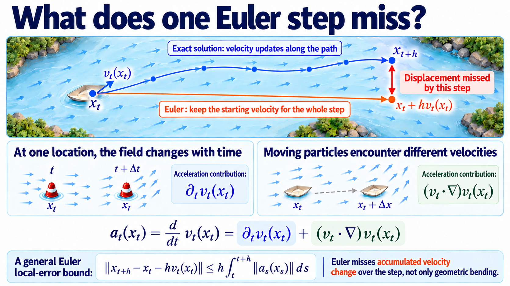
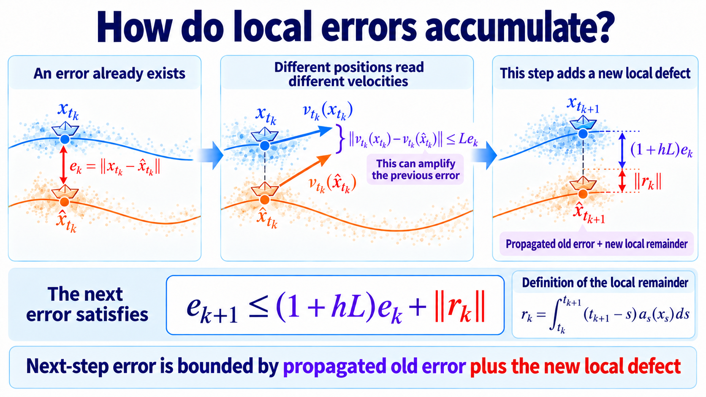

import Objectives from '../../../components/Objectives.astro';
import Prereq from '../../../components/Prereq.astro';
import Ask from '../../../components/Ask.astro';
import Remark from '../../../components/Remark.astro';
import Details from '../../../components/Details.astro';
import Question from '../../../components/Question.astro';
import Answer from '../../../components/Answer.astro';
import QuizBlock from '../../../components/QuizBlock.astro';
import Option from '../../../components/Option.astro';
import Explanation from '../../../components/Explanation.astro';
import VizPlan from '../../../components/VizPlan.astro';
import Bridge from '../../../components/Bridge.astro';
import Ref from '../../../components/Ref.astro';

# How Do We Measure the Velocity Changes Euler Misses?

<Objectives title="After reading, you can">
- **Define trajectory acceleration** as the material derivative of velocity.
- **Derive endpoint error from a local remainder**, identifying step size and accumulated acceleration.
- **Measure the generated trajectory**, rather than assuming straight reference labels imply zero acceleration.
</Objectives>

<Prereq items={frontmatter.prereqs} />

Euler checks velocity at the start of a step and freezes both direction and speed. Turning causes deviation, but even straight motion can overshoot or undershoot if speed changes.

We therefore need more than geometric curvature: how much velocity change did Euler miss, and what endpoint error can it cause?

<Ask>
Can we quantify velocity variation along a trajectory and bound its numerical error?
</Ask>

<iframe loading="lazy" src="/personal_website/notes/research_areas/diffusion-models-applications/w5-2-curvature.en.html" class="demo-frame" title="Euler resolution changes trajectory and endpoint error" style="height: 720px; width: 100%; border: none;"></iframe>

**Interactive demo.** Keep the field and starting point fixed while changing Euler's step count. The fine numerical reference remains unchanged; coarse steps cut across turns and alter the endpoint.

## What does one Euler step omit?

Follow the standard local-to-global Euler analysis [1].

Consider an exact ODE trajectory:

$$
\frac{\mathrm d x_t}{\mathrm d t}=v_t(x_t).
$$

Its exact displacement is

$$
x_{t+h}=x_t+\int_t^{t+h}v_\tau(x_\tau)\,\mathrm d\tau.
$$

Euler replaces the entire interval's velocity with its initial value, yielding $x_t+hv_t(x_t)$.

Define acceleration along the exact trajectory:

$$
a_s(x_s):=\frac{\mathrm d}{\mathrm ds}v_s(x_s).
$$

Integrating acceleration gives the intermediate velocity change:

$$
v_\tau(x_\tau)
=v_t(x_t)+\int_t^\tau \frac{\mathrm d}{\mathrm ds}v_s(x_s)\,\mathrm ds
=v_t(x_t)+\int_t^\tau a_s(x_s)\,\mathrm ds.
$$

Substitute this into the displacement and exchange the order of integration:

$$
\begin{aligned}
x_{t+h}
&=x_t+h\,v_t(x_t)
+\int_t^{t+h}\int_t^\tau a_s(x_s)\,\mathrm ds\,\mathrm d\tau\\
&=x_t+h\,v_t(x_t)
+\int_t^{t+h}(t+h-s)\,a_s(x_s)\,\mathrm ds.
\end{aligned}
$$

The final integral is the omitted local remainder. Its norm satisfies

$$
\left\|x_{t+h}-x_t-hv_t(x_t)\right\|
\le h\int_t^{t+h}\|a_\tau(x_\tau)\|\,\mathrm d\tau.
$$

Expand acceleration using the chain rule:

$$
\begin{aligned}
a_t(x_t)&=\frac{d}{dt}v_t(x_t)\\
&=\underbrace{\partial_t v_t(x_t)}_{\text{field changes with time}}
+\underbrace{(v_t\cdot\nabla)v_t(x_t)}_{\text{particle changes location}}.
\end{aligned}
$$

One contribution comes from the field changing at a fixed position. The other comes from a particle moving through a spatially varying field. Their sum is the experienced acceleration.

<Remark label="Supplement" summary="Acceleration is not geometric curvature">
Let $\rho_t$ be speed, $T_t$ the unit tangent, and $s$ arc length. Geometric curvature is

$$
\kappa_t=\left\|\frac{\mathrm dT_t}{\mathrm ds}\right\|,
$$

It measures direction change per unit arc length. Acceleration instead decomposes as

$$
a_t(x_t)
=\frac{\mathrm d\rho_t}{\mathrm dt}T_t
+\rho_t^2\kappa_tN_t.
$$

The tangential term changes speed; the normal term changes direction. A straight path can have zero curvature but nonzero acceleration. Euler's bound uses the full acceleration.
</Remark>

Constant-speed straight motion has zero acceleration and makes every Euler step exact. This is the trajectory property we seek, rather than straightness without a speed condition.

*Figure: Euler retains the initial arrow while exact motion updates it continuously, through both temporal and spatial changes.*

## How does one-step error reach the endpoint?

A displaced numerical state also queries velocity at the wrong location. On a uniform grid, define its distance from the exact state:

$$
e_k:=\|x_{t_k}-\hat x_{t_k}\|.
$$

The exact update is

$$
x_{t_{k+1}}
=x_{t_k}+h\,v_{t_k}(x_{t_k})+r_k,
$$

with local remainder

$$
r_k=\int_{t_k}^{t_{k+1}}(t_{k+1}-s)a_s(x_s)\,\mathrm ds,\qquad
\|r_k\|\le h\int_{t_k}^{t_{k+1}}\|a_s(x_s)\|\,\mathrm ds.
$$

while Euler uses

$$
\hat x_{t_{k+1}}
=\hat x_{t_k}+h\,v_{t_k}(\hat x_{t_k}).
$$

Subtract:

$$
x_{t_{k+1}}-\hat x_{t_{k+1}}
=(x_{t_k}-\hat x_{t_k})
+h\big(v_{t_k}(x_{t_k})-v_{t_k}(\hat x_{t_k})\big)
+r_k.
$$

The terms represent previous displacement, velocity mismatch from that displacement, and new local remainder. Control the second using a spatial Lipschitz assumption.

<Remark label="Supplement" summary="Lipschitz continuity controls nearby velocity differences">
Assume that at every time and for all positions,

$$
\|v_t(x)-v_t(y)\|\le L\|x-y\|,
$$

Then the field is $L$-Lipschitz in space. Two particles distance $\delta$ apart see velocities differing by at most $L\delta$. Larger $L$ allows stronger sensitivity to position errors.

This compares positions at the same time. Temporal variation is already included in the local remainder.
</Remark>

Take norms and apply the triangle inequality:

$$
\begin{aligned}
e_{k+1}
&\leq\|x_{t_k}-\hat x_{t_k}\|\\
&\quad+h\|v_{t_k}(x_{t_k})-v_{t_k}(\hat x_{t_k})\|\\
&\quad+\|r_k\|.
\end{aligned}
$$

The first term is $e_k$, and Lipschitz continuity bounds the second by $hLe_k$. Therefore

$$
\begin{aligned}
e_{k+1}
&\le e_k+hLe_k+\|r_k\|\\
&=(1+hL)e_k+\|r_k\|.
\end{aligned}
$$

Previous error may grow by $(1+hL)$, and each step adds its own remainder.

*Figure: an earlier displacement changes the next velocity query, propagating old error while new local error is added.*

Unroll from $e_0=0$ through $N=1/h$ steps:

$$
\begin{aligned}
e_N
&\le \sum_{k=0}^{N-1}(1+hL)^{N-1-k}\|r_k\|\\
&\le e^L h\sum_{k=0}^{N-1}
\int_{t_k}^{t_{k+1}}\|a_s(x_s)\|\,\mathrm ds\\
&=e^L h\int_0^1\|a_t(x_t)\|\,\mathrm dt.
\end{aligned}
$$

Use $(1+hL)^N\leq e^L$, a discrete Grönwall estimate over the unit interval.

For each shared initial point,

$$
\boxed{
\|x_1-\hat x_1\|
\le e^L h\int_0^1\|a_t(x_t)\|\,\mathrm dt
}
$$

The bound separates three factors:

- **Step size $h$:** refinement reduces this upper bound linearly.
- **Integrated acceleration:** accumulated velocity variation includes turns, acceleration, and deceleration.
- **Amplification $e^L$:** field sensitivity can magnify local displacement.

> **Euler error is controlled by integrated trajectory acceleration, rather than geometric curvature alone.**

Practical generation uses a learned field and then discretizes it. Endpoint error has two distinct sources:

1. **Modeling error:** the learned field differs from the ideal one.
2. **Discretization error:** Euler approximates the fixed learned ODE.

Start three constructions from the same random source:

$$
\frac{\mathrm dX_t}{\mathrm dt}=v_t(X_t),\qquad
\frac{\mathrm d\widetilde X_t}{\mathrm dt}=v_\theta(\widetilde X_t,t),\qquad
\widehat X_{t_{k+1}}
=\widehat X_{t_k}+h\,v_\theta(\widehat X_{t_k},t_k).
$$

Let $X_1$ be the ideal endpoint, $\widetilde X_1$ the exactly integrated learned endpoint, and $\widehat X_1$ its Euler approximation. Their laws are

$$
X_1\sim p_1,\qquad
\widetilde X_1\sim\widetilde p_1,\qquad
\widehat X_1\sim\widehat p_1.
$$

Wasserstein distance minimizes squared transport cost over couplings:

$$
W_2^2(q,r)
=\inf_{\Gamma\in\Pi(q,r)}
\mathbb E_{(Y,\widehat Y)\sim\Gamma}
\|Y-\widehat Y\|^2.
$$

Shared starting points provide legal endpoint couplings. The triangle inequality gives

$$
\begin{aligned}
W_2(p_1,\widehat p_1)
&\leq\underbrace{W_2(p_1,\widetilde p_1)}_{\text{modeling error}}\\
&\quad+\underbrace{W_2(\widetilde p_1,\widehat p_1)}_{\text{discretization error}}.
\end{aligned}
$$

### First term: learned versus ideal velocity

Define the population velocity error:

$$
\mathcal E_v
:=\int_0^1
\mathbb E_{X_t\sim p_t}
\big[\|v_\theta(X_t,t)-v_t(X_t)\|^2\big]\,\mathrm dt.
$$

Assume the learned field is $L$-Lipschitz. Add and subtract its value at the ideal position:

$$
\begin{aligned}
\frac{\mathrm d}{\mathrm dt}\|\widetilde X_t-X_t\|
&\le
\|v_\theta(\widetilde X_t,t)-v_t(X_t)\|\\
&\le
\underbrace{\|v_\theta(\widetilde X_t,t)-v_\theta(X_t,t)\|}_{\le L\|\widetilde X_t-X_t\|}
+\underbrace{\|v_\theta(X_t,t)-v_t(X_t)\|}_{\text{velocity prediction error}}.
\end{aligned}
$$

Write the instantaneous prediction error as

$$
\delta_t:=\|v_\theta(X_t,t)-v_t(X_t)\|.
$$

Grönwall accumulates it to the endpoint:

$$
\|\widetilde X_1-X_1\|
\le e^L\int_0^1\delta_t\,\mathrm dt.
$$

Square, average, and use Cauchy–Schwarz:

$$
\begin{aligned}
\mathbb E\|\widetilde X_1-X_1\|^2
&\le e^{2L}\,
\mathbb E\left[\left(\int_0^1\delta_t\,\mathrm dt\right)^2\right]\\
&\le e^{2L}\int_0^1\mathbb E[\delta_t^2]\,\mathrm dt
=e^{2L}\mathcal E_v.
\end{aligned}
$$

Since the paired endpoints define a coupling,

$$
W_2(p_1,\widetilde p_1)
\le e^L\sqrt{\mathcal E_v}.
$$

This term remains even with exact numerical integration.

### Second term: Euler versus the learned ODE

Now hold the learned field fixed and define its trajectory acceleration:

$$
\widetilde a_t(\widetilde X_t)
:=\frac{\mathrm d}{\mathrm dt}v_\theta(\widetilde X_t,t),\qquad
\widetilde A(X_0)
:=\int_0^1\|\widetilde a_t(\widetilde X_t)\|\,\mathrm dt.
$$

Apply the pathwise Euler estimate to the shared-source coupling:

$$
\begin{aligned}
W_2^2(\widetilde p_1,\widehat p_1)
&\le\mathbb E\|\widetilde X_1-\widehat X_1\|^2\\
&\le e^{2L}h^2\mathbb E[\widetilde A(X_0)^2],
\end{aligned}
$$

Thus

$$
W_2(\widetilde p_1,\widehat p_1)
\le e^L h
\Big(\mathbb E[\widetilde A(X_0)^2]\Big)^{1/2}.
$$

This is the finite-step contribution, which decreases with refinement under the stated regularity.

Combining the terms gives

$$
\boxed{
W_2(p_1,\widehat p_1)
\le e^L
\left[
\sqrt{\mathcal E_v}
+h\Big(\mathbb E[\widetilde A(X_0)^2]\Big)^{1/2}
\right].
}
$$

Increasing steps reduces numerical error but cannot remove a fixed model error. Conversely, small regression error does not ensure accurate coarse sampling if the learned trajectory has substantial velocity variation.

These shared-source couplings only give upper bounds. Small Wasserstein distance does not imply small error for a particular pairing of individual trajectories; the distance may find a cheaper pairing.

## Check your understanding

<QuizBlock id="w5-2-a">
Which quantity directly accumulates velocity variation along a trajectory?
<Option>The Lipschitz constant alone.</Option>
<Option correct>$\int_0^1\|a_t(x_t)\|\,dt$.</Option>
<Option>The step size alone.</Option>
<Explanation>The acceleration integral includes both speed and direction changes. Lipschitz continuity controls sensitivity to displaced positions.</Explanation>
</QuizBlock>

<QuizBlock id="w5-2-b">
What does $(v_t\cdot\nabla)v_t$ describe?
<Option>Explicit time dependence of the field.</Option>
<Option correct>Velocity change experienced by moving to a new position.</Option>
<Option>Divergence.</Option>
<Explanation>A time-independent field can still accelerate a particle if it varies spatially.</Explanation>
</QuizBlock>

<QuizBlock id="w5-2-c">
Which statement is correct?
<Option>Straight references make one-step Euler exact.</Option>
<Option correct>The relevant acceleration belongs to the generated ODE trajectory.</Option>
<Option>Field sensitivity never affects error.</Option>
<Explanation>Reference paths supply labels; generation follows the averaged field.</Explanation>
</QuizBlock>

<QuizBlock id="w5-2-d">
Two fields have the same acceleration integral, but different amplification constants $C_L$. What follows?
<Option>Their actual errors must agree.</Option>
<Option correct>The larger amplification constant permits stronger growth of local errors.</Option>
<Option>The integral already includes the amplification constant.</Option>
<Explanation>The bound depends on step size, accumulated acceleration, and stability separately.</Explanation>
</QuizBlock>

<Bridge to="dma-rectified-flow">
The bound motivates reducing velocity variation, with constant-speed straight trajectories as an ideal case. Changing the coupling can change the marginal field, but how should we choose it?

The next two notes develop Reflow and minibatch optimal transport as different constructions for this purpose.
</Bridge>

## References

1. Hairer, E., Nørsett, S. P., Wanner, G. [*Solving Ordinary Differential Equations I: Nonstiff Problems.*](https://link.springer.com/book/10.1007/978-3-540-78862-1) Springer.
2. Liu, X., Gong, C., Liu, Q. [*Flow Straight and Fast: Learning to Generate and Transfer Data with Rectified Flow.*](https://arxiv.org/abs/2209.03003) ICLR 2023.
