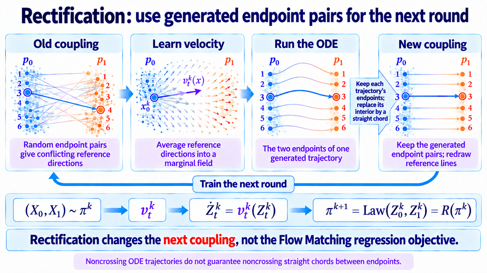

import Objectives from '../../../components/Objectives.astro';
import Prereq from '../../../components/Prereq.astro';
import Ask from '../../../components/Ask.astro';
import Remark from '../../../components/Remark.astro';
import Details from '../../../components/Details.astro';
import Question from '../../../components/Question.astro';
import Answer from '../../../components/Answer.astro';
import QuizBlock from '../../../components/QuizBlock.astro';
import Option from '../../../components/Option.astro';
import Explanation from '../../../components/Explanation.astro';
import VizPlan from '../../../components/VizPlan.astro';
import Bridge from '../../../components/Bridge.astro';
import Ref from '../../../components/Ref.astro';

# Straightening I: Reflow

<Objectives title="After reading, you can">
- **Write one rectification round:** learn a field, solve its ODE, and pair each starting point with its generated endpoint.
- **State the ideal guarantees:** preserve endpoint marginals and avoid increasing convex displacement costs.
- **Separate cost and straightness claims:** quadratic cost decreases by $V+S$, while those variances need not decrease every round and do not imply OT.
</Objectives>

<Prereq items={frontmatter.prereqs} />

## How can the learned field produce straighter trajectories?

For fixed step size and spatial stability, Euler error is bounded using

$$
e^Lh\int_0^1\|a_t(x_t)\|\,\mathrm dt
$$

where acceleration measures velocity change along the generated trajectory. Constant-speed straight motion has zero acceleration and exact Euler integration.

<Ask>
Can we obtain nearly constant-speed straight trajectories while still transporting $p_0$ to $p_1$?
</Ask>

In a dispersing crowd, a traveler following local people keeps changing direction when nearby groups disagree or split.

Reference paths supply those local directions. Regression averages them; as compatible paths change along a generated trajectory, the average direction can change too.

Can a different endpoint assignment make reference directions more consistent without changing the endpoint populations?

## Use the endpoints already paired by an ODE

A deterministic assignment fixes the endpoint once the starting point is known, without drawing additional randomness.

Our learned ODE already supplies such an assignment:

$$
\frac{\mathrm dZ_t}{\mathrm dt}=v_\theta(Z_t,t)
$$

With a unique solution, it determines the whole trajectory, and distinct trajectories cannot meet at the same time.

Each starting point therefore has a generated endpoint, rather than an independently sampled target.

<Remark label="Supplement" summary="Why can unique ODE trajectories not cross at the same time?">
At a shared position and time, a field gives one velocity. However, agreement of instantaneous velocity alone is not enough to establish uniqueness.

If two solutions meet, use their meeting point and time as an initial condition. Under forward and backward uniqueness, both must be the same solution, so they cannot have come from distinct initial points.

This rules out meeting and then separating at the same time. Different trajectories can still visit a spatial location at different times.
</Remark>

These deterministic routes may still bend. Could we retain their endpoint assignments while replacing their interiors by straight references?

> **Pair endpoints produced by the existing flow, then reconnect each pair with a straight line.**

Let everyone follow the current navigation once. Record each person's start and actual arrival. Use those paired endpoints for the next training round rather than assigning destinations independently again.

First consider ideal velocity learning. Begin with a coupling $\pi^{(0)}$, often independent, and perform three operations:

1. Construct linear references and their marginal field $v_t(x)=\mathbb E[X_1-X_0\mid I_t=x]$.
2. Integrate that field from $Z_0^{(1)}=X_0$ to obtain $Z_1^{(1)}$.
3. Use their joint law as the next coupling:

$$
\pi^{(1)}:=\operatorname{Law}(Z_0^{(1)},Z_1^{(1)}).
$$

Liu, Gong, and Liu [1] call this operation **rectification**. As a map between couplings,

$$
\pi^{(1)}=\mathsf R(\pi^{(0)}).
$$

The objective stays the same. Its training endpoint-pair distribution changes.

Repeating the construction gives

$$
\pi^{(k+1)}=\mathsf R(\pi^{(k)}).
$$

The repeated procedure is **reflow**.

*Figure: ideal reflow yields asymptotically vanishing straightness, without guaranteeing a decrease at every round.*

## What does an ODE do with crossed Gaussian groups?

Consider upper and lower Gaussian clusters at both endpoints:

$$
\begin{aligned}
p_0&=\tfrac12\mathcal N((-2,1),\sigma^2I)
+\tfrac12\mathcal N((-2,-1),\sigma^2I),\\
p_1&=\tfrac12\mathcal N((2,1),\sigma^2I)
+\tfrac12\mathcal N((2,-1),\sigma^2I).
\end{aligned}
$$

Deliberately pair upper-left with lower-right and vice versa. Draw $S\in\{-1,+1\}$ uniformly and define

$$
\begin{aligned}
X_0&=(-2,S)+\sigma\varepsilon_0,\\
X_1&=(2,-S)+\sigma\varepsilon_1,
\qquad \varepsilon_0,\varepsilon_1\overset{\mathrm{iid}}{\sim}\mathcal N(0,I).
\end{aligned}
$$

The reference streams cross. The marginal field averages their velocities using the probability that the present location belongs to either stream.

<Remark label="Supplement" summary="Why is the initial field analytic?">
Conditional on the group sign, the linear interpolation has the following mean, variance, and velocity:

$$
\begin{aligned}
m_{t,s}&=(-2+4t,(1-2t)s),\\
q_t&=(1-t)^2+t^2,\\
\rho_{t,s}(x)&=\mathcal N(x;m_{t,s},\sigma^2q_tI),\\
u_{t,s}(x)&=(4,-2s)+\frac{2t-1}{q_t}(x-m_{t,s}).
\end{aligned}
$$

The marginal velocity is therefore

$$
v_t(x)=
\frac{\displaystyle\sum_{s\in\{-1,+1\}}\tfrac12\rho_{t,s}(x)u_{t,s}(x)}
{\displaystyle\sum_{s\in\{-1,+1\}}\tfrac12\rho_{t,s}(x)}.
$$

Equal prior weights do not imply equal posterior weights at every position. Each contribution is weighted by its local conditional density.

This closed form describes the original coupling only. After rectification, the demo rebuilds references from generated endpoint pairs and estimates their new field.
</Remark>

<iframe loading="lazy" src="/personal_website/notes/research_areas/diffusion-models-applications/w5-3-crossing-reflow.en.html" class="demo-frame" title="Crossed Gaussian references, rectification, and reflow" style="height: 900px; width: 100%; border: none;"></iframe>

**Interactive demo.** Compare green crossing references, yellow rectified ODE motion, and purple reflow motion. The initial field is analytic; the next field is estimated only from the newly paired endpoints. Move time to inspect each construction.

InstaFlow [2] applies reflow to fast text-to-image generation. SD3 [3] uses rectified-flow linear-path training without repeated reflow. The shared name does not imply identical procedures.

## Does reflow accomplish the intended goal?

The construction is plausible, but we need to check its properties mathematically.

We ask:

- Does it preserve the required endpoint distributions?
- In what precise sense does it straighten trajectories?

Assume ideal fields, exactly solved unique ODEs, and finite endpoint second moments. Let $\pi^{(k)}$ denote the old endpoint coupling.

Its linear reference process is

$$
I_t^{(k)}=(1-t)Z_0^{(k)}+tZ_1^{(k)}.
$$

Its displacement labels define the ideal field

$$
v_t(x)=\mathbb E\!\left[
Z_1^{(k)}-Z_0^{(k)}\mid I_t^{(k)}=x
\right].
$$

The next ODE follows that newly averaged field:

$$
\frac{\mathrm dZ_t^{(k+1)}}{\mathrm dt}
=v_t(Z_t^{(k+1)}),
\qquad Z_0^{(k+1)}=Z_0^{(k)}.
$$

**Old endpoints determine new reference lines; averaging those lines determines the new ODE.** Each round recomputes the field, rather than repeatedly integrating a fixed field.

**First, preserve marginals.** The new ODE retains the source law:

$$
Z_0^{(k+1)}=Z_0^{(k)}\sim p_0.
$$

The conditional-average theorem gives identical marginals for the new ODE and old interpolation. At the endpoint,

$$
Z_1^{(k+1)}\sim p_1.
$$

Thus the new endpoint joint remains a coupling of $p_0$ and $p_1$.

Individual assignments change, while starting and destination population counts remain unchanged.

## How is cost reduction related to two velocity variances?

**Second, compare cost.** Define expected squared endpoint displacement:

$$
C^{(k)}:=\mathbb E_{\pi^{(k)}}\!\left[
\left\|Z_1^{(k)}-Z_0^{(k)}\right\|^2
\right].
$$

This measures assigned destination distance, not the actual path length. How much does it decrease?

For the old references, define their disagreement with the conditional mean:

$$
V(\pi^{(k)})
=\int_0^1\mathbb E\!\left[
\left\|
\left(Z_1^{(k)}-Z_0^{(k)}\right)-v_t(I_t^{(k)})
\right\|^2
\right]\mathrm dt.
$$

This is integrated **conditional variance** of reference labels. Zero means almost-everywhere agreement at a shared position and time. It is not neural approximation error.

For the new ODE, average velocity over the unit interval equals displacement:

$$
\int_0^1 v_t(Z_t^{(k+1)})\,\mathrm dt
=Z_1^{(k+1)}-Z_0^{(k+1)}.
$$

Now measure temporal velocity variation along each trajectory, averaged over its initial point. The original paper calls this **straightness**:

$$
S(Z^{(k+1)})
=\int_0^1\mathbb E\!\left[
\left\|
\left(Z_1^{(k+1)}-Z_0^{(k+1)}\right)
-\frac{\mathrm d Z_t^{(k+1)}}{\mathrm dt}
\right\|^2
\right]\mathrm dt.
$$

Zero means almost every trajectory has constant velocity equal to its endpoint displacement. Different particles may have different constant velocities; the variance compares a particle with itself over time.

The acceleration integral from the error analysis is

$$
\int_0^1\left\|a_t(Z_t^{(k+1)})\right\|\,\mathrm dt
$$

These are different quantities: straightness compares velocity with its temporal mean, while integrated acceleration measures total velocity variation. They agree on the zero-variation case:

$$
S(Z^{(k+1)})=0
\quad\Longrightarrow\quad
\frac{\mathrm dZ_t^{(k+1)}}{\mathrm dt}
=Z_1^{(k+1)}-Z_0^{(k+1)}
\quad\Longrightarrow\quad
a_t(Z_t^{(k+1)})=0.
$$

Zero straightness therefore makes the acceleration integral vanish under the smoothness assumptions. Outside that case they need not improve together. Reflow directly controls the cost decomposition below, rather than automatically controlling the entire Euler bound.

Split each old label into its conditional mean and residual. The residual has zero conditional mean, so the squared cross term vanishes:

$$
C^{(k)}
=V(\pi^{(k)})
+\int_0^1\mathbb E\!\left[\left\|v_t(I_t^{(k)})\right\|^2\right]\mathrm dt.
$$

The old interpolation and new ODE have equal marginals, so their expected squared field values agree:

$$
\begin{aligned}
&\int_0^1\mathbb E\|v_t(I_t^{(k)})\|^2\,\mathrm dt\\
&\qquad=\int_0^1\mathbb E\|v_t(Z_t^{(k+1)})\|^2\,\mathrm dt.
\end{aligned}
$$

Expand the new straightness and use its integrated velocity identity:

$$
\begin{aligned}
S(Z^{(k+1)})
&=\int_0^1\mathbb E\|v_t(Z_t^{(k+1)})\|^2\,\mathrm dt\\
&\quad-2C^{(k+1)}+C^{(k+1)}.
\end{aligned}
$$

This is mean squared velocity minus squared mean velocity. Rearrange:

$$
\int_0^1\mathbb E\|v_t(Z_t^{(k+1)})\|^2\,\mathrm dt
=S(Z^{(k+1)})+C^{(k+1)}.
$$

Substitute into the old cost decomposition to obtain [1, Theorem 3.7]

$$
\boxed{
C^{(k)}-C^{(k+1)}
=V(\pi^{(k)})+S(Z^{(k+1)}).
}
$$

Both variances are nonnegative. Thus cost never increases, and decreases strictly whenever their sum is positive.

> **Cost is non-increasing each round. Its decrease $V+S$, and each component separately, need not be monotone.**

For a convex cost with finite expectations, apply Jensen first over time, use equality of marginals, then apply Jensen to the conditional label average:

$$
\begin{aligned}
&\mathbb E\!\left[c\!\left(Z_1^{(k+1)}-Z_0^{(k+1)}\right)\right] \\
&=\mathbb E\!\left[c\!\left(\int_0^1v_t(Z_t^{(k+1)})\,\mathrm dt\right)\right] \\
&\le\int_0^1\mathbb E\!\left[c\!\left(v_t(Z_t^{(k+1)})\right)\right]\mathrm dt \\
&=\int_0^1\mathbb E\!\left[c\!\left(v_t(I_t^{(k)})\right)\right]\mathrm dt \\
&\le\mathbb E\!\left[c\!\left(Z_1^{(k)}-Z_0^{(k)}\right)\right].
\end{aligned}
$$

The two averages give non-increasing convex cost. The exact variance identity is specific to quadratic cost.

Sum the quadratic identities over rounds. Costs telescope:

$$
\begin{aligned}
\sum_{k=0}^{K}\Big(
S(Z^{(k+1)})+V(\pi^{(k)})
\Big)
&=C^{(0)}-C^{(K+1)}\\
&\le C^{(0)}.
\end{aligned}
$$

Divide by the number of rounds:

$$
\frac{1}{K+1}
\sum_{k=0}^{K}
\Big(S(Z^{(k+1)})+V(\pi^{(k)})\Big)
\le \frac{C^{(0)}}{K+1}.
$$

The smallest value is at most the average:

$$
\min_{0\le k\le K}
\Big(S(Z^{(k+1)})+V(\pi^{(k)})\Big)
\le \frac{C^{(0)}}{K+1}
=O(1/K).
$$

Thus at least one of the first rounds has a small combined reference disagreement and trajectory straightness.

The summation also gives an asymptotic statement. Define

$$
A_k:=S(Z^{(k+1)})+V(\pi^{(k)})\ge 0.
$$

If ideal rectification can continue indefinitely and the initial cost is finite,

$$
\sum_{k=0}^{\infty}A_k\le C^{(0)}<\infty.
$$

A summable sequence of nonnegative terms must tend to zero:

$$
A_k\longrightarrow 0,
$$

Each nonnegative component therefore tends to zero as well.

The best-iterate $O(1/K)$ bound and asymptotic vanishing are different statements. Neither establishes

$$
S(Z^{(k+2)})\le S(Z^{(k+1)}).
$$

Cost is monotone; the individual decreases and variances need not be. Asymptotic vanishing does not imply round-by-round improvement.

Nor does decreasing cost mean finding its minimum over all legal couplings. That stronger problem is **optimal transport (OT)**.

<Remark label="Supplement" summary="What is quadratic optimal transport?">
Among all endpoint couplings, solve

$$
\pi_{\mathrm{OT}}\in
\underset{\pi\in\Pi(p_0,p_1)}{\operatorname{argmin}}
\mathbb E_{(X_0,X_1)\sim\pi}\|X_1-X_0\|^2.
$$

Reflow compares each round with the previous one. OT compares with every admissible coupling.
</Remark>

Vanishing straightness and label variance alone therefore do not imply convergence to an OT coupling.

Straightness asks whether each chosen endpoint pair can be joined at constant velocity. OT additionally asks whether different endpoint assignments could reduce transport cost.

For example, let

$$
p_0=p_1=\mathcal N(0,I_2),
$$

and rotate each source by $90^\circ$. Its linear interpolation is

$$
I_t=((1-t)I+tR)X_0.
$$

For that rotation,

$$
\det((1-t)I+tR)=(1-t)^2+t^2>0,
$$

The interpolation matrix is invertible throughout the interval. Position and time uniquely identify the source, so no reference labels conflict. The coupling is already straight, with $S=V=0$.

But the marginals agree, so the identity coupling has cost

$$
\mathbb E\|X_1-X_0\|^2=0,
$$

while rotating points has positive cost. A direct route need not use the cheapest destination assignment. Further counterexamples appear in [5,6].

Stronger conclusions require additional conditions or modified rectification.

- Bansal and colleagues [4] provide sufficient Jacobian conditions for complete straightening in a subsequent rectification, and stronger conditions for a quadratic Monge map.
- Hertrich, Chambolle, and Delon [5] give non-optimal fixed points and vanishing-loss counterexamples, clarifying the importance of support and regularity assumptions.
- Wang and colleagues [6] study Gaussian cases and a cost-aware modified procedure, obtaining OT convergence under additional conditions. These are stronger, more specialized claims than ordinary reflow's cost identity.

These results do not establish universal round-by-round straightness decrease or unconditional OT convergence for ordinary reflow.

<Question label="Discussion" id="Q1">
If unique ODE trajectories cannot cross, why can a single rectification still leave curved trajectories in the next round?

<Answer summary="Show the reasoning">
The next round retains endpoints, then draws new chords:

$$
I_t=(1-t)Z_0^{(1)}+tZ_1^{(1)}.
$$

Disjoint curved trajectories can have crossing endpoint chords. Their new average field can therefore turn again.

Generated endpoint pairing can reduce conflict in practice, but does not guarantee zero label variance after one round. This motivates repeating the procedure.
</Answer>
</Question>

<iframe loading="lazy" src="/personal_website/notes/research_areas/diffusion-models-applications/w5-3-reflow.en.html" class="demo-frame" title="Reflow and coarse Euler sampling" style="height: 920px; width: 100%; border: none;"></iframe>

**Interactive demo.** Fix one, two, or three numerical steps and compare the original field with one rectification. Yellow is a fine ODE reference; purple is coarse Euler. Their endpoint separation measures numerical error for that field.

## Check your understanding

<QuizBlock id="w5-3-a">
Why does ideal rectification preserve endpoint marginals?
<Option>It is a linear operation.</Option>
<Option correct>The exact conditional-average field generates the reference marginal path.</Option>
<Option>The old coupling must already be optimal.</Option>
<Explanation>The marginal-path theorem makes the generated endpoint law equal to $p_1$.</Explanation>
</QuizBlock>

<QuizBlock id="w5-3-b">
What does zero trajectory straightness mean?
<Option>The endpoint coupling is OT.</Option>
<Option correct>Velocity is constant along almost every trajectory, making Euler exact.</Option>
<Option>The endpoint distributions are equal.</Option>
<Explanation>Constant-speed straight transport need not be minimum-cost transport.</Explanation>
</QuizBlock>

<QuizBlock id="w5-3-c">
Why can next-round references still cross?
<Option>The old ODE trajectories cross at the same time.</Option>
<Option correct>Endpoint chords of non-crossing curves can cross.</Option>
<Option>Rectification changes the target marginal.</Option>
<Explanation>The new training references retain endpoints rather than the old curved routes.</Explanation>
</QuizBlock>

<QuizBlock id="w5-3-d">
Which ideal guarantee is valid?
<Option correct>Quadratic cost never increases, but individual straightness and label variance need not decrease every round.</Option>
<Option>Cost monotonicity implies strictly decreasing straightness.</Option>
<Option>Vanishing $S+V$ proves OT convergence.</Option>
<Explanation>The nonnegative cost decrease is $V+S$. Monotonicity of cost does not imply monotonicity of its decreases.</Explanation>
</QuizBlock>

<Bridge to="dma-minibatch-ot">
Ideal reflow preserves marginals and offers asymptotic straightening, but repeatedly training and solving ODEs is expensive. Practical rounds may also propagate model and numerical errors.

Can we construct more structured pairs directly, without generating full trajectories first? The next note develops that alternative.
</Bridge>

## References

1. Liu, X., Gong, C., Liu, Q. [*Flow Straight and Fast: Learning to Generate and Transfer Data with Rectified Flow.*](https://arxiv.org/abs/2209.03003) ICLR 2023.
2. Liu, X., et al. [*InstaFlow: One Step is Enough for High-Quality Diffusion-Based Text-to-Image Generation.*](https://arxiv.org/abs/2309.06380) ICLR 2024.
3. Esser, P., et al. [*Scaling Rectified Flow Transformers for High-Resolution Image Synthesis.*](https://arxiv.org/abs/2403.03206) ICML 2024.
4. Bansal, V., et al. [*On the Convergence and Straightness of Rectified Flow.*](https://arxiv.org/abs/2410.14949) ICLR 2025.
5. Hertrich, J., Chambolle, A., Delon, J. [*On the Relation between Rectified Flows and Optimal Transport.*](https://arxiv.org/abs/2505.19712) NeurIPS 2025.
6. Wang, L., et al. [*Computational and Statistical Guarantees of the $c$-Rectified Flow.*](https://arxiv.org/abs/2608.02487) 2026.
