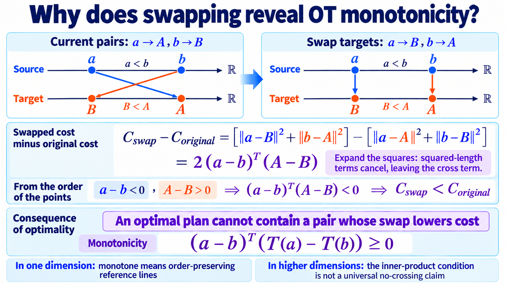

import Objectives from '../../../components/Objectives.astro';
import Prereq from '../../../components/Prereq.astro';
import Ask from '../../../components/Ask.astro';
import Remark from '../../../components/Remark.astro';
import Question from '../../../components/Question.astro';
import Answer from '../../../components/Answer.astro';
import QuizBlock from '../../../components/QuizBlock.astro';
import Option from '../../../components/Option.astro';
import Explanation from '../../../components/Explanation.astro';
import Bridge from '../../../components/Bridge.astro';
import Ref from '../../../components/Ref.astro';

# Straightening II: Choose Better Couplings Without Repeated Training

<Objectives title="After reading, you can">
- **Express endpoint assignment as quadratic OT** and derive its pairwise monotonicity by swapping destinations.
- **Write minibatch OT-CFM training:** assign endpoints, construct linear references, and retain velocity regression.
- **State the finite-batch limitation:** exact batch OT need not give population OT or perfectly straight learned trajectories.
</Objectives>

<Prereq items={frontmatter.prereqs} />

## Can we avoid the reflow loop?

Our error analysis motivates nearly constant-speed trajectories for coarse Euler sampling.

Reflow constructs new pairs through repeated ODE generation and retraining. That is expensive and can propagate previous model and solver errors.

<Ask>
Can we choose better pairs without a preliminary trained flow or an ODE solve?
</Ask>

A natural attempt is to reduce reference-velocity conflict before training begins.

Imagine delivering one package from each source to one destination. Arbitrary assignments can create routes requiring opposite directions in the same region, even when every delivery uses a straight reference line.

Such assignments often send packages unnecessarily far. Perhaps we should first minimize total squared delivery distance.

## What is a cheaper assignment?

For three sources and destinations, one assignment is

$$
x_0^{(1)}\to x_1^{(2)},\qquad
x_0^{(2)}\to x_1^{(3)},\qquad
x_0^{(3)}\to x_1^{(1)}.
$$

The destination list $(2,3,1)$ uses each index once. Such a rearrangement is a **permutation**.

A list such as $(2,2,1)$ is invalid: it repeats one destination and omits another. A permutation changes ordering without duplication or omission.

For $n$ pairs, write the assignment as $\sigma$, where $\sigma(i)=j$ sends source $i$ to destination $j$:

$$
x_0^{(i)}\longrightarrow x_1^{(\sigma(i))}.
$$

Under squared-distance cost, total cost is

$$
C(\sigma)
=
\sum_{i=1}^{n}
\left\|x_0^{(i)}-x_1^{(\sigma(i))}\right\|^2.
$$

Choose the minimum over permutations:

$$
\sigma^\star
\in
\underset{\sigma}{\arg\min}\;C(\sigma).
$$

This is finite, equal-weight **quadratic optimal transport**. It finds the cheapest delivery list while preserving both endpoint sample sets.

Our real concern is numerical integration. Does cheaper assignment also reduce conflicting reference directions?

## What happens if we swap two destinations?

In one dimension, take sources 0 and 3 and destinations 1 and 4. Crossed assignment costs

$$
(0-4)^2+(3-1)^2=20.
$$

Swapping to the order-preserving assignment costs

$$
(0-1)^2+(3-4)^2=2.
$$

The swap both reduces cost and removes a crossing. For general pairs $a\to A$ and $b\to B$, swapped cost minus original cost is

$$
\big(\|a-B\|^2+\|b-A\|^2\big)-\big(\|a-A\|^2+\|b-B\|^2\big)=2\,(a-b)^\top(A-B).
$$

Expand the squares; the endpoint norm terms cancel. If

$$
(a-b)^\top(A-B)<0,
$$

the swap improves cost. An optimal assignment cannot retain such an improving pair.

Write the assignment as a map $T$, with $A=T(a)$ and $B=T(b)$. The necessary condition becomes

$$
(a-b)^\top\big(T(a)-T(b)\big)\ge 0.
$$

This is **monotonicity**. In one dimension it preserves left-to-right ordering, preventing same-time crossings of the linear references.



*Figure: quadratic OT preserves one-dimensional endpoint order.*

In higher dimensions there is no total left-to-right order. Consider instead the two linear references:

$$
I_t(a)=(1-t)a+tT(a),
\qquad
I_t(b)=(1-t)b+tT(b).
$$

Take their separation's inner product with source separation:

$$
\begin{aligned}
(a-b)^\top\big(I_t(a)-I_t(b)\big)
&=(1-t)\|a-b\|^2 \\
&\quad+t(a-b)^\top\big(T(a)-T(b)\big).
\end{aligned}
$$

For distinct sources and $t<1$, the first term is strictly positive and monotonicity makes the second nonnegative. Therefore

$$
I_t(a)=I_t(b).
$$

**The references cannot occupy the same position at the same time.** They do not give conflicting labels at a shared training input.

Their spatial segments may still meet at different times. Since time is part of the input, that is a different situation.

For a sufficiently regular population OT map with this monotonicity, the intermediate position identifies its source. Its marginal velocity then equals the constant displacement along that reference, yielding constant-speed straight ODE motion.

## How do we calculate quadratic OT?

Population OT optimizes over complete distribution couplings and is generally not available in closed form, especially when the target is known only through samples. See <Ref to="math-warehouse-ot"/> for the general formulation.

For two equally sized empirical measures with equal weights, at least one optimum is a permutation. Unequal counts or weights generally require a transport plan that may split mass.

Writing an argmin does not provide an algorithm. Enumerating $n!$ delivery lists is infeasible.

First calculate the cost matrix:

$$
C_{ij}=\left\|x_0^{(i)}-x_1^{(j)}\right\|^2,
$$

Choose one cell per row and column with minimum total cost. This is a **linear assignment problem**, solvable exactly by algorithms such as Hungarian assignment:

$$
\sigma^\star
\in
\underset{\sigma}{\arg\min}
\sum_{i=1}^{n}C_{i,\sigma(i)}.
$$

The returned indices specify destinations. Large datasets make exact assignment costly: the dense matrix needs $O(n^2)$ memory, and standard dense exact methods have roughly cubic time complexity.

Training already uses small batches. Solve the assignment only among the current $B$ source and target samples using a $B\times B$ matrix.

The resulting references and labels are

$$
I_t^{(i)}
=(1-t)x_0^{(i)}+t x_1^{(\sigma^\star(i))},
\qquad
\dot I_t^{(i)}
=x_1^{(\sigma^\star(i))}-x_0^{(i)}.
$$

and training retains the same velocity regression:

$$
\mathcal L_{\mathrm{OT\text{-}CFM}}(\theta)
=
\mathbb E\!\left[
\frac1B\sum_{i=1}^{B}
\left\|
v_\theta(I_t^{(i)},t)-\dot I_t^{(i)}
\right\|^2
\right].
$$

The expectation includes batch and time sampling. **The objective form stays the same; the pairing distribution changes.**

Tong and colleagues call this **OT-CFM** [1]; Multisample Flow Matching [2] also uses minibatch couplings. The batch approximation is commonly called **minibatch OT**.

```
repeat
  x1 ← B data samples
  x0 ← B source samples
  C[i,j] ← ‖x0[i] − x1[j]‖²
  σ ← solve the linear assignment problem
  x1 ← x1[σ]
  draw t and compute I_t = (1−t)x0 + tx1
  train v_θ(I_t,t) against x1 − x0
```

The added operations are assignment and target reordering. A standard exact dense assignment has roughly $O(B^3)$ cost.

<iframe loading="lazy" src="/personal_website/notes/research_areas/diffusion-models-applications/w5-4-batch-ot.en.html" class="demo-frame" title="Solve optimal transport inside a minibatch" style="height: 970px; width: 100%; border: none;"></iframe>

**Interactive demo.** Increase the batch size from independent pairing toward the full 192-point toy. Inspect reference crossings and one-step Euler error. The displayed improvements are measurements for this toy, not a universal monotone guarantee in batch size.

> **OT prevents same-time reference conflicts; it does not forbid every geometric intersection of high-dimensional segments.**

The demo counts spatial segment intersections even if the paths reach them at different times. Its crossing statistic therefore differs from the theoretical same-input condition.

<Remark label="Supplement" summary="What does Sinkhorn calculate?">
Exact batch assignment returns a permutation. For larger batches, Sinkhorn [3] instead solves an entropy-regularized transport problem:

$$
\pi_\varepsilon
\in
\underset{\pi\in\Pi_B}{\arg\min}
\left\{
\sum_{i,j}\pi_{ij}C_{ij}
+\varepsilon\sum_{i,j}\pi_{ij}(\log\pi_{ij}-1)
\right\}.
$$

The admissible nonnegative matrices have row and column sums $1/B$. The distance term favors short transport; entropy spreads mass across entries.

The result is a **soft coupling**, potentially assigning one source to several targets. Draw endpoint pairs according to its weights or use a weighted regression objective.

Repeated row and column scaling is parallelizable. With positive regularization this is entropic OT, rather than exact unregularized assignment. The latter is approached as regularization vanishes under the appropriate convergence conditions.
</Remark>

## Does exact OT in every batch imply population OT or straight motion?

Exact assignment optimizes only the current empirical measures. A better population destination may simply be absent from the batch.

Averaging over random batches induces a valid coupling, generally different from population OT. **Batchwise optimality does not imply population optimality.**

Each batch avoids its own same-time conflicts, but different batches can still supply different velocities in overlapping regions. Their average field can vary along generated trajectories.

Separate three quantities in the analysis of [2]. Let $\pi_B$ be the coupling induced by random BatchOT:

$$
(X_0,X_1)\sim\pi_B,
\qquad
I_t=(1-t)X_0+tX_1,
$$

$$
v_t^{(B)}(x)
=
\mathbb E[X_1-X_0\mid I_t=x].
$$

Assume ideal regression and exact integration, and define the generated process:

$$
\frac{\mathrm d Z_t}{\mathrm dt}
=v_t^{(B)}(Z_t),
\qquad
Z_0\sim p_0.
$$

**Transport cost** measures endpoint displacement under that generated flow:

$$
C_B=\mathbb E\|Z_1-Z_0\|^2.
$$

This is not an individual batch's assignment cost. The smallest possible population coupling cost is $W_2^2(p_0,p_1)$.

**Straightness** measures temporal velocity variation around each generated displacement:

$$
S_B
=
\int_0^1
\mathbb E\left[
\left\|
v_t^{(B)}(Z_t)-(Z_1-Z_0)
\right\|^2
\right]\mathrm dt.
$$

Zero means constant-speed straight generated trajectories. Finite straightness is not the acceleration integral from the Euler bound, so one cannot substitute it directly into that bound.

**Regression-target variance** measures incompatible reference labels at shared inputs:

$$
V_B
=
\int_0^1
\mathbb E\left[
\left\|
(X_1-X_0)-v_t^{(B)}(I_t)
\right\|^2
\right]\mathrm dt.
$$

It is irreducible conditional variance at the ideal predictor, rather than neural approximation error.

Under the assumptions of [2], increasing batch size asymptotically gives

$$
\begin{aligned}
C_B&\longrightarrow W_2^2(p_0,p_1),\\
S_B&\longrightarrow 0,\\
V_B&\longrightarrow 0.
\end{aligned}
$$

These statements concern the limit $B\to\infty$, not monotone improvement for every batch increment. Finite batches guarantee neither population OT nor perfectly straight generated motion.

For the Euler bound, we must still inspect integrated acceleration along the learned ODE and its stability. Changing coupling does not change solver order.

Unlike reflow, minibatch assignment does not use a previous neural ODE to produce endpoints and therefore does not inherit that previous solve's errors in its pairing construction.

<Remark label="Supplement" summary="Does reassignment change endpoint distributions?">
A permutation preserves both sample sets. Every source still appears once and every destination receives one assignment.

Averaging over batch draws preserves the population marginals as well. The resulting law is a valid coupling, so the ideal marginal-path theorem still applies.

</Remark>

## Compare reflow and minibatch OT

| | Reflow | Minibatch OT |
|---|---|---|
| Pairing update | After a trained flow generates endpoints | Within each sampled batch |
| Added computation | ODE generation and retraining | Batch assignment |
| Practical endpoints | Depend on previous model and solver | Same target sample set, reordered |
| Ideal guarantee | Cost decrease and asymptotic $S+V\to0$, without general OT convergence | Population-cost and straightness limits as $B\to\infty$ under assumptions |
| Pairing depends on | Previous learned dynamics | Current samples and specified cost |
| Main burden | Repeated generation and training | Assignment cost and meaningful high-dimensional distances |

<Question label="Discussion" id="Q1">
Why can raw Euclidean cost become less informative in high dimensions?

<Answer summary="Show the reasoning">
Consider independent standard-Gaussian endpoints:

$$
\mathbb E\|x_0-x_1\|^2=2d,\qquad \operatorname{Var}\big(\|x_0-x_1\|^2\big)=8d .
$$

The relative standard deviation of squared distance is $\sqrt{2/d}$: about 100% at $d=2$ but only 2.5% at $d=3072$.

In this example, distances concentrate near a common scale, potentially reducing relative differences among assignments.

Real data need not behave like independent Gaussians. The lesson is to inspect whether the chosen cost captures meaningful similarity.

- Use a suitable representation-space cost if raw pixels are uninformative.
- Larger batches add candidates but cannot automatically repair an unsuitable cost.

Reflow derives assignments through learned dynamics; minibatch OT relies directly on the specified cost.
</Answer>
</Question>

## Check your understanding

<QuizBlock id="w5-4-a">
Why must an optimal quadratic assignment satisfy pairwise monotonicity?
<Option>Its endpoints are independent.</Option>
<Option correct>A negative separation inner product would allow a destination swap that lowers cost.</Option>
<Option>OT exists only in one dimension.</Option>
<Explanation>Expanding the swapped cost gives the necessary condition; inserting it into interpolation proves no same-time meeting.</Explanation>
</QuizBlock>

<QuizBlock id="w5-4-b">
What follows from exact assignment within each batch?
<Option>The averaged coupling must be population OT.</Option>
<Option correct>The current batch is optimally paired; population optimality and perfect straightness do not follow at finite batch size.</Option>
<Option>One Euler step is exact.</Option>
<Explanation>Batch restrictions and disagreements across batches remain.</Explanation>
</QuizBlock>

<QuizBlock id="w5-4-c">
What does the Gaussian distance-concentration example suggest checking?
<Option>Only solver runtime.</Option>
<Option correct>Whether costs distinguish meaningful endpoint choices.</Option>
<Option>Whether high-dimensional OT exists at all.</Option>
<Explanation>The example is a warning about a representation and cost, not a theorem about every dataset.</Explanation>
</QuizBlock>

<QuizBlock id="w5-4-d">
What do reflow and minibatch OT have in common?
<Option>Both require a previous generation round.</Option>
<Option>Both always converge to global OT.</Option>
<Option correct>Both redesign endpoint coupling while retaining linear reference interpolation.</Option>
<Explanation>Their pairing mechanisms and guarantees differ, while the regression construction remains shared.</Explanation>
</QuizBlock>

<Bridge to="dma-shared-techniques">
Coupling changes can improve transport geometry, but a fixed trained field can still vary along its trajectories.

If retraining is unavailable, can a better solver use a limited number of velocity queries more accurately and adapt its step size to local changes?
</Bridge>

## References

1. Tong, A., et al. [*Improving and Generalizing Flow-Based Generative Models with Minibatch Optimal Transport.*](https://arxiv.org/abs/2302.00482) TMLR 2024.
2. Pooladian, A.-A., et al. [*Multisample Flow Matching: Straightening Flows with Minibatch Couplings.*](https://arxiv.org/abs/2304.14772) ICML 2023.
3. Cuturi, M. [*Sinkhorn Distances: Lightspeed Computation of Optimal Transport.*](https://arxiv.org/abs/1306.0895) NeurIPS 2013.
