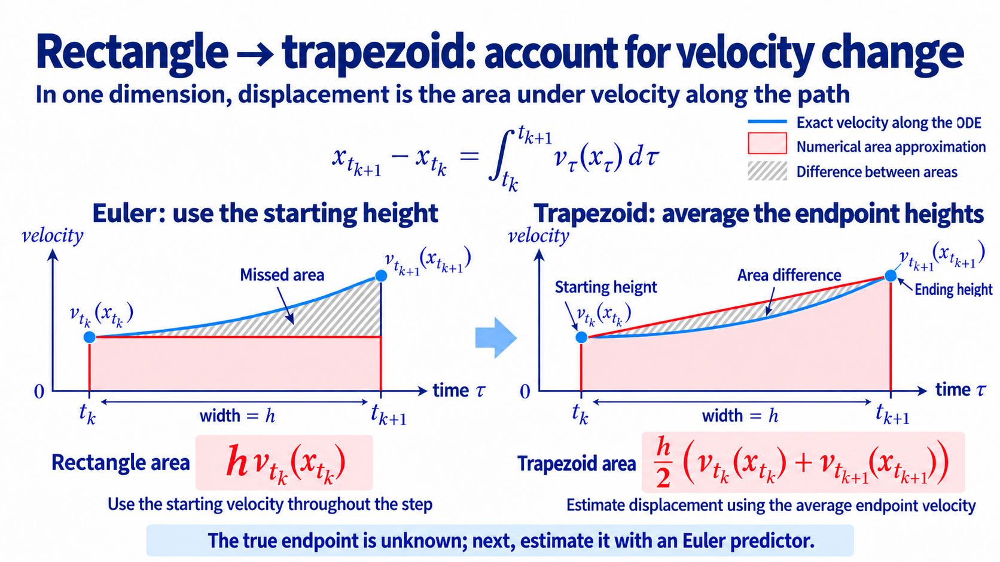

import Objectives from '../../../components/Objectives.astro';
import Prereq from '../../../components/Prereq.astro';
import Ask from '../../../components/Ask.astro';
import Details from '../../../components/Details.astro';
import Question from '../../../components/Question.astro';
import Answer from '../../../components/Answer.astro';
import QuizBlock from '../../../components/QuizBlock.astro';
import Option from '../../../components/Option.astro';
import Explanation from '../../../components/Explanation.astro';
import Bridge from '../../../components/Bridge.astro';
import Ref from '../../../components/Ref.astro';

# Can Fewer Direction Queries Still Give Accurate Sampling?

<Objectives title="After reading, you can">
- **Derive Heun's predictor and corrector** and its second-order global convergence under smoothness assumptions.
- **Compare computational cost using NFE**, accounting for model calls per step.
- **Explain adaptive integration** through discrepancies between two approximations of the same interval.
</Objectives>

<Prereq items={frontmatter.prereqs} />

Euler misses within-step velocity variation. Reflow and minibatch OT change coupling to improve the trajectories themselves.

Once a model is fixed, we can instead change how we approximate its ODE.

Imagine a fixed route with enough phone battery for only a few navigation checks. How should we use those checks around turns?

The exact update is

$$
x_{t+h}=x_t+\int_t^{t+h}v_\tau(x_\tau)\,\mathrm d\tau.
$$

We cannot evaluate the whole integral directly. Each call to the neural velocity is one **network function evaluation (NFE)**. A solver arranges these queries to approximate displacement.

<Ask>
How should a fixed number of velocity queries be used to improve on Euler?
</Ask>

## Review: Euler checks only the starting direction

Euler evaluates the initial velocity:

$$
x_{t+h}^{\mathrm E}=x_t+h\,v_t(x_t).
$$

It uses a rectangle approximation to the integral, with cost 1 NFE per step. On the unit interval, $M$ steps cost $M$ NFE and use $h=1/M$.

Under the regularity assumptions already discussed, its global error is controlled by

$$
h\int_0^1\|a_t(x_t)\|\,\mathrm dt
$$

Smaller steps reduce the effect of changing velocity, but require more evaluations.

## Could we also check the endpoint direction?

Taylor-expand a smooth trajectory using its acceleration:

$$
x_{t+h}
=x_t+h\,v_t(x_t)
+\frac{h^2}{2}a_t(x_t)
+O(h^3).
$$

Euler omits the quadratic term. Can we approximate this correction without differentiating the network to calculate acceleration explicitly?

Acceleration measures velocity change. A second query near the endpoint can estimate that change.

From the integral viewpoint, averaging starting and ending velocities gives a trapezoid approximation:

$$
x_{t+h}
\approx x_t+\frac h2\left(v_t(x_t)+v_{t+h}(x_{t+h})\right).
$$

**Figure: replace a rectangle by a trapezoid.** The blue curve is trajectory velocity; red is approximate displacement and gray indicates area discrepancy. This picture temporarily assumes both endpoint heights are known.

The true endpoint is unknown, so first predict it with Euler:

$$
\widetilde x_{t+h}=x_t+h\,v_t(x_t).
$$

Evaluate velocity there and correct the update using the average:

$$
x_{t+h}^{\mathrm H}
=x_t+\frac h2\left(v_t(x_t)+v_{t+h}(\widetilde x_{t+h})\right).
$$

This **Heun method** uses an Euler predictor and a trapezoidal corrector. The predicted endpoint query prevents the initial arrow from determining the entire displacement alone.

### Why does averaging recover the acceleration term?

For a sufficiently smooth field, velocity at the predicted endpoint expands as

$$
v_{t+h}(\widetilde x_{t+h})
=v_t(x_t)+h\,a_t(x_t)+O(h^2).
$$

The two arrows differ by approximately $ha_t$. Substituting gives

$$
\begin{aligned}
x_{t+h}^{\mathrm H}
&=x_t+\frac h2\left(v_t(x_t)+v_{t+h}(\widetilde x_{t+h})\right)\\
&=x_t+h\,v_t(x_t)+\frac{h^2}{2}a_t(x_t)+O(h^3).
\end{aligned}
$$

Heun recovers the quadratic Taylor term. Its local error is $O(h^3)$ and global error $O(h^2)$, compared with Euler's $O(h^2)$ local and $O(h)$ global errors:

$$
\text{Euler global error}=O(h),
\qquad
\text{Heun global error}=O(h^2).
$$

This correction is used in diffusion sampling by Karras and colleagues [1]. Heun generally costs 2 NFE per step. An $M$-NFE budget therefore allows $M$ Euler steps but only $M/2$ Heun steps.

## Equal step sizes may spend queries in the wrong places

On a nearly constant-velocity segment, repeated checks can be wasteful. Around rapid changes, sparse checks are inaccurate. We would like large steps in stable regions and small steps where needed.

We do not know these regions beforehand. Compare one full Euler step with two half steps:

$$
\begin{aligned}
x_{\mathrm{full}}&=x_t+h\,v_t(x_t),\\
x_{\mathrm{half}}&=x_t+\frac h2v_t(x_t),\\
x_{\mathrm{two}}&=x_{\mathrm{half}}+\frac h2v_{t+h/2}(x_{\mathrm{half}}).
\end{aligned}
$$

Taylor expansion shows

$$
x_{\mathrm{two}}-x_{\mathrm{full}}
=\frac{h^2}{4}a_t(x_t)+O(h^3).
$$

Their discrepancy is not the true error, but supplies a local error signal. Accept when it falls within a chosen **tolerance**; otherwise reject the attempt and retry with a smaller step.

This is **adaptive step size**. Fixed-step Heun is not automatically adaptive, but its predictor and corrector already provide two approximations:

$$
\left\|x_{t+h}^{\mathrm H}-\widetilde x_{t+h}\right\|
$$

Their difference can drive a controller. Embedded Runge–Kutta methods similarly share queries between approximations of different orders; Dormand–Prince [2] is a standard example. Rejected attempts and error estimates still cost NFE, and different samples may require different grids.

<iframe loading="lazy" src="/personal_website/notes/research_areas/diffusion-models-applications/w5-5-solvers.en.html" class="demo-frame" title="Euler, Heun, and adaptive allocation of velocity queries" style="height: 820px; width: 100%; border: none;"></iframe>

**Interactive demo.** Euler and Heun use equal NFE budgets on a smooth rotating field, so Heun takes half as many steps. Adaptive mode uses predictor-corrector disagreement to place denser nodes where needed.

<Question label="Discussion" id="Q1">
With 20 NFE each, must second-order Heun beat first-order Euler?

<Answer summary="Show the reasoning">
No. Order describes the asymptotic rate as step size vanishes, not a universal ranking at every budget.

Euler can take 20 steps while Heun takes 10. Smooth trajectories and moderate higher-derivative constants often favor Heun, but coarse steps or large error constants can reduce that advantage.

Compare total NFE, error order, and the field's smoothness together.
</Answer>
</Question>

## Integrate known structure exactly when possible

General solvers treat velocity as a black box. Gaussian-path diffusion instead offers a semilinear form:

$$
\frac{\mathrm dx_t}{\mathrm dt}
=A(t)x_t+B(t)\,\epsilon_\theta(x_t,t),
$$

The schedule determines $A(t)$ and $B(t)$; only the neural term needs model calls. The exact update can be rewritten as

$$
\begin{aligned}
x_t
&=e^{\int_s^t A(r)\,\mathrm dr}x_s\\
&\quad+\int_s^t
e^{\int_\tau^t A(r)\,\mathrm dr}
B(\tau)\,\epsilon_\theta(x_\tau,\tau)
\,\mathrm d\tau.
\end{aligned}
$$

The linear evolution is analytic, leaving only the neural integral to approximate. **DPM-Solver** [3] uses this structure and a log-SNR time coordinate to build higher-order approximations.

Define

$$
m(t)=\exp\!\left(-\int_s^t A(r)\,\mathrm dr\right).
$$

Multiply the ODE by this factor. The product rule cancels the linear term:

$$
\frac{\mathrm d}{\mathrm dt}\bigl(m(t)x_t\bigr)
=m(t)B(t)\epsilon_\theta(x_t,t).
$$

Integrate and divide by the factor to obtain the displayed update. This is the integrating-factor or variation-of-constants formula.

This advantage requires an ODE with exploitable structure. An arbitrary Flow Matching field may instead call for a general solver such as Heun or adaptive Runge–Kutta.

## An accurate solver still follows the field it receives

Refining a solver approaches the exact trajectory of the **learned** field. If that field is wrong, numerical accuracy does not restore the ideal probability path.

Modeling and numerical errors are separate. The solver methods improve the numerical contribution discussed in <Ref to="dma-error-theory"/>.

> **A solver controls how accurately we follow a given field, rather than whether that field is correct.**

## Check your understanding

<QuizBlock id="w5-5-a">
Why compare neural ODE solvers by NFE rather than step count alone?
<Option>All solvers have different physical time intervals.</Option>
<Option correct>Each step can require a different number of network calls.</Option>
<Option>NFE changes the training objective.</Option>
<Explanation>Equal steps usually give Heun twice the model calls of Euler.</Explanation>
</QuizBlock>

<QuizBlock id="w5-5-b">
How does an adaptive solver detect a need for smaller steps?
<Option>It already knows the exact solution.</Option>
<Option correct>It compares two approximations over the same interval.</Option>
<Option>It only checks velocity magnitude.</Option>
<Explanation>Large speed alone does not imply rapidly changing velocity. Approximation disagreement supplies a local signal.</Explanation>
</QuizBlock>

<QuizBlock id="w5-5-c">
What additional information does DPM-Solver use?
<Option>A retrained coupling.</Option>
<Option correct>Known semilinear structure, integrating its linear part analytically.</Option>
<Option>A replacement SDE.</Option>
<Explanation>It changes numerical integration rather than the trained model.</Explanation>
</QuizBlock>

<QuizBlock id="w5-5-d">
Which error cannot a solver remove by itself?
<Option>Coarse-step discretization error.</Option>
<Option>Wasteful fixed-grid query placement.</Option>
<Option correct>A learned field that differs from the ideal field.</Option>
<Explanation>Numerical integration can become accurate for the wrong dynamics.</Explanation>
</QuizBlock>

<Bridge to="dma-lab-interpolants">
We can change coupling to reduce trajectory variation, or improve integration of a fixed field with better query placement and higher-order updates.

Next we implement these choices in the same toy, controlling pairing, model, and NFE to identify what each comparison measures.
</Bridge>

## References

1. Karras, T., Aittala, M., Aila, T., Laine, S. [*Elucidating the Design Space of Diffusion-Based Generative Models.*](https://arxiv.org/abs/2206.00364) NeurIPS 2022.
2. Dormand, J. R., Prince, P. J. [*A Family of Embedded Runge–Kutta Formulae.*](https://doi.org/10.1016/0771-050X(80)90013-3) 1980.
3. Lu, C., et al. [*DPM-Solver: A Fast ODE Solver for Diffusion Probabilistic Model Sampling in Around 10 Steps.*](https://arxiv.org/abs/2206.00927) NeurIPS 2022.
