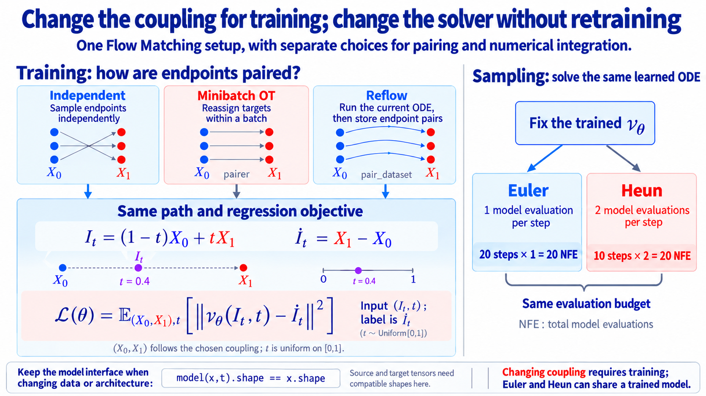

import Objectives from '../../../components/Objectives.astro';
import Prereq from '../../../components/Prereq.astro';
import Ask from '../../../components/Ask.astro';
import Remark from '../../../components/Remark.astro';
import Question from '../../../components/Question.astro';
import Answer from '../../../components/Answer.astro';
import QuizBlock from '../../../components/QuizBlock.astro';
import Option from '../../../components/Option.astro';
import Explanation from '../../../components/Explanation.astro';
import Bridge from '../../../components/Bridge.astro';
import Ref from '../../../components/Ref.astro';

# Lab: Reuse the Methods with New Data and Models

<Objectives title="After reading, you can">
- **Use a model-independent Flow Matching class.** Models accept state and time and return a velocity tensor with the same shape.
- **Implement two coupling mechanisms:** batchwise reassignment for minibatch OT and generated fixed endpoint pairs for Reflow.
- **Compare Euler and Heun at equal NFE**, rather than equal steps.
</Objectives>

<Prereq items={frontmatter.prereqs} />

Reflow and minibatch OT change training pairs. Heun instead improves numerical approximation of an already trained ODE.

If every choice requires a new training loop, we lose sight of what actually changes between methods.

<Ask>
Can one shared training class expose only the parts that differ?
</Ask>

## What will this program produce?

The example transports a Gaussian source to two moons. Download it here:

[Download the Flow Matching, Reflow, minibatch OT, and Heun script](/personal_website/notes/notebooks/diffusion-models-applications/dma-u3-flow-matching-reflow-ot-lab.py)

Install dependencies:

```bash
pip install torch numpy scipy matplotlib
```

Run:

```bash
python dma-u3-flow-matching-reflow-ot-lab.py
```

The script trains an independent-pair baseline, changes pairing through Reflow and minibatch OT, and writes `u3_5_results.png`. It also fixes the baseline model to compare Euler and Heun at equal NFE. Changing coupling changes the learned ODE; changing solver changes its approximation.

For a shorter environment check, use

```bash
python dma-u3-flow-matching-reflow-ot-lab.py --steps 100 --reflow-pairs 1000 --eval-samples 500
```

## Does changing the model require rewriting Flow Matching?

Two-dimensional data may use an MLP; images may use a U-Net. Hard-coding either architecture inside the training class would couple unrelated choices.

Build the model externally and pass it into `FlowMatching`:

```python
model = VelocityMLP(data_dim=2, hidden_dim=128)
device = "cuda" if torch.cuda.is_available() else "cpu"

fm = FlowMatching(
    model=model,
    source_sampler=sample_gaussian,
    target_sampler=sample_two_moons,
    device=device,
)
```

The required interface is

```python
model(x, t).shape == x.shape
```

Given state and time, return velocity with the same shape as the state. Replacing the architecture leaves the learned mathematical object $v_\theta(x,t)$ unchanged.

Pass data sampling functions externally too. Source and target samplers must return tensors with matching shapes.

<Remark label="Interface" summary="Which parts can be replaced independently?">
The example exposes

- `model`: the velocity approximator.
- `source_sampler` and `target_sampler`: the endpoint laws.
- `path`: the reference position and derivative for a given pair and time.
- `pairer` or `pair_dataset`: endpoint coupling.

The example uses linear interpolation, but accepts another path function. Identify which mathematical choice changes before replacing its corresponding interface.
</Remark>

## Which quantities does every training step need?

Every architecture uses a reference position and reference velocity. For a linear path,

```python
def linear_path(x0, x1, t):
    tau = t.reshape(t.shape[0], *([1] * (x0.ndim - 1)))
    xt = (1 - tau) * x0 + tau * x1
    reference_velocity = x1 - x0
    return xt, reference_velocity
```

Reshaping time makes it broadcast across every non-batch dimension, supporting both `[batch,2]` points and image tensors.

Given the position and derivative, training uses the same objective:

```python
x0, x1 = self._draw_pairs(
    batch_size,
    pairer=pairer,
    pair_dataset=pair_dataset,
)
t = torch.rand(batch_size, device=self.device)
xt, reference_velocity = self.path(x0, x1, t)

prediction = self.model(xt, t)
loss = F.mse_loss(prediction, reference_velocity)

self.optimizer.zero_grad(set_to_none=True)
loss.backward()
self.optimizer.step()
```

Independent pairing, minibatch OT, and Reflow share this MSE. Their difference is the endpoint pair returned by `_draw_pairs`.

## Begin with independent pairing

Without a pairer or paired dataset, draw source and target independently:

```python
baseline = FlowMatching(
    model=VelocityMLP(),
    source_sampler=sample_gaussian,
    target_sampler=sample_two_moons,
)

baseline.fit(steps=2500, batch_size=256)
```

This is linear CFM [1]. Both coupling methods below retain its interpolation and objective.

## Which operation changes for minibatch OT?

Before drawing reference lines, reorder targets to minimize batch transport cost. Encapsulate this in a `pairer`:

```python
def minibatch_ot_pair(x0, x1):
    from scipy.optimize import linear_sum_assignment

    flat_x0 = x0.detach().flatten(1)
    flat_x1 = x1.detach().flatten(1)
    cost = torch.cdist(flat_x0, flat_x1).square().cpu().numpy()
    rows, cols = linear_sum_assignment(cost)

    rows = torch.as_tensor(rows, device=x0.device)
    cols = torch.as_tensor(cols, device=x1.device)
    return x0[rows], x1[cols]
```

Flattening each sample permits a shared Euclidean-cost implementation for points and images. The matrix is still $B\times B$, and larger batches increase memory and assignment cost. Meaningful image costs may require a different representation.

Pass the pairer into the same training method:

```python
batch_ot = FlowMatching(
    model=VelocityMLP(),
    source_sampler=sample_gaussian,
    target_sampler=sample_two_moons,
)

batch_ot.fit(
    steps=2500,
    batch_size=128,
    pairer=minibatch_ot_pair,
)
```

Each step draws fresh batches, then permutes target order. No samples are added or removed, so both empirical marginals are preserved.

## Where do Reflow pairs come from?

Reflow [2] does not solve batch assignment. Draw sources and integrate the current model:

```python
reflow_pairs = baseline.make_reflow_dataset(
    n_samples=20000,
    batch_size=1024,
    n_steps=50,
    solver="heun",
)
```

The resulting joint is

$$
(X_0,Z_1^{(1)}),\qquad
\frac{\mathrm dZ_t^{(1)}}{\mathrm dt}
=v_t^{(0)}(Z_t^{(1)}).
$$

Store each source with its actual generated endpoint. Build a new model and train on straight references between these fixed pairs:

```python
reflow = FlowMatching(
    model=VelocityMLP(),
    source_sampler=sample_gaussian,
    target_sampler=sample_two_moons,
)

reflow.fit(
    steps=2500,
    batch_size=256,
    pair_dataset=reflow_pairs,
)
```

The paired dataset replaces independent sampling; path, objective, and optimizer logic remain shared. Further rounds generate new pairs and retrain again.

<Remark label="Implementation" summary="Why generate pairs using a finer Heun solve?">
Ideal rectification uses exact endpoints. Numerical error in generated pairs becomes part of next-round training data.

The example uses 50 Heun steps to reduce that contribution, rather than because Reflow requires this solver. Refine the grid and compare endpoints to check adequacy.
</Remark>

## How should we compare Euler and Heun fairly?

After coupling determines training data, sampling still needs an integration rule. The implementation supports

```python
if solver == "euler":
    x = x + h * v0
else:
    predicted = x + h * v0
    v1 = self.model(predicted, t1)
    x = x + 0.5 * h * (v0 + v1)
```

Euler costs one call per step and Heun two. With 20 NFE, compare

```python
x_euler = baseline.integrate(x0, n_steps=20, solver="euler")
x_heun  = baseline.integrate(x0, n_steps=10, solver="heun")
```

Twenty steps of each would compare 20 with 40 calls, conflating numerical method with budget.



**Figure: coupling and solver changes occur in different parts of the code.** A pairer reorders each batch; a paired dataset stores Reflow endpoints. All use common interpolation and regression. The diagram is schematic, rather than an experimental result.

<Question label="Discussion" id="Q1">
To move from two moons to images, is replacing only `target_sampler` enough?

<Answer summary="Show the reasoning">
No. Check the following interfaces together:

1. Source and target must return matching shapes, such as `[batch,3,32,32]`.
2. The external model must accept image state and time and return matching velocity shape.
3. Batch OT's matrix and assignment cost must fit the available resources.

The shared training, fixed-pair training, and integration logic need not be rewritten merely because state dimension changes. Replace data and architecture, then choose a feasible batch size and suitable cost.
</Answer>
</Question>

## Check your understanding

<QuizBlock id="w5-6-a">
What changes between independent and minibatch OT training?
<Option>The squared-error objective.</Option>
<Option correct>Whether a pairer reorders the sampled targets.</Option>
<Option>The sampling solver.</Option>
<Explanation>They share the same reference interpolation and velocity regression.</Explanation>
</QuizBlock>

<QuizBlock id="w5-6-b">
Why does this Reflow example train a new model?
<Option>The old model cannot use Heun.</Option>
<Option correct>The changed coupling defines new reference labels and a new marginal field to learn.</Option>
<Option>Reflow requires a new target distribution.</Option>
<Explanation>Simply reusing the unchanged field is not a new rectification round. A practical implementation may initialize from existing weights, but still needs training on the new pairs.</Explanation>
</QuizBlock>

<QuizBlock id="w5-6-c">
Are 20 Euler steps and 20 Heun steps equal evaluation budgets?
<Option>Yes, their step counts agree.</Option>
<Option correct>No: typically 20 versus 40 NFE.</Option>
<Option>Only state dimension makes them different.</Option>
<Explanation>At 20 NFE, compare 20 Euler steps with 10 Heun steps.</Explanation>
</QuizBlock>

## Replace the toy with your own problem

1. Replace the target with another 2D law and identify unchanged code.
2. Substitute your own model while retaining the shape contract.
3. Vary OT batch size and record training time and sampling behavior.
4. Add another Reflow round, separately timing pair generation and retraining.

<Bridge to="dma-discrete-data">
We have implemented coupling changes and solver changes separately, with external data, model, and path interfaces supporting reuse.

The next unit removes continuous-state assumptions. Tokens have no directly interpolated intermediate positions or ordinary continuous velocities. What should replace paths, motion rules, and sampling for discrete data?
</Bridge>

## References

1. Lipman, Y., et al. [*Flow Matching for Generative Modeling.*](https://arxiv.org/abs/2210.02747) ICLR 2023.
2. Liu, X., Gong, C., Liu, Q. [*Flow Straight and Fast: Learning to Generate and Transfer Data with Rectified Flow.*](https://arxiv.org/abs/2209.03003) ICLR 2023.
3. Tong, A., et al. [*Improving and Generalizing Flow-Based Generative Models with Minibatch Optimal Transport.*](https://arxiv.org/abs/2302.00482) TMLR 2024.
4. Karras, T., Aittala, M., Aila, T., Laine, S. [*Elucidating the Design Space of Diffusion-Based Generative Models.*](https://arxiv.org/abs/2206.00364) NeurIPS 2022.
