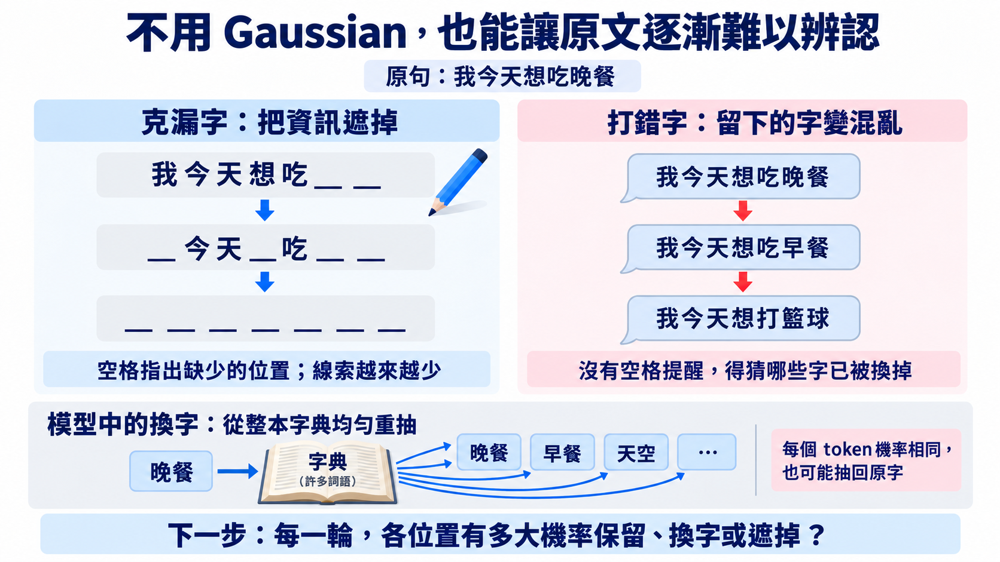

import Objectives from '../../../components/Objectives.astro';
import Prereq from '../../../components/Prereq.astro';
import Ask from '../../../components/Ask.astro';
import FormulaSteps from '../../../components/FormulaSteps.astro';
import Remark from '../../../components/Remark.astro';
import CenteredExample from '../../../components/CenteredExample.astro';
import MaskingSequence from '../../../components/MaskingSequence.astro';
import DiscreteNoisingPython from '../../../components/DiscreteNoisingPython.astro';
import Question from '../../../components/Question.astro';
import Answer from '../../../components/Answer.astro';
import QuizBlock from '../../../components/QuizBlock.astro';
import Option from '../../../components/Option.astro';
import Explanation from '../../../components/Explanation.astro';
import Details from '../../../components/Details.astro';
import Bridge from '../../../components/Bridge.astro';
import Ref from '../../../components/Ref.astro';

# 資料是 Token 的時候，噪聲是什麼？

<Objectives collapsible>
- **分清機率表與一次抽樣的結果。** 用七成保留、三成遮住的例子，說出 PMF 與 categorical sampling 各描述什麼。
- **用同一條 PMF interpolation 比較兩種加噪。** 寫出保留與重抽的貢獻，算出 MASK 與 uniform 的 token 機率。
- **分清條件獨立與整句話的關聯。** 說明每格獨立加噪，為什麼不代表整句的 $p_t$ 也會獨立。
</Objectives>

<Prereq items={frontmatter.prereqs} />

## 一句話，要怎麼加噪聲？

圖片可以逐漸加入 Gaussian noise，變得越來越看不清楚。那一句話呢？

<CenteredExample>

`我／今天／想／吃／麥當勞`

</CenteredExample>

這裡先以詞切分，每個單位叫作 **token**，按順序排成序列（sequence）。每格只能從字典裡選一個 token，例如 `想` 或 `要`。**取值是一個個可列出的選項，這樣的資料就叫離散資料（discrete data）。**

## 從克漏字，找到一個生成的出發點

想像我們在做克漏字。看到「我／今天／＿＿／吃／麥當勞」，可以根據前後的文字，猜中間可能是 `想` 或 `要`。如果遮住更多位置，剩下的線索就更少，直到每一格都被遮住。我們可以用特殊標記 `[MASK]` 表示「這格的 token 被遮住了」：

<MaskingSequence />

**全部都是 MASK，是我們可以輕易製造出的狀態。** 只要知道 sequence 長度，放上五個 MASK 就可以。這樣我們就找到一個生成的出發點：**如果模型能學會反向 denoising，把被遮住的內容逐漸補回來，就有可能從全 MASK 出發，生成不同的合理句子。**

這也讓我們想到，可以從手上的完整句子製造學習用的例子：自己遮住一些字，並保留原句作為學習的參考。那我們要怎麼控制中間的狀態，讓它從還有很多線索，逐漸接近完全遮住呢？

我們可以讓每格被遮住的機率慢慢提高。原本每格都保留，接著比較容易抽到 MASK，最後每格一定都是 MASK。這裡逐漸改變的是機率；抽出來的單一 token，仍然是原字或 MASK。

<Ask>
在逐漸遮住的過程中， 
每個位置可能出現哪些 token，各自的機率是多少？
</Ask>

## 怎麼用機率描述每個位置可能出現的 token？

例如，我們先固定其他四格，只看原本放著 `想` 的第三格。如果七成機率保留、三成機率遮住，就可以把這格可能出現的結果和各自的機率排出來：

<CenteredExample>

| 第三格的結果 | `想` | `[MASK]` | 其他 token |
| --- | --- | --- | --- |
| 機率 | $0.7$ | $0.3$ | $0$ |

</CenteredExample>

這張替每個選項列出機率的表，就是 **probability mass function（機率質量函數，PMF）**。機率不能是負的，而且這格一定會抽到某個選項，所以全部加起來要等於 $1$；這裡就是 $0.7+0.3=1$。

我們把已經固定的原句「我／今天／想／吃／麥當勞」記成 $x_0$，括號中的上標表示位置，所以 $x_0^{(3)}=\texttt{想}$。再用 $t$ 標記加噪的時間，$q_t^{(3)}(a\mid x_0)$ 就表示：**給定原句 $x_0$，在時間 $t$，第三格出現候選 token $a$ 的機率。** 剛才的表就是 $q_t^{(3)}(\texttt{想}\mid x_0)=0.7$、$q_t^{(3)}(\texttt{[MASK]}\mid x_0)=0.3$。

這裡的 $0.7$ 是我們自己指定的保留機率，還不是模型根據句意預測「這格應該填什麼」的機率。我們先用它製造 noisy data，後面才討論生成時的規則。

## 有了機率，怎麼得到一個 token？

要按照這張 PMF 抽出一個 token，我們可以從 $[0,1)$ 均勻抽一個數字 $u$：若 $u<0.7$，第三格就放 `想`；否則放 `[MASK]`。例如抽到 $u=0.2$ 就保留，抽到 $u=0.9$ 就遮住。**PMF 給的是一張機率表，一次抽樣才得到一個具體 token。**

這種按照各類別的機率抽出一個結果的動作，叫作 **categorical sampling**。沿用 U2，用 $I_t$ 表示我們造出的 reference noisy state，$I_t^{(3)}$ 是其中第三格的隨機 token；用 $X_0$ 表示隨機抽到的原句，固定 $X_0=x_0$ 後，就有

$$
I_t^{(3)}\mid X_0=x_0
\sim\operatorname{Categorical}\big(q_t^{(3)}(\cdot\mid x_0)\big).
$$

$\cdot$ 表示把所有候選 token 的機率一起交給抽樣器。固定同一句原文和同一個時間，獨立重複抽很多次，結果中就會大約有 $70\%$ 是 `想`、$30\%$ 是 MASK。**這是同一個時間重複抽樣，讓我們看出分布；不是沿時間走了很多步。**

## 除了遮住，也可以隨機換字

克漏字把線索直接遮住，也告訴我們哪一格需要補。那如果讓字還在，卻慢慢變得和原文無關呢？想像考試時遇到完全不會的題目，只能在選項裡盲猜；我們也可以從字典隨機挑一個 token，取代原字。

這時要讓結果最後容易抽樣，一個自然的選擇是讓字典裡每個 token 的機率都一樣。這個做法稱為 **uniform noising**：仍然決定多少機率保留原字，但剩下的機率從字典均勻重抽。最後若每格都只做均勻重抽，我們就不需要原句，也能輕易製造這一端的狀態。

圖中以「晚餐」示意相同的動作。「打錯字」是生活類比；本篇的 uniform 重抽是從字典均勻選擇，也可能抽回原字。

## 重抽，也可能抽回原字

先用只有 `想`、`要`、`吃` 三個選項的單格 toy 算一次。仍然七成保留，剩下三成均勻分給三個選項，每個各拿到 $0.3/3=0.1$：

<CenteredExample>

| 這格的結果 | `想` | `要` | `吃` |
| --- | --- | --- | --- |
| 保留分支的機率 | $0.7$ | $0$ | $0$ |
| 重抽分支的機率 | $0.1$ | $0.1$ | $0.1$ |
| 合起來的 PMF | $0.8$ | $0.1$ | $0.1$ |

</CenteredExample>

**所以「七成機率選擇保留」不代表「最後只有七成是原字」：重抽也可能抽回 `想`，因此最後是 $0.7+0.1=0.8$。** MASK 則沒有這個情況，因為重抽只會拿到遮蔽標記。

把保留機率慢慢降到零，兩種做法就各自到達容易抽樣的一端：MASK 是每格都被遮住；uniform 是每格都從字典均勻抽。

## 把兩種做法寫成同一條式子

剛才兩個方法都做同樣的決定：這格要保留原字，還是換掉？差別在於換掉時一定拿到 MASK，或從字典均勻挑一個。把這兩個動作分開，我們就能用同一條式子描述它們。

把第三格推廣成任意位置 $\ell$，原 token 就寫成 $x_0^{(\ell)}$。用 $\alpha_t\in[0,1]$ 表示時間 $t$ 選擇保留原字的機率；剩下的 $1-\alpha_t$，改從我們指定的易抽樣分布 $\nu$ 重抽。剛才的兩個例子都是 $\alpha_t=0.7$，差別只在 $\nu$。

用 $\delta_{x_0^{(\ell)}}(a)$ 表示「把全部機率放在原字」的 PMF：只有 $a=x_0^{(\ell)}$ 時等於 $1$，其餘候選都等於 $0$。因此，這一格抽到 $a$ 的機率，就是兩個分支的貢獻相加：

<FormulaSteps
  id="u4-token-pmf-interpolant"
  compact
  title="保留與重抽各貢獻多少機率？"
  formula={String.raw`\reveal{1}{q_t^{(\ell)}(a\mid x_0)=}\reveal{2}{\alpha_t\delta_{x_0^{(\ell)}}(a)}\reveal{3}{+(1-\alpha_t)\nu(a).}`}
  steps={[
    {label: '想求的機率', text: String.raw`固定原句 $x_0$、位置 $\ell$ 與時間 $t$，想知道這格抽到候選 $a$ 的機率。`},
    {label: '保留分支', text: String.raw`以機率 $\alpha_t$ 保留原字；$\delta_{x_0^{(\ell)}}(a)$ 把這部分機率全部放在 $a=x_0^{(\ell)}$。`},
    {label: '加上重抽分支', text: String.raw`剩下的 $1-\alpha_t$ 按 $\nu$ 重抽；抽到 $a$ 的貢獻是 $(1-\alpha_t)\nu(a)$，再與保留分支相加。`},
  ]}
/>

<CenteredExample>

| 做法 | 重抽的 PMF $\nu$ | 保留機率降到零後 |
| --- | --- | --- |
| MASK | $\delta_m$，其中 $m=\texttt{[MASK]}$ | 每格都是 MASK |
| Uniform | $\mathrm{Unif}(\mathcal V)$，每個 token 各有 $1/K$ | 每格從字典均勻抽樣 |

</CenteredExample>

這裡 $\mathcal V$ 是原文字典，$K$ 是其中 token 的數量；使用 MASK 時，候選也包含特殊標記 $m$。前面的三選項例子是只看一格的 toy，處理整句話時則使用包含所有原文字詞的字典。

這和前面的 <Ref to="dma-forward-process">diffusion model</Ref>、<Ref to="dma-unified-equation">Flow Matching／stochastic interpolants</Ref> 一樣，也要選一個 **schedule**，決定係數如何隨時間變化，安排兩端之間的中間分布。前面的係數用來縮放連續 state；這裡的 $\alpha_t$ 則是保留機率的 schedule，決定每格選擇保留原字、或從易抽樣分布 $\nu$ 重抽的機率。我們在兩張 PMF 之間做 interpolation，抽出的 $I_t^{(\ell)}$ 仍是一個 token。

本單元沿用 U1 的時間編號：$t=0$ 是資料、$t=1$ 是好抽樣的分布，讓 $\alpha_0=1$、$\alpha_1=0$，並隨時間逐漸降低保留機率。**生成時則從 $t=1$ 倒著走回 $t=0$。** 這與 U2 的時間方向相反，但要從好抽樣的分布走向資料的目的相同。

<iframe loading="lazy" src="/personal_website/notes/research_areas/diffusion-models-applications/w6-0-noising.html" class="demo-frame" title="Token 的替換與遮蔽" style="height: 810px; width: 100%; border: none;"></iframe>

固定 $t$ 後按「重抽一次」，機率表不變，抽出的句子可以不同。這裡用包含原句字詞的 $10$-token 字典，並選擇 $\alpha_t=1-t$；例如 $t=0.3$ 時，uniform 抽到原字的機率是 $0.7+0.3/10=0.73$，MASK 則是 $0.7$。

## 每格各自處理，整句話會失去關聯嗎？

剛才我們固定其他四格，只處理第三格。現在讓每格都各自做一次「保留或重抽」，就能得到整句的 noisy state。若原句有 $L$ 個位置，我們把它寫成

$$
x_0=(x_0^{(1)},\ldots,x_0^{(L)})\in\mathcal V^L.
$$

$x_0^{(\ell)}$ 是第 $\ell$ 格的 token，$\mathcal V^L$ 是所有長度為 $L$ 的 token 排列。給定這句原文後，每格獨立抽樣；把一次抽出的整句結果記成 $x_t$，它的 conditional PMF 就是

$$
q_t(x_t\mid x_0)=\prod_{\ell=1}^Lq_t^{(\ell)}(x_t^{(\ell)}\mid x_0).
$$

**所以，只要拿一筆原文、選一個時間，就能直接造出那個時間的 noisy state。** 不必先模擬前面所有步驟，原文也保留著，可以在後面的訓練裡作為 denoising 的 label。

## 各格獨立加噪，為什麼還要學整句的關聯？

但資料本身通常有位置間的關聯。我們用 $p_{\mathrm{data}}(x_0)=\Pr(X_0=x_0)$ 描述整句一起出現的機率，這叫 **joint distribution（聯合分布）**；只看其中一格的機率，則叫這格的 **marginal distribution（邊際分布）**。

例如資料只包含下面兩句，各占一半：

<CenteredExample>

| 完整句子 | 資料中的機率 |
| --- | --- |
| `我／今天／想／吃／麥當勞` | $1/2$ |
| `我／今天／想／打／籃球` | $1/2$ |

</CenteredExample>

單看第四格，`吃`、`打` 各占一半；第五格的 `麥當勞`、`籃球` 也各占一半。若生成時只照每格的 marginal 獨立抽，就會用 $(1/2)(1/2)=1/4$ 的機率組出 `我／今天／想／吃／籃球`，但它在資料裡的機率是 $0$。**我們要學的包含這些搭配關係，不能只學每格各自的比例。**

<Question id="Q1">
那剛才讓每格獨立加噪，會不會已經把這些 joint 關聯全部丟掉？

<Answer>
不會。**獨立的是「固定同一句原文之後」的加噪動作。** 不同位置仍共享同一筆原文；把不同原文混合後，它們仍可能相依。例如完全沒有加噪時，雖然每格都各自保留，整句仍只會是資料中的那兩種搭配。

把這個差別寫成式子：所有 noisy sequences 的分布 $p_t$，還要按 $p_{\mathrm{data}}$ 把原文的各種可能性平均進來：

$$
\begin{aligned}
p_t(x_t)
&=\sum_{x_0\in\mathcal V^L}
 p_{\mathrm{data}}(x_0)q_t(x_t\mid x_0)\\
&=\sum_{x_0\in\mathcal V^L}p_{\mathrm{data}}(x_0)\\
&\quad\cdot\prod_{\ell=1}^Lq_t^{(\ell)}(x_t^{(\ell)}\mid x_0).
\end{aligned}
$$

乘積在對原文取平均的加總裡面，不能直接把這個平均改成各格 marginal 的乘積。這就是「給定原文後獨立」與「整句各位置獨立」的差別。

在 $t=0$，$\alpha_0=1$ 讓 $I_0=X_0$，所以 $p_0=p_{\mathrm{data}}$。到 $t=1$，$\alpha_1=0$，每格的機率都變成 $\nu$，不再依賴原文；這時才得到

$$
p_1(x_1)=\prod_{\ell=1}^L\nu(x_1^{(\ell)}).
$$

MASK 的終點是全 MASK，uniform 的終點則是每格各自均勻抽樣。這些 endpoints 很容易抽；如何反過來建立資料中的關聯，才是生成時要學的事。
</Answer>
</Question>

因此，我們已經得到一條從資料分布到好抽樣分布的 reference probability path：先抽原文，再按該時間的 PMF 抽 snapshot。**這還沒有指定同一個樣本在相鄰時間該如何換 token。**

## 動手做：在不同時間抽出 noisy state

現在用 Python，真的把「我／今天／想／吃／麥當勞」變成 noisy state。我們選 $\alpha_t=1-t$，讓保留機率隨時間降低；程式裡對每格抽一個隨機數，決定保留原字，還是從 $\nu$ 重抽，和剛才的 PMF 是同一個做法。

先執行預設的 MASK，再把 `mode` 改成 `"uniform"` 比較。每個時間會抽出三句；改 `seed` 可以換一組結果，改 `times` 則能觀察其他時間。**每一列都是從原句直接抽出指定時間的 snapshot，不是把上一列繼續加噪。** 所以單看幾句，遮住的格數不一定隨時間增加；增加的是每格被遮住的機率。

<DiscreteNoisingPython />

程式最後固定 $t=0.3$，重複抽 $2000$ 次，統計第三格是 `想` 的比例。MASK 的 PMF 給出 $0.7$；uniform 用的是含原句字詞的 $10$-token 字典，所以是 $0.7+0.3/10=0.73$。抽樣比例通常會接近這些值，但有限次抽樣不會每次完全一樣。

也可以把 `times` 改成 `[0, 1]`，檢查兩個端點：$t=0$ 一定保留原句；$t=1$ 時，MASK 一定是五個遮蔽標記，uniform 則是每格各自從字典均勻抽。

[下載同一份 Python 程式](/personal_website/notes/notebooks/diffusion-models-applications/dma-u4-noisy-sequence.py)。

<Remark label="實作" summary="要怎麼在實作上加入 mask 這個 token">
實作上，若 tokenizer 已經有 `[MASK]`，就沿用它的 token ID；若沒有，才另外保留一個編號。**這不代表一定要擴充向量維度。** 例如本單元的 toy 實作直接用 `MASK = -1` 標記被遮住的位置，仍用長度 $L$ 的整數陣列存整句話，不必建立 one-hot 向量。

若明確用 one-hot 或 PMF 向量列出所有狀態，而且 MASK 不在原本的 $K$ 類裡，才需要多留一維；若用 embedding 查表，則需確保表中有 MASK 的向量，但每筆向量的維度不必改變。

<figure>
  
  <figcaption>同一句話、同一個遮蔽動作，表示法不同，需要改的大小也不同。點圖可放大。</figcaption>
</figure>
</Remark>

<Remark label="補充" summary="現在的文字通常怎麼切成 tokens？">
把文字切成 tokens 的過程稱為 **tokenization**，負責切分的工具稱為 **tokenizer**。目前的文字語言模型常用 subword tokenization（子詞切分）：常見的詞可以保留成一個 token，其他詞則可以拆成較小的片段。這是在「每個完整詞都放進字典，字典會太大」與「每個字元各自一個 token，序列會變長」之間取得取捨。

其中廣泛使用的 **BPE（Byte Pair Encoding）**，會從字元或 bytes 等基本單位出發，反覆把常一起出現的相鄰單位合併成較大的 token。其他常見方法還有 WordPiece 與 Unigram，它們用不同的準則建立字典或選擇切分方式。因此，同一句話用不同 tokenizer，可能得到不同的 tokens。各方法的說明可參考 [Hugging Face 的 tokenization 整理](https://huggingface.co/docs/transformers/tokenizer_summary)。

文字以外，也可以把 DNA 每格的 `A`、`T`、`C`、`G` 當成四種 token。若沿用已訓練好的模型，通常要使用與它配套的 tokenizer。不同資料會有不同的切分方法，甚至同一種資料也可以有數種做法；從頭設計時，可以依資料特性、字典大小、序列長度與任務需求選擇。
</Remark>

<Remark label="回顧" summary="U1／U2：連續資料是怎麼生成的？">
在 U1 和 U2，我們把一筆連續資料，像是圖片或座標，當成 $\mathbb R^d$ 裡的一個點。U1 介紹的 diffusion model 從資料出發，逐步加入 Gaussian noise，直到接近純粹的 Gaussian noise，再讓模型學習 denoising：以產生 $x_t$ 的總噪聲 $\epsilon$ 作為 training label，理想上學到 $\epsilon_\theta(x_t,t)\approx\mathbb E[\epsilon\mid x_t]$；U2 則從 Flow Matching 一路推廣到 stochastic interpolants，透過設計中間狀態（如 reference path 上的 $I_t$），讓模型學到推動 distribution 的 velocity $v_\theta(x,t)\approx v_t(x)$。

以最簡單的直線 interpolant 為例，沿用 U2 的時間方向，先抽一組 noise 起點 $X_0$ 與 data 終點 $X_1$，就能寫出中間位置與它的 reference velocity：

$$
\begin{aligned}
I_t&=(1-t)X_0+tX_1,\\
\dot I_t&=X_1-X_0.
\end{aligned}
$$

生成時不知道自己對應哪一組端點，只知道目前的時間 $t$ 與位置 $x$。因此先固定 $I_t=x$，再把所有在此時經過這裡的 reference velocities，按相應的 posterior 機率取平均：

$$
v_t(x)=\mathbb E[\dot I_t\mid I_t=x].
$$

這就是模型要學的 velocity field：訓練時以 $(I_t,t)$ 作 input、$\dot I_t$ 作 label；理想上，regression 學到的是這個條件平均，而不是其中某一條 reference path 的速度。
</Remark>

<Remark label="補充" summary="為什麼不直接對 token 或 PMF 加 Gaussian noise？">
Token 的編號只是類別標記。例如把 `想` 編成 $3$，加噪得到的 $3.01$ 並不是另一個合法 token；換一套編號，也會改變數字的距離。若把已知 token 寫成 one-hot（該類別為 $1$、其餘為 $0$），它也可表示把全部機率放在該 token 的 PMF；直接加 Gaussian noise，則可能出現負分量，總和也不一定是 $1$。

本篇選擇直接設計合法的 PMF，再抽出 token。這不排除另外設計連續表示與解碼器；那是另一種建模選擇。
</Remark>

## 快速回顧一下

<QuizBlock id="w6-0-a">
固定原句 $x_0$ 和時間 $t$，$q_t^{(3)}(\texttt{想}\mid x_0)=0.7$ 表示什麼？
<Option>每次抽出的第三格都同時含有七成的 `想`。</Option>
<Option correct>反覆按這張 PMF 抽第三格，長期約七成的結果是 `想`。</Option>
<Option>模型已經知道這個 context 最適合填 `想`。</Option>
<Explanation>這是我們指定的 noisy-state PMF；一次抽樣只得到一個 token，也還不是模型的 denoising prediction。</Explanation>
</QuizBlock>

<QuizBlock id="w6-0-b">
給定原文後，各格獨立抽 noisy token，為什麼整句的 $p_t$ 仍可能保留關聯？
<Option correct>各格共享同一筆原文；對不同原文取平均後，仍可能相依。</Option>
<Option>因為給定原文後，各格的加噪動作其實也相依。</Option>
<Option>只要每格都有 PMF，整句就一定有關聯。</Option>
<Explanation>條件獨立成立在 $q_t(x_t\mid x_0)$；$p_t$ 還要把具有 joint 關聯的原文按資料分布混合。</Explanation>
</QuizBlock>

<QuizBlock id="w6-0-c">
若 $\alpha_t=0.7$，原 token 是 `想`，單格 toy 只有 `想`、`要`、`吃`，uniform snapshot 中抽到 `想` 的機率是多少？
<Option>$0.7$，只有保留分支會得到原字。</Option>
<Option correct>$0.8$，重抽分支也可能抽回原字。</Option>
<Option>$1/3$，用了 uniform 就一定完全均勻。</Option>
<Explanation>保留分支貢獻 $0.7$，重抽分支再貢獻 $0.3/3=0.1$，總共是 $0.8$。</Explanation>
</QuizBlock>

<Bridge to="dma-ctmc">
現在我們會用保留機率的 schedule $\alpha_t$ 與易抽樣分布 $\nu$ 指定中間 PMF，也會按它抽出 reference noisy state $I_t$。保留機率降到零時，就得到容易製造的全 MASK 或逐位置 uniform 分布。

U2 接著從 reference interpolant 找出 velocity；這次我們也可以從已經建好的 $I_t$ 出發，問：**要讓樣本走過這些 PMF，每個 MASK 應該以多快的頻率填回原字？** <Ref to="dma-ctmc"/> 會先在已知原句時算出這個 rate，看看它為什麼對應到 Flow Matching 的 velocity；再由下一篇處理真正生成時，不知道原句的情況。
</Bridge>

## 參考文獻

1. Austin, J. et al. [*Structured Denoising Diffusion Models in Discrete State-Spaces.*](https://arxiv.org/abs/2107.03006) NeurIPS 2021.
