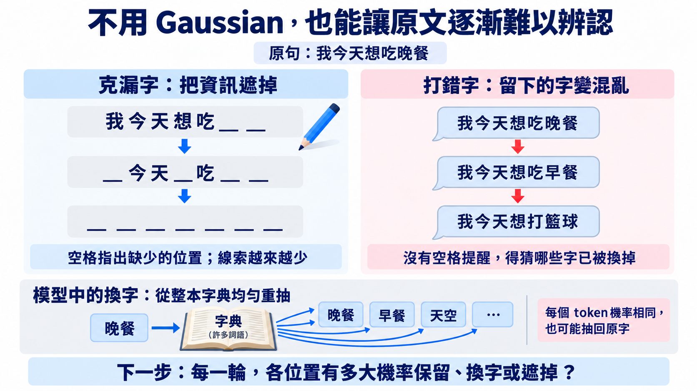

import Objectives from '../../../components/Objectives.astro';
import Prereq from '../../../components/Prereq.astro';
import Ask from '../../../components/Ask.astro';
import FormulaSteps from '../../../components/FormulaSteps.astro';
import Remark from '../../../components/Remark.astro';
import CenteredExample from '../../../components/CenteredExample.astro';
import Question from '../../../components/Question.astro';
import Answer from '../../../components/Answer.astro';
import QuizBlock from '../../../components/QuizBlock.astro';
import Option from '../../../components/Option.astro';
import Explanation from '../../../components/Explanation.astro';
import Details from '../../../components/Details.astro';
import Bridge from '../../../components/Bridge.astro';
import Ref from '../../../components/Ref.astro';

# 資料是 Token 的時候，噪聲是什麼？

<Objectives>
- **說出 token 的 noise 要怎麼設計。** 用替換與遮蔽破壞資訊，而不是對 token 編號加 Gaussian。
- **寫出中間的 conditional PMF 並抽出 noisy state。** 用同一條 probability interpolation 表示 MASK 與 uniform。
- **分清 conditional 與 marginal distribution。** 每個位置獨立加噪，不代表整句話的 $p_t$ 也會獨立。
</Objectives>

<Prereq items={frontmatter.prereqs} />

## 如果資料是離散的呢？

<Remark label="回顧" summary="U1／U2：連續資料是怎麼生成的？">
在 U1 和 U2，我們把一筆連續資料，像是圖片或座標，當成 $\mathbb R^d$ 裡的一個點。U1 介紹的 diffusion model 從資料出發，逐步加入 Gaussian noise，直到接近純粹的 Gaussian noise，再讓模型學習 denoising：以產生 $x_t$ 的總噪聲 $\epsilon$ 作為 training label，理想上學到 $\epsilon_\theta(x_t,t)\approx\mathbb E[\epsilon\mid x_t]$；U2 則從 Flow Matching 一路推廣到 stochastic interpolants，透過設計中間狀態（如 reference path 上的 $I_t$），讓模型學到推動 distribution 的 velocity $v_\theta(x,t)\approx v_t(x)$。

以最簡單的直線 interpolant 為例，沿用 U2 的時間方向，先抽一組 noise 起點 $X_0$ 與 data 終點 $X_1$，就能寫出中間位置與它的 reference velocity：

$$
\begin{aligned}
I_t&=(1-t)X_0+tX_1,\\
\dot I_t&=X_1-X_0.
\end{aligned}
$$

生成時不知道自己對應哪一組端點，只知道目前的時間 $t$ 與位置 $x$。因此先固定 $I_t=x$，再把所有在此時經過這裡的 reference velocities，按相應的 posterior 機率取平均：

$$
v_t(x)=\mathbb E[\dot I_t\mid I_t=x].
$$

這就是模型要學的 velocity field：訓練時以 $(I_t,t)$ 作 input、$\dot I_t$ 作 label；理想上，regression 學到的是這個條件平均，而不是其中某一條 reference path 的速度。
</Remark>

我們已經知道如何透過 diffusion 或 Flow Matching 學習生成連續資料。但有些資料的取值不是連續數值，而是一個個可以列出的選項。例如，資料可能是一句話，每個位置從詞庫中選出 `想`、`要`、`吃` 等字詞；也可能是一段 DNA 序列，每個位置從 `A`、`T`、`C`、`G` 四種鹼基中選一個。**當資料只能取這些選項中的一個，而不是在一段範圍內任意取實數值時，我們就稱它為離散資料（discrete data）。**

## 一句話如何拆成 token 序列？

下面我們先以文字為例。這時候的一筆資料最一開始通常是句子，例如「我今天想吃晚餐」。為了讓模型處理這句話，我們先把它切成一個個較小的單位，稱為 **token**。這裡先以詞為 token 的單位進行切分，得到 `我／今天／想／吃／晚餐`；在實務上，一個 token 可能是一個字，或一個詞的一部分。

把這些 token 按原來的順序排起來，就形成了一個序列（sequence）。定義一個 sequence，就是講清楚每個位置放上哪一個 token：

<CenteredExample>

| 位置 $\ell$ | $1$ | $2$ | $3$ | $4$ | $5$ |
|---|---|---|---|---|---|
| 這個位置的 token | `我` | `今天` | `想` | `吃` | `晚餐` |

</CenteredExample>

<Remark label="補充" summary="現在的文字通常怎麼切成 tokens？">
把文字切成 tokens 的過程稱為 **tokenization**，負責切分的工具稱為 **tokenizer**。目前的文字語言模型常用 subword tokenization（子詞切分）：常見的詞可以保留成一個 token，其他詞則可以拆成較小的片段。這是在「每個完整詞都放進字典，字典會太大」與「每個字元各自一個 token，序列會變長」之間取得取捨。

其中廣泛使用的 **BPE（Byte Pair Encoding）**，會從字元或 bytes 等基本單位出發，反覆把常一起出現的相鄰單位合併成較大的 token。其他常見方法還有 WordPiece 與 Unigram，它們用不同的準則建立字典或選擇切分方式。因此，同一句話用不同 tokenizer，可能得到不同的 tokens。各方法的說明可參考 [Hugging Face 的 tokenization 整理](https://huggingface.co/docs/transformers/tokenizer_summary)。

若沿用已訓練好的模型，通常要使用與它配套的 tokenizer。不同資料會有不同的切分方法，甚至同一種資料也可以有數種做法；從頭設計時，可以依資料特性、字典大小、序列長度與任務需求選擇。
</Remark>

## 每個位置的可能性，怎麼用機率描述？

有了這個概念以後，我們先看一下第三個位置。雖然現在放的是 `想`，但也可以換成 `要`，讓原句變成「我今天要吃晚餐」。也就是說，一個位置可以有很多不同的可能；不同 tokens 出現在一個位置的這件事，再次帶我們連回機率的概念。

我們可以用符號將整件事情寫清楚：先把所有可以選的 token 收在一本字典裡，並用 $\mathcal V$ 表示這個集合，裡面共有 $K$ 個 token。若一句話有 $L$ 個位置，每個位置都可以從 $\mathcal V$ 選一個 token 來放置，整句話就可以寫成

$$
x_0=(x_0^1,\ldots,x_0^L)\in\mathcal V^L,
\qquad x_0^\ell\in\mathcal V.
$$

這裡 $x_0$ 是整句話，$x_0^\ell$ 是第 $\ell$ 個位置的 token，上標表示位置編號；$\mathcal V^L$ 則是所有長度為 $L$ 的 token 排列所成的集合。像是剛剛舉的例子，$L=5$，其中 $x_0^3$ 的取值為 `想`。

如果從資料分布中隨機抽出一句長度為 $L$ 的話，抽到之前，我們還不知道各位置會放哪個 token。因此，可以把第 $\ell$ 個位置當成一個**離散隨機變數**，用大寫的 $X_0^\ell$ 表示；抽到之後，才得到一個具體的取值 $x_0^\ell$，例如 `想`。

要描述這個隨機變數的分布，我們就替字典裡每個可能的 token 記下一個機率。固定位置 $\ell$，用 $a\in\mathcal V$ 表示其中一個候選 token，將「這個位置出現 $a$ 的機率」記成

$$
p_0^\ell(a)=\Pr(X_0^\ell=a),
\qquad a\in\mathcal V.
$$

這個把每個可能取值對應到其機率的函數，稱為 **probability mass function（機率質量函數，PMF）**。例如，$p_0^3(\texttt{想})$ 是第三個位置出現 `想` 的機率，$p_0^3(\texttt{要})$ 則是出現 `要` 的機率。若反覆從同一個資料分布抽很多句話，這些機率就對應到各 token 在第三格出現的長期比例。

每個 token 的機率都不能是負的，而這個位置最後一定會取字典中的某個 token，所以整本字典的機率加起來必須是 $1$：

$$
p_0^\ell(a)\geq0,
\qquad \sum_{a\in\mathcal V}p_0^\ell(a)=1.
$$

## 為什麼要學整句話的 joint distribution？

不過，我們最後要生成的是一整句話，所以還需要描述「哪些 tokens 一起出現」的機率。把整個隨機序列記成 $X_0=(X_0^1,\ldots,X_0^L)$，資料分布就可以寫成

$$
p_{\mathrm{data}}(x_0)=\Pr(X_0=x_0),
\qquad x_0\in\mathcal V^L.
$$

它記錄的是所有位置一起取某組值的機率，因此稱為 **joint distribution（聯合分布）**。前面的 $p_0^\ell$ 則只看其中一個位置，稱為這個位置的 **marginal distribution（邊際分布）**。但只知道每個位置各自的機率，還不足以知道它們應該怎麼搭配。

例如，假設一個簡化的資料分布只包含 `我／今天／想／吃／晚餐` 和 `我／今天／想／打／籃球` 兩句話，各有 $1/2$ 的機率。單看第四格，`吃` 和 `打` 各占一半；單看第五格，`晚餐` 和 `籃球` 也各占一半。但它們是配對出現的：`吃` 搭配 `晚餐`，`打` 搭配 `籃球`。

若把各位置分開獨立抽樣，就有可能組出 $\tilde x_0=$ `我／今天／想／吃／籃球`。前三格固定不變，第四格抽到 `吃`、第五格抽到 `籃球` 的機率各為 $1/2$，相乘就會給這句話 $1/4$ 的機率；但在我們設定的資料分布裡，它根本不會出現：

$$
\begin{aligned}
\prod_{\ell=1}^5 p_0^\ell(\tilde x_0^\ell)
&=1\cdot1\cdot1\cdot\frac12\cdot\frac12=\frac14,\\
p_{\mathrm{data}}(\tilde x_0)&=0.
\end{aligned}
$$

所以一般而言，整句話的 joint distribution 不能直接寫成各位置 marginal PMFs 的乘積：

$$
p_{\mathrm{data}}(x_0)\neq\prod_{\ell=1}^L p_0^\ell(x_0^\ell).
$$

只有各位置互相獨立時，這個乘積才會等於 joint distribution。**我們最重要要學到的，就是 joint distribution 裡各位置之間的關聯：哪些 tokens 會一起出現，以及它們應該以多大的機率組成一整句話。**

## 能不能直接建模我們在意的 PMF？

既然我們在意的是整句話的 joint PMF $p_{\mathrm{data}}$，那麼，**能不能直接從 PMF 出發，設計並學習分布的變化？** 沿用 <Ref to="dma-unified-equation">U2.4 stochastic interpolants</Ref> 的思路，我們可以先設計一條連接資料分布與簡單 noise 分布的 reference probability path，再讓模型學會從 noise 那一端生成資料。

但是，原本常用的 Gaussian 加噪，或以 Gaussian 向量作為 source，似乎不能直接套用在這裡的機率向量上。先把已知的 token $k$ 寫成 one-hot 向量 $e_k$（原類別那格為 $1$，其他為 $0$），這相當於一張把全部機率放在 $k$ 上的 PMF。對候選 token $a\in\mathcal V$，可以寫成

$$
\delta_k(a)=(e_k)_a=
\begin{cases}
1,&a=k,\\
0,&a\neq k.
\end{cases}
$$

這時候再加入 Gaussian noise，機率向量的分量可能變成負的，總和也未必仍是 $1$，因此不能直接把結果當成 PMF；直接抽一個 Gaussian 向量當作 source，也有同樣的問題。不過這也合理：在連續的情況，我們用 Gaussian 製造 noisy state；現在 state 只有字典裡的那些選擇，因此可以改為建模這些選項上的 PMF，生成時再根據 PMF 抽樣得到 state。

<Ask>
那麼，從資料的 PMF 出發， 
我們要怎麼建立通往簡單、容易抽樣的離散分布的橋樑？
</Ask>

## 遮蔽或替換 token，PMF 會怎麼改變？

先看原句第三個位置的 `想`。給定原句時，這格的 PMF 把機率 $1$ 全放在 `想`。我們要找一個容易抽樣的終點，再讓這張 PMF 慢慢變成那個樣子。

第一個和生活經驗有關的直覺，是克漏字：把原本的字換成不透露原 token 資訊的 `[MASK]`。Interpolation 的中間狀態可以定義成：有一部分機率把 `想` 變成 `[MASK]`，而且越到後面，抽到 `[MASK]` 的機率越高。抽到 MASK 時，原句變成 `我／今天／[MASK]／吃／晚餐`；其他位置也這樣處理，最後就能變成全 MASK。**所以終點的分布只有一種可能：每個位置都是 `[MASK]`，當然很容易抽樣。**

另一個和生活經驗有關的直覺，是讓它慢慢變成字典裡每個 token 的機率都一樣，就像對不會的題目完全隨機地盲猜。我們可以讓這格的 PMF 從「只會抽到 `想`」，逐漸變成「整本字典都有一樣的機率被抽到」。這就像隨機換字：第三格可能換成 `要`，也可能換成完全不相關的 `天空`，還可能抽回原字 `想`。這次沒有 MASK 告訴我們哪格被動過，留下的文字也可以非常零亂。**所以終點的分布，是每個位置各自獨立地從字典均勻抽樣，也很容易抽。**

**這兩種做法都只需要先選好終點的 PMF，再決定中間要保留多少原字的機率，剩下的機率交給終點分布。** 接下來，我們會把這個想法寫成同一條式子，看到與 stochastic interpolants 非常類似的形式。

## 先決定中間要保留多少原文

我們用 $x_0$ 表示一筆給定的 sequence 資料，再用 $\nu$ 表示我們替單一位置選的可抽樣分布：可以是全部機率放在 MASK，也可以是字典上的均勻分布。

延續上面的討論，我們用 $\alpha_t\in[0,1]$ 決定在時間 $t$ 要保留多少 $x_0$ 中的原 token。它的明確意義是：對每個位置，以機率 $\alpha_t$ 保留原 token，否則從 $\nu$ 隨機抽一個來取代。

明確一點來說，我們先固定 sequence 中的一個位置 $\ell$，只看這一格的 token。用 $q_t^\ell(a\mid x_0)$ 表示「給定原句 $x_0$，在時間 $t$，位置 $\ell$ 是 token $a$ 的機率」。上面的設計給出：

<FormulaSteps
  id="u4-token-pmf-interpolant"
  compact
  title="把保留與重抽合成中間 PMF"
  formula={String.raw`\reveal{1}{q_t^\ell(a\mid x_0)=}\reveal{2}{\alpha_t\delta_{x_0^\ell}(a)}\reveal{3}{+(1-\alpha_t)\nu(a).}`}
  steps={[
    {label: '想求的機率', text: String.raw`固定原句 $x_0$、位置 $\ell$ 與時間 $t$，想知道這格抽到 $a$ 的機率。`},
    {label: '保留原字', text: String.raw`$\delta_{x_0^\ell}(a)$ 只有在 $a=x_0^\ell$ 時才是 $1$，其餘 token 都是 $0$；乘上 $\alpha_t$，就把保留分支的機率放在原字上。`},
    {label: '加上重抽的機率', text: String.raw`剩下的 $1-\alpha_t$ 從 $\nu$ 重抽，抽到 $a$ 的機率是 $\nu(a)$；將兩個分支相加。`},
  ]}
/>

第一項代表有 $\alpha_t$ 的機率會保留原本的 token $x_0^\ell$；第二項則代表剩下有 $1-\alpha_t$ 的機率，會把這一格換成由 $\nu$ 抽出的 token，其中抽到 $a$ 的機率是 $\nu(a)$。**給定原句 $x_0$ 後，每個位置都各自獨立地進行這個「保留或重抽」的動作。** 只要選擇不同的 $\nu$，就能在上面提到的兩種做法之間切換：

<CenteredExample>

| 做法 | Noise 分布 $\nu$ | $\alpha_t=0$ 時 |
| --- | --- | --- |
| **MASK** | $\delta_m$，全部機率放在 $m=\texttt{[MASK]}$ | 每格都是 MASK |
| **Uniform** | $\mathrm{Unif}(\mathcal V)$，每個 token 各有 $1/K$ | 每格從字典均勻抽樣 |

</CenteredExample>

MASK 是用一個特殊標記表示「這個位置的 token 被遮住了」。實作上，若 tokenizer 已經有 `[MASK]`，就沿用它的 token ID；若沒有，才另外保留一個編號。**這不代表一定要擴充向量維度。** 例如本單元的 toy 實作直接用 `MASK = -1` 標記被遮住的位置，仍用長度 $L$ 的整數陣列存整句話，不必建立 one-hot 向量。

若明確用 one-hot 或 PMF 向量列出所有狀態，而且 MASK 不在原本的 $K$ 類裡，才需要多留一維；若用 embedding 查表，則需確保表中有 MASK 的向量，但每筆向量的維度不必改變。Uniform 則直接從原字典的 $K$ 種 token 抽樣，不需要另外的遮蔽標記。

<figure>
  
  <figcaption>同一句話、同一個遮蔽動作，表示法不同，需要改的大小也不同。點圖可放大。</figcaption>
</figure>

例如，固定一個位置 $\ell$，假設原 token 是 $x_0^\ell=\texttt{想}$，且在 $t=0.8$ 時，$\alpha_{0.8}=0.7$。我們現在要考慮依照 $q_t^\ell(a\mid x_0)$ 抽樣得到的 intermediate state $x_{0,t}^\ell$，也就是這一格加噪後的 token。

**若用 MASK**，$\nu=\delta_m$（$m=\texttt{[MASK]}$），那重抽一定會拿到 MASK token（$\nu(\texttt{想})=0$、$\nu(m)=1$）。代入剛才的式子：

$$
\begin{aligned}
q_t^\ell(\texttt{想}\mid x_0)&=0.7\cdot1+0.3\cdot0=0.7,\\
q_t^\ell(m\mid x_0)&=0.7\cdot0+0.3\cdot1=0.3.
\end{aligned}
$$

也就是這一格有 $0.7$ 的機率是 `想`、$0.3$ 的機率是 MASK，其餘 token 的機率都是 $0$。

**若用 uniform**，我們改用只有 `想`、`要`、`吃` 的 toy 字典，$K=3$，讓 $\nu(a)=1/3$。仍然令 $x_0^\ell=\texttt{想}$、$\alpha_t=0.7$，就得到：

$$
\begin{aligned}
q_t^\ell(\texttt{想}\mid x_0)&=0.7\cdot1+0.3/3=0.8,\\
q_t^\ell(\texttt{要}\mid x_0)&=0.7\cdot0+0.3/3=0.1,\\
q_t^\ell(\texttt{吃}\mid x_0)&=0.7\cdot0+0.3/3=0.1.
\end{aligned}
$$

因此，按 `想`、`要`、`吃` 排列，這一格的 PMF 是 $(0.8,0.1,0.1)$。**$\alpha_t=0.7$ 是選擇「保留原字」的機率；最後抽到原字的機率還要加上重抽時抽回 `想` 的 $0.3/3=0.1$，所以是 $0.8$。**

這個單元統一用連續時間 $t\in[0,1]$，沿用 U1 diffusion 的時間編號：$t=0$ 表示資料、$t=1$ 表示 noise，與 U2 的方向相反。**生成的目的仍然是從 noise 走向 data，只是這裡的生成時間由 $1$ 倒著走到 $0$。** 這是時間編號的選擇，並不是資料離散就必須反轉方向。我們讓 $\alpha_t$ 隨 $t$ 從 $1$ 降到 $0$，就能從保留整句原文，走到只從 noise 分布抽樣。

## 有了 PMF，就能直接抽出 noisy state

現在這格的 PMF 已經有了，但它給的是各個 token 的機率；要得到一個具體的 noisy token，還需要真的抽一次。例如剛才 MASK 的例子，$q_t^\ell(\texttt{想}\mid x_0)=0.7$、$q_t^\ell(m\mid x_0)=0.3$，我們可以把 $[0,1)$ 切成長度 $0.7$ 和 $0.3$ 的兩段，再均勻抽一個數字 $u$：若 $u<0.7$，這格就放 `想`；否則放 MASK。**每次抽樣只得到一個 token，而每個選項被抽中的機率，就是它在 PMF 裡占的比例。**

這種「從有限個類別中，按照各自的機率抽出一個」的動作，就叫 **categorical sampling**。沿用 U2 的記號，用 $I_t$ 表示我們造出的 reference noisy state，$I_t^\ell$ 就是其中位置 $\ell$ 的隨機 token。把剛才的動作寫成數學，就是：

$$
I_t^\ell\mid X_0=x_0
\sim\operatorname{Categorical}\big(q_t^\ell(\cdot\mid x_0)\big).
$$

右邊的 $q_t^\ell(\cdot\mid x_0)$ 是把所有候選 token 的機率放在一起的整張 PMF；$\cdot$ 表示這裡考慮所有候選 $a$。這條式子說的是：給定原句 $x_0$，就按這張表抽出 $I_t^\ell$。若固定同一個 $x_0$ 和時間 $t$，獨立重複抽很多次，剛才的例子就會有約 $70\%$ 的結果是 `想`、約 $30\%$ 是 MASK；這是在同一個時間重複抽樣。

實作時，也可以沿用前面的兩個分支：先以機率 $\alpha_t$ 決定是否保留原字，否則從 $\nu$ 抽一個；兩種方式得到的 token 機率相同。讓每個位置各自做一次，就得到整句的 noisy sequence $x_t$；給定原文，各位置使用獨立抽樣，因此

$$
q_t(x_t\mid x_0)=\prod_{\ell=1}^L q_t^\ell(x_t^\ell\mid x_0).
$$

**所以訓練時，只要抽一筆原文 $x_0$、選一個時間 $t$，就能直接造出 $x_t$。** 不必真的一步步改字到第 $t$ 步；原文 $x_0$ 留著，之後就能當作 denoising 的 label。

<iframe loading="lazy" src="/personal_website/notes/research_areas/diffusion-models-applications/w6-0-noising.html" class="demo-frame" title="Token 的替換與遮蔽" style="height: 810px; width: 100%; border: none;"></iframe>

## 各位置獨立加噪，整句話就獨立了嗎？

這裡的獨立，是在「原文已經固定」之後才成立。訓練時，我們會抽到不同的原文；要看所有 noisy sequences 的分布，就要把這些原文按 $p_{\mathrm{data}}$ 加權混合：

$$
\begin{aligned}
p_t(x_t)
&=\sum_{x_0}p_{\mathrm{data}}(x_0)q_t(x_t\mid x_0)\\
&=\sum_{x_0}p_{\mathrm{data}}(x_0)
\prod_{\ell=1}^L q_t^\ell(x_t^\ell\mid x_0).
\end{aligned}
$$

各位置共享同一句原文，所以混合後仍可能保留「吃／晚餐」「打／籃球」這些 joint 關聯。在起點，$\alpha_0=1$ 讓 $I_0=X_0$，因此 $p_0=p_{\mathrm{data}}$；到終點，$\alpha_1=0$ 讓 conditional PMF 完全不再依賴原文，整句話才變成各位置獨立的 noise：

$$
p_1(x_1)=\prod_{\ell=1}^L\nu(x_1^\ell).
$$

這樣就把資料分布連到容易抽樣的終點：全 MASK，或一串均勻抽出的 tokens。生成時要倒著走，重新建立這些位置間的關聯。

<Question id="Q1">
既然整句話有 joint 關聯，給定原文後讓每格獨立加噪，會不會一開始就把這些關聯全部丟掉？

<Answer>
不會。獨立的是固定同一句原文後，各位置的加噪動作；把不同原文按資料分布混合後，位置仍可能相依。例如 $t=0$ 完全沒有加噪，各位置的條件 PMF 都是 point mass，但混合後正好回到原本有關聯的 $p_{\mathrm{data}}$。只有到了 $\alpha_1=0$，每個位置都不再依賴原文，這條 path 才得到各位置獨立的 noise。
</Answer>
</Question>

## 快速回顧一下

<QuizBlock id="w6-0-a">
$p_0^3(\texttt{想})$ 描述的是什麼？
<Option>整句話恰好是「我今天想吃晚餐」的機率。</Option>
<Option correct>從資料分布抽一句話時，第三個位置出現 `想` 的機率。</Option>
<Option>`想` 在字典裡的編號。</Option>
<Explanation>固定的是第三個位置，PMF 記錄這一格各個可能 token 的機率；其他位置還可以有不同的取值。</Explanation>
</QuizBlock>

<QuizBlock id="w6-0-b">
各位置獨立抽 noisy token，為什麼整句的 $p_t$ 仍可能保留 joint 關聯？
<Option correct>各位置共享同一筆原文；把不同原文混合後，仍可能相依。</Option>
<Option>因為給定原文後，各位置的加噪其實也相依。</Option>
<Option>只要每個位置有相同的 PMF，整句就一定有關聯。</Option>
<Explanation>獨立成立在給定原文的 $q_t(x_t\mid x_0)$；$p_t$ 還要把有 joint 關聯的原文按資料分布混合。</Explanation>
</QuizBlock>

<QuizBlock id="w6-0-c">
若 $\alpha_t=0.7$，原 token 是 `想`，字典只有 `想`、`要`、`吃`，uniform snapshot 中抽到 `想` 的機率是多少？
<Option>$0.7$，只有保留分支會得到原字。</Option>
<Option correct>$0.8$，重抽分支也可能抽回原字。</Option>
<Option>$1/3$，用了 uniform 就一定完全均勻。</Option>
<Explanation>保留分支貢獻 $0.7$，重抽分支再貢獻 $0.3/3=0.1$，總共是 $0.8$。</Explanation>
</QuizBlock>

<Bridge to="dma-ctmc">
現在我們已經設計好 PMF interpolation，也能直接抽出每個時間的 reference snapshot。那麼，能不能像 U2 的 Flow Matching 一樣，學一個 velocity，把容易抽樣的 noise 分布推回資料？

下一篇就從這個想法出發：對 PMF 微分會得到什麼？它與「一個樣本接下來怎麼動」又差在哪裡？我們需要先找到離散狀態上能實際推動分布的規則。
</Bridge>

## 參考文獻

1. Austin, J. et al. [*Structured Denoising Diffusion Models in Discrete State-Spaces.*](https://arxiv.org/abs/2107.03006) NeurIPS 2021.
