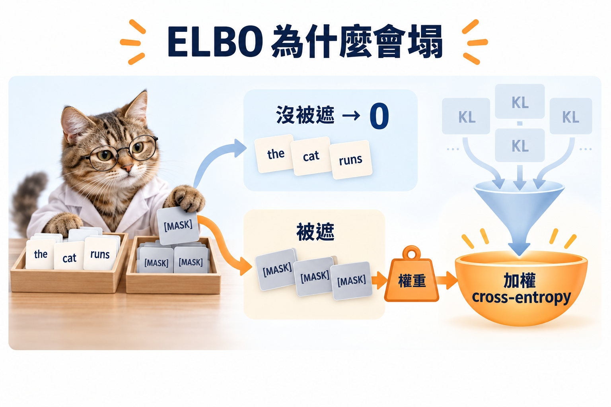
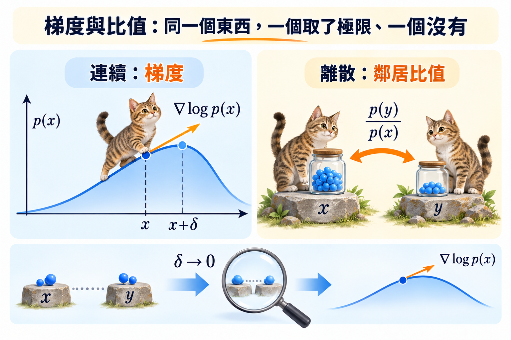

import Objectives from '../../../components/Objectives.astro';
import Prereq from '../../../components/Prereq.astro';
import Ask from '../../../components/Ask.astro';
import FormulaSteps from '../../../components/FormulaSteps.astro';
import DiscreteMechanismFigure from '../../../components/DiscreteMechanismFigure.astro';
import AlgorithmView from '../../../components/AlgorithmView.astro';
import Remark from '../../../components/Remark.astro';
import Question from '../../../components/Question.astro';
import Answer from '../../../components/Answer.astro';
import QuizBlock from '../../../components/QuizBlock.astro';
import Option from '../../../components/Option.astro';
import Explanation from '../../../components/Explanation.astro';
import Details from '../../../components/Details.astro';
import Bridge from '../../../components/Bridge.astro';
import Ref from '../../../components/Ref.astro';
import DiscretePythonExperiment from '../../../components/DiscretePythonExperiment.astro';

# 有了模型，要怎麼一步步抽出句子？

<Objectives collapsible>
- **把 rate 轉成有限時間的抽樣規則。** 區分理想 rate、模型 rate、連續時間過程與有限步 sampler，並檢查步長是否給出合法機率。
- **推導 MASK 的 closed-form 翻開機率。** 算出從 $t$ 退到 $s$ 要翻開多少 MASK，並把 denoiser 接成完整生成流程。
- **指出精確 reveal probability 的保證範圍。** 區分翻開時間、原字預測與同一步多格獨立抽樣。
</Objectives>

<Prereq items={frontmatter.prereqs} />

## 現在真的從全 MASK 開始

在 <Ref to="dma-discrete-flow-matching"/>，我們已經把「翻開後要填什麼」交給 denoiser：模型看目前整句與時間，替每個 MASK 給出原字 PMF。現在拿五個 MASK 當起點，分幾次填回來。就像做克漏字，新填的字也會成為其他空格的線索。

前面已經知道一個位置的 rate，電腦還需要下一步的抽樣機率。沿用同一個例子，先看目前這句 $x=$ `我／今天／[MASK]／吃／麥當勞`：如果模型預測 `想`、`要` 的機率為 $0.7/0.3$，我們要怎麼真的抽出下一個 token？

<Ask>
知道這格翻得多快、各個答案有多可能， 
這一步應該怎麼決定繼續 MASK，或填入一個字？
</Ask>

## 先把這格下一步的三種結果列出來

沿用 $\alpha_t=1-t$，在 $t=0.5$，每個 MASK 的總 reveal rate 是 $2$。模型給第三格 `想` rate $1.4$、`要` rate $0.6$。若只退一小段 $h=0.01$，翻開機率約為 $2h=0.02$，再按 $0.7/0.3$ 分給兩個字：

$$
\begin{pmatrix}
\text{填「想」的機率}\\
\text{填「要」的機率}\\
\text{繼續 MASK 的機率}
\end{pmatrix}
\approx\begin{pmatrix}0.014\\0.006\\0.98\end{pmatrix}.
$$

三項加起來是 $1$。前兩項是跳成某個字的機會，最後一項是這一步還不翻開。**不是每走一步就一定要填字，也不是每次都選機率最大的字。**

一般式仍是前篇的模型 rate。用 $x^{(\ell\to a)}$ 表示只換第 $\ell$ 格後的整句，對 $x^{(\ell)}=m$，

<FormulaSteps
  id="u4-ideal-to-model-rate"
  compact
  title="翻開的快慢已知，答案機率由模型預測"
  formula={String.raw`
    \begin{gathered}
    \reveal{1}{\bar R_t\bigl(x,x^{(\ell\to a)}\bigr)}\\[.2em]
    \reveal{2}{=\frac{-\dot\alpha_t}{1-\alpha_t}
    \Pr(X_0^{(\ell)}=a\mid I_t=x),}\\[.5em]
    \reveal{3}{\bar R_{\theta,t}\bigl(x,x^{(\ell\to a)}\bigr)}\\[.2em]
    \reveal{3}{=\frac{-\dot\alpha_t}{1-\alpha_t}
    f_\theta^{(\ell)}(a\mid x,t).}
    \end{gathered}
  `}
  steps={[
    {label: '指定同一個換字動作', text: String.raw`來源與去向都是整句，只把第 $\ell$ 格的 MASK 換成候選 $a$。`},
    {label: '理想規則', text: String.raw`真 posterior 將總 reveal rate 分給各個答案。給定的是目前 $I_t=x$，不再給定原句。`},
    {label: '實際使用的模型', text: String.raw`以 $f_\theta^{(\ell)}(a\mid x,t)$ 近似這張原字 PMF；對所有候選加總為 $1$，所以一個 MASK 的總 reveal rate 仍是已知的 schedule 係數。`},
  ]}
/>

用 $Y_t$ 表示模型 rates $\bar R_{\theta,t}$ 定義的連續時間隨機 sequence。它與製造 training pairs 的 reference process $I_t$ 不同；模型近似後，$Y_t$ 不必有指定的 $p_t$。對不同完整序列 $x,y$，rate 定義給出

$$
\begin{gathered}
\Pr(Y_{t-h}=y\mid Y_t=x)\\[.3em]
=h\bar R_{\theta,t}(x,y)+o(h).
\end{gathered}
$$

省略高階項就是一階近似。單格至少要滿足 $h[-\dot\alpha_t/(1-\alpha_t)]\le1$，才有合法的留在 MASK 機率；整句若選擇「一步最多跳一次」，要用所有 MASK 的總流出 rate 限制步長。

讓各位置依同一份舊 context 平行更新，則是另一個小步近似：兩格同時改變的機率為高階項。有限大步時，這不等於精確抽取 $Y_t$，因為中途填出一個字後，其他格的 PMF 可能已經改變。

## 這次走的時間較長，還能只用 rate 乘步長嗎？

U4.1 已經算過，不必猜翻開機率：要補回的原字質量，除以目前 MASK 的比例。把下一個時間記為 $s=t-h$，$0\le s<t\le1$，同一個結果就寫成

<FormulaSteps
  id="u4-finite-reveal-probability"
  compact
  title="沿用 reference 的整段翻開機率"
  formula={String.raw`
    \begin{gathered}
    \reveal{1}{w_{t,s}:=\Pr(I_s^{(\ell)}\ne m\mid I_t^{(\ell)}=m,X_0=x_0)}\\[.4em]
    =\reveal{3}{\frac{\reveal{2}{\alpha_s-\alpha_t}}{1-\alpha_t}.}
    \end{gathered}
  `}
  steps={[
    {label: '仍是同一個翻開事件', text: String.raw`這裡的 $w_{t,s}$ 就是 U4.1 的 $w_{t,h}$，只是把正的時間長度 $h$ 改寫成目標時間 $s=t-h$。`},
    {label: '要補回的比例', text: String.raw`從 $t$ 退到 $s$，原字比例由 $\alpha_t$ 增至 $\alpha_s$，因此需補回兩者的差。`},
    {label: '分給目前的 MASK', text: String.raw`除以來源比例 $1-\alpha_t$，得到每個 MASK 的整段翻開機率。結果不含原字，所以不知道原句仍然能算。`},
  ]}
/>

假設 schedule 非增且 $\alpha_t<1$，這個值就在 $[0,1]$。回到熟悉的 $t=0.5\to s=0.4$，有 $w_{t,s}=0.2$；配上第三格的 PMF $0.7/0.3$，就得到 `想`、`要`、MASK 的機率 $(0.14,0.06,0.8)^{\mathsf T}$。

**這裡精確計算的是這格是否翻開。** 我們仍要選擇翻開時用哪一份 context 預測答案，不能把這個精確機率直接當成整句精確抽樣的保證。

即使填字 PMF 隨 context 改變，$f_\theta$ 加總為 $1$，所以一個 MASK 的總 reveal rate 始終是 $c_t=-\dot\alpha_t/(1-\alpha_t)$。在沒有 remasking 的模型過程 $Y_t$ 裡，對 $x^{(\ell)}=m$，仍未翻開的機率為

$$
\begin{gathered}
\Pr(Y_s^{(\ell)}=m\mid Y_t=x)\\[.3em]
=\exp\!\left(-\int_s^t\frac{-\dot\alpha_u}{1-\alpha_u}\,\mathrm du\right)\\[.3em]
=\frac{1-\alpha_s}{1-\alpha_t}=1-w_{t,s}.
\end{gathered}
$$

積分用了 $\partial_u\log(1-\alpha_u)=-\dot\alpha_u/(1-\alpha_u)$。這只計算一格的 clock，不是計算整段每個新字的 joint。

在線性 schedule 下，$w_{t,s}=(t-s)/t$，剛好等於步首 rate $1/t$ 乘步長。一般 schedule 沒有這個巧合。若凍結步首 rate 再抽 exponential waiting time，則得到 $1-e^{-(t-s)c_t}$，一般也不同於積分真正變動的 rate。

## 多個 MASK，各自按哪張表抽？

這裡選擇一個有限步 sampler：**每段先讓模型讀取目前整句一次，這段要填的所有格子都使用這份舊 context。** 用 $\widehat Y_t$ 表示格點上的隨機 sequence，$\widehat x_t$ 表示某次抽出的整句；帽號提醒我們，這是所選有限步規則，不是直接精確抽取連續時間的 $Y_t$。

固定 $\widehat Y_t=x$，第 $\ell$ 格目前為 MASK。它的下一步 PMF 記為 $\widehat K_{\theta;t,s}^{(\ell)}(\cdot\mid x)$：

$$
\begin{aligned}
\widehat K_{\theta;t,s}^{(\ell)}(m\mid x)&=1-w_{t,s},\\
\widehat K_{\theta;t,s}^{(\ell)}(a\mid x)&=w_{t,s}f_\theta^{(\ell)}(a\mid x,t),
\quad a\in\mathcal V.
\end{aligned}
$$

第一項是繼續遮住，第二項是翻開並抽到 $a$。如果這格已填字，直接保留：$\widehat K_{\theta;t,s}^{(\ell)}(a\mid x)=\delta_{x^{(\ell)}}(a)$。

若目前是 `我／今天／[MASK]／吃／[MASK]`，第三格與第五格都各抽一次；但這次沒有原句可查，翻開後要各按模型給的 PMF 選字。這就是和 U4.1 相同的逐格操作，以及多出來的模型預測。

<DiscreteMechanismFigure kind="sampler" />

給定舊 context $x$ 後，各格獨立抽樣，便**定義了**整句 kernel

$$
\begin{gathered}
\Pr(\widehat Y_s=y\mid\widehat Y_t=x)
=\widehat K_{\theta;t,s}(y\mid x)\\[.3em]
=\prod_{\ell=1}^{L}\widehat K_{\theta;t,s}^{(\ell)}(y^{(\ell)}\mid x).
\end{gathered}
$$

這個等號描述所選 sampler，不是宣稱它等於 $\Pr(Y_s=y\mid Y_t=x)$。不同新字可能相依，而它們在這一段還沒看見彼此的結果；U4.4 接著把差別算出來。

## 更新 context，再抽下一段

選時間格點 $1=t_N>\cdots>t_0=0$。先預測、再抽這一步翻開的格子與答案；更新整句後，下一段重新預測。把數學和 pseudocode 放在一起看：

<AlgorithmView id="u4-mask-sampling" title="從全 MASK 生成一次序列" code={`輸入：模型 f_theta、時間格點 1 = t[N] > ... > t[0] = 0
x ← 全 MASK 的長度 L 序列
for n = N, ..., 1:
    t ← t[n]; s ← t[n-1]
    old ← copy(x)
    prediction ← f_theta(old, t)
    w ← (alpha(s) - alpha(t)) / (1 - alpha(t))
    for ell = 1, ..., L:
        if old[ell] == MASK:
            以機率 w，按 prediction[ell] 抽一個 token 放進 x[ell]
return x`}>

給定目前整句 $\widehat Y_t=\widehat x_t$，在 MASK 位置各抽

$$
\begin{aligned}
B_\ell&\sim\mathrm{Bernoulli}(w_{t,s}),\\
A_\ell&\sim\mathrm{Categorical}
\bigl(f_\theta^{(\ell)}(\cdot\mid\widehat x_t,t)\bigr),\\[.3em]
\widehat Y_s^{(\ell)}&=\begin{cases}
A_\ell,&\widehat x_t^{(\ell)}=m,\ B_\ell=1,\\
\widehat x_t^{(\ell)},&\text{其他情況}.
\end{cases}
\end{aligned}
$$

$B_\ell$ 決定翻不翻，$A_\ell$ 決定翻開後的一個字；條件都是同一份 $\widehat x_t$。各格排回原位置，才是下一份整句 $\widehat Y_s=(\widehat Y_s^{(1)},\ldots,\widehat Y_s^{(L)})$。

</AlgorithmView>

程式中的 `old` 就是這份步首 context，`x` 是更新後抽出的整句。從 $\widehat Y_1=(m,\ldots,m)$ 重複到 $0$，最後輸出一次實現 $\widehat x_0$。若 $\alpha_0=1$，最後一段 $w_{t,0}=1$，剩下的 MASK 就會全部翻開。

## 多生成幾趟，看到的是誰的分布？

完成一趟只得到一句話。獨立重跑 $M$ 趟，得到 $\{\widehat x_0^{(r)}\}_{r=1}^M$；這裡 $r$ 是樣本編號，與 token 位置 $\ell$ 不同。某句 $x$ 出現的頻率是

$$
\widehat p^{(M)}(x)=\frac1M\sum_{r=1}^M\mathbf1[\widehat x_0^{(r)}=x].
$$

增加 $M$，看清的是固定模型和 sampler 的輸出分布。它有多接近資料，仍由模型預測和每趟的抽樣規則決定；多跑幾趟本身不會修正偏差。

## 動手做：從全 MASK 跑完一趟生成

下面沿用七成「我今天想吃麥當勞」、三成「我今天要吃麥當勞」的 toy 資料。先用精確 posterior 查表代替 $f_\theta$，拿掉模型誤差；程式仍真的計算翻開機率、抽硬幣、抽 token，再用新的整句預測下一段。

<DiscretePythonExperiment example="sampler" />

先看一趟句子怎麼變，再看 `n_runs` 趟的比例。把 `steps` 改成 `1` 或 `8`，比較一次翻開多少格：這個 toy 只有第三格有兩種原字，其他位置的答案固定，因此還沒有兩個未知字要搭配的問題。第三格反覆生成後會接近 $0.7/0.3$，而不是每趟都填 `想`。

[下載這份 MASK sampler](/personal_website/notes/notebooks/diffusion-models-applications/dma-u4-mask-sampler.py)。

<Question id="Q1">
如果兩個 MASK 都有不同答案，翻開機率精確、每格 posterior 也精確，能不能一次各自抽完？
<Answer>
可以執行這個 sampler，但它一般不給出正確的整句 joint。U4.1 知道原句時，各格的答案固定；現在不知道原句，兩個答案可能必須一起搭配。各自正確的 PMF，沒有決定這個搭配的 joint。下一篇就用「吃麥當勞／打籃球」算一次。
</Answer>
</Question>

Austin 等人的 **D3PM** [1] 從 forward Markov chain 建構離散 diffusion。這裡用 $n$ 表示整數步，$t_n$ 表示對應的連續時間。以下矩陣先只描述一個位置 $\ell$ 的 token-to-token 轉換，沿資料到易抽樣分布的加噪方向走；正文的 $\widehat K$ 則沿生成方向抽樣。

設單格矩陣 $\boldsymbol P(\cdot,\cdot)$ 的元素為 $P(i,j)=\nu(j)$，來源 $i$、去向 $j$ 都是單一 token；它的每列都是同一張易抽樣 PMF。一步轉移矩陣為

$$
\boldsymbol Q_n^{(\ell)}(\cdot,\cdot)
=(1-\beta_n)\mathbf I+\beta_n\boldsymbol P(\cdot,\cdot).
$$

$\beta_n$ 是這一整數步選擇重抽的機率。這個已知 forward 規則只需目前 token，因此矩陣沒有另帶 $\mid x_0$。

由 $\boldsymbol P^2=\boldsymbol P$，兩步相乘仍是 identity 與 $\boldsymbol P$ 的組合；繼續相乘得到單格的累積矩陣

$$
\begin{gathered}
\bar{\boldsymbol Q}_n^{(\ell)}(\cdot,\cdot)
=\boldsymbol Q_1^{(\ell)}\cdots\boldsymbol Q_n^{(\ell)}\\[.3em]
=\alpha_{t_n}\mathbf I+(1-\alpha_{t_n})\boldsymbol P(\cdot,\cdot),\\[.3em]
\alpha_{t_n}=\prod_{r=1}^n(1-\beta_r).
\end{gathered}
$$

乘積中的每張矩陣都沿用同一個 token 排序；為了讀乘積，右邊省略重複的 $(\cdot,\cdot)$。這裡 $\bar Q$ 的橫線表示累積 forward 轉移，與生成 rate $\bar R$ 的橫線意義不同。

乘積係數表示每步都選保留分支；至少重抽一次後，分布就是 $\nu$。給定非增的 $\alpha$，在分母非零時可設 $\beta_n=1-\alpha_{t_n}/\alpha_{t_{n-1}}$；已到零時可令後續 $\beta_n=0$。Uniform 的重抽也可能抽回原字，所以這個係數不是最後仍為原字的總機率。

現在固定 clean 原句 $X_0=x_0$，並將第 $\ell$ 格的原字記為 $k=x_0^{(\ell)}$。若目前 reference token 是 $I_{t_n}^{(\ell)}=j$，上一整數步是 token $i$ 的 posterior 由 Bayes 得到：

$$
\begin{gathered}
\Pr(I_{t_{n-1}}^{(\ell)}=i\mid I_{t_n}^{(\ell)}=j,X_0=x_0)\\[.3em]
=\frac{\bar Q_{n-1}^{(\ell)}(k,i)Q_n^{(\ell)}(i,j)}{\bar Q_n^{(\ell)}(k,j)}.
\end{gathered}
$$

$Q_n^{(\ell)}(i,j)$ 是單格矩陣的一個元素，$i,j,k$ 都是 token，而不是三份 sequences。分子是先從原字 $k$ 到 $i$、再到 $j$ 的 joint weight；分母是所有到 $j$ 的機率。D3PM 的 $x_0$-parameterization，再按 denoiser 對候選原字的機率混合這些已知 posteriors。只在分母為正、與觀察相容的候選上使用；MASK 的可見字則直接複製。

對 MASK，這個 Bayes 計算就回到正文的 $w_{t,s}$。對 uniform，這條反覆重抽的 forward chain，與 <Ref to="dma-discrete-flow-matching"/> 補充中「生成時重設到資料端」的建構，可以有相同 PMF snapshots，卻有不同的生成 dynamics。

這裡回到 reference process $I_t$，不是有限步 sampler 的 $\widehat Y_t$。固定整句 $I_t=x$ 與 clean 原句 $X_0=x_0$，對一個目前是 MASK 的位置 $x^{(\ell)}=m$，把單格 reverse posterior 記成

$$
\begin{gathered}
q_{s\mid t}^{(\ell)}(a\mid x,x_0)\\
:=\Pr(I_s^{(\ell)}=a\mid I_t=x,X_0=x_0)\\[.3em]
=(1-w_{t,s})\delta_m(a)+w_{t,s}\delta_{x_0^{(\ell)}}(a).
\end{gathered}
$$

$a$ 是一個候選 token，但條件 $x,x_0$ 都是整句。模型 kernel 則是正文已定義的 $\widehat K_{\theta;t,s}^{(\ell)}(\cdot\mid x)$，只讀目前整句與時間，沒有 $\mid x_0$。

未遮位置兩者都複製輸入，KL 為零。被遮位置在 MASK 上的機率相同，只有原字那一項留下：

$$
\begin{gathered}
D_{\mathrm{KL}}\!\left(
\begin{gathered}
q_{s\mid t}^{(\ell)}(\cdot\mid x,x_0)\\
\Big\|\widehat K_{\theta;t,s}^{(\ell)}(\cdot\mid x)
\end{gathered}\right)\\[.3em]
=(1-w_{t,s})\log1\\
\quad+w_{t,s}\log
\frac{w_{t,s}}{w_{t,s}f_\theta^{(\ell)}(x_0^{(\ell)}\mid x,t)}\\[.3em]
=w_{t,s}[-\log f_\theta^{(\ell)}(x_0^{(\ell)}\mid x,t)].
\end{gathered}
$$

對整句，給定原文時的 reverse posterior 逐位置獨立；正文也選擇逐位置乘積的 model kernel $\widehat K_{\theta;t,s}(y\mid x)$。因此這個整句 conditional KL 是各位置 KL 的和。沿用 <Ref to="dma-denoising-regression"/> 的 negative ELBO 分解，將各時間段的 reverse KL 與 reconstruction 項合起來：

$$
\begin{gathered}
\mathcal L_{\mathrm{VLB}}=C+\sum_{n=1}^N
\mathbb E_{X_0,I_{t_n}}\Big[\\
w_{t_n,t_{n-1}}\sum_{\ell:I_{t_n}^{(\ell)}=m}\\
\bigl[-\log f_\theta^{(\ell)}(X_0^{(\ell)}\mid I_{t_n},t_n)\bigr]\Big].
\end{gathered}
$$

期望值裡仍然是用 clean 原句製造的 reference snapshots $I_{t_n}$，不是模型自己生成的 $\widehat Y_{t_n}$。$C$ 是與模型無關的 prior KL，精確全 MASK endpoint 下為零；$w_{t_1,0}=1$ 包含最後的 reconstruction。這個 loss 是所選有限步生成模型的資料 negative log-likelihood 上界；它與單純 CE 的逐 input 理想最佳解相同，但權重與 objective 的解讀不同。

在連續時間極限，$w_{t,t-h}=h[-\dot\alpha_t/(1-\alpha_t)]+o(h)$，因此和式對應以 reveal rate 加權的 masked CE 積分；Sahoo 等人的 **MDLM** [2] 使用這個 absorbing 結構。推導 ELBO 選用的逐位置 model kernel，並沒有證明真 reverse joint 也能逐位置獨立抽。

*圖：未遮位置的 KL 為零；MASK 項相消，原字項留下已知權重乘上 cross-entropy。*

**Forward 的門會開，倒著走該怎麼開？**

前兩篇從 reference PMF 直接建構填回方向的 rates。另一種推導方式，是先指定沿加噪方向的 rate matrix $R_t$，其中 $R_t(y,x)$ 表示整句由 $y$ 跳到 $x$ 的 rate，再問：**現在落在 $x$ 的樣本，剛才有多少是從另一個狀態 $y$ 過來的？**

可以把兩種 states 想成 A、B 兩個房間。A 往 B 的門每個人都能走，但 B 裡的人有多少原本來自 A，還要看 A 與 B 各有多少人。不能把門上的方向倒過來，就宣稱頻率也相同。下面把房間換成完整序列的狀態 $x,y$，用 Bayes 算真正的比例。

這一小節用 $I_t$ 表示由已知 forward rates 建構的 reference process，$p_t$ 是它的整句 PMF。$\bar R_t(x,y)$ 是它的精確 reverse rate；經過正的時間長度 $h$，時間從 $t$ 退到 $t-h$。對兩份不同的完整 sequences $x,y$，想求的是 $\Pr(I_{t-h}=y\mid I_t=x)$；只在 $p_t(x)>0$ 的狀態使用 Bayes：
$$
\begin{gathered}
\Pr(I_{t-h}=y\mid I_t=x)\\
=\frac{p_{t-h}(y)\Pr(I_t=x\mid I_{t-h}=y)}{p_t(x)}.
\end{gathered}
$$
Forward 的短時間轉移是 $hR_t(y,x)+o(h)$，且 $p_{t-h}(y)=p_t(y)+o(1)$。除以 $h$ 再取極限：
$$
\bar R_t(x,y)=R_t(y,x)\frac{p_t(y)}{p_t(x)}.
$$
式子中的 $R_t(y,x)$ 是原來那扇門：forward 從 $y$ 走到 $x$，reverse 才沿它退回去。例如某時刻 $p_t(y)=0.8$、$p_t(x)=0.2$，而 $R_t(y,x)=0.5$，則 $\bar R_t(x,y)=0.5\times0.8/0.2=2$。同一股流量 $0.4$，對來源比例 $0.8$ 與 $0.2$ 的兩群樣本，就對應不同的每人頻率。

**Forward rate 已知；未知的部分是兩個完整狀態的機率比。** Campbell 等人 [5] 用這個時間反轉公式建構 discrete denoising models。接下來的訓練目標，就是要補上這份資料分布的資訊。

**兩個狀態之間，要學哪一種比較？**

連續空間的 score $\nabla\log p_t(x)$ 告訴我們附近哪裡密度比較高。離散空間沒有「朝某個字移動一點點」，所以先保留一個有限的比較：
$$
s_t(x)_y=\frac{p_t(y)}{p_t(x)}.
$$
這個 ratio 回答「$y$ 出現的機率是 $x$ 的幾倍」。它可以大於 $1$，例如上面的 ratio 是 $4$；它也不要求對不同鄰居加總為 $1$。因此，直接預測 ratio 的網路要輸出非負數值，不能把所有 ratio 用 softmax 正規化成一張 categorical distribution。

若只知道未正規化的 weights，分子與分母的共同 normalizing constant 仍會相消。Meng 等人 [4] 提出 **concrete score** 的離散比較觀點；Lou、Meng 與 Ermon 的 **SEDD** [3] 直接學這些比值。這裡的新物件是「比較兩個狀態的相對可能性」，不是 token 編號的導數。

<Remark label="符號" summary="Concrete score 有兩種常見寫法">
原始 concrete score matching 常用 $(p_t(y)-p_t(x))/p_t(x)$，也就是本篇 ratio 減 $1$。本篇跟隨 SEDD 使用 $p_t(y)/p_t(x)$，方便直接乘進 reverse rate。兩者資訊相同，但公式中的常數不能混用。
</Remark>

用 $x^{(\ell\to v)}$ 表示把完整序列 $x$ 的第 $\ell$ 格換成 $v$、其他格原封不動。這樣的 $y$ 就是 $x$ 的一個鄰居。在逐位置 corruption 的精確 CTMC 裡，一次跳躍只改一個位置；reverse 因此也只需要這些鄰居的 ratio，而不是輸出所有 $K^L$ 個序列的機率。這裡的「一次跳躍」與電腦用有限步一次更新多格，是兩個層次。

<iframe loading="lazy" src="/personal_website/notes/research_areas/diffusion-models-applications/w7-2-ratios.html" class="demo-frame" title="鄰居之間的 probability ratios" style="height: 890px; width: 100%; border: none;"></iframe>

**可是整個 $p_t$ 算不出來，Label 從哪裡來？**

若要直接把 $p_t(y)/p_t(x)$ 當 label，就得先知道整個資料分布，這正是我們沒有的東西。不過回想 <Ref to="dma-denoising-regression"/> 的 **conditional trick**：卡在 marginal object 時，可以先盤點自己製造 training pair 時還知道什麼。

訓練時，對一次 reference 抽樣結果 $(X_0,I_t)=(x_0,x)$，我們不只看到目前整句 $x$，還保有 clean 原句 $x_0$，而且已經會算整句 conditional PMF $q_t(\cdot\mid x_0)$。所以可以先為這筆 training pair 算一個 conditional ratio label：

$$
\frac{q_t(y\mid x_0)}{q_t(x\mid x_0)}.
$$

同一個 reference input 可能來自不同原文，這個 label 也可能不同。固定時間 $t$ 與目前整句 $I_t=x$，按相容原文 $X_0\mid I_t=x$ 的 posterior 平均，會得到什麼？先假設我們比較的鄰居滿足下面補充中的 support 條件，讓分母有定義、約分後也不漏掉原文：
$$
\begin{gathered}
\mathbb E\left[\frac{q_t(y\mid X_0)}{q_t(x\mid X_0)}
\,\middle|\,I_t=x\right]\\
=\sum_{x_0}\Biggl[
\frac{q_t(y\mid x_0)}{q_t(x\mid x_0)}\\[.2em]
\cdot\frac{q_t(x\mid x_0)p_{\mathrm{data}}(x_0)}{p_t(x)}\Biggr]\\
=\frac{\sum_{x_0}q_t(y\mid x_0)p_{\mathrm{data}}(x_0)}{p_t(x)}\\
=\frac{p_t(y)}{p_t(x)}.
\end{gathered}
$$
第一步用 Bayes，把「給定 $x$ 後原文是誰」的 posterior 寫出來；第二步約掉相同的 $q_t(x\mid x_0)$；最後分子把所有原文造成的 $y$ 加起來，正是 $p_t(y)$。這個 expectation 平均的是**固定目前 input 後，仍可能的原文所給出的 labels**，不是把所有 noisy inputs 的 ratios 混在一起。

所以，單筆 label 不需要等於 marginal ratio；我們要設計的 loss，是讓固定 input 下的理想最佳輸出等於這些 labels 的 posterior average。下面的 score entropy loss 就完成這個動作。

<Remark label="補充" summary="這個約分要有什麼條件？">
我們在 $p_t(x)>0$ 的位置使用 ratio，且要求分子有質量的原文也能產生 $x$：
$$
\begin{gathered}
q_t(y\mid x_0)>0\\
\Longrightarrow\ q_t(x\mid x_0)>0.
\end{gathered}
$$
這樣求和才不會漏掉 denominator 為零的原文。Uniform corruption 在內部時間有完整 support；absorbing 則對 reverse 所需的 MASK $\to$ 字鄰居成立。不能對任意兩個離散狀態，不檢查 support 就直接套公式。
</Remark>

固定時間 $t$，先抽 $X_0\sim p_{\mathrm{data}}$，再依 $I_t\mid X_0\sim q_t(\cdot\mid X_0)$ 製造 reference input。模型 $s_\theta(I_t,t)_y$ 讀取目前整句與時間，預測它和完整鄰居 $y$ 的 marginal ratio；能算出的 label 則是 $q_t(y\mid X_0)/q_t(I_t\mid X_0)$。

SEDD 的 denoising score entropy [3]，略去不含 $\theta$ 的項後是

$$
\begin{gathered}
L_{\mathrm{DSE}}=\mathbb E_{t,X_0,I_t}\Bigg[\\
\sum_{y\ne I_t}w_t(I_t,y)\\[.3em]
\cdot\left[\begin{aligned}
&s_\theta(I_t,t)_y\\[.3em]
&-\frac{q_t(y\mid X_0)}{q_t(I_t\mid X_0)}\\
&\quad\cdot\log s_\theta(I_t,t)_y
\end{aligned}\right]\Bigg].
\end{gathered}
$$

這裡對時間、原文與 corruption randomness 平均；$w_t(x,y)\geq0$ 是不依賴未知原文的 loss 邊權重，與正文的翻開機率 $w_{t,s}$ 不同。為了看最佳解，固定 $(t,I_t=x,y)$，將單一預測值暫記為 $z=s_\theta(x,t)_y$。剛才已算出 conditional ratio label 的 posterior 平均是 $s_t(x)_y=p_t(y)/p_t(x)$，因此固定 input 後的 scalar objective 是 $z-s_t(x)_y\log z$。

對 $z$ 微分得到 $1-s_t(x)_y/z$。若真 ratio 為正，最佳預測就是 $z=s_t(x)_y$；若真 ratio 為零，最小值在 $z=0$，正值參數化可逼近它。這個機制用到 label 只在線性的負 log 項中出現，沒有將 ratio labels 正規化成類別機率；一般情況下 $\sum_y s_\theta(x,t)_y$ 也不是 $1$。

取 $w_t(x,y)=R_t(y,x)$，就會對 reverse 需要的 edges 加權。要解讀成 CTMC 的 likelihood bound，還需保留常數與 prior term。

對一個 MASK 位置 $x^{(\ell)}=m$，考慮完整鄰居 $y=x^{(\ell\to a)}$。採用本節的 masked denoiser 參數化

$$
\begin{gathered}
s_\theta(x,t)_y\\
=\frac{\alpha_t}{1-\alpha_t}f_\theta^{(\ell)}(a\mid x,t).
\end{gathered}
$$

將它代入，並使用 $\sum_{a\in\mathcal V}f_\theta^{(\ell)}(a\mid x,t)=1$，再乘上連續時間的 masking rate $\beta_t=-\dot\alpha_t/\alpha_t$，模型相關的那一部分變成

$$
\begin{gathered}
\frac{-\dot\alpha_t}{1-\alpha_t}
\bigl[-\log f_\theta^{(\ell)}(x_0^{(\ell)}\mid x,t)\bigr]\\
+C_t.
\end{gathered}
$$

這裡 $(x_0,x)$ 是一次 reference training pair，$C_t$ 不依賴模型參數。$\beta_t$ 是瞬時 rate，與 D3PM 的單步重抽機率 $\beta_n$ 不同。這個參數化讓吸收態的 score entropy 與 weighted masked CE 具有相同的模型相關部分；比較兩組預測的 loss 差值時，常數便相消。這個換算在實作 B 的選讀實驗中檢查。

**原本的 masked denoiser，其實已經給了 ratio**

先回到熟悉的 MASK，看看這份 ratio 資訊和 <Ref to="dma-discrete-flow-matching"/> 的猜字機率有什麼關係。令 $x^{(\ell)}=m$，把這格填成 $v$ 得到 $y=x^{(\ell\to v)}$。固定原文 $x_0$ 後，$x$、$y$ 的其他位置完全相同，所以那些 conditional probability factors 都能約掉。

剩下的第 $\ell$ 格，在 $x$ 中被遮的機率是 $1-\alpha_t$；在 $y$ 中保持為 $v$ 的機率是 $\alpha_t$，但必須原字本來就是 $v$。因此
$$
\frac{q_t(y\mid x_0)}{q_t(x\mid x_0)}
=\frac{\alpha_t}{1-\alpha_t}\mathbf1[x_0^{(\ell)}=v].
$$
符號 $\mathbf1[x_0^{(\ell)}=v]$ 在原字是 $v$ 時為 $1$、否則為 $0$。把這個指示量對仍可能的原文取 posterior average，就是原字為 $v$ 的 conditional probability，因此得到
$$
\begin{gathered}
s_t(x)_y\\[.2em]
=\frac{\alpha_t}{1-\alpha_t}\Pr(X_0^{(\ell)}=v\mid I_t=x).
\end{gathered}
$$
因此 <Ref to="dma-discrete-flow-matching"/> 的 denoiser 可以直接換成 ratio：
$$
s_\theta(x,t)_y
=\frac{\alpha_t}{1-\alpha_t}f_\theta^{(\ell)}(v\mid x,t).
$$
Forward 每單位時間要遮掉的總質量是 $-\dot\alpha_t$，來源可見比例則是 $\alpha_t$，所以每個未遮字的 masking rate 為 $\beta_t=-\dot\alpha_t/\alpha_t$。將它乘上剛才的 ratio：
$$
\begin{gathered}
\bar R_t(x,x^{(\ell\to v)})\\
=\frac{-\dot\alpha_t}{1-\alpha_t}
\Pr(X_0^{(\ell)}=v\mid I_t=x).
\end{gathered}
$$
所以一個 MASK 的總翻開 rate 是 $-\dot\alpha_t/(1-\alpha_t)$，翻成哪個字則按 denoiser 的 categorical distribution 抽樣。**Ratio 與 masked posterior，在這條 chain 上是同一份資訊的兩種寫法。**

*圖：連續空間用局部梯度比較密度；離散空間則比較鄰居的機率比。*

## 快速回顧一下

<QuizBlock id="w6-1-a">
一般情況下，將步首 rate 乘上步長得到的是：
<Option>任意時間段的精確轉移機率。</Option>
<Option correct>短時間的一階轉移近似，還需檢查機率是否合法。</Option>
<Option>模型的 training label。</Option>
<Explanation>Rate 定義中的高階項在有限步不會自動消失；有 closed form 時，可另外計算整段轉移。</Explanation>
</QuizBlock>

<QuizBlock id="w6-1-b">
在 MASK sampler，$w_{t,s}$ 決定的是：
<Option>翻開後每個詞各占多少機率。</Option>
<Option correct>目前這個 MASK 在這段時間是否翻開的機率。</Option>
<Option>所有新字的 joint distribution。</Option>
<Explanation>翻成哪個字由 denoiser 決定；多格如何一起抽，又是另一個設計。</Explanation>
</QuizBlock>

<QuizBlock id="w6-1-c">
把固定 sampler 重跑更多次，可以：
<Option>自動修正模型估錯的 posterior。</Option>
<Option correct>更清楚估計它的輸出分布，卻不自動消除偏差。</Option>
<Option>讓同一步的獨立抽字變成 joint sampling。</Option>
<Explanation>重複次數決定統計估計的穩定程度；每趟的生成規則並沒有因此改變。</Explanation>
</QuizBlock>

<Bridge to="dma-factorization-error">
現在已經有從全 MASK 生成整句的完整流程。翻開機率可以精確計算，模型也可以給出正確的逐位置 posterior；但我們最後把多個新字獨立抽了出來。下一篇就檢查這個動作：每格的機率都對，整句的分布還會錯嗎？
</Bridge>

## 參考文獻

1. Austin, J. et al. [*Structured Denoising Diffusion Models in Discrete State-Spaces.*](https://arxiv.org/abs/2107.03006) NeurIPS 2021.
2. Sahoo, S. S. et al. [*Simple and Effective Masked Diffusion Language Models.*](https://arxiv.org/abs/2406.07524) NeurIPS 2024.
3. Lou, A., Meng, C., Ermon, S. [*Discrete Diffusion Modeling by Estimating the Ratios of the Data Distribution.*](https://arxiv.org/abs/2310.16834) ICML 2024.
4. Meng, C. et al. [*Concrete Score Matching: Generalized Score Matching for Discrete Data.*](https://arxiv.org/abs/2211.00802) NeurIPS 2022.
5. Campbell, A. et al. [*A Continuous Time Framework for Discrete Denoising Models.*](https://arxiv.org/abs/2205.14987) NeurIPS 2022.
