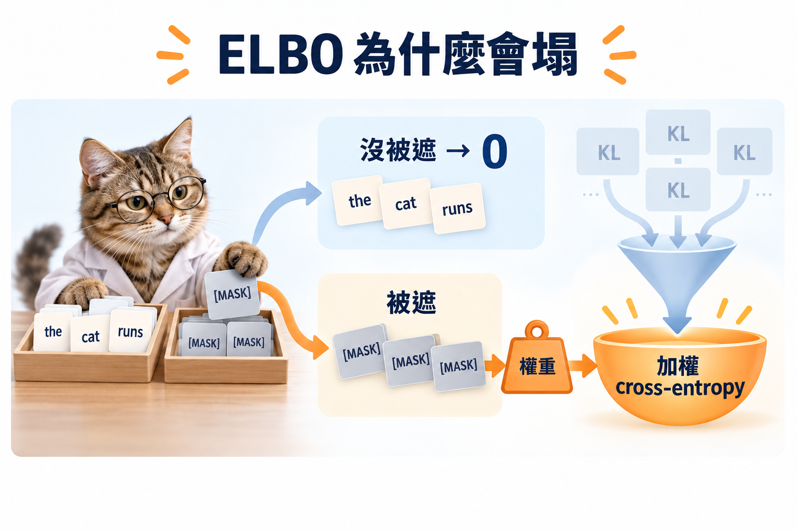
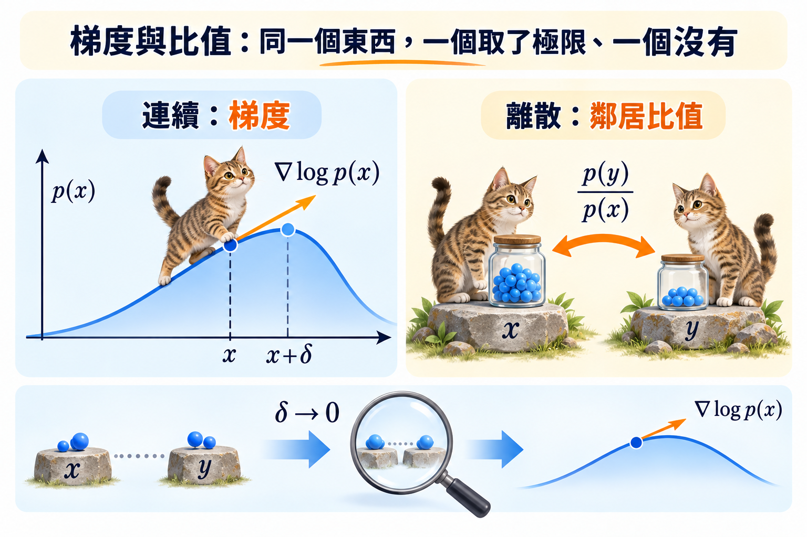

import Objectives from '../../../components/Objectives.astro';
import Prereq from '../../../components/Prereq.astro';
import Ask from '../../../components/Ask.astro';
import AlgorithmView from '../../../components/AlgorithmView.astro';
import Remark from '../../../components/Remark.astro';
import Question from '../../../components/Question.astro';
import Answer from '../../../components/Answer.astro';
import QuizBlock from '../../../components/QuizBlock.astro';
import Option from '../../../components/Option.astro';
import Explanation from '../../../components/Explanation.astro';
import Details from '../../../components/Details.astro';
import Bridge from '../../../components/Bridge.astro';
import Ref from '../../../components/Ref.astro';

# 有了模型，要怎麼一步步抽出句子？

<Objectives>
- **把 rate 轉成有限時間的抽樣規則。** 分清精確短時間關係、步首 rate 的近似，以及合法機率對步長的限制。
- **推導 MASK 的 closed-form 翻開機率。** 算出從 $t$ 退到 $s$ 要翻開多少 MASK，並把 denoiser 接成完整生成流程。
- **指出精確 reveal probability 的保證範圍。** 區分翻開時間、原字預測與同一步多格獨立抽樣。
</Objectives>

<Prereq items={frontmatter.prereqs} />

## 現在真的從全 MASK 開始

在 <Ref to="dma-discrete-flow-matching"/>，我們學到 denoiser $f_\theta^\ell(a\mid x,t)$，並把它接到生成 rate。對目前為 MASK 的位置，模型使用

$$
\begin{gathered}
\bar R_{\theta,t}\bigl(x,x^{(\ell\to a)}\bigr)\\
=\frac{-\dot\alpha_t}{1-\alpha_t}
f_\theta^\ell(a\mid x,t),
\qquad a\in\mathcal V.
\end{gathered}
$$

這裡用 $\bar R_{\theta,t}$ 區分網路近似與理想 rate。既然 $f_\theta^\ell$ 對所有原字加總為 $1$，每個 MASK 的總 reveal rate 就是 $-\dot\alpha_t/(1-\alpha_t)$；翻成哪個字，再按 $f_\theta^\ell$ 抽樣。已填位置直接保留。

讓 $Y_t$ 表示真正生成的隨機序列，$x_t$ 是某次抽到的結果。Reference noisy state $I_t$ 用來製造 training pairs；$Y_t$ 則是從 noise 出發、依模型走出的過程，兩者先不要視為相同。若 $\alpha_1=0$，生成起點 $Y_1=(m,\ldots,m)$ 是確定的全 MASK。

<Ask>
模型給的是每單位時間的 rate， 
電腦一次走一小段時間時，應該怎麼抽下一句話？
</Ask>

## 先把一小步的轉移寫出來

對兩個不同的完整序列 $x,y$，rate 的定義給出

$$
\Pr(Y_{t-h}=y\mid Y_t=x)
=h\bar R_{\theta,t}(x,y)+o(h).
$$

留在 $x$ 的機率，則是 $1$ 減掉所有跳走的機率。先只看一個 MASK 位置，省略高階項後，這一步使用的機率表為

$$
\begin{aligned}
\Pr(Y_{t-h}^\ell=m\mid Y_t=x)
&\approx1-h\frac{-\dot\alpha_t}{1-\alpha_t},\\
\Pr(Y_{t-h}^\ell=a\mid Y_t=x)
&\approx h\frac{-\dot\alpha_t}{1-\alpha_t}
f_\theta^\ell(a\mid x,t).
\end{aligned}
$$

也就是先決定這一格是否翻開，再按預測抽原字。這是只用步首 rate 的一階小步規則；至少需要 $h[-\dot\alpha_t/(1-\alpha_t)]\leq1$，才不會出現負機率。完整序列若用「一步最多跳一次」的轉移表，還要用整句的總流出 rate 檢查步長。

實作也可以讓各位置依同一份舊 context 平行更新。一小段時間內兩格都改變的機率是高階項，所以在適當條件下可作小步近似；有限大步時，這不等於精確模擬整個跳躍過程。真正跳出一個字後，其餘位置的 posterior 可能已經改變。

## MASK 的翻開機率，能不能直接算一整段？

可以，這條 path 有更直接的答案。先固定原文，從 $s$ 到 $t$ 加噪時，仍可見的比例由 $\alpha_s$ 降成 $\alpha_t$；兩者之差是這段時間才首次被遮的質量。現在已知這格在 $t$ 是 MASK，所以在比例 $1-\alpha_t$ 的群體裡，倒著走應翻開的比例是

$$
w_{t,s}=\frac{\alpha_s-\alpha_t}{1-\alpha_t},
\qquad 0\leq s<t\leq1.
$$

例如 $\alpha_t=0.4$、$\alpha_s=0.6$，要補回 $0.2$ 的總質量，而當下 MASK 有 $0.6$，所以每個 MASK 以 $1/3$ 機率翻開。這個式子描述整段機率，不必把 rate 乘上大步長。

它也能由 rate 積分得到。沒有翻開的存活機率為

$$
\begin{aligned}
1-w_{t,s}
&=\exp\!\left(-\int_s^t
\frac{-\dot\alpha_r}{1-\alpha_r}\,\mathrm dr\right)\\
&=\frac{1-\alpha_s}{1-\alpha_t}.
\end{aligned}
$$

第二行用了 $\partial_r\log(1-\alpha_r)=-\dot\alpha_r/(1-\alpha_r)$。總 reveal rate 不依賴句子的字，所以「是否翻開」能精確算整段；翻出的 token 如何搭配，還是另一個問題。

例如選 $\alpha_t=1-t$，就有 $w_{t,s}=(t-s)/t$。這個特殊 schedule 下，一階的 $h/t$ 恰好等於整段翻開機率；不能因此把所有 schedule 的 rate 乘步長都當成精確式。

<Remark label="補充" summary="凍結 rate，再抽 exponential waiting time 呢？">
若把步首總 rate $c_t=-\dot\alpha_t/(1-\alpha_t)$ 凍結一整段 $h$，翻開機率會是 $1-e^{-hc_t}$。它在小步時等於 $hc_t+O(h^2)$，卻一般不同於積分實際隨時間變化的 rate。對 $\alpha_t=1-t$，兩者分別是 $1-e^{-h/t}$ 與 $h/t$。實作 B 會把這個時間近似單獨量出來。
</Remark>

## 把預測和抽樣接成完整流程

選時間格點 $1=t_N>\cdots>t_0=0$。每一段先讓模型看目前整句，再決定哪些 MASK 翻開，並依各格預測抽 token。**更新完 context，下一段要重新預測。**

<AlgorithmView id="u4-mask-sampling" title="從全 MASK 生成一次序列" code={`輸入：模型 f_theta、時間格點 1 = t[N] > ... > t[0] = 0
x ← 全 MASK 的長度 L 序列
for n = N, ..., 1:
    t ← t[n]; s ← t[n-1]
    old ← copy(x)
    prediction ← f_theta(old, t)
    w ← (alpha(s) - alpha(t)) / (1 - alpha(t))
    for ell = 1, ..., L:
        if old[ell] == MASK:
            以機率 w，按 prediction[ell] 抽一個 token 放進 x[ell]
        # 原本已填的位置保留；這一步所有預測共用 old
return x`}>

對每段 $t\to s$，從目前序列 $x_t$ 開始：

$$
\begin{aligned}
x_t
&\xrightarrow{\text{讀取整句 context}}
\{f_\theta^\ell(\cdot\mid x_t,t)\}_{\ell=1}^L,\\
B_\ell&\sim\mathrm{Bernoulli}(w_{t,s}),
\qquad x_t^\ell=m,\\
A_\ell&\sim\mathrm{Categorical}
\bigl(f_\theta^\ell(\cdot\mid x_t,t)\bigr),\\
x_s^\ell&=\begin{cases}
A_\ell,&x_t^\ell=m,\ B_\ell=1,\\
x_t^\ell,&\text{其他情況}.
\end{cases}
\end{aligned}
$$

各 MASK 的翻開硬幣與 token 抽樣，在給定這份 $x_t$ 後各自獨立。對所有時間段重複，最後輸出 $\widehat x_0$。在 $\alpha_0=1$ 下，最後一段的 $w_{t,0}=1$，所以剩下的 MASK 都會被填完。

</AlgorithmView>

這是一趟生成。獨立重跑 $n$ 趟，得到 $\{\widehat x_0^{(r)}\}_{r=1}^n$；這批樣本的 empirical PMF 是

$$
\widehat p^{(n)}(x)
=\frac1n\sum_{r=1}^n\mathbf1[\widehat x_0^{(r)}=x].
$$

增加 $n$ 會讓我們看清固定模型與 sampler 的輸出分布。它是否接近 $p_{\mathrm{data}}$，仍取決於模型和抽樣規則；反覆生成本身不會消除它們的偏差。

<iframe loading="lazy" src="/personal_website/notes/research_areas/diffusion-models-applications/w6-2-sampling.html" class="demo-frame" title="從全 MASK 逐步生成" style="height: 810px; width: 100%; border: none;"></iframe>

*互動 demo：觀察每段翻開後，新的可見字如何成為下一段的 context。每次完整執行只產生一串；需要重複抽樣，才能比較輸出分布。*

<Question id="Q1">
既然 $w_{t,s}$ 是精確的，模型也可能精確學到每格的 posterior，那一次把所有 MASK 都獨立填完，是否就是精確的整句抽樣？

<Answer>
還不是。這裡精確的是各位置的翻開機率；用理想 denoiser，也能給出各位置的 reverse conditional marginal。但多個位置的答案可能相依，將它們獨立抽出來，仍不等於抽它們的 joint。下一篇會用只有四種原文的例子，算出漏掉這個相依會發生什麼事。
</Answer>
</Question>

Austin 等人的 **D3PM** [1] 從 forward Markov chain 建構離散 diffusion。這裡用 $n$ 表示整數步，$t_n$ 表示對應的連續時間，避免把兩種時間混用。設 $P(i,j)=\nu(j)$，每列都是 noise PMF，一步轉移為

$$
Q_n=(1-\beta_n)I+\beta_nP.
$$

由 $P^2=P$，兩步相乘仍是 $I$ 與 $P$ 的組合；繼續相乘得到

$$
\begin{aligned}
\bar Q_n&=Q_1\cdots Q_n
=\alpha_{t_n}I+(1-\alpha_{t_n})P,\\
\alpha_{t_n}&=\prod_{r=1}^n(1-\beta_r).
\end{aligned}
$$

乘積係數表示每步都選保留分支；至少重抽一次後，分布就是 $\nu$。給定非增的 $\alpha$，在分母非零時可設 $\beta_n=1-\alpha_{t_n}/\alpha_{t_{n-1}}$；已到零時可令後續 $\beta_n=0$。Uniform 的重抽也可能抽回原字，所以這個係數不是最後仍為原字的總機率。

固定原字 $k$、現在 token $j$，上一整數步為 $i$ 的 posterior 由 Bayes 得到：

$$
\begin{gathered}
q(x_{t_{n-1}}^\ell=i\mid x_{t_n}^\ell=j,x_0^\ell=k)\\
=\frac{\bar Q_{n-1}(k,i)Q_n(i,j)}{\bar Q_n(k,j)}.
\end{gathered}
$$

分子是先從 $k$ 到 $i$ 再到 $j$ 的 joint weight；分母是所有到 $j$ 的機率。D3PM 的 $x_0$-parameterization，再按 denoiser 對候選原字的機率混合這些已知 posteriors。只在分母為正、與觀察相容的候選上使用；MASK 的可見字則直接複製。

對 MASK，這個 Bayes 計算就回到正文的 $w_{t,s}$。對 uniform，這條反覆重抽的 forward chain，與 <Ref to="dma-discrete-flow-matching"/> 補充中「生成時重設到資料端」的建構，可以有相同 PMF snapshots，卻有不同的生成 dynamics。

固定原句，MASK 的單位置 reverse posterior 與模型 kernel 分別是

$$
\begin{aligned}
q&=(1-w_{t,s})\delta_m+w_{t,s}\delta_{x_0^\ell},\\
p_\theta&=(1-w_{t,s})\delta_m+w_{t,s}f_\theta^\ell.
\end{aligned}
$$

未遮位置兩者都複製輸入，KL 為零。被遮位置在 MASK 上的機率相同，只有原字那一項留下：

$$
\begin{aligned}
D_{\mathrm{KL}}(q\|p_\theta)
&=(1-w_{t,s})\log1\\
&\quad+w_{t,s}\log
\frac{w_{t,s}}{w_{t,s}f_\theta^\ell(x_0^\ell\mid x_t,t)}\\
&=w_{t,s}[-\log f_\theta^\ell(x_0^\ell\mid x_t,t)].
\end{aligned}
$$

對整句，已知原文時的 posterior 逐位置獨立，我們也選擇逐位置乘積的 model kernel，所以這個 conditional KL 是各位置的和。沿用 <Ref to="dma-denoising-regression"/> 的 negative ELBO 分解，將各時間段的 reverse KL 與 reconstruction 項合起來：

$$
\begin{gathered}
\mathcal L_{\mathrm{VLB}}=C+\sum_{n=1}^N
\mathbb E_{X_0,I_{t_n}}\Big[\\
w_{t_n,t_{n-1}}\sum_{\ell:I_{t_n}^\ell=m}
-\log f_\theta^\ell(X_0^\ell\mid I_{t_n},t_n)\Big].
\end{gathered}
$$

$C$ 是與模型無關的 prior KL，精確全 MASK endpoint 下為零；$w_{t_1,0}=1$ 包含最後的 reconstruction。Expectation 對原文與其 noisy snapshot 平均。這個 loss 是資料 negative log-likelihood 的上界；它與單純 CE 的逐 input 理想最佳解相同，但權重與 objective 的解讀不同。

在連續時間極限，$w_{t,t-h}=h[-\dot\alpha_t/(1-\alpha_t)]+o(h)$，因此和式對應以 reveal rate 加權的 masked CE 積分；Sahoo 等人的 **MDLM** [2] 使用這個 absorbing 結構。推導 ELBO 選用的逐位置 model kernel，並沒有證明真 reverse joint 也能逐位置獨立抽。

*圖：未遮位置的 KL 為零；MASK 項相消，原字項留下已知權重乘上 cross-entropy。*

**Forward 的門會開，倒著走該怎麼開？**

<Ref to="dma-ctmc"/> 已經用 $R_t$ 決定資料怎麼逐漸被破壞。但生成時，我們站在 noisy state $x$，想問的是：**現在落在這裡的樣本，剛才有多少是從另一個狀態 $y$ 過來的？**

沿用房間的例子，A 往 B 的門每個人都能走，但 B 裡的人有多少原本來自 A，還要看 A 與 B 各有多少人。不能把門上的方向倒過來，就宣稱頻率也相同。下面把房間換成完整序列的狀態 $x,y$，用 Bayes 算真正的比例。

令 $\bar R_t(x,y)$ 表示生成時，從目前的 $x$ 跳向 $y$ 的 reverse rate：經過正的時間長度 $h$，diffusion 時間從 $t$ 退到 $t-h$。對 $y\neq x$，想求的是 $\Pr(x_{t-h}=y\mid x_t=x)$；只在 $p_t(x)>0$ 的狀態使用 Bayes：
$$
\begin{gathered}
\Pr(x_{t-h}=y\mid x_t=x)\\
=\frac{p_{t-h}(y)\Pr(x_t=x\mid x_{t-h}=y)}{p_t(x)}.
\end{gathered}
$$
Forward 的短時間轉移是 $hR_t(y,x)+o(h)$，且 $p_{t-h}(y)=p_t(y)+o(1)$。除以 $h$ 再取極限：
$$
\bar R_t(x,y)=R_t(y,x)\frac{p_t(y)}{p_t(x)}.
$$
式子中的 $R_t(y,x)$ 是原來那扇門：forward 從 $y$ 走到 $x$，reverse 才沿它退回去。例如某時刻 $p_t(y)=0.8$、$p_t(x)=0.2$，而 $R_t(y,x)=0.5$，則 $\bar R_t(x,y)=0.5\times0.8/0.2=2$。同一股流量 $0.4$，對來源比例 $0.8$ 與 $0.2$ 的兩群樣本，就對應不同的每人頻率。

**Forward rate 已知；未知的部分是兩個完整狀態的機率比。** Campbell 等人 [5] 用這個時間反轉公式建構 discrete denoising models。接下來的訓練目標，就是要補上這份資料分布的資訊。

**兩個狀態之間，要學哪一種比較？**

連續空間的 score $\nabla\log p_t(x)$ 告訴我們附近哪裡密度比較高。離散空間沒有「朝某個字移動一點點」，所以先保留一個有限的比較：
$$
s_t(x)_y=\frac{p_t(y)}{p_t(x)}.
$$
這個 ratio 回答「$y$ 出現的機率是 $x$ 的幾倍」。它可以大於 $1$，例如上面的 ratio 是 $4$；它也不要求對不同鄰居加總為 $1$。因此，直接預測 ratio 的網路要輸出非負數值，不能把所有 ratio 用 softmax 正規化成一張 categorical distribution。

若只知道未正規化的 weights，分子與分母的共同 normalizing constant 仍會相消。Meng 等人 [4] 提出 **concrete score** 的離散比較觀點；Lou、Meng 與 Ermon 的 **SEDD** [3] 直接學這些比值。這裡的新物件是「比較兩個狀態的相對可能性」，不是 token 編號的導數。

<Remark label="符號" summary="Concrete score 有兩種常見寫法">
原始 concrete score matching 常用 $(p_t(y)-p_t(x))/p_t(x)$，也就是本篇 ratio 減 $1$。本篇跟隨 SEDD 使用 $p_t(y)/p_t(x)$，方便直接乘進 reverse rate。兩者資訊相同，但公式中的常數不能混用。
</Remark>

用 $x^{(\ell\to v)}$ 表示把完整序列 $x$ 的第 $\ell$ 格換成 $v$、其他格原封不動。這樣的 $y$ 就是 $x$ 的一個鄰居。在逐位置 corruption 的精確 CTMC 裡，一次跳躍只改一個位置；reverse 因此也只需要這些鄰居的 ratio，而不是輸出所有 $K^L$ 個序列的機率。這裡的「一次跳躍」與電腦用有限步一次更新多格，是兩個層次。

<iframe loading="lazy" src="/personal_website/notes/research_areas/diffusion-models-applications/w7-2-ratios.html" class="demo-frame" title="鄰居之間的 probability ratios" style="height: 890px; width: 100%; border: none;"></iframe>

**可是整個 $p_t$ 算不出來，Label 從哪裡來？**

若要直接把 $p_t(y)/p_t(x)$ 當 label，就得先知道整個資料分布，這正是我們沒有的東西。不過回想 <Ref to="dma-denoising-regression"/> 的 **conditional trick**：卡在 marginal object 時，可以先盤點自己製造 training pair 時還知道什麼。

我們其實不只看到 $x_t$，還保有抽到的原文 $x_0$，而且已經會算 $q_t(\cdot\mid x_0)$。所以可以先為這筆 training pair 算一個 conditional ratio label：

$$
\frac{q_t(y\mid x_0)}{q_t(x_t\mid x_0)}.
$$

同一個 noisy input 可能來自不同原文，這個 label 也可能不同。固定時間 $t$，只看能產生目前 $x_t=x$ 的那些原文，按它們的 posterior 機率平均會得到什麼？先假設我們比較的鄰居滿足下面補充中的 support 條件，讓分母有定義、約分後也不漏掉原文：
$$
\begin{gathered}
\mathbb E\left[\frac{q_t(y\mid x_0)}{q_t(x\mid x_0)}
\,\middle|\,x_t=x\right]\\
=\sum_{x_0}\frac{q_t(y\mid x_0)}{q_t(x\mid x_0)}
\frac{q_t(x\mid x_0)p_0(x_0)}{p_t(x)}\\
=\frac{\sum_{x_0}q_t(y\mid x_0)p_0(x_0)}{p_t(x)}\\
=\frac{p_t(y)}{p_t(x)}.
\end{gathered}
$$
第一步用 Bayes，把「給定 $x$ 後原文是誰」的 posterior 寫出來；第二步約掉相同的 $q_t(x\mid x_0)$；最後分子把所有原文造成的 $y$ 加起來，正是 $p_t(y)$。這個 expectation 平均的是**固定目前 input 後，仍可能的原文所給出的 labels**，不是把所有 noisy inputs 的 ratios 混在一起。

所以，單筆 label 不需要等於 marginal ratio；我們要設計的 loss，是讓固定 input 下的理想最佳輸出等於這些 labels 的 posterior average。下面的 score entropy loss 就完成這個動作。

<Remark label="補充" summary="這個約分要有什麼條件？">
我們在 $p_t(x)>0$ 的位置使用 ratio，且要求分子有質量的原文也能產生 $x$：
$$
q_t(y\mid x_0)>0\ \Longrightarrow\ q_t(x\mid x_0)>0.
$$
這樣求和才不會漏掉 denominator 為零的原文。Uniform corruption 在內部時間有完整 support；absorbing 則對 reverse 所需的 MASK $\to$ 字鄰居成立。不能對任意兩個離散狀態，不檢查 support 就直接套公式。
</Remark>

固定時間 $t$，以原文 $x_0\sim p_0$ 與加噪結果 $x_t\sim q_t(\cdot\mid x_0)$ 做一筆資料。把上面的 conditional ratio 簡寫成 label $a=q_t(y\mid x_0)/q_t(x_t\mid x_0)$；模型 $s_\theta(x_t,t)_y$ 則要預測這條鄰邊的 marginal ratio。

SEDD 的 denoising score entropy [3]，略去不含 $\theta$ 的項後是

$$
\begin{gathered}
L_{\mathrm{DSE}}
=\mathbb E_{t,x_0,x_t}\sum_{y\neq x_t}w_t(x_t,y)\\
\cdot\big[s_\theta(x_t,t)_y
-a\log s_\theta(x_t,t)_y\big].
\end{gathered}
$$

這裡對時間、原文與 corruption randomness 平均；$w_t(x,y)\geq0$ 是不依賴未知原文的邊權重。為了看最佳解，固定 $(x_t,t,y)$，只把仍可能的 labels $a$ 平均，記其平均為 $r$。Scalar loss 便成為 $s-r\log s$，對預測值 $s$ 微分得到 $1-r/s$。若 $r>0$，它在 $s=r$ 唯一最小；若 $r=0$，最小值在邊界 $s=0$，正值參數化可逼近它。於是最佳預測正好是正文算出的 marginal ratio。

這個機制用到 label 只在線性的 $-a\log s$ 中出現。它不是把 ratio labels 先正規化成類別機率；一般情況下 $\sum_y s_\theta(x,t)_y$ 也不是 $1$。取 $w_t(x,y)=R_t(y,x)$，就會對 reverse 需要的 edges 加權。要解讀成 CTMC 的 likelihood bound，還需保留常數與 prior term。

對 absorbing 的一個 MASK 位置，把正文的 $s_\theta(v)=\alpha_t f_\theta^\ell(v\mid x_t,t)/(1-\alpha_t)$ 代入，再用 $\sum_v f_\theta^\ell(v\mid x_t,t)=1$。乘上 masking rate $\beta_t$ 後，模型相關的那一部分變成

$$
\frac{-\dot\alpha_t}{1-\alpha_t}
\bigl[-\log f_\theta^\ell(x_0^\ell\mid x_t,t)\bigr]+C_t,
$$

其中 $C_t$ 不依賴模型參數：$\sum_v s_\theta(v)=\alpha_t/(1-\alpha_t)$ 是常數，$\log s_\theta(x_0^\ell)$ 則拆成已知係數的 log 與 $\log f_\theta^\ell(x_0^\ell)$。因此在這個參數化下，absorbing score entropy 與 weighted masked cross-entropy 的模型相關部分相同；比較兩組預測的 loss 差值時，常數便相消。這個換算在實作 B 的選讀實驗中檢查。

**原本的 masked denoiser，其實已經給了 ratio**

先回到熟悉的 MASK，看看這份 ratio 資訊和 <Ref to="dma-discrete-flow-matching"/> 的猜字機率有什麼關係。令 $x^\ell=m$，把這格填成 $v$ 得到 $y=x^{(\ell\to v)}$。固定原文 $x_0$ 後，$x$、$y$ 的其他位置完全相同，所以那些 conditional probability factors 都能約掉。

剩下的第 $\ell$ 格，在 $x$ 中被遮的機率是 $1-\alpha_t$；在 $y$ 中保持為 $v$ 的機率是 $\alpha_t$，但必須原字本來就是 $v$。因此
$$
\frac{q_t(y\mid x_0)}{q_t(x\mid x_0)}
=\frac{\alpha_t}{1-\alpha_t}\mathbf1[x_0^\ell=v].
$$
符號 $\mathbf1[x_0^\ell=v]$ 在原字是 $v$ 時為 $1$、否則為 $0$。把這個指示量對仍可能的原文取 posterior average，就是原字為 $v$ 的 conditional probability，因此得到
$$
s_t(x)_y
=\frac{\alpha_t}{1-\alpha_t}p(x_0^\ell=v\mid x_t=x).
$$
因此 <Ref to="dma-discrete-flow-matching"/> 的 denoiser 可以直接換成 ratio：
$$
s_\theta(x,t)_y
=\frac{\alpha_t}{1-\alpha_t}f_\theta^\ell(v\mid x,t).
$$
Forward 每單位時間要遮掉的總質量是 $-\dot\alpha_t$，來源可見比例則是 $\alpha_t$，所以每個未遮字的 masking rate 為 $\beta_t=-\dot\alpha_t/\alpha_t$。將它乘上剛才的 ratio：
$$
\bar R_t(x,x^{(\ell\to v)})
=\frac{-\dot\alpha_t}{1-\alpha_t}
p(x_0^\ell=v\mid x_t=x).
$$
所以一個 MASK 的總翻開 rate 是 $-\dot\alpha_t/(1-\alpha_t)$，翻成哪個字則按 denoiser 的 categorical distribution 抽樣。**Ratio 與 masked posterior，在這條 chain 上是同一份資訊的兩種寫法。**

*圖：連續空間用局部梯度比較密度；離散空間則比較鄰居的機率比。*

## 快速回顧一下

<QuizBlock id="w6-1-a">
一般情況下，將步首 rate 乘上步長得到的是：
<Option>任意時間段的精確轉移機率。</Option>
<Option correct>短時間的一階轉移近似，還需檢查機率是否合法。</Option>
<Option>模型的 training label。</Option>
<Explanation>Rate 定義中的高階項在有限步不會自動消失；有 closed form 時，可另外計算整段轉移。</Explanation>
</QuizBlock>

<QuizBlock id="w6-1-b">
在 MASK sampler，$w_{t,s}$ 決定的是：
<Option>翻開後每個詞各占多少機率。</Option>
<Option correct>目前這個 MASK 在這段時間是否翻開的機率。</Option>
<Option>所有新字的 joint distribution。</Option>
<Explanation>翻成哪個字由 denoiser 決定；多格如何一起抽，又是另一個設計。</Explanation>
</QuizBlock>

<QuizBlock id="w6-1-c">
把固定 sampler 重跑更多次，可以：
<Option>自動修正模型估錯的 posterior。</Option>
<Option correct>更清楚估計它的輸出分布，卻不自動消除偏差。</Option>
<Option>讓同一步的獨立抽字變成 joint sampling。</Option>
<Explanation>重複次數決定統計估計的穩定程度；每趟的生成規則並沒有因此改變。</Explanation>
</QuizBlock>

<Bridge to="dma-factorization-error">
現在已經有從全 MASK 生成整句的完整流程。翻開機率可以精確計算，模型也可以給出正確的逐位置 posterior；但我們最後把多個新字獨立抽了出來。下一篇就檢查這個動作：每格的機率都對，整句的分布還會錯嗎？
</Bridge>

## 參考文獻

1. Austin, J. et al. [*Structured Denoising Diffusion Models in Discrete State-Spaces.*](https://arxiv.org/abs/2107.03006) NeurIPS 2021.
2. Sahoo, S. S. et al. [*Simple and Effective Masked Diffusion Language Models.*](https://arxiv.org/abs/2406.07524) NeurIPS 2024.
3. Lou, A., Meng, C., Ermon, S. [*Discrete Diffusion Modeling by Estimating the Ratios of the Data Distribution.*](https://arxiv.org/abs/2310.16834) ICML 2024.
4. Meng, C. et al. [*Concrete Score Matching: Generalized Score Matching for Discrete Data.*](https://arxiv.org/abs/2211.00802) NeurIPS 2022.
5. Campbell, A. et al. [*A Continuous Time Framework for Discrete Denoising Models.*](https://arxiv.org/abs/2205.14987) NeurIPS 2022.
