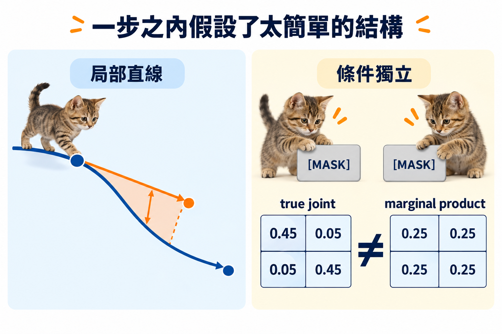

import Objectives from '../../../components/Objectives.astro';
import Prereq from '../../../components/Prereq.astro';
import Ask from '../../../components/Ask.astro';
import Remark from '../../../components/Remark.astro';
import Question from '../../../components/Question.astro';
import Answer from '../../../components/Answer.astro';
import QuizBlock from '../../../components/QuizBlock.astro';
import Option from '../../../components/Option.astro';
import Explanation from '../../../components/Explanation.astro';
import Details from '../../../components/Details.astro';
import Bridge from '../../../components/Bridge.astro';
import Ref from '../../../components/Ref.astro';

# 每格都猜對，整句話就會對嗎？

<Objectives>
- **用 parity 說明 marginal 正確不等於 joint 正確。** 算出一次獨立填完與逐格填入時，各自的合法率。
- **寫出 factorization error 比較的兩個 distributions。** 它量的是 conditional joint 與 conditional marginals 的乘積，而不是網路預測誤差。
- **說明步長為什麼會影響這個誤差。** 同一步填越多格，可能漏掉更多相依；但不是所有資料都隨步數單調改善。
</Objectives>

<Prereq items={frontmatter.prereqs} />

## 問題可能不在網路

在 <Ref to="dma-d3pm"/>，每個 MASK 都有一個原字的預測分布。我們可以一次呼叫網路，平行填入很多字；這看起來比一格一格生成快得多。但一句話的合理性不是每個字各自合理就夠了：前面選了「一隻」，後面接「貓」或「桌子」，結果並不一樣。

<Ref to="dma-discrete-data"/> 已經用「吃／晚餐」與「打／籃球」區分 joint 和 marginals。現在多了一份可見 context：對「我／今天／[MASK]／吃／[MASK]」，第三格和第五格各有一張 conditional marginal PMF；我們需要檢查的是，這兩張表能不能直接組成 conditional joint。

模型可以看整句 context 才算出這兩張表，但若接著各自抽一個詞，這兩次抽樣仍沒有看見彼此剛選的答案。先假設兩張表都完全正確，把網路誤差拿掉：**光是把它們獨立抽出來，還可能出錯嗎？**

## 只有 0、1，就能看出差別

考慮長度 $L=3$ 的 bit 序列。資料只有偶數 parity，也就是 $1$ 的數量為偶數：
$$
p_0(000)=p_0(011)=p_0(101)=p_0(110)=\frac14.
$$
沒有列出的另外四種序列，資料機率都是 $0$。從全 MASK 看，第一格在四筆合法資料中有兩次是 $0$、兩次是 $1$；其他兩格也一樣。因此每一格的 conditional marginal 都是 $(1/2,1/2)$。

如果照這三張正確的表獨立抽樣，某一串（例如 $001$）的機率就是

$$
\Pr_{\mathrm{ind}}(001)=\frac12\cdot\frac12\cdot\frac12=\frac18.
$$

其他七種排列也各有 $1/8$，所以合法的四種加起來只有 $4\times1/8=1/2$。**每格各自的 $0$、$1$ 比例都對，卻把一半機率放到資料中不可能出現的組合。**

另一種做法是先填一格，再根據新 context 算下一格。前兩格可以是 $00$、$01$、$10$、$11$，各有 $1/4$；但到最後一格時，已填的兩格會決定答案。例如前兩格是 $01$，最後一格只能填 $1$，才能讓 $1$ 的數量變回偶數。

所以四種合法序列最後各有 $1/4$，不合法序列的機率是 $0$。這次不只合法率是 $1$，整個 distribution 也正確。差別是**後一格有機會根據前面剛抽出的結果，更新自己的 conditional**。

<Ask>
各格的機率都算對了， 
那一次填完時，到底漏掉了什麼？
</Ask>

## 漏掉的是同一步裡的相依

把上面的差別寫成可比較的兩個分布。令 $A$ 是已看見的位置集合，$B$ 是這一步要填的位置集合；$x_0^A$ 表示那些可見位置的 token，$x_0^B$ 表示這次要一起填出的那一組。例如先看見第一格、再同時填後兩格，就是 $A=\{1\}$、$B=\{2,3\}$。

固定可見的 $x_0^A$，真正需要的是這一組 token 的 conditional joint：
$$
p(x_0^B\mid x_0^A),
$$
它會替每種搭配分配機率。若每個位置都只根據同一份舊 context 獨立抽樣，實際用的則是各張機率表的乘積：
$$
\prod_{\ell\in B}p(x_0^\ell\mid x_0^A).
$$
我們用 KL 比較這兩張「所有搭配的機率表」，再考慮資料中可能看見的不同 contexts。這個量稱為 **factorization error（因子化誤差）**：
$$
\begin{gathered}
\mathrm{FE}(A,B)=\mathbb E_{x_0^A}\Big[\\
D_{\mathrm{KL}}\Bigl(p(x_0^B\mid x_0^A)
\,\Big\|\,
\prod_{\ell\in B}p(x_0^\ell\mid x_0^A)\Bigr)\Big].
\end{gathered}
$$
外面的 expectation 按 $p_0(x_0^A)$ 對可見 context 加權；裡面的 KL 則在固定 context 下，對 $x_0^B$ 的各種搭配比較機率。它等於 $0$，表示在這些 contexts 下，這批位置確實可以 conditional independent 地抽；大於 $0$，則表示這個乘積漏掉了相依。Zheng 等人 [1] 分析平行 decoding 重用舊 conditional 的近似；這裡先用精確 conditional marginals，將同一步漏掉的相依單獨量出來。

在全 MASK 的 parity 例子，真實 joint 對四種合法序列各給 $\tfrac14$，乘積分布則各給 $\tfrac18$，所以
$$
\mathrm{FE}(\varnothing,\{1,2,3\})
=4\cdot\frac14\log\frac{1/4}{1/8}
=\log2.
$$
**即使模型已經完美，這個誤差仍然存在。**

<iframe loading="lazy" src="/personal_website/notes/research_areas/diffusion-models-applications/w6-3-parity.html" class="demo-frame" title="Parity 的 joint 與獨立填字" style="height: 810px; width: 100%; border: none;"></iframe>

<Remark label="補充" summary="每個 head 獨立抽樣，不代表網路只能看一個字">
Transformer 的每個 output head 可以看整句 context，學到的位置機率也可以完全正確。因子化發生在**同一步怎麼抽出多個 token**：它們還沒看見彼此剛抽出的答案。問題不是 attention 看不到其他位置，而是 conditional marginals 不能替代 conditional joint。
</Remark>

<Question id="Q1">
在 parity toy 裡，先填很多格，最後只剩一格；或者每一步都填得很少，但最後還有兩格一起填。哪一種能保證合法？這表示「步數越多一定越好」嗎？

<Answer>
用精確 conditional 時，**最後只剩一格**就能補對 parity；前面怎麼填都還有合法的 completion。若最後兩格一起獨立填，它們的 marginals 仍各半，合法率只有 $\tfrac12$。

因此這個例子看的是「最後剩下的相依有沒有被一起拆掉」，不是步數本身。增加步數通常讓同時填的格數變少，但不能不看實際的 reveal schedule，就宣稱每次加一步都一定改善。
</Answer>
</Question>

*圖：逐格填時，下一格會看見前一格的結果；同時獨立填時，這批 token 之間的限制可能被漏掉。*

先固定一個與資料無關的 reveal partition $B_1,\ldots,B_N$，令 $A_n$ 是第 $n$ 步前已填的位置。假設所有 conditional marginals 都精確，生成分布為
$$
\hat p_0(x)=\prod_{n=1}^N\prod_{\ell\in B_n}
p(x^\ell\mid x^{A_n}).
$$
真實資料可以按相同順序用 chain rule 分解：
$$
p_0(x)=\prod_{n=1}^N p(x^{B_n}\mid x^{A_n}).
$$
把兩者代入 KL，先拆開 log，再對已填位置取期望：
$$
\begin{gathered}
D_{\mathrm{KL}}(p_0\|\hat p_0)\\
=\mathbb E_{p_0}\sum_n
\log\frac{p(x^{B_n}\mid x^{A_n})}
{\prod_{\ell\in B_n}p(x^\ell\mid x^{A_n})}\\
=\sum_n\mathrm{FE}(A_n,B_n).
\end{gathered}
$$
若 reveal order 本身隨機，這個等式先對**固定的 order**成立；把 order 平均掉後，由 KL 的凸性，terminal KL **不超過**各 order 的 KL 平均。若順序還依賴模型信心，就要另外分析那個選擇規則，不能直接沿用等式。

## 少填幾格，為什麼會有幫助？

如果 $B$ 只包含一格，上面的 joint 本來就只有一個變數，和它的 marginal 相同，這一步的 FE 為 $0$。若每次都只填一格並重新計算精確 conditional，就能按照 chain rule 組成正確的整句分布；順序不必固定為從左到右。

平行填字節省的是重新計算 context 的次數，代價是這一批新字沒有彼此條件化。增加步數常讓每批變小，但 parity 的提問已經顯示：要看真正的分組與相依結構，不能只用步數判斷。有限模型還有預測誤差，這也不會因為 FE 變小就自動消失。

## 快速回顧一下

<QuizBlock id="w6-3-a">
Factorization error 可以在什麼情況下仍存在？
<Option>只有網路沒訓練好時。</Option>
<Option correct>Conditional marginals 完全正確，但同一步獨立填入相依的多個位置時。</Option>
<Option>只有 uniform corruption 才會發生。</Option>
<Explanation>它來自 joint 的分解假設，不是 marginal 預測不準。</Explanation>
</QuizBlock>

<QuizBlock id="w6-3-b">
Parity toy 最後只剩一格時，精確 conditional 為什麼能補對？
<Option correct>已填位置決定了最後一個 bit，posterior 是確定的。</Option>
<Option>因為網路一定看過同一個 training pair。</Option>
<Option>因為最後一步沒有隨機性就一定正確。</Option>
<Explanation>確定性來自資料的 parity constraint；一般資料的最後一格不必是確定的。</Explanation>
</QuizBlock>

<QuizBlock id="w6-3-c">
為什麼縮小 reveal batch 常常有幫助？
<Option>因為它會自動消除模型誤差。</Option>
<Option correct>先填的結果能進入下一步 context，較少相依被拆在同一步。</Option>
<Option>因為 token 變成連續數值。</Option>
<Explanation>它改善抽樣方式，仍不能保證有限網路的預測也精確。</Explanation>
</QuizBlock>

<Bridge to="dma-remasking">
少填幾格可以讓下一步看見更多 context，但 absorbing sampler 還有另一個限制：剛才填錯的字，之後不會再碰它。如果要給模型修改的機會，我們該換一條 forward chain，還是可以只改生成時的規則？
</Bridge>

## 參考文獻

1. Zheng, K. et al. [*Masked Diffusion Models are Secretly Time-Agnostic Masked Models and Exploit Inaccurate Categorical Sampling.*](https://arxiv.org/abs/2409.02908) 2024.
