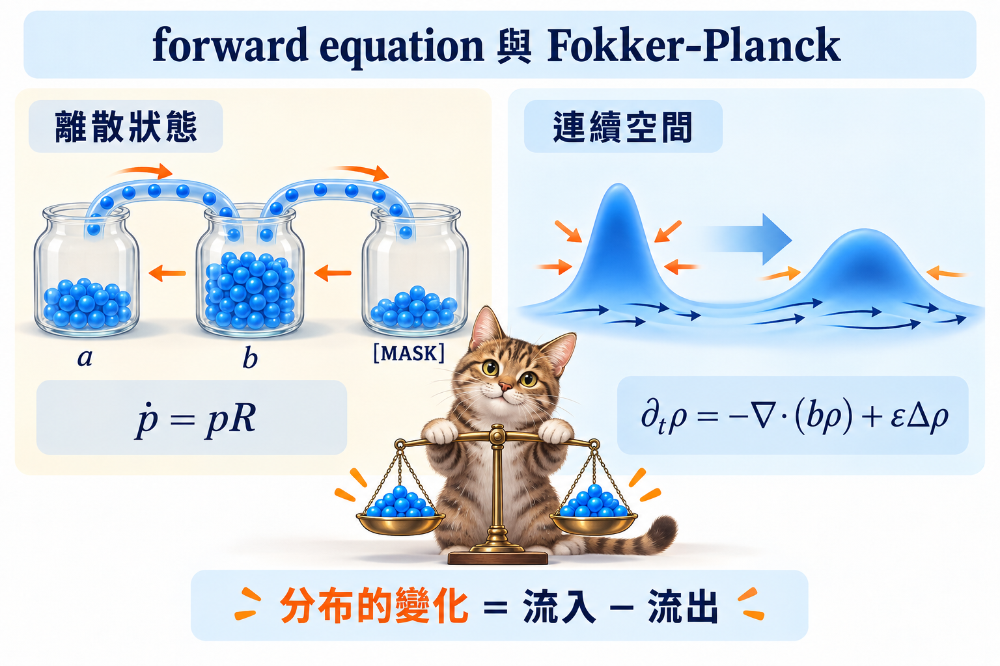

import Ask from '../../../components/Ask.astro';
import FormulaSteps from '../../../components/FormulaSteps.astro';
import Remark from '../../../components/Remark.astro';
import Question from '../../../components/Question.astro';
import Answer from '../../../components/Answer.astro';
import Objectives from '../../../components/Objectives.astro';
import Prereq from '../../../components/Prereq.astro';
import QuizBlock from '../../../components/QuizBlock.astro';
import Option from '../../../components/Option.astro';
import Explanation from '../../../components/Explanation.astro';
import Details from '../../../components/Details.astro';
import Bridge from '../../../components/Bridge.astro';
import Ref from '../../../components/Ref.astro';

# 有了 PMF path，能不能像 Flow Matching 一樣學 velocity？

<Objectives>
- **分清 PMF 的導數與生成樣本的規則。** 算出同一個機率淨變化，可以由不同的轉換流量實現。
- **用短時間轉移定義離散的 probability velocity。** 說出 rate、轉移機率與來源機率乘 rate 各自描述什麼。
- **從流入減流出推導 PMF 的演化。** 用 master equation 檢查局部跳躍是否推動指定的 joint distribution。
</Objectives>

<Prereq items={frontmatter.prereqs} />

## 已經有 interpolation，直接對時間微分呢？

在 <Ref to="dma-discrete-data"/>，我們已經指定了中間 PMF：

$$
q_t^\ell(a\mid x_0)
=\alpha_t\delta_{x_0^\ell}(a)+(1-\alpha_t)\nu(a).
$$

U2 也是先設計 interpolant，再讓模型學 velocity。那這裡能不能照做？先固定原句 $x_0$、位置 $\ell$ 和候選 $a$，對時間微分：

$$
\partial_t q_t^\ell(a\mid x_0)
=\dot\alpha_t\big[\delta_{x_0^\ell}(a)-\nu(a)\big].
$$

這個導數確實算得出來。例如選 MASK、原字是 `想`，當 $\dot\alpha_t=-0.2$，`想` 的機率每單位時間減少 $0.2$，MASK 則增加 $0.2$。但這還沒有告訴一個目前拿著某個 token 的樣本：下一刻該換成什麼、以多大的機率換？

回想 <Ref to="dma-flows-and-continuity"/>：$v_t(x)$ 描述位在 $x$ 的樣本怎麼移動，$\partial_t p_t(x)$ 描述這個位置的 density 怎麼變。**PMF 的導數對應後者；我們還需要前者在離散狀態上的版本。**

<Ask>
如果不能讓一個 token 沿座標移動一點點， 
我們要用什麼規則，讓整群樣本的 PMF 按指定方式改變？
</Ask>

## 機率要增加，可以讓一些樣本換過來

想像把每個 token 當成一個房間，每個樣本是房間裡的一個人。重複產生很多個樣本後，房間裡的人數比例就是 PMF；一個人換房間，就是一個樣本換 token。

先只看 `想` 與 `要` 兩個房間。假設某一刻各占一半，希望 `要` 的比例每單位時間增加 $0.1$。下面兩種搬法，都能在這一刻完成相同的淨變化：

| 搬法 | `想` $\to$ `要` 的 flow | `要` $\to$ `想` 的 flow | `要` 的淨增加 |
| --- | --- | --- | --- |
| 只往一邊搬 | $0.1$ | $0$ | $0.1$ |
| 兩邊都有人搬 | $0.2$ | $0.1$ | $0.1$ |

表裡的數值都是「每單位時間移動的機率質量」。兩種搬法的 PMF 導數相同，樣本可能經歷的跳躍卻不同。因此，**指定各時間的 PMF，還需要選一個實現它的轉換規則。** 就像連續情況先給 probability path，再找符合 continuity equation 的 velocity。

## 把每個樣本換字的頻率寫出來

先回到 forward 的時間方向，從較小的 $t$ 走向 $t+h$；reverse 之後才倒著走。本節先把一個位置可取的各個 token 當成狀態 $i,j$，用 $Y_t$ 表示依規則跳動的隨機 state，並用 $R_t(i,j)$ 表示每個目前在 $i$ 的樣本，跳到 $j$ 的 rate。對 $i\neq j$，
$$
\Pr(Y_{t+h}=j\mid Y_t=i)=hR_t(i,j)+o(h).
$$
給定現在在 $i$，小時間內跳到 $j$ 的機率約為 $hR_t(i,j)$。若有多扇門，要把各個離開方向加起來，總流出 rate 就是 $\sum_{j\neq i}R_t(i,j)$；留在原狀態的機率則用 $1$ 減掉它：
$$
\begin{gathered}
\Pr(Y_{t+h}=i\mid Y_t=i)\\
=1-h\sum_{j\neq i}R_t(i,j)+o(h).
\end{gathered}
$$
所以定義
$$
\begin{gathered}
R_t(i,i)=-\sum_{j\neq i}R_t(i,j),\\
Q_{t\to t+h}=I+hR_t+o(h).
\end{gathered}
$$
這張收集所有跳躍 rates 的表稱為 **rate matrix**。**它的每列和為 $0$，不是 $1$；$I+hR_t$ 才是短時間的 transition approximation。** Campbell 等人 [1] 用這套 CTMC 語言建構 continuous-time discrete diffusion。

<Remark label="定義" summary="CTMC：離散狀態，連續時間">
Continuous-time Markov chain 的狀態可以是有限個 token，但跳躍發生的時間不必落在整數格子。給定現在的狀態，未來的轉移由當下與之後的 rates 決定；不需要查更早的路徑。若總流出 rate 是常數 $\lambda$，等待下一次跳躍的時間是 $\mathrm{Exp}(\lambda)$。更詳細的定義見 <Ref to="math-ctmc"/>。
</Remark>

一列 $R_t(i,\cdot)$ 包含「往其他 token 增加多少轉移機會」和「從原 token 扣掉多少留下的機率」。它在這裡扮演離散的 **probability velocity**：對足夠小的 $h$，先形成 $\delta_i+hR_t(i,\cdot)$ 這張轉移 PMF，再抽出下一個 token。樣本仍然是字典裡的一個選項，連續改變的是轉移機率。

## 每個房間的機率，怎麼增加或減少？

令 $p_t(i)=\Pr(Y_t=i)$ 是這群樣本在時刻 $t$ 位於狀態 $i$ 的機率。從 $i$ 流向 $j$ 的 probability flow 是
$$
p_t(i)R_t(i,j).
$$
它的單位是每單位時間移動的機率，而不是單一樣本的轉移機率。沿用房間的例子，若 A 有 $20\%$ 的樣本、A 到 B 的 rate 是 $2$，來源比例乘 rate 是每單位時間 $0.4$；很小的 $h=0.01$ 內，搬走的質量約是 $0.004$。

現在算狀態 $j$ 在 $t+h$ 的機率：它包含原本在 $j$ 且留下的樣本，以及從其他狀態進來的樣本：

$$
\begin{aligned}
p_{t+h}(j)
&=p_t(j)\left[1-h\sum_{k\neq j}R_t(j,k)\right]\\
&\quad+h\sum_{i\neq j}p_t(i)R_t(i,j)+o(h).
\end{aligned}
$$

兩邊扣掉 $p_t(j)$、除以經過的時間 $h$，再讓 $h\to0$，就得到機率的瞬時變化：
<FormulaSteps
  id="u4-probability-conservation"
  compact
  title="把每個房間的機率變化寫出來"
  formula={String.raw`
    \begin{aligned}
    \reveal{1}{\frac{d p_t(j)}{dt}=}
    &\reveal{2}{\underbrace{\sum_{i\neq j}p_t(i)R_t(i,j)}_{\text{流入}}}\\
    &\reveal{3}{-\underbrace{p_t(j)\sum_{k\neq j}R_t(j,k)}_{\text{流出}}.}
    \end{aligned}
  `}
  steps={[
    {label: '想追蹤的量', text: String.raw`固定狀態 $j$，我們想知道在這裡的機率每單位時間改變多少。`},
    {label: '加上流入', text: String.raw`從每個其他狀態 $i$ 進來的 flow 是來源機率 $p_t(i)$ 乘上 rate $R_t(i,j)$，再對所有來源相加。`},
    {label: '扣掉流出', text: String.raw`目前在 $j$ 的機率，乘上所有離開方向的總 rate；流入減流出就是這個狀態的淨變化。`},
  ]}
/>

把第二項改用對角元素，就得到
$$
\frac{d p_t(j)}{dt}=\sum_i p_t(i)R_t(i,j),
\qquad
\frac{d p_t}{dt}=p_tR_t.
$$
這裡 $p_t=(p_t(1),p_t(2),\ldots)$ 是 row vector，右乘 $R_t$ 就把每個房間的流入與流出一起算完。這條式子叫 **Kolmogorov forward equation**，也稱 **master equation**。把所有 $j$ 的變化加起來，每股從 $i$ 流出的質量都會在另一個狀態流入，因此總機率仍是 $1$。它和 <Ref to="dma-conditional-flow-matching"/> 的 continuity equation 一樣在講質量守恆，只是這次的流量沿離散狀態之間的邊移動。

之後也可以把「整句話的一種排列」當成一個狀態，用 $x,y$ 表示。即使每次只改一個位置，$p_t(x)$ 仍可以包含整句話的相依；方程本身沒有假設各位置的 marginal distribution 獨立。

<iframe loading="lazy" src="/personal_website/notes/research_areas/diffusion-models-applications/w7-1-ctmc.html" class="demo-frame" title="Rate 與流入減流出" style="height: 800px; width: 100%; border: none;"></iframe>

*圖：Forward equation、continuity equation 與 Fokker–Planck 都描述 probability 如何流動；離散狀態用求和，連續空間用微分算子。*

## 我們要學的，是能產生這條 PMF path 的規則

U2 用 $\partial_t p_t=-\nabla\cdot(p_tv_t)$ 檢查 velocity；這裡用 $\dot p_t=p_tR_t$ 檢查 rate。給定指定的 PMF path，我們要找非對角元素非負、列和為零，而且滿足這條守恆式的 $R_t$。不能只把 $\dot p_t$ 換個名字叫 velocity，因為它還沒有決定從哪個狀態跳去哪裡。

如果真的知道整張 joint PMF，也可以直接解它的 ODE，最後按 PMF 抽樣。但長度 $L$、字典大小 $K$ 的序列有 $K^L$ 種排列；我們希望用讀取目前序列的模型給出局部 rates，不必存下所有排列的機率。每次只改一格，也不表示不同格彼此獨立：rate 可以依賴目前整句 context。

<Question id="Q1">
Rate matrix 有負的對角元素，是不是不合法？若某狀態總流出 rate 是 $4$，可以直接取 $h=1$，把 $I+hR$ 當 transition matrix 嗎？

<Answer>
負的對角元素在記錄機率減少，不是負機率。但 $I+hR$ 的對角會是 $1-4h$，所以 $h=1$ 會得到 $-3$，不能拿來抽樣。小步近似至少要滿足 $h\sum_{j\neq i}R(i,j)\leq1$；即使元素都非負，它仍只是近似，不代表把一整段時間內的多次跳躍都算準了。
</Answer>
</Question>

## 快速回顧一下

<QuizBlock id="w7-1-a">
Rate matrix 的一列總和是：
<Option>$1$。</Option>
<Option correct>$0$。</Option>
<Option>該位置的 token 數。</Option>
<Explanation>對角元素等於其他元素總和的負值；真正的 transition matrix 才有列和 $1$。</Explanation>
</QuizBlock>

<QuizBlock id="w7-1-b">
從 $i$ 流到 $j$ 的 probability flow 是：
<Option>$R_t(i,j)$。</Option>
<Option correct>$p_t(i)R_t(i,j)$。</Option>
<Option>$p_t(j)R_t(i,j)$。</Option>
<Explanation>Rate 乘上來源狀態的機率，才是整群樣本的流量。</Explanation>
</QuizBlock>

<QuizBlock id="w7-1-c">
已經知道 $\dot p_t$，還需要設計 rate 的原因是：
<Option>PMF 不能對時間微分。</Option>
<Option correct>機率的淨增減，尚未指定樣本如何在不同狀態間轉換。</Option>
<Option>離散資料的時間也只能是整數。</Option>
<Explanation>不同的相反 flow 可以抵消，產生同樣的 PMF 導數；生成還需要一個具體的跳躍規則。</Explanation>
</QuizBlock>

<Bridge to="dma-discrete-flow-matching">
我們可以延續 Flow Matching 的想法，只是推動樣本的規則變成跳躍 rates；流入減流出則檢查它有沒有走過指定的 PMF path。下一篇先解容易的版本：知道原句時，怎麼設計倒著生成的 rate？再問不知道原句時，能不能像 U2 一樣參考所有可能原句，學到共同的生成規則。
</Bridge>

## 參考文獻

1. Campbell, A. et al. [*A Continuous Time Framework for Discrete Denoising Models.*](https://arxiv.org/abs/2205.14987) NeurIPS 2022.
