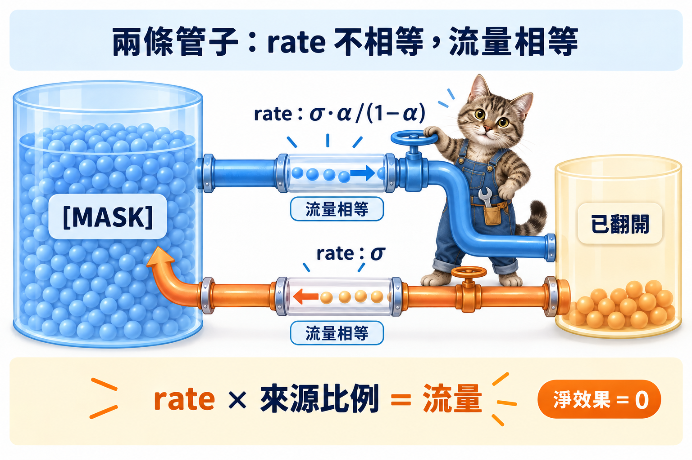

import Ask from '../../../components/Ask.astro';
import AlgorithmView from '../../../components/AlgorithmView.astro';
import Remark from '../../../components/Remark.astro';
import Objectives from '../../../components/Objectives.astro';
import Prereq from '../../../components/Prereq.astro';
import Question from '../../../components/Question.astro';
import Answer from '../../../components/Answer.astro';
import QuizBlock from '../../../components/QuizBlock.astro';
import Option from '../../../components/Option.astro';
import Explanation from '../../../components/Explanation.astro';
import Details from '../../../components/Details.astro';
import Bridge from '../../../components/Bridge.astro';
import Ref from '../../../components/Ref.astro';

# 填錯的字，可以再改而不改變目標分布嗎？

<Objectives>
- **從修改錯字的需求建立 remasking rate。** 寫出字回到 MASK 的頻率，並算出需要增加多少 reveal rate。
- **用逐邊的 probability flow 證明 marginals 不變。** 不只檢查 MASK 比例，而是檢查整個序列分布的流入與流出。
- **分清理論保留與實際改善。** 相同 denoiser 可以沿用；有限模型、有限步 sampler 的品質仍要測量。
</Objectives>

<Prereq items={frontmatter.prereqs} />

## 後面的 context 更完整，前面填的字卻不能改

在 <Ref to="dma-factorization-error"/>，我們看到少填幾格、更新 context 後再預測，能避免一部分同批抽字漏掉的相依。但原本的 MASK sampler 還有一個限制：**已經填入的字不會再修改。**

想像寫訊息時，你先打了「明天晚上見」，寫到後面才發現約的是下午。人可以回頭改「晚上」；目前的 sampler 卻只會補空格，不能碰已寫好的部分。對可見的 $v$，它的規則是

$$
\begin{gathered}
\Pr(Y_s^\ell=v\mid Y_t=x)=1,\\
x^\ell=v\ne m,\quad s<t.
\end{gathered}
$$

Training snapshot 的可見字來自原文，照抄很合理；生成時的可見字卻是模型先前自己填的，可能在 context 不足時選錯。要給它修改機會，最直接的想法是把某個已填字遮回 MASK，再讓模型根據新的 context 重選。

## 換成 uniform，還是沿用原本的 MASK path？

Uniform 的中間 PMF 允許各種 token，生成規則也能允許已見字再換；代價是沒有 MASK 標明哪格缺資訊，模型連當下的可見字也得判斷是否可信。這不是只換 sampler：原本的 training snapshots 與 posterior 也可能一起改變。

<iframe loading="lazy" src="/personal_website/notes/research_areas/diffusion-models-applications/w6-4-correction.html" class="demo-frame" title="已填字能不能修改" style="height: 800px; width: 100%; border: none;"></iframe>

Demo 比較的是修改通道；不能由一次 toy 實驗推論任何 corruption 在所有資料上都較好。

我們也可以沿用 MASK 的 training path。<Ref to="dma-ctmc"/> 已經顯示，同一個 PMF 導數可以有不同的搬法；如果多加一對相反且等量的 flows，整體的淨變化就不必改。這給了另一個選擇：**保留原本的 $p_t$ 與 denoiser，改變樣本走過它的方式。**

把已填字遮回去的操作稱為 **remasking**。但只多遮字，MASK 就會累積得更多；還需要補上適量的翻開機會。

<Ask>
我們能不能增加遮回去重選的機會， 
同時保留原本每個時刻的 joint PMF？
</Ask>

## 遮多少，就要補多少流量

先只看一個位置，想像從資料出發造出很多份時刻 $t$ 的 snapshots。未遮的比例是 $\alpha_t$，MASK 比例是 $1-\alpha_t$；我們想讓新的生成過程在同一時刻也有這些比例。以下仍沿生成方向從 $t$ 退到 $t-h$，$h>0$。

先固定新增的修改頻率：每個已填字以 rate $\sigma_t\geq0$ 遮回去。那麼每單位生成時間新增的 masking flow 就是「目前可見的比例乘上每個字被遮的 rate」：
$$
\sigma_t\alpha_t.
$$
若要配平這股 flow，每個 MASK 的額外 reveal rate 應為
$$
\frac{\sigma_t\alpha_t}{1-\alpha_t}.
$$
因為來源 MASK 的比例乘上這個 rate，正好也是 $\sigma_t\alpha_t$。例如此刻有 $80\%$ 可見、$20\%$ 是 MASK，取 $\sigma_t=0.5$，新增遮回 flow 為 $0.8\times0.5=0.4$。要從 $20\%$ 的 MASK 群體補回同樣的 flow，每個 MASK 的額外 reveal rate 必須是 $0.4/0.2=2$。兩邊 rate 不同，才能搬動相同的 probability mass。

加上原本的 reveal rate，新的總翻開頻率是
$$
\frac{-\dot\alpha_t+\sigma_t\alpha_t}{1-\alpha_t}.
$$
第一項 $-\dot\alpha_t/(1-\alpha_t)$ 是原本沿目標 path 翻開的 rate，第二項才是為了補償遮回而新增的 rate。補償後，淨增加的可見比例仍是原本的 $-\dot\alpha_t$。

翻成哪個字，先以真實 posterior 決定；實作時才用同一個 $f_\theta$ 近似。將兩種操作並列寫成模型可用的 rates，對位置 $\ell$ 就是：
$$
\begin{aligned}
\text{字}\to m &: \quad \sigma_t,\\
m\to v &: \quad
\frac{-\dot\alpha_t+\sigma_t\alpha_t}{1-\alpha_t}
f_\theta^\ell(v\mid x_t,t).
\end{aligned}
$$
$\sigma_t=0$ 就回到原本只翻開、不回頭的 sampler。Wang 等人的 **ReMDM** [1] 建構保留 absorbing marginals 的 remasking family；這裡用 rate 的形式理解其連續時間版本。

*圖：兩邊的來源比例不同，所以 rate 不必相同；來源比例乘上 rate 形成的 flow，才是要配平的量。*

## MASK 比例相同，整句分布也相同嗎？

剛才只算出可見與 MASK 兩群的總量。但兩種完全不同的句子，都可能有相同 MASK 比例；如果新翻出的詞分配錯了，整句 distribution 還是會改變。所以還要檢查：**在同一個 context 下，某個特定詞被遮掉的質量，有沒有由對應的 MASK 補回來？**

令完整狀態 $x$ 的第 $\ell$ 格是 MASK，而 $y=x^{(\ell\to v)}$ 只把那一格改成 $v$。其他位置完全相同，所以固定原文 $x_0$ 後，那些位置的 conditional probability factors 相同；這一格則在 $x$ 中貢獻 $1-\alpha_t$，在 $y$ 中貢獻 $\alpha_t\mathbf1[x_0^\ell=v]$。因此

$$
q_t(y\mid x_0)
=q_t(x\mid x_0)\frac{\alpha_t}{1-\alpha_t}
\mathbf1[x_0^\ell=v].
$$

兩邊乘上 $p_{\mathrm{data}}(x_0)$，再對所有原文求和。左邊變成 $p_t(y)$；右邊用 Bayes 收成「目前看到 $x$ 時，原字是 $v$」的 posterior：

$$
\begin{gathered}
p_t(y)=p_t(x)\frac{\alpha_t}{1-\alpha_t}
p(X_0^\ell=v\mid I_t=x).
\end{gathered}
$$

左邊 $p_t(y)$ 是目前帶著這個 $v$ 的整句機率；右邊則從帶著 MASK 的那群樣本出發，乘上保留／遮蔽係數與原字是 $v$ 的 posterior。現在把這個已知關係乘上 $\sigma_t$，正好得到新增的兩股相反 flow：
$$
\begin{aligned}
y\to x &: \quad p_t(y)\sigma_t,\\
x\to y &: \quad
p_t(x)\frac{\sigma_t\alpha_t}{1-\alpha_t}
p(x_0^\ell=v\mid x_t=x).
\end{aligned}
$$
由前一條 ratio 關係，兩行正好相等。把所有位置與候選詞都做同樣的配平，對每個完整序列而言，每股新增流出都有相同的新增流入。**所以保留的是整個 $p_t$，不只是 MASK 的總比例。**

這個結論先在真實 posterior 與精確的 continuous-time dynamics 下成立：新增轉移對每個狀態的機率導數貢獻都是零。從同一個正確 noise distribution 出發，且過程可適當定義時，便能沿原本的 marginals 倒著走；下面的矩陣計算把這句話寫完整。

令 $C_t$ 是新增的 remasking 與 compensating reveal rates，對角元素仍取負的總流出。上面的等式就是
$$
p_t(x)C_t(x,y)=p_t(y)C_t(y,x).
$$
對所有鄰居求和：
$$
\begin{gathered}
(p_tC_t)(x)\\
=\sum_{y\neq x}
\left[p_t(y)C_t(y,x)-p_t(x)C_t(x,y)\right]=0.
\end{gathered}
$$
因此原 reverse generator $\bar R_t$ 換成 $\bar R_t+C_t$ 後，$p_t$ 在倒著走時的演化完全相同。在正確初始分布、理想 posterior 與可適當定義的精確 CTMC 下，仍經過原本的 marginals。端點有發散 rate 時，需要使用極限或另外指定端點轉移。

## 沿用網路，不代表每一種設定都會更好

Training snapshot 沒有改，模型仍在預測 $p(x_0^\ell\mid x_t)$，所以可以沿用原本的 masked denoiser。但有限模型不一定估對 posterior，實作也會把 rate 切成有限步；上面的 exact cancellation 不會自動替這些誤差消失。

例如一開始兩格同時抽出不相配的詞，等附近的字更完整後，把其中一格遮回，原本的 denoiser 就能用新的 context 重新預測。這提供了修改機會，卻不保證新答案更好；若模型一直把 posterior 估偏，重抽也可能繼續偏。

ReMDM 論文 [1] 在其實驗中觀察到，增加取樣計算可以改善生成結果。對我們的設定仍要固定模型、比較相同 posterior queries 或模型呼叫預算，再量不同 $\sigma_t$ 的效果。理想的 marginal-preservation 結論，與有限預算下的品質改善，是分別需要檢查的兩件事。

<iframe loading="lazy" src="/personal_website/notes/research_areas/diffusion-models-applications/w7-3-remasking.html" class="demo-frame" title="比較 remasking 強度與有限步結果" style="height: 970px; width: 100%; border: none;"></iframe>

*Demo 使用 toy 的 conditional probabilities。觀察 rate 強度與步數一起改變時的結果；曲線是有限步實驗，不是新增 rate 保留 marginals 的證明。*

<Question id="Q1">
如果把新 MASK reveal rate 也直接設成 $\sigma_t$，讓兩個方向的 rates 一樣，分布就會不變嗎？

<Answer>
不會。兩股 flow 分別是 $\sigma_t\alpha_t$ 與 $\sigma_t(1-\alpha_t)$，一般不相等。要保留分布，還需要對每個字按它在這個 context 下的 posterior 分配 reveal flow。**相同 rate 不等於相同 flow；相同總 MASK 比例也不等於相同整句 distribution。**
</Answer>
</Question>

先用一個直接配平 conditional snapshot 的 kernel。對 $s<t$，令舊可見字以機率 $r$ 遮回、舊 MASK 以機率 $a$ 翻開。固定原文時要求

$$
\alpha_t(1-r)+(1-\alpha_t)a=\alpha_s,
$$

所以 $a=(\alpha_s-\alpha_t+r\alpha_t)/(1-\alpha_t)$。為了讓它不超過 $1$，在 $\alpha_t>0$ 時限制 $r\leq\min\{1,(1-\alpha_s)/\alpha_t\}$；若 $\alpha_t=0$，沒有可見字需要遮回，可設 $r=0$。最後 $s=0$ 時也取 $r=0$、$a=1$。

<AlgorithmView id="u4-remask-step" title="一次有限步 remasking：$t\to s$" code={`輸入：目前序列 x、時間 t > s、denoiser f_theta、強度 sigma
old ← copy(x)
prediction ← f_theta(old, t)
r ← 1 - exp(-sigma * (t - s))
若 alpha(t) > 0：r ← min(r, (1 - alpha(s)) / alpha(t))
否則：r ← 0
a ← (alpha(s) - alpha(t) + r * alpha(t)) / (1 - alpha(t))
for ell = 1, ..., L:
    if old[ell] != MASK:
        以機率 r，將 x[ell] 遮回 MASK
    else:
        以機率 a，按 prediction[ell] 抽 token 放進 x[ell]
return x`}>

先讀取舊序列 $x_t$，算出 $f_\theta(x_t,t)$、$r$ 與 $a$，再同時執行：

$$
\begin{aligned}
x_t^\ell\ne m&:\quad
\begin{cases}
m,&\text{機率 }r,\\
x_t^\ell,&\text{機率 }1-r;
\end{cases}\\
x_t^\ell=m&:\quad
\begin{cases}
A_\ell\sim f_\theta^\ell,&\text{機率 }a,\\
m,&\text{機率 }1-a.
\end{cases}
\end{aligned}
$$

每次都用更新前的 mask pattern 判斷兩種操作，得到 $x_s$ 後，下一段才重算 context。

</AlgorithmView>

小步時 $r=\sigma_t h+o(h)$，代入 $a$ 就回到正文的補償 reveal rate。給定原文並確定填回原字時，有限步 kernel 保留所需 conditional snapshots；改成以 posterior marginals 平行抽多個新字，仍可能有因子化誤差。實作 B 會分開檢查這兩件事。

## 快速回顧一下

<QuizBlock id="w7-3-a">
加入 rate $\sigma_t$ 的 remasking 後，每個 MASK 需要增加的總 reveal rate 是：
<Option>$\sigma_t$。</Option>
<Option correct>$\sigma_t\alpha_t/(1-\alpha_t)$。</Option>
<Option>$\sigma_t(1-\alpha_t)/\alpha_t$。</Option>
<Explanation>額外 masking flow 是 $\sigma_t\alpha_t$，要除以 reveal 的來源比例 $1-\alpha_t$。</Explanation>
</QuizBlock>

<QuizBlock id="w7-3-b">
完整 marginals 不變的證明用到：
<Option>只看 MASK 比例相同。</Option>
<Option correct>每一對相反轉移的新增 probability flow 相等。</Option>
<Option>網路輸出每列和為 $1$。</Option>
<Explanation>逐邊的 detailed balance 讓每個序列狀態的新增淨流量都是零。</Explanation>
</QuizBlock>

<QuizBlock id="w7-3-c">
可以沿用原 denoiser，表示：
<Option>Remasking 不需要額外計算。</Option>
<Option correct>Prediction target 不變，但修改與重選仍需取樣計算，也可能有模型與有限步誤差。</Option>
<Option>任意強度都保證提升品質。</Option>
<Explanation>不必重新訓練與取樣一定改善，是兩件不同的事。</Explanation>
</QuizBlock>

<Bridge to="dma-lab-discrete-time">
我們已經從 PMF path 建立生成 rate、學到原字 posterior，並看見兩個抽樣問題：同批抽字可能漏掉相依，已填字也可能需要修改。Remasking 提供了保留理想 path 的修改規則；接下來用兩次實作，分別量出因子化誤差、有限步近似與修改的實際效果。
</Bridge>

## 參考文獻

1. Wang, G., Schiff, Y., Sahoo, S. S., Kuleshov, V. [*Remasking Discrete Diffusion Models with Inference-Time Scaling.*](https://arxiv.org/abs/2503.00307) 2025.
