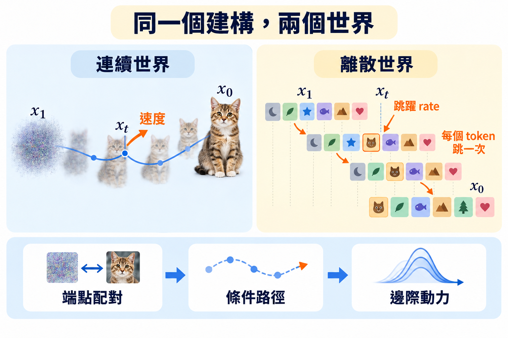

import Ask from '../../../components/Ask.astro';
import FormulaSteps from '../../../components/FormulaSteps.astro';
import AlgorithmView from '../../../components/AlgorithmView.astro';
import Remark from '../../../components/Remark.astro';
import Objectives from '../../../components/Objectives.astro';
import Prereq from '../../../components/Prereq.astro';
import Question from '../../../components/Question.astro';
import Answer from '../../../components/Answer.astro';
import QuizBlock from '../../../components/QuizBlock.astro';
import Option from '../../../components/Option.astro';
import Explanation from '../../../components/Explanation.astro';
import Details from '../../../components/Details.astro';
import Bridge from '../../../components/Bridge.astro';
import Ref from '../../../components/Ref.astro';

# 不知道原句，怎麼學到推動 PMF 的規則？

<Objectives>
- **從指定的 MASK path 算出 conditional rate。** 把需要搬回的機率質量，除以目前可用的 MASK 比例。
- **用 posterior average 建構生成時的 rate。** 固定目前序列，平均仍可能原句給出的 rates，並用 flow 檢查它保留指定的 joint PMF path。
- **寫出模型的 input、label 與 cross-entropy。** 說明理想預測為什麼是原字的 posterior，而不是 token 編號的平均。
</Objectives>

<Prereq items={frontmatter.prereqs} />

## 先假設我們知道原句

在 <Ref to="dma-ctmc"/>，我們把離散的 velocity 寫成跳躍 rate，也知道要用流入減流出檢查分布。現在要反過來：已經指定 PMF path，怎麼找到生成方向的 rate？

先用最容易追蹤的 MASK。固定原句 $x_0$，位置 $\ell$ 在時間 $t$ 的 PMF 是

$$
q_t^\ell(a\mid x_0)
=\alpha_t\delta_{x_0^\ell}(a)+(1-\alpha_t)\delta_m(a).
$$

這格不是原字，就是 MASK。假設我們偷看了原文，知道被遮的是 `想`，生成時就只需要決定：**現在這群 MASK 裡，有多少要翻回 `想`？**

本篇維持 $t=0$ data、$t=1$ noise，$\alpha_t$ 非增，生成從 $t$ 退到 $t-h$，$h>0$。這段時間可見比例要由 $\alpha_t$ 增至 $\alpha_{t-h}$；需要翻回的質量是兩者之差，來源 MASK 比例則是 $1-\alpha_t$。因此每個 MASK 的翻開機率為

$$
\begin{aligned}
\frac{\alpha_{t-h}-\alpha_t}{1-\alpha_t}
&=h\frac{-\dot\alpha_t}{1-\alpha_t}+o(h).
\end{aligned}
$$

所以每個 MASK 的 reveal rate 是 $-\dot\alpha_t/(1-\alpha_t)$。例如 $\alpha_t=1-t$，在 $t=0.5$ 有一半樣本是 MASK；退回 $h=0.01$ 要補回 $0.01$ 的總質量，因此這群 MASK 各有約 $0.02$ 的翻開機率，rate 是 $2$。

用 $x^{(\ell\to a)}$ 表示把整句 $x$ 的第 $\ell$ 格換成 $a$，其他位置不動。已知原句時，翻開一定填原字，所以對 $x^\ell=m$、$a\in\mathcal V$，

$$
\begin{gathered}
\bar R_t^{\mathrm{cond}}
\bigl(x,x^{(\ell\to a)}\mid x_0\bigr)\\
=\frac{-\dot\alpha_t}{1-\alpha_t}
\mathbf1[x_0^\ell=a].
\end{gathered}
$$

指示量 $\mathbf1[x_0^\ell=a]$ 只在原字是 $a$ 時為 $1$。已經可見的位置不再跳；對角元素仍是負的總流出。上標 cond 表示這條規則還需要原句，$\bar R$ 的橫線則表示沿生成方向倒著走，並不是先前已簡化掉的保留係數符號。

<Remark label="條件" summary="時間方向與端點怎麼處理？">
以下先在 $0<\alpha_t<1$ 的內部時間使用可微的 schedule。$\bar R_t$ 以正的生成時間長度 $h$ 定義：$\Pr(Y_{t-h}=y\mid Y_t=x)=h\bar R_t(x,y)+o(h)$，$y\ne x$。因此它要滿足的是 $-\dot p_t=p_t\bar R_t$。若 rate 在端點發散，需使用極限或另外指定端點轉移，不能把無限 rate 直接乘上有限步長。
</Remark>

## 生成時不知道原句，能不能參考所有可能？

真正生成時，只看到「我／今天／[MASK]／吃／[MASK]」。我們沒有原句，不知道第三格應該跳成 `想` 還是 `要`。但回想 <Ref to="dma-conditional-flow-matching"/>：同一個街口可能有多條 reference paths，我們參考的是所有相容路徑給出的方向。

這裡也一樣。先固定時間 $t$ 和目前序列 $x$，只考慮能產生這個 $x$ 的原句，再按它們的 posterior 機率平均 conditional rates。例如相容原句在第三格有 $70\%$ 是 `想`、$30\%$ 是 `要`，總 reveal rate 為 $2$，就分別給 `想` rate $1.4$、`要` rate $0.6$。

<Ask>
把可能原句提供的 rates 取條件平均， 
能不能得到只看目前序列就能使用的生成規則？
</Ask>

用 $I_t$ 表示 reference noisy state，固定 $I_t=x$ 後，仍隨機的是原句 $X_0$。我們想平均的 label 是這些原句各自提供的 conditional rate：

<FormulaSteps
  id="u4-average-conditional-rates"
  compact
  title="不知道原字時，該用哪個跳躍 rate？"
  formula={String.raw`
    \begin{gathered}
    \reveal{1}{\bar R_t(x,y)=}\\[.25em]
    \reveal{4}{\mathbb E\big[}
    \reveal{3}{\bar R_t^{\mathrm{cond}}(x,y\mid X_0)\mid}
    \reveal{2}{I_t=x}
    \reveal{4}{\big].}
    \end{gathered}
  `}
  steps={[
    {label: '要找的生成規則', text: String.raw`固定時間 $t$，目前在 $x$，想算跳向另一個狀態 $y$ 的 rate。`},
    {label: '固定能看見的資訊', text: String.raw`只參考這時能造出目前序列的原句：$I_t=x$。`},
    {label: '各原句給出的 label', text: String.raw`若知道原句 $X_0$，我們就能算出 conditional rate。`},
    {label: '按 posterior 取平均', text: String.raw`對 $X_0\mid I_t=x$ 平均這些 rates，得到只依賴目前狀態與時間的規則。`},
  ]}
/>

把剛才的指示量代入，便得到對 MASK 位置的生成 rate：

$$
\begin{gathered}
\bar R_t\bigl(x,x^{(\ell\to a)}\bigr)\\
=\frac{-\dot\alpha_t}{1-\alpha_t}
\underbrace{\mathbb E[\mathbf1[X_0^\ell=a]\mid I_t=x]}_{\text{原字 posterior}}.
\end{gathered}
$$

指示量的條件平均，就是原字為 $a$ 的 posterior probability。**前面的係數決定翻得多快，後面的機率決定翻成哪個字。** 我們沒有平均 token 編號，也不需要先列出整張 joint PMF。

<Question id="Q1">
既然有些原句比較可能，能不能只選最可能的原句，再使用它提供的 conditional rate？

<Answer>
這會改變轉移的比例。若目前 context 下，原字為 `想`、`要` 的 posterior 是 $0.7$、$0.3$，總 reveal rate 是 $2$，posterior average 分別給它們 $1.4$、$0.6$ 的 rate；只選最可能的原句，則會給 `想` rate $2$、`要` rate $0$。

我們要重現的是各種可能原句所貢獻的 flows，所以需要按 posterior 加權，不能用最可能的一句取代整個平均。接著就用這個 flow 關係檢查分布。
</Answer>
</Question>

## 為什麼平均後仍推動原本的分布？

只平均出一條合法 rate 還不夠，還要檢查它是否推動我們指定的 $p_t$。沿用 <Ref to="dma-discrete-data"/> 的混合式，$p_t(x)=\sum_{x_0}p_{\mathrm{data}}(x_0)q_t(x\mid x_0)$。在 $p_t(x)>0$ 的狀態，Bayes 給出相容原句的權重：

$$
p(X_0=x_0\mid I_t=x)
=\frac{p_{\mathrm{data}}(x_0)q_t(x\mid x_0)}{p_t(x)}.
$$

把它放進平均 rate，再乘回來源狀態的機率：

$$
\begin{aligned}
p_t(x)\bar R_t(x,y)
&=\sum_{x_0}p_{\mathrm{data}}(x_0)q_t(x\mid x_0)\\
&\quad\cdot\bar R_t^{\mathrm{cond}}(x,y\mid x_0).
\end{aligned}
$$

右邊正是各原句提供的 conditional flows，按資料機率加起來。每一組 conditional process 都有正確的流入減流出；加總後，就得到 $-\dot p_t=p_t\bar R_t$。因此，在正確的 noise 起點與可適當定義的精確動態下，這條 rate 會倒著經過原本的 **joint** PMF path；不要求某條生成 trajectory 認回某一句 training 原文。

這是 <Ref to="dma-denoising-regression"/> 的 **conditional trick** 在跳躍規則上的版本。先設計 conditional probability path、建立能推動它的 conditional rates，再取 posterior average，便得到 **Discrete Flow Matching（DFM）** 的建構方式；Gat 等人 [1] 與 Campbell 等人 [2] 系統化了這類離散生成流程。

*圖：連續情況平均 reference velocities；離散情況平均 conditional rates。兩者都以機率守恆確認平均後的動態能走過指定的 probability path。*

## 未知的 posterior，要用什麼 label 學？

U2 用平方誤差對準 reference velocity，理想解就是相容 velocities 的條件平均。這裡也可以沿用同一個做法：固定一個內部時間 $t$，以剛才的 conditional rate 為 label 做平方誤差 regression，理想解就是我們已經推得的 posterior-average rate。

不過，剛才的公式還告訴我們：時間係數 $-\dot\alpha_t/(1-\alpha_t)$ 已知，真正未知的只剩指示量的條件平均，也就是 $p(X_0^\ell=a\mid I_t=x)$。**因此可以先讓模型預測這張原字 PMF，再乘回已知係數，組成生成時的 rate。** 這仍是在學推動分布的規則，只是改用原字機率來參數化它。

讓模型讀取整句 $x$ 與時間 $t$，在每個位置輸出一張字典上的機率表：

$$
f_\theta^\ell(a\mid x,t)
\approx p(X_0^\ell=a\mid I_t=x),
\qquad a\in\mathcal V.
$$

對 $a$ 加總為 $1$；模型不必把 MASK 當成原字的候選。這個預測原始資料的模型，仍稱為 **denoiser**。每個 output 可以參考整句 context；輸出每格的 posterior，不代表假設原句各位置獨立。

接下來選擇用 cross-entropy 學這張 PMF。我們沒有真 posterior 當 label，但製造 noisy input 時，手上還保有原文。先抽 $x_0\sim p_{\mathrm{data}}$、$t\sim\mathrm{Unif}(0,1)$，按已知 $q_t(\cdot\mid x_0)$ 抽出 $x_t$；模型只看 $(x_t,t)$，被遮位置的 label 就是 $x_0^\ell$。用 cross-entropy 衡量它給原字多少機率：

<FormulaSteps
  id="u4-posterior-training-loss"
  compact
  title="用能製造的 training pairs 學原字機率"
  formula={String.raw`
    \begin{gathered}
    \reveal{1}{\mathcal L(\theta)=}\\[.25em]
    \reveal{4}{\mathbb E_{t,X_0,I_t}\Big[}
    \reveal{3}{\sum_{\ell:I_t^\ell=m}-\log}
    \reveal{2}{f_\theta^\ell(}
    \reveal{3}{X_0^\ell}
    \reveal{2}{\mid I_t,t)}
    \reveal{4}{\Big].}
    \end{gathered}
  `}
  steps={[
    {label: '製造 input', text: String.raw`先抽原文 $X_0$ 與時間 $t$，再依 conditional PMF 製造 $I_t$。`},
    {label: '模型給機率', text: String.raw`模型只看 $(I_t,t)$，替各個原字候選給出機率。`},
    {label: '用原文當 label', text: String.raw`在 MASK 位置，以已知的 $X_0^\ell$ 當正確類別，計算負 log-probability。`},
    {label: '涵蓋可能的 labels', text: '對時間、原文與遮罩隨機性平均；反覆訓練時，相容的原字會按其機率成為 label。'},
  ]}
/>

固定一個 masked input 和位置，將它的真 posterior 簡記為 $p_a$、模型機率記為 $f_a$。把可能的原字 labels 平均，loss 就是 $-\sum_a p_a\log f_a$。加減同一項，可寫成

$$
-\sum_a p_a\log f_a
=-\sum_a p_a\log p_a+D_{\mathrm{KL}}(p\|f).
$$

第一項不隨模型改變，第二項在 $f=p$ 時為零，因此理想最佳輸出正是真 posterior。每次只給一個原字 label，反覆訓練卻能學到整張條件機率表；不需要事先知道這張表。

<AlgorithmView id="u4-mask-training" title="MASK denoiser：一次 training update" code={`輸入：資料集、保留係數 alpha(t)、模型 f_theta
x0 ← 從資料集抽一句原文
t ← Uniform(0, 1)
xt ← copy(x0)
for ell = 1, ..., L:
    以機率 1 - alpha(t)，將 xt[ell] 換成 MASK
prediction ← f_theta(xt, t)     # 每格一張原字典上的 PMF
loss ← 對所有 MASK 位置加總 -log prediction[ell, x0[ell]]
以 loss 的 gradient 更新 theta`}>

$$
\begin{aligned}
&(x_0,t)\sim p_{\mathrm{data}}\times\mathrm{Unif}(0,1)\\
&\quad\xrightarrow{\text{依 }q_t\text{ 抽樣}}x_t\\
&\quad\xrightarrow{f_\theta(\cdot,t)}
\{f_\theta^\ell(\cdot\mid x_t,t)\}_{\ell=1}^L\\
&\quad\xrightarrow{\text{以原字為 label}}
\sum_{\ell:x_t^\ell=m}-\log f_\theta^\ell(x_0^\ell\mid x_t,t).
\end{aligned}
$$

</AlgorithmView>

**Training 只要抽 snapshot，不必先模擬完整的跳躍過程。** 學完後，用 $f_\theta$ 取代 rate 裡的 posterior；理想 rate 與網路近似是兩個層次，實際生成還要選取樣方法。

<Remark label="補充" summary="換時間權重，還是在學同一張 posterior 嗎？">
若只在 loss 乘上與原字 label 無關、對所學時間為正的 $w(t)$，固定 input 下的最佳機率表仍是 posterior。有限模型會共用參數，權重仍可能影響實際學習。這裡先用容易理解的 CE 建立模型；<Ref to="dma-d3pm"/> 的補充再從 discrete diffusion 的 ELBO 解釋特定 weighting。
</Remark>

可以。對 $q_t^\ell=\alpha_t\delta_{x_0^\ell}+(1-\alpha_t)\nu$，在生成方向選擇「以 rate $c_t=-\dot\alpha_t/(1-\alpha_t)$ 重設成原字」。這個操作對候選 $a$ 的淨變化為

$$
\begin{aligned}
&c_t[\delta_{x_0^\ell}(a)-q_t^\ell(a\mid x_0)]\\
&=-\dot\alpha_t[\delta_{x_0^\ell}(a)-\nu(a)]\\
&=-\partial_tq_t^\ell(a\mid x_0).
\end{aligned}
$$

因此它也實現同一條 conditional PMF path。對所有原句取 posterior average 後，對 $a\ne x^\ell$ 有

$$
\bar R_t\bigl(x,x^{(\ell\to a)}\bigr)
=\frac{-\dot\alpha_t}{1-\alpha_t}
p(X_0^\ell=a\mid I_t=x).
$$

MASK 時，已見字的原字 posterior 是 point mass，所以不能再跳；uniform 時，當前字也可能被換掉，所以所有位置都可能需要預測。Training 可以對所有位置計算 CE。

這是一個實現指定 path 的生成規則。Uniform D3PM 的 forward chain 可以反覆重抽，反轉它會得到另一個 generator；兩者雖可有相同 snapshots，不能宣稱 trajectory law 相同。

先抽配對 $(X_0,X_1)\sim\pi$，$X_0$ 是 data、$X_1$ 是 source；$\pi$ 指定兩端如何配在一起，兩個 marginals 分別是所需的資料與 source 分布。固定兩端，令

$$
q_t^\ell(a\mid x_0,x_1)
=\alpha_t\delta_{x_0^\ell}(a)+(1-\alpha_t)\delta_{x_1^\ell}(a).
$$

各位置條件獨立，再按端點配對混合：

$$
p_t(x)=\sum_{x_0,x_1}\pi(x_0,x_1)
\prod_\ell q_t^\ell(x^\ell\mid x_0,x_1).
$$

同樣可以選擇生成方向以 $-\dot\alpha_t/(1-\alpha_t)$ 的 rate 重設成 data token，再對兩端的 posterior 平均。正文的 iid noise 版本，相當於令 source 與 data 獨立，再將 source 平均掉。

配對不同，中間 PMF 與 endpoint posterior 可能不同；這不等於 U3 的幾何拉直，也不保證有限模型更容易學。這裡仍沿用 $\alpha_t$；原 DFM 論文 [1] 的時間方向相反，不能直接照搬其下標。

<iframe loading="lazy" src="/personal_website/notes/research_areas/diffusion-models-applications/w7-4-token-path.html" class="demo-frame" title="離散端點之間的 probability interpolation" style="height: 870px; width: 100%; border: none;"></iframe>

先看狀態、中間 PMF、模型輸出與 sampler。例如 MDLM [3] 用 absorbing masking 和原字預測；Multiflow [2] 同時處理蛋白質的離散序列與連續結構；DiGress [4] 對圖的 node、edge 類別設計離散 corruption。

類別合法不代表化學或生物限制必定滿足；除了 path 與模型，仍需檢查任務條件與評估方式。

## 快速回顧一下

<QuizBlock id="w7-4-a">
MASK 的 reveal rate 分母為什麼是 $1-\alpha_t$？
<Option>因為所有 token 的機率總和不是 $1$。</Option>
<Option correct>需要補回的質量，要除以目前能翻開的 MASK 群體比例。</Option>
<Option>因為它是資料在每格出現的機率。</Option>
<Explanation>Rate 描述每個來源樣本的頻率，所以要用來源群體的機率作分母。</Explanation>
</QuizBlock>

<QuizBlock id="w7-4-b">
Posterior averaging 固定了什麼、平均什麼？
<Option correct>固定目前序列與時間，按相容原句的 posterior 平均它們的 conditional rates。</Option>
<Option>把所有 training sequences 的 token 編號取平均。</Option>
<Option>固定原句，將所有時間的 rates 等權平均。</Option>
<Explanation>生成規則只能使用目前可見資訊；原句已經被平均掉。</Explanation>
</QuizBlock>

<QuizBlock id="w7-4-c">
每次訓練只給一個原字 label，為什麼能學到 posterior PMF？
<Option>因為所有原句都有相同 label。</Option>
<Option correct>固定 input 下，相容 labels 按其機率出現，平均 CE 在預測等於 posterior 時最小。</Option>
<Option>因為輸出最大的 logit 就是 joint distribution。</Option>
<Explanation>模型學的是給各類別多少機率；單筆 label 與反覆訓練的理想最佳解不同。</Explanation>
</QuizBlock>

<Bridge to="dma-d3pm">
現在我們知道離散的 velocity 如何設計、怎麼由 conditional rates 平均而來，也有模型可以學的原字機率。下一步要真的生成：從全 MASK 出發，一次應該翻開多少格、如何抽字，又該怎麼把 rate 轉成有限步的轉移機率？
</Bridge>

## 參考文獻

1. Gat, I. et al. [*Discrete Flow Matching.*](https://arxiv.org/abs/2407.15595) NeurIPS 2024.
2. Campbell, A. et al. [*Generative Flows on Discrete State-Spaces: Enabling Multimodal Flows with Applications to Protein Co-Design.*](https://arxiv.org/abs/2402.04997) ICML 2024.
3. Sahoo, S. S. et al. [*Simple and Effective Masked Diffusion Language Models.*](https://arxiv.org/abs/2406.07524) NeurIPS 2024.
4. Vignac, C. et al. [*DiGress: Discrete Denoising Diffusion for Graph Generation.*](https://arxiv.org/abs/2209.14734) ICLR 2023.
