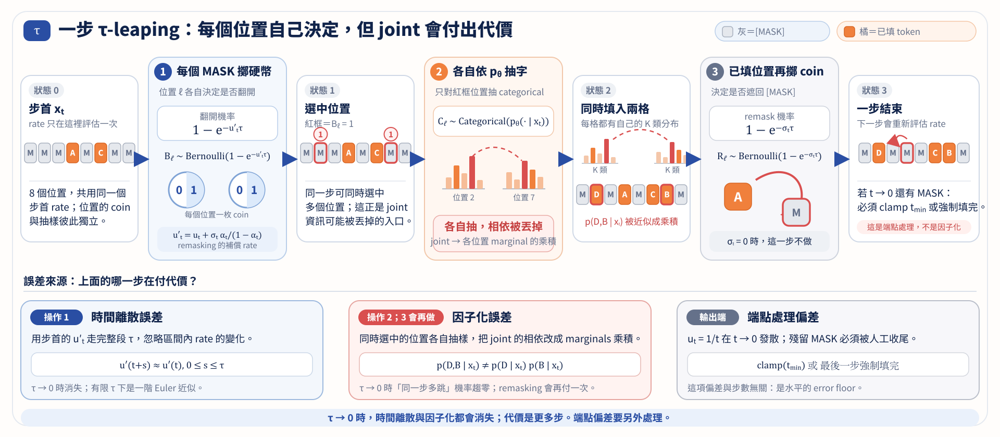

import Ask from '../../../components/Ask.astro';
import Remark from '../../../components/Remark.astro';
import Question from '../../../components/Question.astro';
import Answer from '../../../components/Answer.astro';
import Objectives from '../../../components/Objectives.astro';
import Prereq from '../../../components/Prereq.astro';
import QuizBlock from '../../../components/QuizBlock.astro';
import Option from '../../../components/Option.astro';
import Explanation from '../../../components/Explanation.astro';
import Details from '../../../components/Details.astro';
import Bridge from '../../../components/Bridge.astro';
import Ref from '../../../components/Ref.astro';

# 實作 B：步長與重新遮蔽會改變什麼？

<Objectives>
- **比較 closed-form reveal 與 frozen-rate 近似。** 不混入 endpoint completion，先量每個時刻的 MASK 比例。
- **實作真的會修改已填字的 remasking。** 寫出有限步的遮回與補償機率，分清 conditional snapshot 保留與生成時的因子化。
- **分開時間近似、因子化與預測誤差。** 先比較 MASK 比例，再固定 sampler 與計算預算，比較模型誤差和修改頻率。
</Objectives>

<Prereq items={frontmatter.prereqs} />

## 同一條路，換成 Rate 來走會差多少？

<Ref to="dma-lab-discrete-time"/> 已經把平行抽字的問題分開量出來。本次加入時間近似：只拿現在的 rate 走一整段，會不會和 closed-form 的 snapshot probabilities 有差？再加入 remasking，讓前面已填的字也能修改。

[下載實作 B notebook：Rate、remasking 與 absorbing ratios](/personal_website/notes/notebooks/diffusion-models-applications/dma-w7-lab.ipynb)

程式需要 NumPy 與 Matplotlib，仍用完整列舉的 $8$ 格 bit 序列。這次資料給全部偶數 parity 合計 $99\%$、全部奇數 parity 合計 $1\%$，各組內再均勻分配，所以每種完整序列都有正機率。

為什麼要改資料？Remasking 會在已填出的 context 上繼續詢問 posterior。若純偶數資料的 sampler 暫時產生一整串奇數 parity，這就是資料機率為零的 context，真 posterior 無從定義；oracle 不能替它憑空提供答案。加入少量奇數資料，才能在本次每個可能的 context 上持續比較已定義的 conditional。這次要量的是生成結果的偶數比例是否接近 $0.99$，而不是是否每次都為偶數。

## 第一步：先只檢查 MASK 比例

選 $\alpha_t=1-t$。<Ref to="dma-discrete-flow-matching"/> 的 reverse reveal rate 是 $1/t$；從 $t$ 退到 $s=t-h$，closed-form 的翻開機率為
$$
w_{t,s}=\frac{\alpha_s-\alpha_t}{1-\alpha_t}
=\frac ht.
$$
若把步首 rate $1/t$ 凍結在整段 $h$，則翻開機率為
$$
1-e^{-h/t}.
$$
這是 **frozen-rate 的 $\tau$-leaping 型近似**：用目前的 rate 描述一整段時間，這段內不重新查詢 rates 與 context。因為凍結後的等待時間是 exponential，長度 $h$ 內至少跳一次的機率才是 $1-e^{-h/t}$；它和直接使用一階近似 $h/t$ 是不同規則。

先比較一個能手算的時間段：$t=0.5$、$s=0.4$，則 $h/t=0.2$，closed-form 翻開 $20\%$ 的 MASK；凍結 rate 給 $1-e^{-0.2}\approx0.1813$，只翻開約 $18.13\%$。後者沒有跟上這條 path 所要求的翻開量。由 $1-e^{-h/t}=h/t+O((h/t)^2)$ 可看出，小步時一階一致，但有限步不同。

先猜哪種方法會留下較多 MASK，再執行 notebook 的第一組實驗。它只追蹤 $30000$ 個位置的 MASK 與否，先不抽具體 bit，並停在 $t=0.02$。這樣不會把最後強制填完、或多個 bit 的搭配問題混進來。

畫出每個時間的 MASK 比例，與目標 $1-\alpha_t=t$ 比較；closed-form 那條應在抽樣波動內吻合。各方法若最後都硬填完，MASK 比例都會變成 $0$，反而會把中途的時間近似誤差藏起來，所以這次先不走到端點。

<iframe loading="lazy" src="/personal_website/notes/research_areas/diffusion-models-applications/w7-6-tauleap.html" class="demo-frame" title="比較 snapshot probabilities 與 frozen-rate 取樣" style="height: 1000px; width: 100%; border: none;"></iframe>

*Demo 使用純偶數 parity，另比較最後填完後的合法率；notebook 的第一張圖只看內部時間的 MASK 比例。兩者測量的物件不同。*

<Question id="Q1">
既然 closed-form 的 reveal probability 更直接，為什麼還要學 rate sampling？

<Answer>
因為新設計不一定有好算的整段 transition。例如 rate 依賴當下完整 context，或加入新的修改規則時，一整段時間內可能多次改變狀態與 rates。Rate sampler 可以只使用當下的局部轉移資訊。

但在本例，closed form 精確的是「各位置是否翻開」的機率；把翻開的字獨立抽出來，仍有 <Ref to="dma-factorization-error"/> 的問題。時間近似與因子化不能混成同一個誤差。
</Answer>
</Question>

*圖：凍結 rates、平行抽字與端點補完是不同操作，評估時要分開檢查。*

## 第二步：Remasking 不只是晚一點才填字

依信心先保留一些新字、其餘留著 MASK，不一定真的會修改**已經保留的字**。本 notebook 則明確加入遮回操作。

這次把 <Ref to="dma-remasking"/> 的流量配平改成有限一步的機率配平。對 $t>s$，先固定一筆原文；$\alpha_t$ 的位置可見，其他 $1-\alpha_t$ 是 MASK。若原本可見的字以機率 $r$ 遮回去，還留下 $\alpha_t(1-r)$ 的可見比例；若原本 MASK 以機率 $a$ 翻開並填回原字，就增加 $(1-\alpha_t)a$。目標是在 $s$ 時刻仍有 $\alpha_s$ 可見，因此
$$
\alpha_t(1-r)+(1-\alpha_t)a=\alpha_s.
$$
解出
$$
a=\frac{\alpha_s-\alpha_t+r\alpha_t}{1-\alpha_t}.
$$
例如 $\alpha_t=0.4$、$\alpha_s=0.6$、$r=0.3$：舊可見字留下 $0.4\times0.7=0.28$，還缺 $0.32$，所以原 MASK 需以 $a=0.32/0.6\approx0.5333$ 翻開。

機率必須介於 $0$ 與 $1$。當 $\alpha_t>0$，$r$ 要同時滿足 $r\leq1$ 與 $r\leq(1-\alpha_s)/\alpha_t$，才能讓 $a\leq1$。程式先算 $r=1-e^{-\sigma(t-s)}$，再套用這個限制；這是直接設計的有限步 kernel，不是把所有機率都寫成 rate 乘步長。若 $\alpha_t=0$，當下沒有可見字可遮回，不必用上述比值限制 $r$。這類保留 conditional marginals 的設計見 ReMDM [2]。

分成兩次驗證。先給定真實 $x_0$，翻開時確定填原字，檢查所有可見字是否仍與原文相同、新的 MASK 比例是否接近 $1-\alpha_s$。再拿掉原文，改用 posterior marginals 抽新字，比較不同 steps 與 $\sigma$ 的偶數 parity 比例。第二次仍有平行抽字的因子化誤差，不能只憑第一次 snapshot 配平，就宣稱生成 joint 正確。

<Remark label="補充" summary="為什麼需要所有轉移都用更新前的狀態？">
這一步同時決定哪些原 MASK 翻開、哪些原可見字遮回。若先修改陣列，再用修改後的 MASK 判斷第二個操作，剛填的字也可能立刻被遮掉；那就不是上式描述的 kernel。Notebook 先保存舊的 mask pattern，再一次更新。
</Remark>

## 第三步：把模型誤差另外加進來

程式把精確的 token=1 posterior 往 $\tfrac12$ 拉：
$$
\tilde f^\ell=(1-\epsilon)f^\ell+\epsilon\frac12.
$$
這裡 $f^\ell$ 只指 token 為 $1$ 的精確 posterior probability，$\tilde f^\ell$ 是給 sampler 用的預測值。$\epsilon=0$ 時使用 oracle；$\epsilon=1$ 時完全忽略 context、每格都以一半機率填 $1$。中間值是我們明確設定的 prediction surrogate，不是訓練好的 neural network。

先固定 steps（此程式每步查一次 posterior），比較不同 remasking 強度；再固定 $\sigma$，改變 $\epsilon$。Notebook 每個設定抽 $400$ 串，偶數比例會有抽樣波動；重複 seeds 後再判斷差異，不能只比較兩條很接近的單次曲線。

不要預設每條線都單調改善。記錄 remasking 在哪些計算預算下有幫助，哪些設定反而更差；理想 rate 的 marginal-preservation theorem，不能直接當作 finite-step quality guarantee。

選一張只剩一個 MASK 的 $x$，把它填成 $v$ 得到 $y$。程式分別直接列舉 $p_t(y)/p_t(x)$，以及計算
$$
\frac{\alpha_t}{1-\alpha_t}
p(x_0^\ell=v\mid x_t=x),
$$
直接列舉的比值使用整句的 $p_t$；右邊只使用目前 context 下那格的 posterior 與已知 schedule。用 assertion 比較兩者，才能確認 ratio 換算沒有把 forward rate、reveal rate 或保留係數混在一起。

最後令 $s_\theta(v)=\alpha_t f_\theta(v)/(1-\alpha_t)$，檢查 SEDD [3] 的 absorbing denoising score entropy 與 weighted CE：比較兩組不同預測的 **loss 差值**，確認不含參數的常數相消後，兩者一致。完整推導在 <Ref to="dma-d3pm"/> 的 SEDD 延伸補充，不影響前三組實驗。

## 延伸練習

1. 固定 steps，比較 $\sigma=0,2,5$；增加修改頻率是否每次都更好？
2. 把 prediction surrogate 換成自己的 masked model，保留相同介面與評估。記錄 seed、模型規模、posterior queries 與抽樣數。
3. 換成其他具有正機率 support 的相依資料，重新測量；不要只用 MASK 比例判定完整 distribution 正確。
4. 改回純偶數 parity 時，記錄哪些 generated contexts 的真 posterior 沒有定義。這些 off-support states 不能當作 oracle 自動提供了正確答案。

## 快速回顧一下

<QuizBlock id="w7-6-a">
$1-e^{-h/t}$ 與 $h/t$ 的關係是：
<Option>對任意步長都相同。</Option>
<Option correct>小步時一階一致；前者凍結 rate，有限步時有時間近似。</Option>
<Option>前者一定沒有因子化誤差。</Option>
<Explanation>是否精確計算 reveal probability，與字之間怎麼 joint 抽樣，是兩件事。</Explanation>
</QuizBlock>

<QuizBlock id="w7-6-b">
有限步 remasking 中，補償機率 $a$ 的來源是：
<Option>任意多填幾格。</Option>
<Option correct>讓 $\alpha_t(1-r)+(1-\alpha_t)a=\alpha_s$。</Option>
<Option>要求兩邊轉移機率相同。</Option>
<Explanation>來源比例乘上轉移機率，才是被搬動的 probability mass。</Explanation>
</QuizBlock>

<QuizBlock id="w7-6-c">
用真原文驗證有限步 remasking 的 MASK 比例正確，是否表示實際生成的 joint 也正確？
<Option>是，只要 MASK 比例正確，所有 token 的相依就會正確。</Option>
<Option correct>否，實際生成還用模型抽字，可能有 posterior 預測與多格獨立抽樣的誤差。</Option>
<Option>否，因為離散資料不能使用連續時間。</Option>
<Explanation>給定原文的 conditional kernel 配平，與不知道原文時如何抽出整組新字，是不同的檢查。</Explanation>
</QuizBlock>

<Bridge to="dma-learn-the-map">
我們現在能從連續速度或離散 rates 建立生成過程，也看過有限步的近似與修改方式。但每一步仍要計算模型的預測。如果想把整段生成濃縮成一次預測，除了改「怎麼走」，能不能直接學「走完會到哪裡」？下一個單元從這個問題出發。
</Bridge>

## 參考文獻

1. Campbell, A. et al. [*A Continuous Time Framework for Discrete Denoising Models.*](https://arxiv.org/abs/2205.14987) NeurIPS 2022.
2. Wang, G. et al. [*Remasking Discrete Diffusion Models with Inference-Time Scaling.*](https://arxiv.org/abs/2503.00307) 2025.
3. Lou, A., Meng, C., Ermon, S. [*Discrete Diffusion Modeling by Estimating the Ratios of the Data Distribution.*](https://arxiv.org/abs/2310.16834) ICML 2024.
