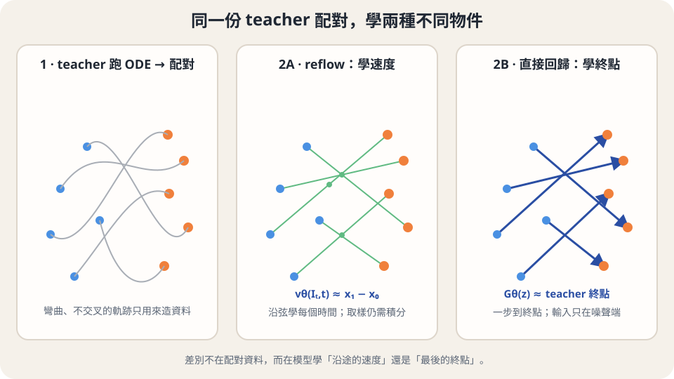

import Answer from '../../../components/Answer.astro';
import Ask from '../../../components/Ask.astro';
import Bridge from '../../../components/Bridge.astro';
import Explanation from '../../../components/Explanation.astro';
import Objectives from '../../../components/Objectives.astro';
import Option from '../../../components/Option.astro';
import Prereq from '../../../components/Prereq.astro';
import Question from '../../../components/Question.astro';
import QuizBlock from '../../../components/QuizBlock.astro';
import Ref from '../../../components/Ref.astro';
import Try from '../../../components/Try.astro';
import Remark from '../../../components/Remark.astro';

# 一步去噪，為什麼還不是一步生成？

<Objectives>
- **分清去噪估計與生成終點。** 用 Gaussian 例子算出 posterior mean 與 ODE flow map 的不同。
- **寫出直接蒸餾的目標。** 說明 deterministic teacher 如何提供逐點配對，以及資料成本與誤差從哪裡進來。
- **對齊本單元的時間方向。** 從 $x_t=x_0+t\epsilon$ 推出 PF-ODE，辨認 reference process 與 ODE trajectory。
</Objectives>

<Prereq items={frontmatter.prereqs} />

## 模型已經會去噪，為什麼還要呼叫很多次？

<Ref to="dma-tweedie-and-score"/> 已經告訴我們，denoiser 可以從 noisy image 猜乾淨圖片。如果最後只想得到一張圖片，最自然的想法就是：**從一團噪聲開始，請它直接去噪一次，不就好了？**

想像一張模糊到看不清楚的照片，同時可能來自幾張不同的原圖。若訓練要求平方誤差最小，最好的回答是這些原圖的條件平均。這是很好的「平均猜測」，卻未必像其中任何一張照片。生成時，我們想抽出一個合理結果；這和估計原圖的平均，是兩個不同的要求。

先把本單元的座標固定下來。沿用資料在 $t=0$ 的方向，從乾淨資料與獨立 Gaussian noise 合成

$$
x_t=x_0+t\epsilon,\qquad
x_0\sim p_{\mathrm{data}},\quad\epsilon\sim\mathcal N(0,I).
$$

$t$ 就是 noise 的標準差，$p_t$ 是這個合成結果的 marginal density。這裡的 $x_t$ 先表示 reference process 的 snapshot；我們還沒有說，一組固定的 $(x_0,\epsilon)$ 畫出的直線就是生成時會走的軌跡。

## 先用一個能算到底的例子比較

假設資料只有一維，而且 $x_0\sim\mathcal N(0,1)$。加噪後 $p_t=\mathcal N(0,1+t^2)$。Gaussian 的條件平均給出 denoiser

$$
D(x,t)=\mathbb E[x_0\mid x_t=x]=\frac{x}{1+t^2}.
$$

<Try summary="這個條件平均怎麼算？">
固定 $x_t=x$ 後，Bayes rule 讓 posterior 與 prior 乘 likelihood 成正比：

$$
p(x_0\mid x_t=x)\propto
\exp\left[-\frac{x_0^2}{2}-\frac{(x-x_0)^2}{2t^2}\right].
$$

把指數裡與 $x_0$ 有關的平方項配方，得到 Gaussian 的中心 $x/(1+t^2)$，variance 為 $t^2/(1+t^2)$。Gaussian 的中心也是平均，所以得到正文的 $D(x,t)$。這裡固定的是 noisy input，平均的是與它相容的乾淨資料。
</Try>

它把輸入往中心縮。如果真的從 $x_t\sim p_t$ 抽樣，再輸出 $D(x_t,t)$，輸出的變異數是多少？縮放一個隨機變數時，變異數要乘上係數的平方，因此

$$
\operatorname{Var}(D(x_t,t))
=\frac{1+t^2}{(1+t^2)^2}
=\frac{1}{1+t^2}.
$$

原本想要的是變異數 $1$ 的資料，結果卻越縮越集中。**denoiser 即使完全正確，一次去噪也不等於從資料分布抽樣。** 問題在它被要求估計什麼，不是網路還沒訓好。

<Ask>
那原本多步生成做的事情， 
能不能整個變成另一個網路的學習目標？
</Ask>

## 從一支方向，走到一個確定的終點

在這條加噪路徑下，<Ref to="dma-reverse-process"/> 的 probability-flow ODE 可以寫成

$$
\frac{\mathrm dx_t}{\mathrm dt}=v_t(x_t),\qquad
v_t(x)=-t\nabla_x\log p_t(x).
$$

$v_t$ 描述 $t$ 增加時的位置變化；生成時由 $T$ 往 $0$ 解同一條 ODE。Tweedie 公式還給出 $v_t(x)=\mathbb E[\epsilon\mid x_t=x]$：reference 直線的速度是單筆 $\epsilon$，ODE 使用的是經過當下位置的條件平均。兩者的 snapshots 可以有相同分布，單條路徑不必相同。

<Remark label="推導" summary="VE 座標的速度為什麼是 −t 乘 score？">
這個加噪 kernel 的變異數是 $t^2$，其變化率是 $2t$；相同 marginals 可由 forward SDE $\mathrm dx=\sqrt{2t}\,\mathrm dW_t$ 產生。將 drift $0$、diffusion coefficient 的平方 $2t$ 代入 PF-ODE 的 drift $\mu-\tfrac12g^2\nabla\log p_t$，便得到 $-t\nabla\log p_t$。

另一方面，對 Gaussian kernel 微分再取條件平均，得到 $\nabla\log p_t(x)=-\mathbb E[\epsilon\mid x_t=x]/t$。因此兩個速度表示一致；這不是把固定 noise 的直線當成 ODE trajectory。
</Remark>

給定目前的 $x$ 與時間 $t$，在 ODE 解存在且唯一的區域，走到 $0$ 的位置是確定的。我們把這個對應記成 $\psi_{t\to0}(x)$，也就是 **flow map**。以剛才的 Gaussian 為例，score 是 $-x/(1+t^2)$，所以 $v_t(x)=tx/(1+t^2)$；沿解微分可檢查 $x_t/\sqrt{1+t^2}$ 不變，於是

$$
\psi_{t\to0}(x)=\frac{x}{\sqrt{1+t^2}}.
$$

現在輸出變異數是 $(1+t^2)/(1+t^2)=1$，正好回到資料分布。它與 $D(x,t)=x/(1+t^2)$ 的分母不同。**ODE 的終點映射不是 posterior mean。** 這個差別會一路決定後面的訓練目標。

## 能不能用慢模型替快模型出題？

想像導航已經知道怎麼沿路開到目的地。我們可以讓它先走完，把「起點、最後到哪裡」記下來，再訓另一個網路直接回答終點。Luhman 與 Luhman 的直接蒸餾 [1] 就使用這種逐點監督。

令固定的 teacher 速度網路與指定 solver 合起來產生 $\operatorname{Solver}_{T\to0}(z)$。從起點分布抽 $z$，學生用

$$
\mathcal L_{\mathrm{KD}}(\theta)
=\mathbb E_z\left[
\left\|G_\theta(z)-\operatorname{Solver}_{T\to0}(z)\right\|^2
\right]
$$

學會 teacher 的數值終點。固定 teacher 與 deterministic solver 後，每個 $z$ 都有一個確定標籤；MSE 的條件平均就是那個標籤，不會因為資料本身有多個 modes 就自動把它們平均在一起。實作可先存配對，也可以在訓練時即時計算；兩種都要付出完整 teacher rollout 的成本。

<Question id="Q1">
既然學生不用積分，是否代表一步輸出已經沒有誤差？
<Answer>
沒有學生自己的逐步積分誤差，不代表沒有其他誤差。Teacher 的 learned field 可能已偏離理想 $v_t$；solver 只是近似 teacher ODE；學生又只是近似 solver 的輸出。將學生輸出與理想終點之間加上、減去這兩個中間量，再用 triangle inequality，就得到三者誤差之和的上界。

因此，一步學生可能很準，也可能把 teacher 的偏差完整學下來。「省掉生成時的積分」說的是計算方式，沒有宣告終點必然正確。
</Answer>
</Question>

## 同一份配對，也可以拿去重訓速度

<Ref to="dma-rectified-flow"/> 的 reflow 也會用舊 ODE 收集起點與終點。但拿到同一份配對後，兩種做法學的東西不同：

| 拿到配對後做什麼？ | 網路輸出 | 生成時怎麼用？ |
|---|---|---|
| Reflow：重新插值、回歸 reference velocity | 新的速度場 | 仍須積分 |
| 直接蒸餾：從起點回歸 teacher 終點 | 終點位置 | 一次求值 |

Reflow 改變 coupling 後得到的新 ODE，也不必保留舊 teacher 每個起點的終點對應；保留 marginal 與保留逐點 map 是不同要求。U3 的誤差上界說 velocity 變化較小有助控制積分誤差，**不能反過來說只要 acceleration 不為零，一步誤差就一定非零**；積分中的誤差也可能抵消。

*圖：配對來源可以相同，學習物件仍然不同。*

<Remark label="符號" summary="本單元的乾淨端與實作上的小正數">
本單元統一用 $t=0$ 表示資料、$t=T$ 表示高 noise；$v_t$ 是理想速度，$f_\theta$ 會用來表示終點映射。這與 U2–U3 的生成時間方向相反。數學上先寫到 $0$；實作若停在 $\varepsilon>0$，真正的 target 是 $p_\varepsilon$ 與 $\psi_{t\to\varepsilon}$，不能直接當成已精確到達 $p_{\mathrm{data}}$。同樣地，$\mathcal N(0,T^2I)$ 通常只是 $p_T$ 的近似。
</Remark>

<iframe loading="lazy" src="/personal_website/notes/research_areas/diffusion-models-applications/fast-maps-gaussian.html?topic=5-0" class="demo-frame" title="U5.0：解析 Gaussian 互動檢查" style="height: 900px; width: 100%; border: none;"></iframe>

**互動 demo：先用解析答案對照。** 每個數字由目前參數重新計算；實際訓練結果另見實作程式。

## 消化一下

<QuizBlock id="w8-0-a">
Gaussian 例子中，為什麼正確 denoiser 不能直接作為正確的一步生成器？
<Option>因為它還沒有訓練到收斂。</Option>
<Option correct>因為它輸出 posterior mean，輸出的變異數是 $1/(1+t^2)$，不是資料的變異數 $1$。</Option>
<Option>因為所有 deterministic map 都無法生成 Gaussian。</Option>
<Explanation>同一個 $p_t$ 經 $x/\sqrt{1+t^2}$ 就能得到正確資料分布；關鍵是 map 的定義。</Explanation>
</QuizBlock>

<QuizBlock id="w8-0-b">
Deterministic teacher 的終點標籤，給定起點後是什麼？
<Option correct>一個確定結果；MSE 在理想情況下回歸這個結果。</Option>
<Option>必須把所有 modes 的終點取平均。</Option>
<Option>一個與起點無關的資料平均。</Option>
<Explanation>資料分布多峰不代表這份起點到終點的監督配對多值。</Explanation>
</QuizBlock>

<QuizBlock id="w8-0-c">
直接蒸餾省下了哪一項？
<Option>所有訓練成本。</Option>
<Option>teacher 的模型誤差。</Option>
<Option correct>學生生成時反覆積分的成本；完整 teacher target 仍有取得成本。</Option>
<Explanation>計算可以由 sampling 移到 training，並沒有憑空消失。</Explanation>
</QuizBlock>

<Bridge to="dma-progressive-distillation">
一步生成需要學的是終點映射；慢模型可以提供配對，但每個完整終點都很貴。若先只要求學生一步抵達 teacher 兩步的地方，能不能逐漸把整趟生成壓短？<Ref to="dma-progressive-distillation"/> 從這個較小的任務開始。
</Bridge>

## 參考文獻

主要理論參考：[The Principles of Diffusion Models](https://arxiv.org/abs/2510.21890)，§10.1、§11.1；VE 座標另參照 §4.4 與附錄 D.6。正文的符號沿用本課程；方法實作細節再對照下列原始論文。

1. [Luhman & Luhman, Knowledge Distillation in Iterative Generative Models for Improved Sampling Speed (2021)](https://arxiv.org/abs/2101.02388)。
2. [Liu, Gong & Liu, Flow Straight and Fast: Learning to Generate and Transfer Data with Rectified Flow (ICLR 2023)](https://arxiv.org/abs/2209.03003)。
3. [Salimans & Ho, Progressive Distillation for Fast Sampling of Diffusion Models (ICLR 2022)](https://arxiv.org/abs/2202.00512)。
4. [Song, Dhariwal, Chen & Sutskever, Consistency Models (ICML 2023)](https://arxiv.org/abs/2303.01469)。
5. [Karras, Aittala, Aila & Laine, Elucidating the Design Space of Diffusion-Based Generative Models (NeurIPS 2022)](https://arxiv.org/abs/2206.00364)。
