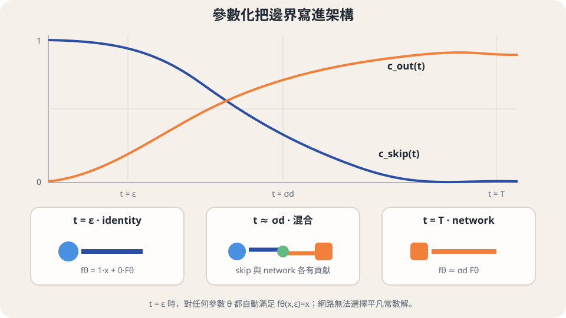

import Answer from '../../../components/Answer.astro';
import Bridge from '../../../components/Bridge.astro';
import Explanation from '../../../components/Explanation.astro';
import Objectives from '../../../components/Objectives.astro';
import Option from '../../../components/Option.astro';
import Prereq from '../../../components/Prereq.astro';
import Question from '../../../components/Question.astro';
import QuizBlock from '../../../components/QuizBlock.astro';
import Ref from '../../../components/Ref.astro';
import Remark from '../../../components/Remark.astro';

# 同一條路上的不同位置，能不能認出同一個終點？

<Objectives>
- **從終點定義 consistency function。** 用自我一致性與邊界條件說明它為何等於 ODE 的終點 map。
- **把邊界寫進參數化。** 檢查 skip 與 output 係數在乾淨端的值。
- **寫出相鄰點的監督問題。** 分清數學上的一致性、stop-gradient 與目標參數更新。
</Objectives>

<Prereq items={frontmatter.prereqs} />

## 沿路都會看到的共同答案

<Ref to="dma-progressive-distillation"/> 讓學生學指定網格上的大步。若我們不再要求「下一步走到哪裡」，而是每次都問「沿這條路最後到哪裡」，不同時間的任務就有了共同答案。

想像同一班車在不同站點報出它的總站。車還在移動，總站名稱卻不會跟著變；換到另一班車，總站才可能改變。這裡的車程對應一條 PF-ODE trajectory，站點是 $(x_t,t)$，我們要學的是它在乾淨端的實際位置。

在 ODE 解存在且唯一的設定下，定義

$$
f(x,t):=\psi_{t\to0}(x).
$$

這個函數接收目前位置與時間，回傳同一條 trajectory 在 $0$ 的終點。Song 等人 [1] 將它稱為 **consistency function**。它不是猜「哪張訓練圖片最可能產生這個 noisy input」；<Ref to="dma-learn-the-map"/> 的 Gaussian 例子已算出，終點 map 與 denoiser 是不同函數。

## 只要求兩個回答相同，會不會什麼也沒學到？

若 $x_t$ 與 $x_s$ 在同一條 ODE trajectory 上，兩者去乾淨端會抵達同一個位置，因此

$$
f(x_t,t)=f(x_s,s).
$$

這叫 self-consistency。但只看這條等式，令所有輸入都回傳常數 $c$ 也成立。我們還缺一個能把答案接到資料的位置：已經在乾淨端時，不必再移動，所以

$$
f(x,0)=x.
$$

兩條要求合起來才決定正確答案。從 $(x_t,t)$ 沿同一條路走到 $(x_0,0)$，一致性讓值不變，邊界條件再把它定成 $x_0$。這是沿每條 trajectory 的論證；不是說整個函數都應該是同一個常數。

<Question id="Q1">
如果我們把「同一個資料 $x_0$ 加上不同強度的同一份 noise」當作同一條路，是否已經得到上面需要的 training pair？
<Answer>
還沒有。$x_0+t\epsilon$ 是固定配對的 reference 直線，真正的 PF-ODE 使用 $\mathbb E[\epsilon\mid x_t]$，兩條路通常不同。同一條 reference 直線上的兩點不保證有相同的 ODE 終點。

這個區分不妨礙我們之後拿 reference pair 訓練，但必須再證明它如何近似所需的監督；不能用這裡的定義直接宣布兩點等價。<Ref to="dma-cd-vs-ct"/> 會把這個問題算出來。
</Answer>
</Question>

<iframe loading="lazy" src="/personal_website/notes/research_areas/diffusion-models-applications/fast-maps-gaussian.html?topic=5-2" class="demo-frame" title="U5.2：解析 Gaussian 互動檢查" style="height: 900px; width: 100%; border: none;"></iframe>

**互動 demo：解析 Gaussian 檢查。** 調整起始時間、區間與位置，直接計算本篇的關係；偏差控制是明示的 surrogate，沒有使用預設的品質曲線。

## 能不能讓邊界在訓練前就成立？

我們可以加一項 boundary loss，也可以直接把它寫進網路。後者的好處很具體：不必靠有限資料與有限權重，去近似一條已經知道的恆等式。令 $F_\theta$ 是一般網路，寫成

$$
f_\theta(x,t)=c_{\mathrm{skip}}(t)x
+c_{\mathrm{out}}(t)F_\theta(x,t).
$$

只要 $c_{\mathrm{skip}}(0)=1$、$c_{\mathrm{out}}(0)=0$，代入就得到 $f_\theta(x,0)=x$，與參數值無關。例如資料尺度為 $\sigma_d>0$ 時，可以用

$$
\begin{aligned}
c_{\mathrm{skip}}(t)&=\frac{\sigma_d^2}{t^2+\sigma_d^2},\\
c_{\mathrm{out}}(t)&=\frac{\sigma_dt}{\sqrt{t^2+\sigma_d^2}}.
\end{aligned}
$$

第一項保留輸入，第二項讓網路補上需要的終點資訊。這只是表示函數的方式；借用 EDM denoiser 的外形，不會讓 $f_\theta$ 的訓練目標自動變成 posterior mean。

<Remark label="實作" summary="若乾淨端取 ε，而不是 0">
將邊界改成 $f_\theta(x,\varepsilon)=x$，並選在 $\varepsilon$ 處為 $1$、$0$ 的兩個係數。例如原始 CM 以 $t-\varepsilon$ 調整 skip 與 output 係數的分子。這時網路學到 $\psi_{t\to\varepsilon}$；輸出 law 是 $p_\varepsilon$，仍與 $p_0$ 有一個小的終止差距。
</Remark>

*圖：原圖以 $\varepsilon$ 表示實作的乾淨端。邊界由係數保證，內部函數仍需訓練。*

## 找不到完整終點，先比較相鄰兩點可以嗎？

完整 target $\psi_{t\to0}(x_t)$ 很貴。可是同一條 trajectory 上，較近的兩點也應認出同一個終點。取網格 $0=t_0<t_1<\cdots<t_N=T$，令 $\hat x_{t_i}$ 近似從 $x_{t_{i+1}}$ 沿 ODE 回到 $t_i$ 的位置，考慮

$$
\begin{aligned}
\mathcal L(\theta;\theta^-)
&=\mathbb E\big[\lambda_i\,
\|f_\theta(x_{t_{i+1}},t_{i+1})\\
&\qquad-\operatorname{sg}(f_{\theta^-}(\hat x_{t_i},t_i))\|^2\big].
\end{aligned}
$$

期望平均資料、noise 與相鄰時間對；$\lambda_i$ 是正權重。現在完整終點不在標籤裡，取而代之的是 target network 在較乾淨位置的回答。**尚未解決的部分是：$\hat x_{t_i}$ 從哪裡來？**

先假設相鄰位置精確、同一個函數在所有相鄰對上都達到零差距。從邊界逐格使用等式，就能將 $f(x_{t_N},t_N)$ 一路等同到 $x_0$。這說明相鄰一致性在理想設定下為什麼足夠；實際 SGD 不會照時間格逐一完成這個歸納，也沒有「較乾淨一側早已正確」的保證。

$\operatorname{sg}$ 只改變反向傳播：這次更新將 target 的數值視為固定。$\theta^-$ 可以是當前參數的停止梯度副本，也可以是另一份滯後參數；是否使用 EMA 是額外選擇。Boundary、stop-gradient 與 EMA 各自做不同的事，不能合起來當成必然收斂的保證。

## 消化一下

<QuizBlock id="w8-2-a">
Consistency function 在哪裡保持常數？
<Option correct>沿同一條 ODE trajectory；不同 trajectories 可以有不同終點。</Option>
<Option>對所有位置與時間都是同一個值。</Option>
<Option>沿每條固定 noise 的 reference 直線。</Option>
<Explanation>函數的定義固定了 ODE 動力學，不能任意換成 reference path。</Explanation>
</QuizBlock>

<QuizBlock id="w8-2-b">
$f_\theta(x,0)=x$ 由哪一項保證？
<Option>目標網路使用 EMA。</Option>
<Option correct>skip 在 $0$ 為 $1$、output 係數在 $0$ 為 $0$。</Option>
<Option>loss 已下降到足夠小。</Option>
<Explanation>直接代入參數化即可檢查，與訓練進度無關。</Explanation>
</QuizBlock>

<QuizBlock id="w8-2-c">
相鄰一致性沿網格傳遞的論證，說明了什麼？
<Option>SGD 必定先學好低 noise 再學高 noise。</Option>
<Option>有限網格一定等於連續時間真值。</Option>
<Option correct>在精確配對、邊界成立且每對一致的理想條件下，所有格點的輸出等於共同終點。</Option>
<Explanation>函數的刻畫與訓練演算法是否收斂，是不同層級的問題。</Explanation>
</QuizBlock>

<Bridge to="dma-cd-vs-ct">
我們已把昂貴的完整終點換成相鄰位置的回答，但相鄰位置本身仍來自未知 ODE。<Ref to="dma-cd-vs-ct"/> 比較兩種取得方式：請 teacher 走一步，或直接沿資料與 noise 的 reference 配對重新合成。
</Bridge>

## 參考文獻

主要理論參考：[The Principles of Diffusion Models](https://arxiv.org/abs/2510.21890)，§11.2，特別是式 11.2.1–11.2.6 與附錄 D.6 的邊界參數化。正文的符號沿用本課程；方法實作細節再對照下列原始論文。

1. [Song, Dhariwal, Chen & Sutskever, Consistency Models (ICML 2023)](https://arxiv.org/abs/2303.01469)。
2. [Karras, Aittala, Aila & Laine, Elucidating the Design Space of Diffusion-Based Generative Models (NeurIPS 2022)](https://arxiv.org/abs/2206.00364)。
