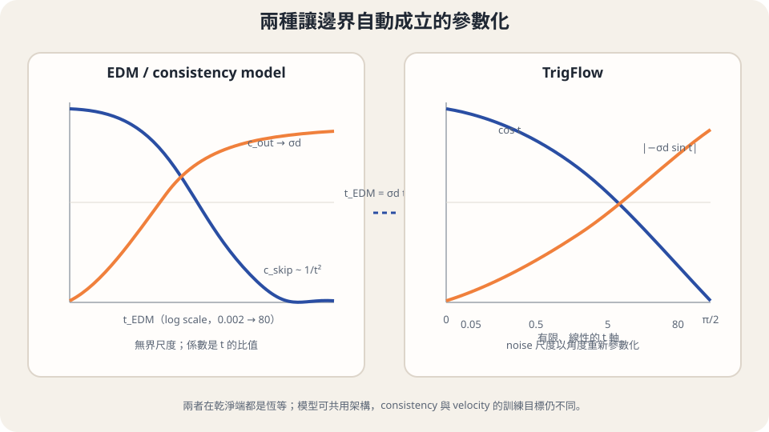

import Answer from '../../../components/Answer.astro';
import Bridge from '../../../components/Bridge.astro';
import Explanation from '../../../components/Explanation.astro';
import Objectives from '../../../components/Objectives.astro';
import Option from '../../../components/Option.astro';
import Prereq from '../../../components/Prereq.astro';
import Question from '../../../components/Question.astro';
import QuizBlock from '../../../components/QuizBlock.astro';
import Ref from '../../../components/Ref.astro';
import Remark from '../../../components/Remark.astro';

# 相鄰點越來越近，訓練該怎麼繼續？

<Objectives>
- **比較有限間隔與連續時間的要求。** 用 chain rule 展開沿 trajectory 的全導數。
- **推導停止梯度 loss 的小間隔更新。** 說明為何要比較縮放後的梯度，且不能直接把條件速度塞進 squared residual。
- **解釋穩定技巧改動了什麼。** 分開 target EMA、discrepancy、時間抽樣與 tangent 正規化。
</Objectives>

<Prereq items={frontmatter.prereqs} />

## 兩個回答幾乎一樣時，梯度還剩多少？

<Ref to="dma-cd-vs-ct"/> 把 finite-gap 近似控制在小間隔裡。可是 $h$ 越小，兩個相鄰回答也越接近；不能只說近似變準，就當作訓練一定更容易。這一篇先讓我們看見更新裡究竟剩下哪個量，再討論如何算它。

想像在車程中每隔一小段時間問一次總站。如果答案真的一致，沿車程的變化率應該是零。以位置與時間為輸入的 $f(x,t)$ 有兩種變化來源：時間本身改變，以及車子移到新的位置。由 chain rule，

$$
\frac{\mathrm d}{\mathrm dt}f(x_t,t)
=\partial_t f(x_t,t)+J_xf(x_t,t)v_t(x_t).
$$

第一項固定位置只改時間，第二項固定時間看位置沿 $v_t$ 移動的影響。$J_xf$ 是矩陣，乘 velocity 後得到與 $f$ 同維度的向量。**兩項相消，才是沿 trajectory 的答案不變。**

## 從離散 loss 推出該用的更新

固定 target 參數 $\theta^-$，先用精確相鄰點 $x_{t-h}$，並令

$$
L_h=\mathbb E\|f_\theta(x_t,t)-f_{\theta^-}(x_{t-h},t-h)\|^2.
$$

這裡暫時省略與 $h$ 無關的時間權重。要看 $h\to0$，先展開 target：

$$
\begin{aligned}
f_{\theta^-}(x_{t-h},t-h)
={}&f_{\theta^-}(x_t,t)\\
&-h\frac{\mathrm d}{\mathrm dt}f_{\theta^-}(x_t,t)+O(h^2).
\end{aligned}
$$

只讓線上輸出接受參數梯度，然後在比較點將兩份參數數值設成相同，零階差距便消失。因此

$$
\left.\frac{1}{h}\nabla_\theta L_h\right|_{\theta^-=\theta}
\longrightarrow
2\mathbb E\left[(J_\theta f_\theta)^\top
\frac{\mathrm d}{\mathrm dt}f_{\theta^-}(x_t,t)\right].
$$

$J_\theta f$ 把輸出空間的變化帶回參數空間。原始梯度會按 $h$ 縮小，所以要先除以 $h$ 才得到非零的比較極限；不能直接說「把間隔設為零」就有一個可用 loss。這個結果假設足夠光滑、可交換微分與期望，並在兩份參數數值相同的比較點成立。

右邊可由 pseudo-objective $2\mathbb E[f_\theta^\top\operatorname{sg}(\mathrm df_{\theta^-}/\mathrm dt)]$ 產生相同梯度。這裡關心的是更新方向，並沒有把這個內積當作非負誤差指標。

<Question id="Q1">
既然正確條件是 $\partial_tf+J_xfv_t=0$，我們能否直接用單筆 $\epsilon$ 代替 $v_t$，最小化 $\mathbb E\|\partial_tf_\theta+J_xf_\theta\epsilon\|^2$？
<Answer>
這個直接代換會改變目標。令 $\delta=\epsilon-v_t(x_t)$，給定 $x_t$ 時它是零均值。展開平方後交叉項消失，但仍多出 $\mathbb E\|J_xf_\theta\delta\|^2$；它依賴線上網路的 Jacobian，不能當成與參數無關的常數。

剛才的 stopped-gradient 更新不同：$\epsilon$ 線性地出現在固定 target 的 $\partial_tf_{\theta^-}+J_xf_{\theta^-}\epsilon$ 裡。取條件平均便恢復 $v_t$，而參數梯度只經過線上輸出。這才是 conditional trick 在連續時間更新裡可用的結構；「條件速度無偏」本身還不夠。
</Answer>
</Question>

## 用方向導數計算，而不是存整個矩陣

我們需要的是 $J_xf\,v+\partial_tf$，不是 $J_xf$ 的每個元素。把 $(x,t)$ 的擾動方向設成 $(v,1)$，一次 Jacobian–vector product（JVP）就能得到所需向量：

```python
_, tangent = torch.func.jvp(
    f, (x, t), (velocity, torch.ones_like(t))
)
```

`velocity` 可以是 teacher 的 $v_\phi$；從頭訓練時則用這筆配對的條件速度。後者的原始 stopped-gradient 更新在條件平均下精確相同，但單筆 tangent 仍有隨機性。JVP 省下完整 Jacobian 的儲存，不等於沒有額外計算成本。

<iframe loading="lazy" src="/personal_website/notes/research_areas/diffusion-models-applications/fast-maps-gaussian.html?topic=5-4" class="demo-frame" title="U5.4：解析 Gaussian 互動檢查" style="height: 1000px; width: 100%; border: none;"></iframe>

**互動 demo：解析 Gaussian 檢查。** 調整起始時間、區間與位置，直接計算本篇的關係；偏差控制是明示的 surrogate，沒有使用預設的品質曲線。

## iCT 先修改有限間隔的訓練問題

Song 與 Dhariwal 的 improved consistency training（iCT）[1] 仍使用相鄰點，但調整了 target、距離函數與抽時間的方法。它們各有具體作用，不必全塞進同一種「variance 技巧」裡。

**Target 使用當前參數的停止梯度副本。** 原始 CM 可用 EMA target；iCT 指出滯後 target 會影響 CT 的小間隔分析，於是去掉訓練 target 的 EMA。這不等於「任何 EMA 都有害」；另存 EMA 參數作評估，與用 EMA 產生本次 target 是兩個用途。上面的推導也讓我們看到為什麼比較點 $\theta^-=\theta$ 需要明寫。

**讓大殘差不必產生任意大的梯度。** 對向量殘差 $r$，pseudo-Huber discrepancy 是

$$
\begin{aligned}
d(r)&=\sqrt{\|r\|^2+c^2}-c,\\
\nabla_r d(r)&=\frac{r}{\sqrt{\|r\|^2+c^2}}.
\end{aligned}
$$

梯度 norm 不超過 $1$。小殘差時它近似平方，大殘差時增長接近線性；這是限制離群殘差影響的機制，不是讓 target noise 消失。

**重新配置時間與間隔。** iCT 使用隨間隔變化的 loss 權重、lognormal noise-level sampling，以及逐階增加網格點數的 curriculum。抽時間決定哪些區域常被看到，權重決定看見之後的貢獻；改變網格則改變相鄰 target 的距離。它們都會改變有效訓練分配，不能只由名稱判斷最終品質。

## sCM 再把有限差分換成 tangent

Lu 與 Song 的 sCM [2] 使用連續時間 consistency，並重新安排座標與數值尺度。這裡需要更換加噪座標，當場對照：改用角度 $t\in[0,\pi/2]$，

$$
x_t=\cos t\,x_0+\sin t\,z,\qquad
z\sim\mathcal N(0,\sigma_d^2I).
$$

乾淨端仍是 $0$，噪聲端變成 $\pi/2$；這裡的 $t$ 已不是 VE noise 標準差。將位置除以 $\cos t$ 後，noise 標準差為 $\sigma_d\tan t$，因此能和 VE 座標對照。單筆條件速度是 $-\sin t\,x_0+\cos t\,z$。

對應的終點參數化可寫成

$$
f_\theta(x,t)=\cos t\,x
-\sigma_d\sin t\,F_\theta(x/\sigma_d,t).
$$

$t=0$ 時自動回傳 $x$。沿一條路微分，用乘積法則得到

$$
\begin{aligned}
\frac{\mathrm df_\theta}{\mathrm dt}
={}&-\cos t\left(\sigma_dF_\theta-\dot x_t\right)\\
&-\sin t\left(x_t+\sigma_d\frac{\mathrm dF_\theta}{\mathrm dt}\right).
\end{aligned}
$$

這把不穩定的來源展開了：不只係數的尺度，還有網路沿時間與位置的導數。sCM 因而使用 tangent normalization、warmup、合適的時間 embedding 與自適應權重。它們是實際訓練設計；消除 finite-gap 近似，不會同時消除模型與優化誤差。

<Remark label="限制" summary="正規化 tangent 後，哪些等式要重新檢查？">
將每筆 tangent $g$ 換成 $g/(\|g\|+c)$，會限制它對更新的影響。但正規化是非線性的，通常 $\mathbb E[g/(\|g\|+c)]\ne\mathbb E[g]/(\|\mathbb E[g]\|+c)$。因此原始更新的條件無偏性，不能直接用來保證正規化後的 expected gradient 或最終解完全相同。這是穩定化策略與原始理論之間需要保留的界線。
</Remark>



*圖：兩種參數化都有明確邊界；三角時間把 noise 尺度換成有限角度區間。它不保證 ODE trajectory 變成等速直線。*

## 消化一下

<QuizBlock id="w8-4-a">
沿 trajectory 的 $\mathrm df/\mathrm dt$ 包含什麼？
<Option>只有 $\partial_tf$。</Option>
<Option correct>$\partial_tf+J_xf\,v_t$，因為時間與位置同時改變。</Option>
<Option>只有網路對參數的梯度。</Option>
<Explanation>對輸入的方向導數與對參數的更新梯度有不同角色。</Explanation>
</QuizBlock>

<QuizBlock id="w8-4-b">
為什麼不能把條件速度直接塞進 squared residual 就宣稱無偏？
<Option correct>展開後多出的 variance 項含線上網路的 Jacobian，會影響參數梯度。</Option>
<Option>因為 Gaussian noise 沒有期望。</Option>
<Option>因為 chain rule 在高維失效。</Option>
<Explanation>需要固定 target、並檢查條件量在更新裡如何出現。</Explanation>
</QuizBlock>

<QuizBlock id="w8-4-c">
連續時間 consistency 去掉了什麼？
<Option>所有 teacher 與模型誤差。</Option>
<Option>所有隨機梯度。</Option>
<Option correct>原本由有限相鄰間隔構造所引入的差分近似；仍有函數逼近與優化問題。</Option>
<Explanation>精確的微分條件不等於已精確學到解。</Explanation>
</QuizBlock>

<Bridge to="dma-multistep-limit">
我們已能更仔細地訓練「任何位置到共同終點」的函數。但它每次仍只回答終點。如果多呼叫幾次，是否就能像加密 ODE 步長那樣持續變準？<Ref to="dma-multistep-limit"/> 先檢查這個取樣程序到底保留了什麼。
</Bridge>

## 參考文獻

主要理論參考：[The Principles of Diffusion Models](https://arxiv.org/abs/2510.21890)，§11.3，特別是 Proposition 11.3.1、式 11.3.3–11.3.12；iCT 細節參照原始論文。正文的符號沿用本課程；方法實作細節再對照下列原始論文。

1. [Song & Dhariwal, Improved Techniques for Training Consistency Models (ICLR 2024)](https://arxiv.org/abs/2310.14189)。
2. [Lu & Song, Simplifying, Stabilizing and Scaling Continuous-Time Consistency Models (2024)](https://arxiv.org/abs/2410.11081)。
3. [Song, Dhariwal, Chen & Sutskever, Consistency Models (ICML 2023)](https://arxiv.org/abs/2303.01469)。
4. [Karras, Aittala, Aila & Laine, Elucidating the Design Space of Diffusion-Based Generative Models (NeurIPS 2022)](https://arxiv.org/abs/2206.00364)。
