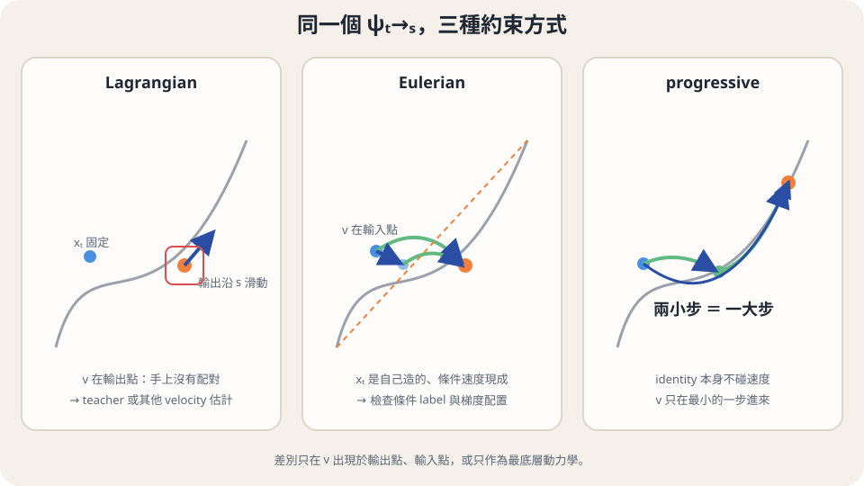

import Answer from '../../../components/Answer.astro';
import Bridge from '../../../components/Bridge.astro';
import Explanation from '../../../components/Explanation.astro';
import Objectives from '../../../components/Objectives.astro';
import Option from '../../../components/Option.astro';
import Prereq from '../../../components/Prereq.astro';
import Question from '../../../components/Question.astro';
import QuizBlock from '../../../components/QuizBlock.astro';
import Ref from '../../../components/Ref.astro';
import Remark from '../../../components/Remark.astro';

# 改變出發時間或抵達時間，終點會怎麼變？

<Objectives>
- **推導兩種時間微分。** 分清固定起點移動終點，與沿軌跡移動起點但固定目的時間。
- **從合成規則構造監督。** 解釋只靠自我一致為何不足以選定資料動力學。
- **檢查可用資訊。** 區分輸入點的配對速度與模型輸出點所需的 velocity evaluation。
</Objectives>

<Prereq items={frontmatter.prereqs} />

## 同一條路，可以從哪裡微分？

<Ref to="dma-flow-map"/> 已用 teacher 短段與合成規則訓練任意 $t\to s$。但完整 flow map 不只知道落點，也知道落點隨時間怎麼變。現在的問題是：**能否將這些變化直接寫成學習訊號，減少取得完整 trajectory target 的成本？**

沿用 $0$ 為噪聲、$1$ 為資料，$\dot x_t=v_t(x_t)$。想像同一段車程：固定出發站，改問不同抵達時間的位置；或固定目的時間，換到同一路線較晚的站點出發。前者的答案會移動，後者的答案應保持不變。下面各自把動作翻成微分。

## 固定出發點，讓目的時間往前走

從 $(x,t)$ 出發，$\psi_{t\to s}(x)$ 就是 $s$ 時的 trajectory 位置。對 $s$ 微分，其變化率就是終點所在位置的速度：

$$
\partial_s\psi_{t\to s}(x)
=v_s\big(\psi_{t\to s}(x)\big).
$$

左邊是 flow map 對目的時間的偏導，右邊在**輸出位置**查 velocity。這是追蹤粒子的 Lagrangian 關係。若有能在任意位置求值的 velocity teacher，就能把兩側差距寫成

$$
\mathcal L_{\mathrm{Lag}}
=\mathbb E\left[
\|\partial_sG_\theta(x_t,t\to s)
-v_\phi(G_\theta(x_t,t\to s),s)\|^2\right].
$$

這是一個具體的 teacher-based residual。Teacher 在這裡提供輸出點的局部方向，而不是先跑完整長段生成一筆終點標籤。

## 沿路換一個出發點，但目的時間固定

現在固定 $s$，讓 $x_t$ 沿同一條 ODE 移動。無論從這條路哪個站點出發，走到 $s$ 都到達同一位置，所以

$$
\frac{\mathrm d}{\mathrm dt}\psi_{t\to s}(x_t)=0.
$$

將全導數用 chain rule 展開，就得到 Eulerian 關係：

$$
\partial_t\psi_{t\to s}(x_t)
+J_x\psi_{t\to s}(x_t)v_t(x_t)=0.
$$

兩項分別是改變出發時間、改變出發位置帶來的影響。這次 velocity 在**輸入位置** $x_t$。若輸入由 $I_t=(1-t)X_0+tX_1$ 抽出，我們手上就有它的 reference label $X_1-X_0$，其條件平均是 $v_t(x_t)$。

<Remark label="小心" summary="輸出位置也可能在 support 裡，為什麼仍不能直接用原配對？">
問題不是「沒有任何 reference path 經過輸出位置」。真正缺的是：原本那份 $(X_0,X_1)$ 在給定模型輸出位置後，不一定具有正確的 posterior law。只有在自己合成的輸入 $I_t$，這筆配對才直接給出所需的條件速度估計。若另有解析 velocity、能正確抽取輸出點 posterior 的方法，或另訓局部模型，仍可能在輸出點取到速度；所以這不是「Lagrangian 在定義上必須有 pretrained teacher」的定理。
</Remark>

## 條件速度無偏，還要看它放在 loss 的哪裡

先令 $\tilde v=X_1-X_0$，$\delta=\tilde v-v_t(x_t)$，則 $\mathbb E[\delta\mid x_t]=0$。如果直接最小化

$$
\mathbb E\|\partial_tG_\theta+J_xG_\theta\tilde v\|^2,
$$

展開後會得到 oracle Eulerian squared residual，另加 $\mathbb E\|J_xG_\theta\delta\|^2$。額外項依賴線上 Jacobian，會改變學習問題。這與普通 FM 回歸不同：FM 的 random label 在固定輸入下的 variance 不含線上參數。

因此，想沿輸入點的條件速度從頭訓練，還需要像 <Ref to="dma-ict-scm"/> 那樣，把含 velocity 的線性項放在固定的 stopped-gradient target 或更新裡。下一篇會用另一個輸出座標，把這個構造完整寫出來。

<Question id="Q1">
Lagrangian 與 Eulerian 都是精確 flow 的關係。為什麼不能只看公式相同，就說它們有相同的從頭訓練方式？
<Answer>
因為公式需要的資訊不同。Lagrangian 在模型輸出位置要 $v_s$，Eulerian 在自己抽出的輸入位置要 $v_t$；reference 配對只直接提供後者的條件 label。而且「能估計 velocity」之後，還要檢查 discrepancy、微分與 stop-gradient 的配置，才能判斷代換是否保留 expected update。

所以我們依序問：要哪個位置的速度？手上怎麼取得它？把估計量代進去後，梯度是否仍是想要的那個？每一問都不能省。
</Answer>
</Question>

## 不微分，直接要求兩段等於一段

還有 <Ref to="dma-flow-map"/> 的合成規則：

$$
\psi_{t\to s}(x)
=\psi_{u\to s}\big(\psi_{t\to u}(x)\big).
$$

可以用兩個短跳的停止梯度結果監督一個長跳，這類構造稱為 progressive matching。式子不顯式出現 $v_t$，但不代表可以不提供動力學。所有 maps 都原地不動時，也滿足這條式子；teacher 短段或資料的局部 FM loss，才將它接回我們指定的 transport。

這三種描述在書 §11.6 並排整理，Flow Map Matching [1] 也用它們組織學習目標。它們刻畫同一個精確 flow，不代表實作 loss、所需資源與優化軌跡相同。

*圖：比較時先看 velocity 在哪個位置求值，再檢查如何取得訓練訊號。圖中 teacher 欄指本課程討論的常用蒸餾設定。*

| 動作 | 精確關係 | 直接需要的訊號 |
|---|---|---|
| 移動目的時間 | $\partial_s\psi=v_s(\psi)$ | 輸出點的 velocity |
| 沿路移動出發點 | $\partial_t\psi+J_x\psi\,v_t=0$ | 輸入點的 velocity |
| 切成兩段 | $\psi_{t\to s}=\psi_{u\to s}\circ\psi_{t\to u}$ | 中間 map 與局部動力學錨定 |

<iframe loading="lazy" src="/personal_website/notes/research_areas/diffusion-models-applications/fast-maps-gaussian.html?topic=6-1" class="demo-frame" title="U6.1：解析 Gaussian 互動檢查" style="height: 900px; width: 100%; border: none;"></iframe>

**互動 demo：先用解析答案對照。** 每個數字由目前參數重新計算；實際訓練結果另見實作程式。

## 消化一下

<QuizBlock id="w9-1-a">
固定目的時間、沿同一條路移動出發點時，為什麼全導數為零？
<Option correct>因為最後到達的是該路線在同一個目的時間的同一位置。</Option>
<Option>因為 velocity 本身為零。</Option>
<Option>因為所有 flow maps 都是常數函數。</Option>
<Explanation>不變的是沿指定 trajectory 的答案，不是輸出對所有空間輸入都不變。</Explanation>
</QuizBlock>

<QuizBlock id="w9-1-b">
原本抽出的 reference label 可以直接代替輸出點的 velocity 嗎？
<Option>可以，只要輸出點在 support 裡。</Option>
<Option correct>一般不行，原配對不是給定輸出位置後的正確 posterior sample。</Option>
<Option>不行，因為空間中沒有 reference paths。</Option>
<Explanation>限制來自已知配對的條件 law，不是路徑不存在。</Explanation>
</QuizBlock>

<QuizBlock id="w9-1-c">
只用兩段等於一段的自我 loss，還缺什麼？
<Option>另一個名字。</Option>
<Option>更多隨機中途時間就足夠。</Option>
<Option correct>能指定正確局部動力學的 teacher 或資料監督。</Option>
<Explanation>合成規則無法單獨選出我們想要的 ODE。</Explanation>
</QuizBlock>

<Bridge to="dma-meanflow">
輸入點的 velocity 有可計算的條件 label，但直接對位置 map 寫 loss 仍要安排邊界與停止梯度。能不能把「終點位置」換成「這一段的平均速度」，讓這些關係更自然？<Ref to="dma-meanflow"/> 從位移除以時間開始。
</Bridge>

## 參考文獻

主要理論參考：[The Principles of Diffusion Models](https://arxiv.org/abs/2510.21890)，§11.6 的 Lagrangian、Eulerian 與 semigroup views；相關方法細節參照 Flow Map Matching。正文的符號沿用本課程；方法實作細節再對照下列原始論文。

1. [Boffi, Albergo & Vanden-Eijnden, Flow Map Matching (2024)](https://arxiv.org/abs/2406.07507)。
2. [Salimans & Ho, Progressive Distillation for Fast Sampling of Diffusion Models (ICLR 2022)](https://arxiv.org/abs/2202.00512)。
3. [Song, Dhariwal, Chen & Sutskever, Consistency Models (ICML 2023)](https://arxiv.org/abs/2303.01469)。
4. [Kim et al., Consistency Trajectory Models (ICLR 2024)](https://arxiv.org/abs/2310.02279)。
