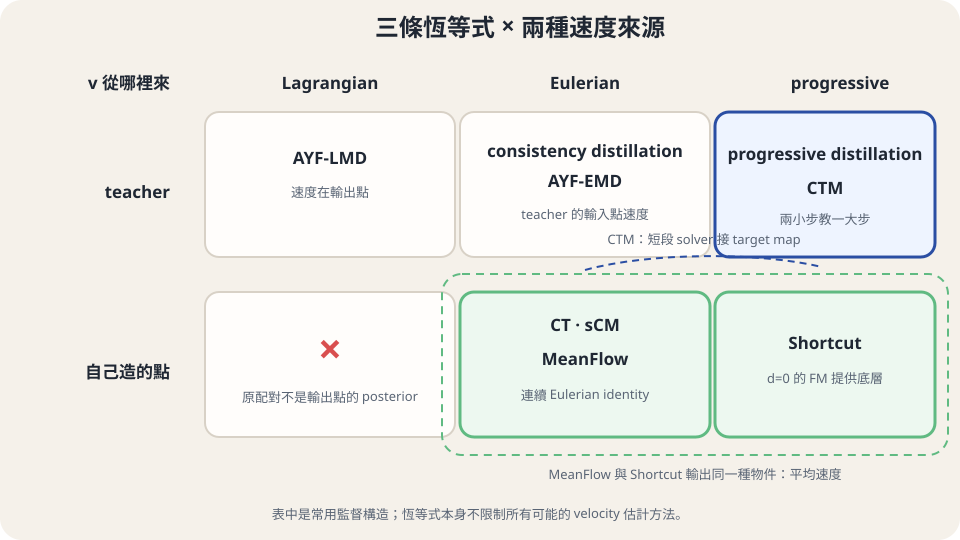

import Answer from '../../../components/Answer.astro';
import Bridge from '../../../components/Bridge.astro';
import Details from '../../../components/Details.astro';
import Explanation from '../../../components/Explanation.astro';
import Objectives from '../../../components/Objectives.astro';
import Option from '../../../components/Option.astro';
import Prereq from '../../../components/Prereq.astro';
import Question from '../../../components/Question.astro';
import QuizBlock from '../../../components/QuizBlock.astro';
import Ref from '../../../components/Ref.astro';

# 不算導數，能不能用兩個小跳教一個大跳？

<Objectives>
- **由位移合成推出 Shortcut target。** 解釋兩個小步平均的係數從哪裡來。
- **說明短步 supervision 的作用。** 分清自我合成與資料決定的局部 velocity。
- **比較導數與合成的代價。** 區分 MeanFlow、Shortcut 與 teacher-based flow-map distillation。
</Objectives>

<Prereq items={frontmatter.prereqs} />

## 長跳的答案，能不能由短跳湊出來？

<Ref to="dma-meanflow"/> 用導數關係學整段平均速度。但計算 JVP 需要自動微分支援，也要處理 tangent 的數值尺度。若我們只想用網路求值，最自然的動作就是：先走兩小段，把兩段位移加起來，教模型一次跳到同一個地方。

這延續 <Ref to="dma-progressive-distillation"/> 的兩步合一。不過這次我們不另外訓一輪輪新模型，而是把「想跳多長」直接交給同一個網路。Frans 等人的 **Shortcut model** [1] 就使用這種步長條件化的輸出。

## 先加位移，再除以總時間

沿用 $t=0$ 噪聲、$t=1$ 資料。令 $s_\theta(x,t,d)$ 輸出從 $t$ 往前 $d$ 的平均速度，落點是 $x+d\,s_\theta(x,t,d)$。這裡 $s_\theta$ 是 Shortcut 的函數名，不是 score；本篇的 $d\ge0$ 是時間間隔。

先走兩段相同長度 $d$，精確 maps 的第一段落點記成 $x'$。總位移應滿足

$$
2d\,s(x,t,2d)
=d\,s(x,t,d)+d\,s(x',t+d,d).
$$

左邊是一次長跳，右邊是兩段位移相加。當 $d>0$，兩邊除以 $2d$：

$$
s(x,t,2d)=\frac12\left[
s(x,t,d)+s(x',t+d,d)\right].
$$

$1/2$ 來自兩段時間相同。若兩段時間不同，就要按各自時間比例加權，不能仍直接取算術平均。

訓練時沒有精確短跳，改用停止梯度的模型算出 $x'$ 與右側，監督線上的長跳：

$$
\begin{aligned}
x'&=x+d\,s_{\theta^-}(x,t,d),\\
y^-&=\tfrac12\big[s_{\theta^-}(x,t,d)
+s_{\theta^-}(x',t+d,d)\big],\\
\mathcal L_{\mathrm{long}}
&=\mathbb E\|s_\theta(x,t,2d)-\operatorname{sg}(y^-)\|^2.
\end{aligned}
$$

抽取時間時須確保 $t+2d\le1$。兩次短跳的輸入位置不同，第二次必須用 $x'$，不能只把時間改成 $t+d$、位置仍留在 $x$。

## 若短跳還沒學好，長跳在跟誰學？

這個 self-target 仍需要資料的方向。令步長縮到零，平均速度應回到 instantaneous velocity，因此以 $I_t=(1-t)X_0+tX_1$ 訓練

$$
\mathcal L_{\mathrm{local}}
=\mathbb E\|s_\theta(I_t,t,0)-(X_1-X_0)\|^2.
$$

它就是 ordinary flow matching。$d=0$ 時 sampling 位移為零，但輸出的極限 velocity 不為零；這個 local label 指定我們要學的動力學。訓練混合 local 與有限 $d$ 的合成樣本，讓同一網路把小尺度規則延伸到較大的跳躍。

<Question id="Q1">
如果只用長跳 self-consistency，資料不用進來，是否也能把 loss 訓到很小？
<Answer>
可以。令所有 $s_\theta$ 都輸出零，兩個小跳與一個大跳都原地不動，長跳 loss 就是零。但它沒有把 noise 送向資料。局部 FM supervision 的作用是排除這種與資料動力學無關的解，不只是「幫訓練加速」。

另一方面，使用 local label 也不保證長跳一定精確。短跳的位置偏差會進入第二次求值，target network 本身又在更新；這些都需要訓練與評估來檢查。
</Answer>
</Question>

<iframe loading="lazy" src="/personal_website/notes/research_areas/diffusion-models-applications/fast-maps-gaussian.html?topic=6-3" class="demo-frame" title="U6.3：解析 Gaussian 互動檢查" style="height: 1000px; width: 100%; border: none;"></iframe>

**互動 demo：解析 Gaussian 檢查。** 調整起始時間、區間與位置，直接計算本篇的關係；偏差控制是明示的 surrogate，沒有使用預設的品質曲線。

## 與 MeanFlow 比較的，是訓練訊號

兩者都能用平均速度表示 flow map，也都可以從資料提供局部動力學。但 MeanFlow 用導數 identity 建立自我 target；Shortcut 用兩個短段的實際模型輸出建立 target。

| 問題 | MeanFlow | Shortcut |
|---|---|---|
| 長段 target 怎麼來？ | 當下 velocity 與平均速度的導數 | 模型的兩個短跳合成 |
| 額外操作 | JVP 與 stopped-gradient tangent | 短跳網路求值與位置合成 |
| 資料從哪裡進來？ | Target 的條件 velocity，另可混合對角線 FM | $d=0$ 的 FM supervision |
| 要檢查什麼？ | derivative target 的穩定性與近似 | 短跳誤差、self-target 與步長泛化 |

兩者都有 bootstrapping，不能說 MeanFlow 已經完全換掉自我目標。Shortcut 常選二進位步長訓練；實際取樣要檢查所用步長是否在訓練範圍。也不能僅由有多少級，就宣稱總誤差一定按 $\log_2$ 倍率放大；那還需要各級近似與 map 穩定性的假設。

## 若有 teacher，還能直接約束兩種時間變化

書 §11.6 把精確 flow 的 Lagrangian、Eulerian 與合成三種關係並排。若有固定 velocity teacher，就能在輸入點與模型輸出點都查方向，建立連續時間的 flow-map distillation。Sabour 等人的 **Align Your Flow（AYF）** [2] 是這條路的代表，討論 Eulerian 與 Lagrangian matching。

它與從頭訓練的主要差別在訊號來源：teacher 可以在模型移動到的位置提供 velocity，不需要把原輸入的 reference label 誤用到輸出位置。實際訓練仍要安排參數化、梯度停止與 tangent 尺度；這裡不把單一 residual 當成完整重現 AYF 的 recipe。

三者都會用較短 transition 監督較長 transition。PD 的 teacher 是前一輪模型，對指定網格逐輪減半；CTM 把起訖時間放進模型，用短 solver 段加上 target map；Shortcut 在同一網路裡以步長條件化短跳與長跳。它們共享合成的想法，但 training distribution、target 來源與參數更新不同，不是同一個演算法換名字。

*圖：方法的輸出形式與監督來源要分開比較；圖中「不需 teacher」指相應的從頭訓練構造。*

## 消化一下

<QuizBlock id="w9-3-a">
兩個等長短跳的 $1/2$ 係數來自哪裡？
<Option>為了防止梯度太大而任選。</Option>
<Option correct>兩段位移相加後，除以總時間 $2d$。</Option>
<Option>Gaussian 的對稱性。</Option>
<Explanation>它是時間比例，不是資料分布的性質。</Explanation>
</QuizBlock>

<QuizBlock id="w9-3-b">
第二個短跳應在哪個位置求值？
<Option correct>第一個短跳得到的新位置 $x'$。</Option>
<Option>仍在原始 $x$。</Option>
<Option>乾淨資料的平均。</Option>
<Explanation>合成要接續位置；只改時間不移動位置，已經不是同一個 transition。</Explanation>
</QuizBlock>

<QuizBlock id="w9-3-c">
MeanFlow 與 Shortcut 是否都使用 self-target？
<Option>只有 Shortcut。</Option>
<Option>只有 MeanFlow。</Option>
<Option correct>都有；一個使用模型導數，一個使用模型短跳結果。</Option>
<Explanation>兩種方式各自有近似與優化代價。</Explanation>
</QuizBlock>

<Bridge to="dma-distribution-matching">
這些方法都希望學生對準指定 flow 的位置或平均速度。但生成任務是否一定要保留這一份逐點對應？若只要求整體輸出分布正確，能不能建立另一種監督？<Ref to="dma-distribution-matching"/> 改從這個較弱的要求出發。
</Bridge>

## 參考文獻

主要理論參考：[The Principles of Diffusion Models](https://arxiv.org/abs/2510.21890)，§10.3、§11.4 與 §11.6 的合成觀點；Shortcut 與 AYF 的方法細節參照原始論文。正文的符號沿用本課程；方法實作細節再對照下列原始論文。

1. [Frans, Hafner, Levine & Abbeel, One Step Diffusion via Shortcut Models (ICLR 2025)](https://arxiv.org/abs/2410.12557)。
2. [Sabour, Fidler & Kreis, Align Your Flow: Scaling Continuous-Time Flow Map Distillation (2025)](https://arxiv.org/abs/2506.14603)。
3. [Kim et al., Consistency Trajectory Models (ICLR 2024)](https://arxiv.org/abs/2310.02279)。
4. [Geng, Deng, Bai, Kolter & He, Mean Flows for One-step Generative Modeling (2025)](https://arxiv.org/abs/2505.13447)。
5. [Boffi, Albergo & Vanden-Eijnden, Flow Map Matching (2024)](https://arxiv.org/abs/2406.07507)。
