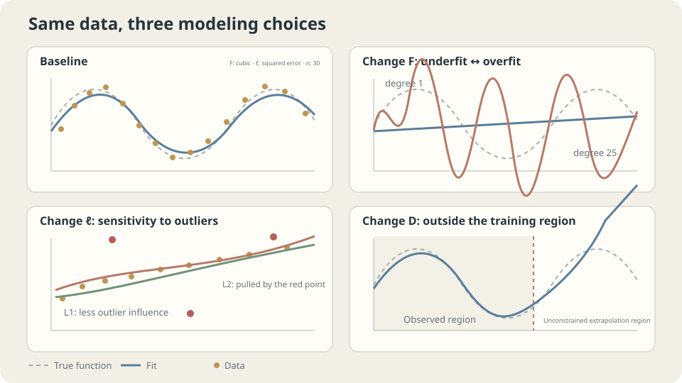

import Objectives from '../../../components/Objectives.astro';
import Ask from '../../../components/Ask.astro';
import Prereq from '../../../components/Prereq.astro';
import Question from '../../../components/Question.astro';
import Answer from '../../../components/Answer.astro';
import QuizBlock from '../../../components/QuizBlock.astro';
import Option from '../../../components/Option.astro';
import Explanation from '../../../components/Explanation.astro';
import VizPlan from '../../../components/VizPlan.astro';
import Remark from '../../../components/Remark.astro';
import Bridge from '../../../components/Bridge.astro';
import UsedBy from '../../../components/UsedBy.astro';
import Ref from '../../../components/Ref.astro';

# How an Agent Prices a House: Learning Rules from Examples

<Objectives title="After reading, you can">
- Separate hypothesis space, loss, and data, explaining what each choice changes.
- Write empirical risk minimization and distinguish approximation, estimation, and irreducible errors.
- Test when lower training error helps and when it misleads using the shared toy dataset.
</Objectives>

<Prereq items={frontmatter.prereqs} />

## Why can an experienced agent estimate a price?

An experienced property agent has seen hundreds of sales. After three minutes in an unfamiliar house, the agent estimates 28.5 million; three weeks later it sells for 29.1 million.

This is not memorization: the house is new to the agent. The agent may not articulate a formula, yet past examples inform the estimate.

**To turn that ability into a program, what must we specify? What does “accurate” mean, and how accurate is enough?**

“Fit a function to sales data” leaves three choices unresolved: which functions are allowed, how mistakes are penalized, and which transactions provide the examples.

We will formalize these choices and compare predictions on observed and unseen locations using one toy dataset. **Does answering familiar examples correctly mean the rule works on new houses?**

> **Low training error is a measurement, not a conclusion.**

<Ask>
What must we specify to learn from examples?<br />
Which number represents successful prediction?<br />
Is it the number we can directly compute?
</Ask>

<Question label="Discussion" id="Q1">
Which three objects define this learning problem, and what does learning optimize?

<Answer summary="Show the reasoning">
The familiar answer, “minimize $\sum_i(f(x_i)-y_i)^2$,” hides three choices and risks confusing an observable score with the actual objective.

**Specify three components:**

1. **Hypothesis space** $\mathcal F$: the candidate rules, such as lines, bounded-degree polynomials, or neural networks.
2. **Loss** $\ell(\hat y,y)$: the penalty for one prediction error. The relative cost of errors is a choice, not a natural constant.
3. **Data** $D=\{(x_i,y_i)\}_{i=1}^n$: the observed examples, conventionally assumed iid from a joint law $p(x,y)$.

**Learning optimizes a rule.** Choose the member of $\mathcal F$ with the smallest average observed loss:

$$
\hat f=\arg\min_{f\in\mathcal F}\ \frac1n\sum_{i=1}^n \ell(f(x_i),y_i).
$$

But success means predicting the **next** house: $R(f)=\mathbb E[\ell(f(X),Y)]$ over a fresh pair. We compute a sample average and want a population expectation to be small. Understanding their gap is central to this series.
</Answer>
</Question>

## Three choices with different roles

These components can be adjusted independently:

- **Hypothesis space:** too restrictive a family cannot express the pattern; an unconstrained family can memorize observed points and behave arbitrarily elsewhere.
- **Loss:** changing penalties can change the optimal answer on the same data. <Ref to="math-mse-conditional-expectation" mode="title"/> shows that squared loss targets a conditional mean, while absolute loss targets a median.
- **Data:** too few examples or examples unlike future inputs can undermine otherwise appropriate modeling choices.

“Poor model” is not yet a diagnosis. Capacity, data, loss, regularization, and algorithm interact; a larger model can also improve results when its structure is appropriate.



*Different failures can leave different patterns. A disappointing score alone does not identify the cause.*

## The number we compute and the number we want small

Fix the loss and population law. Define **population risk** and **empirical risk** as

$$
R(f)=\mathbb E_{(X,Y)\sim p}\big[\ell(f(X),Y)\big],
\qquad
\widehat R_n(f)=\frac1n\sum_{i=1}^n \ell(f(x_i),y_i).
$$

**ERM** chooses $\hat f=\arg\min_{f\in\mathcal F}\widehat R_n(f)$. Let $f^\star$ be the best unrestricted rule and $f^\dagger=\arg\min_{f\in\mathcal F}R(f)$ the best rule within the hypothesis space:

$$
\underbrace{R(\hat f)-R(f^\star)}_{\text{excess risk}}
=\underbrace{R(\hat f)-R(f^\dagger)}_{\text{estimation error}}
+\underbrace{R(f^\dagger)-R(f^\star)}_{\text{approximation error}}.
$$

Adding $R(f^\star)$ recovers total risk. This assumes exact ERM; incomplete optimization introduces another issue. Enlarging a nested hypothesis space cannot increase approximation error, but estimation error need not increase monotonically: algorithm, regularization, and data structure matter.

For squared loss, <Ref to="math-mse-conditional-expectation"/> gives $f^\star(x)=\mathbb E[Y\mid X=x]$. The irreducible risk is $\mathbb E[\operatorname{Var}(Y\mid X)]$.

> **Under squared loss, learning estimates the conditional-mean function.**

<Remark label="Caution" summary="Why not allow every function?">
With all functions allowed, a rule can return $y_i$ at each observed $x_i$ and arbitrary values elsewhere. It has zero training loss without useful population predictions. High-degree interpolation below illustrates the danger, although floating-point conditioning can prevent exact interpolation.

Generalization needs an **inductive bias**: restrictions or preferences supplied by the hypothesis space, regularization, or algorithm. Statistical learning theory analyzes such preferences through complexity and other tools [1,2]. We first develop judgment using training and validation evidence.
</Remark>

## Identify the agent's three components

**Hypothesis space:** comparable sales adjusted for area, floor, age, and orientation form a restricted family. Such prior structure can make hundreds of examples useful.

**Loss:** if underpricing hurts a seller much more than overpricing, the appropriate estimate may be an upper conditional quantile rather than the mean. The next note formalizes that asymmetry.

**Data:** experience in one district and period may not transfer to another city, year, or property type. This breaks the same-distribution assumption; see <Ref to="ml-empirical-risk" mode="title"/>.

The standard setup assumes iid examples from the test population, unpredictable residual variation conditional on available features, and a loss representing the actual goal. Missing features, distribution shift, or a convenient but inappropriate loss each require a different response.

## A shared toy dataset

The series uses shared examples so fitting, splits, optimization, and architectures can be compared consistently. Save this as `ml_toy.py`:

```python
import numpy as np
NOISE = 0.15

def toy_1d(n=30, noise=NOISE, seed=0):
    rng = np.random.default_rng(seed)
    x = np.sort(rng.uniform(0, 1, n))
    return x, np.sin(2*np.pi*x) + noise*rng.standard_normal(n)

def truth(m=400):
    x = np.linspace(0, 1, m)
    return x, np.sin(2*np.pi*x)

def toy_2d(n=200, noise=0.20, seed=0):
    # Use even n: two interleaving moons for binary classification.
    rng = np.random.default_rng(seed)
    t = rng.uniform(0, np.pi, n//2)
    X = np.r_[np.c_[np.cos(t), np.sin(t)], np.c_[1-np.cos(t), 0.4-np.sin(t)]]
    X = X + noise*rng.standard_normal((n, 2))
    return X, np.r_[np.zeros(n//2), np.ones(n//2)].astype(int)
```

The conditional mean is $\sin(2\pi x)$ and Gaussian noise has standard deviation $0.15$. Thus irreducible population MSE is $0.15^2=0.0225$, a reference line for subsequent examples.

Perform ERM over polynomials of degree at most $d$, using squared loss and the thirty observed points:

```python
import numpy as np
from numpy.polynomial import Polynomial
from ml_toy import toy_1d, truth, NOISE
x, y = toy_1d()
xs, ys = truth()
for d in (1, 3, 9, 25):
    f = Polynomial.fit(x, y, d)  # Scales the fitting domain internally.
    print(f"degree {d:2d}  empirical risk {((f(x)-y)**2).mean():.4f}"
          f"   population risk ≈ {((f(xs)-ys)**2).mean() + NOISE**2:.4f}")
```

```
degree  1  empirical risk 0.2118   population risk ≈ 0.2679
degree  3  empirical risk 0.0178   population risk ≈ 0.0312
degree  9  empirical risk 0.0122   population risk ≈ 0.0285
degree 25  empirical risk 0.0016   population risk ≈ 8032.3199
```

Training error decreases while estimated population risk first improves and then explodes. A line has high approximation error; intermediate degrees approach the noise floor. Degree 25 fits much of the observed noise yet behaves badly between points. Training MSE below the noise variance is a warning to investigate, not sufficient proof by itself.

Push the degree to the interpolation threshold:

```python
f = Polynomial.fit(x, y, len(x)-1)
print(f"degree 29  empirical risk {((f(x)-y)**2).mean():.2e}"
      f"   population risk ≈ {((f(xs)-ys)**2).mean()+NOISE**2:.2e}")
# A representative run gives a tiny training residual and enormous grid error.
# Numerical conditioning affects high-degree interpolation and reported values.
```

Very low training loss can coexist with catastrophic unseen-input predictions. Only the training score is available during fitting; a memorizing property agent can excel on old transactions without pricing new houses reliably.

## Change the components and watch the risks separate

<iframe loading="lazy" src="/personal_website/notes/research_areas/machine-learning-foundations/l0-learning-as-fitting/l0-0-2.en.html" class="demo-frame" title="How sample size and model complexity separate empirical and population risks" style="height: 827px; width: 100%; border: none;"></iframe>

**Vary sample size and model complexity to compare the two risk curves.**

## Check your understanding

<QuizBlock id="ml-l0-0-a">
Training MSE is $0.001$ and validation MSE is $0.9$. The team immediately chooses a larger model. Is that justified?
<Option>Yes: greater expressiveness guarantees improvement.</Option>
<Option correct>Evidence is insufficient. Check splitting, distribution consistency, and overfitting, then compare capacity and regularization.</Option>
<Option>Only a different loss can reveal the cause.</Option>
<Explanation>In a controlled toy, this gap can demonstrate overfitting. Real projects also require checking preprocessing, leakage, and distribution shift before diagnosing capacity.</Explanation>
</QuizBlock>

<QuizBlock id="ml-l0-0-b">
Fit degree 25 to thirty noiseless samples of $\sin(2\pi x)$. What is guaranteed?
<Option>No noise means unseen-input error is impossible.</Option>
<Option correct>Nothing guarantees accuracy between observations; whether this particular fit oscillates badly requires checking.</Option>
<Option>Empirical and population risks must agree.</Option>
<Explanation>Distinct inputs give a full-rank least-squares problem in exact arithmetic, but a unique fitted polynomial need not equal the true function elsewhere. Conditioning also matters.</Explanation>
</QuizBlock>

<QuizBlock id="ml-l0-0-c">
Why investigate training MSE $0.0016$ below noise variance $0.0225$?
<Option>It proves a software bug.</Option>
<Option>MSE can never be smaller than noise variance.</Option>
<Option correct>Fitting and evaluating the same observations can make the training score optimistic; fresh data is needed to assess generalization.</Option>
<Explanation>The noise floor bounds population risk, not every finite-sample training MSE. Even the true function can have a realized average noise square below its expectation.</Explanation>
</QuizBlock>

<UsedBy slug={frontmatter.slug} />

<Bridge to="ml-loss-declaration">
Of the three components, loss is often accepted as a default. Yet it determines whether the desired answer is a mean, median, or quantile. Next make error costs explicit before deciding what the model should learn.
</Bridge>

## References

1. Hastie, T., Tibshirani, R., Friedman, J. [*The Elements of Statistical Learning*](https://hastie.su.domains/ElemStatLearn/), 2nd ed. Springer 2009, Ch. 2, 7.1–7.3.
2. Shalev-Shwartz, S., Ben-David, S. [*Understanding Machine Learning: From Theory to Algorithms*](https://www.cs.huji.ac.il/~shais/UnderstandingMachineLearning/) Cambridge University Press 2014, Ch. 2–5.
3. Vapnik, V. *The Nature of Statistical Learning Theory*, 2nd ed. Springer 2000.
