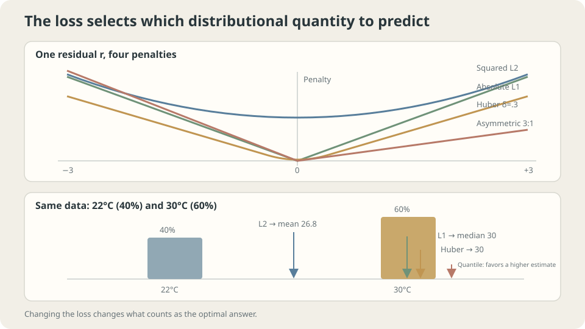

import Objectives from '../../../components/Objectives.astro';
import Ask from '../../../components/Ask.astro';
import Prereq from '../../../components/Prereq.astro';
import Question from '../../../components/Question.astro';
import Answer from '../../../components/Answer.astro';
import QuizBlock from '../../../components/QuizBlock.astro';
import Option from '../../../components/Option.astro';
import Explanation from '../../../components/Explanation.astro';
import VizPlan from '../../../components/VizPlan.astro';
import Details from '../../../components/Details.astro';
import Bridge from '../../../components/Bridge.astro';
import UsedBy from '../../../components/UsedBy.astro';
import Ref from '../../../components/Ref.astro';

# One Degree or Ten: A Loss Function Declares What Matters

<Objectives title="After reading, you can">
- Identify the statistics elicited by squared, absolute, asymmetric, and cross-entropy losses.
- Distinguish the desired target from the ease of optimizing a loss.
- Compare outlier sensitivity and explain why sigmoid saturation affects squared loss differently from cross-entropy.
</Objectives>

<Prereq items={frontmatter.prereqs} />

## Ten times worse or a hundred times worse?

A forecast of 25 degrees is slightly wrong when the temperature is 26, and badly wrong when it is 35.

**How much worse is the larger error?**

Squared loss makes a tenfold error a hundred times as costly; absolute loss makes it ten times as costly. A decision about clothing might instead depend on crossing a threshold. Turning accuracy into a training objective requires deciding which consequences matter.

Data alone cannot tell us how painful a ten-degree error is. **The loss declares a preference** supplied by the forecast's users.

Once declared, that preference determines an ideal target. <Ref to="math-mse-conditional-expectation" mode="title"/> showed that squared loss selects a conditional mean and absolute loss a median. Here we examine the resulting target, outlier sensitivity, and optimization behavior.

> **Choosing a loss chooses the statistic to learn.**

<Ask>
Is a ten-degree error ten or a hundred times worse?<br />
Does the data determine that ratio,<br />
or do the prediction's users choose it?
</Ask>

<Question label="Discussion" id="Q1">
What kind of object is a loss? What changes when we replace it, and what might we sacrifice for easier optimization?

<Answer summary="Show the reasoning">
A loss $\ell:\hat{\mathcal Y}\times\mathcal Y\to\mathbb R$ assigns a penalty to a prediction and outcome. Their types can differ: a binary label is zero or one, while the prediction can be a probability.

For each input $x$, the ideal answer is

$$
f^\star(x)=\arg\min_{a}\ \mathbb E\big[\ell(a,Y)\mid X=x\big],
$$

This minimizes expected penalty within the conditional distribution at $x$. Changing the loss can therefore change the target function itself: squared loss elicits the mean, absolute loss a median, and cross-entropy the conditional probability distribution.

Changing a loss for computational convenience may change the target. Conversely, two losses can share an unrestricted ideal target yet optimize differently. Squared probability loss and cross-entropy both elicit probabilities, but sigmoid saturation can suppress the former's gradient when confidently wrong. Ask separately: **Is this the right target, and can we train toward it?**
</Answer>
</Question>

## The shape of the penalty

Plot the penalty against residual $r=\hat y-y$:

- **Squared loss $r^2$:** marginal penalty grows with error. Extreme observations can pull a fitted curve strongly.
- **Absolute loss $|r|$:** marginal penalty has constant magnitude, limiting an extreme residual's influence.
- **Huber loss:** quadratic near zero and linear beyond $\delta$, retaining smooth local behavior while limiting the influence of large residuals.

Cross-entropy penalizes assigning probability $0.01$ to the realized class by about $4.6$, and $0.0001$ by about $9.2$. Confident mistakes have unbounded penalty. Binary squared probability loss is bounded by one.



*The same conditional distribution yields a mean, median, or other quantile depending on the penalty.*

## Where does the best answer move?

Fix $x$ and minimize conditional expected loss:

| Loss $\ell(a,y)$ | Ideal answer | Reason |
|---|---|---|
| $(a-y)^2$ | $\mathbb E[Y\mid x]$ | See <Ref to="math-mse-conditional-expectation"/> |
| $\lvert a-y\rvert$ | Conditional median | $P(Y<a)\le1/2\le P(Y\le a)$ |
| $(1-\tau)(a-y)_++\tau(y-a)_+$ | Conditional $\tau$-quantile | $P(Y<a)\le\tau\le P(Y\le a)$ |
| $-\log\hat p_y$ | $p(\cdot\mid x)$ | Expected loss is entropy plus KL; see <Ref to="math-kl"/> |
| $\mathbb1[a\ne y]$ | Conditional mode | Choose the most probable class |

For cross-entropy, first allow any candidate probability distribution and expand the expected penalty:

$$
\mathbb E_{Y\sim p}[-\log\hat p_Y]
=\underbrace{H(p)}_{\text{independent of }\hat p}
+\underbrace{\mathrm{KL}(p\Vert\hat p)}_{\ge0,\text{ minimized at }\hat p=p}.
$$

Minimizing cross-entropy minimizes KL from the true conditional distribution. A score uniquely minimized by the truth is **strictly proper**. Squared probability loss, the Brier score, is also strictly proper; classification accuracy is not, because it ignores probability values beyond the winning class. This matters when probabilities inform decisions and expected costs.

<Details label="Details" summary="Proper does not mean easy to optimize">
For sigmoid output $\hat p=\sigma(z)$, differentiate with respect to logit $z$:

$$
\frac{\partial}{\partial z}\big[-\log\hat p\big]\Big|_{y=1}=\hat p-1,
\qquad
\frac{\partial}{\partial z}\big[(\hat p-y)^2\big]=2(\hat p-y)\,\hat p(1-\hat p).
$$

When $y=1$ but $\hat p\approx0$, the cross-entropy gradient is near $-1$. Squared loss contains the extra factor $\hat p(1-\hat p)\approx0$, weakening correction precisely when the prediction is confidently wrong.

Their unrestricted probability targets coincide, but their optimization landscapes differ. The example below compares recovery after 400 steps from a deliberately poor initialization.
</Details>

## Forecasts, property prices, and the MSE default

**Forecasts:** first specify which side of temperature error costs more. If overestimation is more costly, pinball loss with $\tau<1/2$ targets a lower quantile. The cost interpretation must match the residual's sign.

**Property prices:** if underestimation costs three times as much as overestimation, pinball loss with $\tau=3/4$ targets the conditional 75th percentile.

**When is MSE appropriate?** When the conditional mean is desired, second moments exist, and squared costs match the use. It can also estimate classification probabilities, though sigmoid saturation can slow optimization.

These conclusions assume the loss represents the actual preference, extreme observations are unwanted contamination rather than important signals, and the ideal target exists and is representable. Otherwise the table describes an ideal objective rather than the fitted model's guaranteed result.

## Same data, different losses

**Outliers.** Add $2.5$ to three of thirty toy responses. Fit cubic polynomials under different losses and compare squared distance to the true conditional mean:

```python
import numpy as np
from scipy.optimize import minimize
from ml_toy import toy_1d, truth
x, y = toy_1d()
y = y.copy()
y[[5, 14, 23]] += 2.5
xs, ys = truth()
V = np.vander(x, 4, increasing=True)
Vs = np.vander(xs, 4, increasing=True)
def fit(rho):
    w0 = np.linalg.lstsq(V, y, rcond=None)[0]
    return minimize(lambda w: rho(V @ w-y).mean(), w0, method='Powell',
                    options=dict(xtol=1e-10, ftol=1e-12, maxfev=200000)).x
losses = {
    'MSE': lambda r: r**2,
    'MAE': lambda r: np.abs(r),
    'Huber delta=0.3': lambda r: np.where(np.abs(r)<=.3, .5*r**2, .3*(np.abs(r)-.15)),
}
for name, rho in losses.items():
    w = fit(rho)
    print(name, 'squared distance to truth:', ((Vs@w-ys)**2).mean())
```

```
MSE              squared distance to truth: 0.1005
MAE              squared distance to truth: 0.0183
Huber delta=0.3  squared distance to truth: 0.0148
```

Only the loss changes, yet the fitted curve's error differs substantially. Squaring gives large residuals disproportionate influence. Huber retains quadratic behavior for small residuals and reduces that influence for large ones; its advantage here is an example, not universal dominance.

**Correct target, difficult training.** Fit the same linear logistic model to the two-moons toy, using the same learning rate and 400 updates, from two initializations:

```python
import numpy as np
from ml_toy import toy_2d
X, y = toy_2d()
A = np.c_[np.ones(len(X)), X]
sig = lambda z: 1/(1+np.exp(-z))
def train(kind, w0, steps=400, lr=0.5):
    w = np.array(w0, float)
    for _ in range(steps):
        p = sig(A@w)
        g = A.T@(p-y)/len(y) if kind=='ce' else A.T@((p-y)*p*(1-p))/len(y)
        w -= lr*g
    p = sig(A@w)
    nll = -(y*np.log(p+1e-12)+(1-y)*np.log(1-p+1e-12)).mean()
    return ((p>.5)==y).mean(), nll
for w0, tag in (([0,0,0], 'zero start'), ([0,-8,8], 'confidently wrong start')):
    for kind in ('ce', 'sq'):
        acc, nll = train(kind, w0)
        print(tag, kind, 'accuracy', acc, 'NLL', nll)
# sq uses half squared loss, accounting for its omitted factor of two.
```

```
zero start               cross-entropy  accuracy 0.890  NLL 0.2603
zero start               squared loss   accuracy 0.865  NLL 0.2946
confidently wrong start  cross-entropy  accuracy 0.890  NLL 0.2610
confidently wrong start  squared loss   accuracy 0.180  NLL 9.0023
```

From zero, both train reasonably. From the saturated wrong start, cross-entropy recovers while squared loss moves slowly because of the extra sigmoid factor. This illustrates an optimization difficulty, not a claim that squared loss is never usable for classification.

Poor initialization, an oversized update, or a previously trained model facing distribution shift can all produce confident mistakes.

> **A proper score locates the desired ideal minimum; it does not guarantee reaching it.**

## Change both the target and the gradient

<iframe loading="lazy" src="/personal_website/notes/research_areas/machine-learning-foundations/l0-learning-as-fitting/l0-1-2.en.html" class="demo-frame" title="How loss choices change ideal predictions and gradients" style="height: 850px; width: 100%; border: none;"></iframe>

**Switch losses to see how the same observations produce different best predictions.**

## Check your understanding

<QuizBlock id="ml-l0-1-a">
Underestimating delivery time costs four times as much as overestimating it. A team trains with MSE and adds five minutes everywhere. What is a better formulation?
<Option>A fixed offset is always equivalent to changing the loss.</Option>
<Option correct>Use pinball loss with underestimation-to-overestimation slopes $4:1$, targeting the conditional 80th percentile.</Option>
<Option>Use symmetric absolute loss because it is robust.</Option>
<Explanation>A constant offset only matches the desired quantile adjustment under special conditional-distribution structures. Tail shape can vary across inputs. Absolute loss targets a median and does not encode the asymmetric cost.</Explanation>
</QuizBlock>

<QuizBlock id="ml-l0-1-b">
What follows from cross-entropy and Brier scores both being strictly proper?
<Option>They are interchangeable in every optimization problem.</Option>
<Option correct>They share the unrestricted true-probability target, but their parameterized optimization behavior can differ.</Option>
<Option>Brier loss is not proper.</Option>
<Explanation>Sigmoid squared loss has an extra saturation factor. Properness concerns ideal probability predictions; restricted model families may also have different optimal parameters under the two losses.</Explanation>
</QuizBlock>

<QuizBlock id="ml-l0-1-c">
If the three contaminated responses shift by $0.3$ instead of $2.5$, what happens to the loss comparison?
<Option>The gap must grow.</Option>
<Option correct>It may shrink, but inspect fitted residuals; a response shift of $0.3$ does not imply every residual is within the Huber threshold.</Option>
<Option>MAE must become best.</Option>
<Explanation>Robustness can trade off efficiency on clean data. Huber's threshold should reflect the noise scale and the intended treatment of large residuals; no loss wins universally.</Explanation>
</QuizBlock>

<UsedBy slug={frontmatter.slug} />

<Bridge to="ml-empirical-risk">
The remaining component is data. How close is empirical risk to population risk, what does the law of large numbers actually guarantee, and what changes when a property agent moves to another city?
</Bridge>

## References

1. Gneiting, T., Raftery, A. E. [*Strictly Proper Scoring Rules, Prediction, and Estimation.*](https://doi.org/10.1198/016214506000001437) JASA 2007.
2. Huber, P. J., Ronchetti, E. M. *Robust Statistics*, 2nd ed. Wiley 2009, Ch. 1, 7.
3. Bishop, C. M. [*Pattern Recognition and Machine Learning.*](https://www.microsoft.com/en-us/research/publication/pattern-recognition-machine-learning/) Springer 2006, Ch. 1.5.5, 4.3.2.
