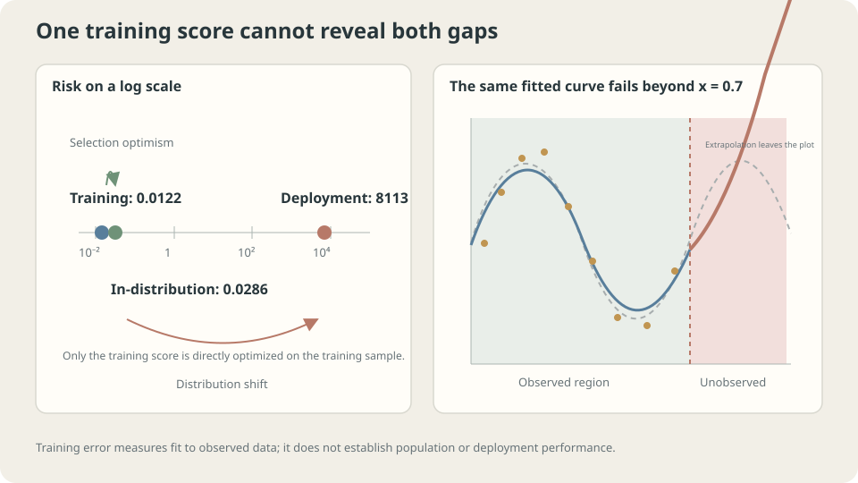

import Objectives from '../../../components/Objectives.astro';
import Ask from '../../../components/Ask.astro';
import Prereq from '../../../components/Prereq.astro';
import Question from '../../../components/Question.astro';
import Answer from '../../../components/Answer.astro';
import QuizBlock from '../../../components/QuizBlock.astro';
import Option from '../../../components/Option.astro';
import Explanation from '../../../components/Explanation.astro';
import VizPlan from '../../../components/VizPlan.astro';
import Remark from '../../../components/Remark.astro';
import Bridge from '../../../components/Bridge.astro';
import UsedBy from '../../../components/UsedBy.astro';
import Ref from '../../../components/Ref.astro';

# A Property Agent Moves Cities: Risk and Empirical Risk

<Objectives title="After reading, you can">
- Define population and empirical risks and state the fixed-rule law of large numbers precisely.
- Explain selection-induced training optimism and measure it across hypothesis spaces.
- Distinguish same-distribution generalization problems from distribution shift and identify appropriate checks.
</Objectives>

<Prereq items={frontmatter.prereqs} />

## Accurate in one city, inaccurate in another

The experienced agent moves from Taipei to Taichung. The same confident three-minute estimate now misses by 30% rather than 2%.

The learned relationships may still describe Taipei well. But proximity to public transport and the mix of property types have different implications in the new city.

Separate two effects:

1. Even in Taipei, performance on new transactions may be worse than on the examples used to adjust the agent's judgment.
2. Moving cities also changes the population being predicted.

The first concerns fitting and evaluation within one population; the second changes the population itself. **Write down which houses the risk averages over before diagnosing the gap.**

<Ask>
How far is the training score from deployment performance?<br />
Does finite data explain the difference,<br />
or has the evaluation population changed?
</Ask>

<Question label="Discussion" id="Q1">
Define future performance and retrospective training performance. What does the law of large numbers assume about the rule, and does an ERM-selected rule satisfy that assumption?

<Answer summary="Show the reasoning">
**Two quantities:** $R(f)=\mathbb E_{(X,Y)\sim p}[\ell(f(X),Y)]$ averages fresh-example loss; $\widehat R_n(f)=\frac1n\sum_i\ell(f(x_i),y_i)$ averages the observed losses.

For a **fixed rule independent of these iid observations**, with integrable loss, the law of large numbers gives $\widehat R_n(f)\to R(f)$ and $\mathbb E_D[\widehat R_n(f)]=R(f)$. The rule can be complex; independence from the evaluation data is the key.

An ERM rule $\hat f$ was selected because it looked good on those points. The fixed-rule argument cannot simply be substituted into this data-dependent selection. Exact ERM is optimistic in expectation, as derived below. Larger candidate families can increase selection effects, without a universal monotonic law for every problem.

Selection consumes the independence needed for an honest evaluation on those same observations.

> **A sample average can honestly evaluate a fixed rule without honestly evaluating the process that selected a rule from that sample.**

This concerns convergence of sample averages, a different comparison from weak convergence of SDE discretizations.
</Answer>
</Question>

## Two gaps, two diagnoses

Separate the training score from deployment risk through an intermediate same-population risk:

$$
\underbrace{\widehat R_n(\hat f)}_{\text{training score}}
\xrightarrow{\text{selection optimism}}
\underbrace{R_p(\hat f)}_{\text{source-population risk}}
\xrightarrow{\text{distribution shift}}
\underbrace{R_q(\hat f)}_{\text{deployment risk}}.
$$

The **generalization gap** is $R_p(\hat f)-\widehat R_n(\hat f)$, distinct from estimation error $R_p(\hat f)-R_p(f^\dagger)$. The shift term $R_q(\hat f)-R_p(\hat f)$ can have either sign. More source examples alone do not guarantee lower target risk.

An independent source-population holdout can reveal poor source generalization. It can nevertheless look good when deployment encounters a different population.

> **When holdout and deployment disagree, first check whether their data, processing, and evaluation match.**



*Selection optimism and deployment shift are separate effects.*

## Why selection makes training scores optimistic

For a rule fixed independently of the sample, $\mathbb E_D[\widehat R_n(f)]=R(f)$.

Exact ERM satisfies $\widehat R_n(\hat f)\le\widehat R_n(f)$ for every fixed candidate $f$. Taking expectations and comparing with the best population candidate gives

$$
\mathbb E_D\big[\widehat R_n(\hat f)\big]\ \le\ \min_{f\in\mathcal F}\mathbb E_D\big[\widehat R_n(f)\big]\ =\ \min_{f\in\mathcal F}R(f)\ \le\ \mathbb E_D\big[R(\hat f)\big].
$$

The expected training score is no larger than expected population risk. This is structural optimism **in expectation**, not a claim that every realized gap is positive.

How large can the gap be? For a finite hypothesis class and bounded loss, a uniform-convergence bound gives

$$
R(\hat f)\ \le\ \widehat R_n(\hat f)+O\!\left(\sqrt{\tfrac{\log|\mathcal F|+\log(1/\delta)}{n}}\right)
$$

with probability at least $1-\delta$, up to the stated scaling/constants. The important dependence is increasing complexity and decreasing uncertainty with more samples. Infinite classes require suitable complexity measures, such as VC dimension or Rademacher complexity, and the relevant assumptions.

Distribution shift is outside this same-population statement. Relating $R_q$ to $R_p$ needs assumptions, such as covariate shift with unchanged $p(y\mid x)$, or label shift with unchanged class-conditional inputs. Without such restrictions, a good source score gives no general target guarantee.

<Remark label="Supplement" summary="What is uniform about uniform convergence?">
The ordinary law of large numbers handles one fixed rule. A data-selected rule is unknown until after seeing the sample, so a uniform bound controls every candidate simultaneously.

It bounds $\sup_{f\in\mathcal F}|\widehat R_n(f)-R(f)|$. Enlarging the class cannot decrease this supremum for a fixed dataset. An unrestricted family of functions need not have this uniform-convergence property; memorization illustrates why a restriction matters.
</Remark>

## Two ways the agent can fail

**Within Taipei:** reviewing familiar transactions may suggest 3% error, while fresh examples give 5%. An evaluation set unused in adjusting the rule estimates the latter quantity. This motivates the later discussion of data splits.

**After moving:** a Taipei holdout cannot establish Taichung performance. Target-city examples are needed. Unlabeled changes in property type, size, and age offer useful early warnings, though unchanged input distributions do not rule out changes in conditional outcomes.

Check independence, a stable evaluation population, and adequate loss moments. Repeated sales from one building or related photographs reduce effective independence; heavy-tailed losses can make averages unstable. Sample count alone does not settle reliability.

## Measure both gaps

**Selection optimism:** for each degree, repeatedly draw thirty observations and compare a separately fitted fixed rule against a newly fitted ERM rule.

```python
import numpy as np
from numpy.polynomial import Polynomial
from ml_toy import toy_1d, truth, NOISE
xs, ys = truth()
risk = lambda f: ((f(xs)-ys)**2).mean()+NOISE**2
for d in (3,5,9):
    fixed = Polynomial.fit(*toy_1d(n=2000, seed=999), d)
    gap_fixed, gap_erm = [], []
    for s in range(200):
        x, y = toy_1d(seed=s)
        gap_fixed.append(risk(fixed)-((fixed(x)-y)**2).mean())
        f = Polynomial.fit(x,y,d)
        gap_erm.append(risk(f)-((f(x)-y)**2).mean())
    print(d, 'fixed mean gap', np.mean(gap_fixed),
          'ERM mean gap', np.mean(gap_erm), 'ERM median gap', np.median(gap_erm))
```

```
degree 3: fixed mean gap +0.0005 | ERM mean +0.0094 median +0.0092
degree 5: fixed mean gap +0.0005 | ERM mean +0.0130 median +0.0111
degree 9: fixed mean gap +0.0005 | ERM mean +0.7495 median +0.0252
```

The fixed-rule gap is near zero; selected rules are optimistic on average. In this example, the median gap grows with degree. Degree nine has a much larger mean than median, indicating rare disastrous fits. These observations illustrate the theory without proving universal monotonicity. <Ref to="ml-bias-variance" mode="title"/> examines instability further.

**Distribution shift:** collect inputs only in $[0,0.7]$, then deploy across $[0,1]$:

```python
rng = np.random.default_rng(0)
x = np.sort(rng.uniform(0,.7,30))
y = np.sin(2*np.pi*x)+NOISE*rng.standard_normal(30)
f = Polynomial.fit(x,y,9)
m = xs<=.7
print('training:', ((f(x)-y)**2).mean())
print('source risk:', ((f(xs[m])-ys[m])**2).mean()+NOISE**2)
print('deployment risk:', ((f(xs)-ys)**2).mean()+NOISE**2)
```

```
training:        0.0122
source risk:     0.0286
deployment risk: 8113.2300
```

The deployment risk here is roughly 280,000 times source risk. A holdout drawn from the observed interval only evaluates that source population; it cannot reliably warn about this unseen-region extrapolation. Its finite-sample estimate will fluctuate around source risk, rather than equal it exactly.

Likewise, a model trained on daylight photographs may lack evidence for night scenes. Its function remains defined there, but accuracy needs new data, structural assumptions, or a suitable uncertainty policy.

## Vary sample size and hypothesis-space size

<iframe loading="lazy" src="/personal_website/notes/research_areas/machine-learning-foundations/l0-learning-as-fitting/l0-2-2.en.html" class="demo-frame" title="How sample size and hypothesis-space size affect risk gaps" style="height: 859px; width: 100%; border: none;"></iframe>

**More observations can reduce estimation uncertainty; a misspecified hypothesis family requires a different modeling choice.**

## Check your understanding

<QuizBlock id="ml-l0-2-a">
An untouched holdout gives 92% accuracy but deployment gives 71%. Should the team immediately add regularization?
<Option>Yes: this gap defines overfitting.</Option>
<Option correct>First check shift, repeated holdout use, preprocessing, sample uncertainty, and changes in labels or metrics.</Option>
<Option>Immediately merge the holdout into training.</Option>
<Explanation>The scores guide investigation but do not identify a cause by themselves. Honest same-population holdouts assess source generalization; they do not guarantee deployment conditions match.</Explanation>
</QuizBlock>

<QuizBlock id="ml-l0-2-b">
What does the near-zero average gap for independently fixed rules illustrate?
<Option>Model complexity never affects generalization.</Option>
<Option correct>A sample-average loss is unbiased for a rule independent of that sample, even if the rule is complex.</Option>
<Option>Two thousand examples suffice for every model.</Option>
<Explanation>Selection on the evaluation sample creates the dependence. Independence restores unbiased evaluation, though the variance of that estimate still depends on the loss distribution.</Explanation>
</QuizBlock>

<QuizBlock id="ml-l0-2-c">
What does deployment risk near 8113 indicate in this experiment?
<Option>Only a minor accuracy loss outside the observed interval.</Option>
<Option correct>Severe unsupported extrapolation; gather relevant data, add justified structure, or restrict use according to the application.</Option>
<Option>A higher polynomial degree guarantees a fix.</Option>
<Explanation>The function is defined outside the observed interval, but the training objective supplies little evidence there. Good interpolation does not establish extrapolation accuracy.</Explanation>
</QuizBlock>

<UsedBy slug={frontmatter.slug} />

<Bridge to="ml-gradient-descent">
The learning components are defined, but $\arg\min$ is still an idealized operation. In practice we have a differentiable objective and an update loop. Next derive negative-gradient steps, their step-size conditions, and what happens when the steps are too large.
</Bridge>

## References

1. Shalev-Shwartz, S., Ben-David, S. [*Understanding Machine Learning.*](https://www.cs.huji.ac.il/~shais/UnderstandingMachineLearning/) Cambridge University Press 2014, Ch. 2–4.
2. Quiñonero-Candela, J. et al. (eds.) [*Dataset Shift in Machine Learning.*](https://mitpress.mit.edu/9780262170055/dataset-shift-in-machine-learning/) MIT Press 2009.
3. Recht, B. et al. [*Do ImageNet Classifiers Generalize to ImageNet?*](https://proceedings.mlr.press/v97/recht19a.html) ICML 2019.
