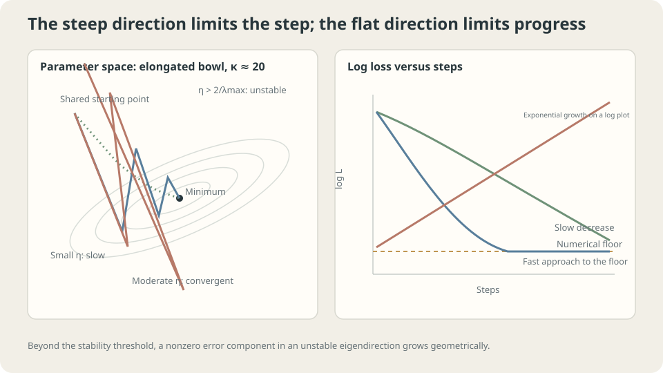

import Objectives from '../../../components/Objectives.astro';
import Ask from '../../../components/Ask.astro';
import Prereq from '../../../components/Prereq.astro';
import Question from '../../../components/Question.astro';
import Answer from '../../../components/Answer.astro';
import QuizBlock from '../../../components/QuizBlock.astro';
import Option from '../../../components/Option.astro';
import Explanation from '../../../components/Explanation.astro';
import VizPlan from '../../../components/VizPlan.astro';
import Remark from '../../../components/Remark.astro';
import Bridge from '../../../components/Bridge.astro';
import UsedBy from '../../../components/UsedBy.astro';
import Ref from '../../../components/Ref.astro';

# Downhill in Fog: Direction, Step Size, and Gradient Descent

<Objectives title="After reading, you can">
- Derive local descent from the first-order Taylor term and state its limitations.
- Derive $0<\eta<2/\lambda_{\max}$ for positive-definite quadratics and explain the role of the condition number.
- Test instability and feature scaling using the shared polynomial-regression toy.
</Objectives>

<Prereq items={frontmatter.prereqs} />

## Descending through fog

Recall <Ref to="math-gradient" mode="title"/>: fog limits visibility to a meter, but you can measure the steepest local slope and want to reach the valley.

A natural strategy is to step downhill, stop, measure again, and repeat.

The difficult question is **how far to step**.

- Ten centimeters keeps the local direction relevant but may take all day.
- Fifty meters may overshoot the valley as the terrain changes.
- Five hundred meters may bounce between hillsides at increasing heights.

The last case does more than converge slowly: it moves away from the solution, increasingly rapidly.

Local direction does not determine step size. **Can we calculate when a step turns descent into ascent?** A positive-definite quadratic gives an exact threshold; general networks require additional care.

<Ask>
How large should a negative-gradient step be?<br />
Do oversized steps merely slow learning,<br />
or can they make errors grow?
</Ask>

<Question label="Discussion" id="Q1">
Write the update, explain its descent argument, and identify what makes a step too large.

<Answer summary="Show the reasoning">
For parameters $\theta\in\mathbb R^p$ and objective $L(\theta)=\widehat R_n(f_\theta)$, update by

$$
\theta_{k+1}=\theta_k-\eta\,\nabla L(\theta_k).
$$

The local argument comes from Taylor expansion, as in <Ref to="math-taylor" mode="title"/>:

$$
L(\theta_k+\Delta)=L(\theta_k)+\nabla L(\theta_k)^\top\Delta+O(\lVert\Delta\rVert^2).
$$

Taking $\Delta=-\eta\nabla L$ gives first-order change $-\eta\|\nabla L\|^2$. At a nonzero gradient, sufficiently small steps decrease the objective. Larger steps can let the quadratic remainder overwhelm that decrease; first-order negativity alone is not a finite-step guarantee.

The Hessian controls curvature and the remainder. One shared learning rate must accommodate every direction: steep directions restrict its size, while flat directions can converge slowly. Their curvature ratio, the **condition number**, captures this difficulty for positive-definite quadratics.
</Answer>
</Question>

## The shape of the valley

Imagine an elliptical bowl: narrow across one direction and elongated along another.

- The steep direction limits stable step sizes: excessive overshoot amplifies its error.
- A flat direction can shrink error very slowly because its gradient is small.

One rate must serve both. The more elongated the bowl, the larger $\kappa=\lambda_{\max}/\lambda_{\min}$ and the greater the potential difficulty.

Mismatched feature scales often worsen this geometry. Area, room count, and age use different numerical ranges, so equal parameter changes have different effects. Standardization can improve conditioning by changing the parameterization of the objective.



*Steep directions restrict stable steps; slow modes determine convergence. Exponential loss growth appears linear on a logarithmic plot.*

## Derive the instability threshold

For linear predictions $f_w(x)=\phi(x)^\top w$ and design matrix $V$, take half the mean squared loss:

$$
L(w)=\frac1{2n}\|Vw-y\|^2,\qquad
\nabla L(w)=\frac1nV^\top(Vw-y),\qquad
\nabla^2L=\frac1nV^\top V\quad\text{(constant)}.
$$

The half factor matches the code; full MSE doubles the gradient. Set $H=V^\top V/n$ and assume full column rank, so $H$ is positive definite and the minimizer is unique. With $e_k=w_k-w^\star$ and gradient $He_k$, each eigenvector component satisfies

$$
e_{k+1}^{(j)}=(1-\eta\lambda_j)\,e_k^{(j)}.
$$

Each step multiplies that component by a scalar. Convergence for every initialization therefore requires

$$
\text{convergence for all initial errors}
\iff |1-\eta\lambda_j|<1\ \forall j
\iff \boxed{0<\eta<2/\lambda_{\max}}.
$$

The slowest absolute amplification factor controls the worst-case speed. The optimal constant rate is $\eta=2/(\lambda_{\max}+\lambda_{\min})$, giving contraction factor

$$
\frac{\kappa-1}{\kappa+1},\qquad \kappa=\frac{\lambda_{\max}}{\lambda_{\min}}.
$$

For $\kappa=1$, one step suffices with this rate. At $\kappa=10^7$, the factor is approximately $0.9999998$: convergence can be mathematically valid yet practically too slow.

<Remark label="Caution" summary="Why divergence can appear sudden">
An unstable mode with magnitude 1.04 grows by roughly 10^34 over 2000 steps; squaring it makes the loss enormous. Small initial components can hide the growth until floating-point overflow.

Near the stability boundary, small rate changes can switch contraction to expansion. Leave a margin and inspect losses and gradients; a delayed NaN alone does not prove this mechanism caused it.

Neural-network Hessians change during training, so a locally safe rate need not stay safe. Learning-rate schedules and warmup address related practical issues; see <Ref to="ml-optimizers" mode="title"/>.
</Remark>

## A threshold is not a recommended rate

The exact argument assumes a differentiable, full-batch, positive-definite quadratic with constant Hessian. General models have changing curvature; minibatch gradients introduce noise, treated in <Ref to="ml-minibatch-noise" mode="title"/>. Discrete 0–1 error also requires another training objective; see <Ref to="ml-loss-declaration" mode="title"/>.

Smaller rates can improve stability but miss useful accuracy within a fixed budget. In the example, rate $0.01$ after 2000 steps still has training MSE near $0.209$.

> **Stable but inadequately optimized training can fail without producing an obvious NaN.**

## Measure the threshold

Use degree-five polynomial features on the shared toy. A direct least-squares solution gives a reference:

```python
import numpy as np
from ml_toy import toy_1d
x, y = toy_1d()
V = np.vander(x,6,increasing=True)
print('direct MSE:', ((V@np.linalg.lstsq(V,y,rcond=None)[0]-y)**2).mean())
lam = np.linalg.eigvalsh(V.T@V/len(x))
print('lambda_max:',lam[-1], 'rate threshold:',2/lam[-1], 'condition:',lam[-1]/lam[0])
for eta in (.01,.1,.5,1.05,1.15):
    w = np.zeros(6)
    for _ in range(2000):
        w -= eta*(V.T@(V@w-y))/len(x)
    print(eta, 'MSE after 2000 steps:', ((V@w-y)**2).mean())
```

```
direct MSE: 0.0147
lambda_max: 1.8034  rate threshold: 1.109  condition: 1.6e+07
eta=0.01  MSE=2.0935e-01
eta=0.1   MSE=1.4498e-01
eta=0.5   MSE=7.0104e-02
eta=1.05  MSE=4.1486e-02
eta=1.15  MSE=6.6166e+122
```

The unstable rate amplifies errors. Several larger stable rates improve this finite-budget result, but “larger is always faster below the threshold” is false: beyond the optimal rate, oscillatory modes slow again. Large condition numbers can require many updates; additional steps are not mathematically useless.

**Change only the coordinate units.** Replace $x\in[0,1]$ by $t=100+10x$ before constructing polynomial features:

```python
t = 100+10*x
Vt = np.vander(t,6,increasing=True)
lam_t = np.linalg.eigvalsh(Vt.T@Vt/len(t))
print('lambda_max:',lam_t[-1], 'threshold:',2/lam_t[-1])
for eta in (.01,1e-12,1e-24):
    w = np.zeros(6)
    for _ in range(2000):
        w -= eta*(Vt.T@(Vt@w-y))/len(t)
    print(eta, 'MSE:', ((Vt@w-y)**2).mean())
```

```
lambda_max: 1.750e+20  threshold: 1.143e-20
eta=0.01   MSE=nan
eta=1e-12  MSE=nan
eta=1e-24  MSE=3.9465e-01
```

The stability threshold shrinks by about twenty orders of magnitude because the $t^5$ column has enormous scale. The exact polynomial function family remains equivalent, but its parameterization and numerical conditioning change dramatically.

Center and scale the input, then normalize the feature columns:

```python
Vz = np.vander((t-t.mean())/t.std(),6,increasing=True)
Vz = Vz/np.linalg.norm(Vz,axis=0)*np.sqrt(len(t))
lam_z = np.linalg.eigvalsh(Vz.T@Vz/len(t))
print('lambda_max:',lam_z[-1], 'threshold:',2/lam_z[-1], 'condition:',lam_z[-1]/lam_z[0])
w = np.zeros(6)
for _ in range(2000):
    w -= .3*(Vz.T@(Vz@w-y))/len(t)
print('MSE:', ((Vz@w-y)**2).mean())
```

```
lambda_max: 3.936  threshold: 0.508  condition: 1.6e+03
eta=0.3  MSE after 2000 steps: 0.0155
```

Compared with the original $x$-power basis, the reported condition number drops from about $1.6\times10^7$ to $1.6\times10^3$. The same budget approaches the direct fit more closely. Normalization and residual connections later also influence optimization geometry, though their effects cannot universally be reduced to this quadratic calculation.

> **Standardization changes optimization geometry, not just the appearance of numbers.**

## Vary the learning rate and inspect the trajectory

<iframe loading="lazy" src="/personal_website/notes/research_areas/machine-learning-foundations/l0-learning-as-fitting/l0-3-2.en.html" class="demo-frame" title="Learning rate, trajectories, and stability thresholds" style="height: 1047px; width: 100%; border: none;"></iframe>

**Cross the stability threshold and compare the steep and flat modes.**

## Check your understanding

<QuizBlock id="ml-l0-3-a">
Loss becomes NaN after hundreds of apparently normal updates. What should you do first?
<Option>Assume the data must contain NaN.</Option>
<Option correct>Locate the first nonfinite input, activation, gradient, or operation; compare a smaller-rate run while checking the data and arithmetic.</Option>
<Option>Immediately enlarge the model.</Option>
<Explanation>Oversized updates are one plausible cause, but not the only one. Diagnose the first failure rather than inferring a unique cause from delayed NaN.</Explanation>
</QuizBlock>

<QuizBlock id="ml-l0-3-b">
Several larger stable rates reduce finite-budget error. Does that prove we should always approach the stability boundary?
<Option>Yes.</Option>
<Option correct>No. Even a positive-definite quadratic's optimal rate generally lies below the boundary; nonquadratic and minibatch training add further conditions.</Option>
<Option>No, because smaller rates are always better.</Option>
<Explanation>The experiment supports its measured comparisons, not universal monotonic improvement. Distinguish an asymptotic convergence guarantee from useful finite-budget accuracy.</Explanation>
</QuizBlock>

<QuizBlock id="ml-l0-3-c">
Two positive-definite quadratics share $\lambda_{\max}$ but have condition numbers 10 and $10^6$. What follows?
<Option>Their stability thresholds differ.</Option>
<Option correct>The thresholds agree, but worst-case convergence rates can differ greatly because of their flat modes.</Option>
<Option>The poorly conditioned problem must diverge.</Option>
<Explanation>The largest eigenvalue controls the constant-rate stability boundary. The full spectrum and selected rate control contraction; at optimal constant rates the condition number gives the worst-case factor. Initial alignment also affects actual iteration counts.</Explanation>
</QuizBlock>

<UsedBy slug={frontmatter.slug} />

<Bridge to="ml-overfitting-underfitting">
We now have hypothesis space, loss, data, and a concrete optimization loop. Yet nearly zero training risk can be misleading, and larger families can produce unstable generalization. Next diagnose overfitting and underfitting and decide what evidence justifies a remedy.
</Bridge>

## References

1. Boyd, S., Vandenberghe, L. [*Convex Optimization.*](https://web.stanford.edu/~boyd/cvxbook/) Cambridge University Press 2004, Ch. 9.
2. Nocedal, J., Wright, S. *Numerical Optimization*, 2nd ed. Springer 2006, Ch. 3.
3. LeCun, Y., Bottou, L., Orr, G., Müller, K.-R. [*Efficient BackProp.*](https://doi.org/10.1007/3-540-49430-8_2) Neural Networks: Tricks of the Trade, Springer 1998.
