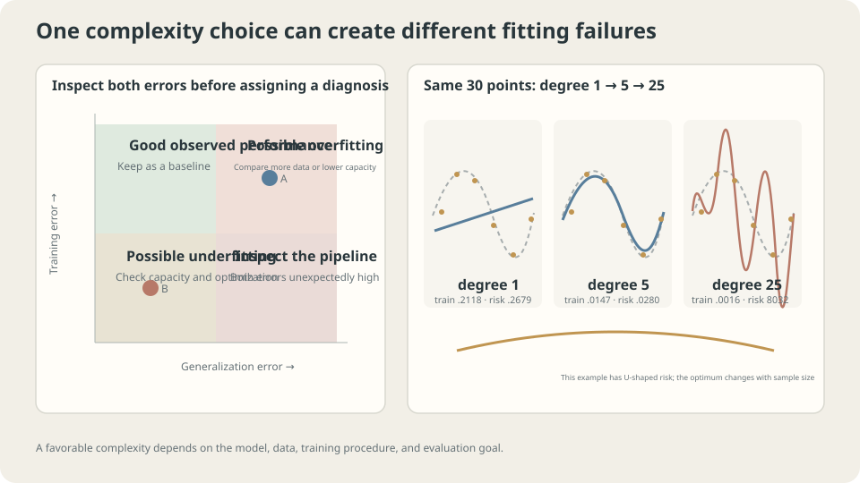

import Objectives from '../../../components/Objectives.astro';
import Ask from '../../../components/Ask.astro';
import Prereq from '../../../components/Prereq.astro';
import Question from '../../../components/Question.astro';
import Answer from '../../../components/Answer.astro';
import QuizBlock from '../../../components/QuizBlock.astro';
import Option from '../../../components/Option.astro';
import Explanation from '../../../components/Explanation.astro';
import VizPlan from '../../../components/VizPlan.astro';
import Remark from '../../../components/Remark.astro';
import Bridge from '../../../components/Bridge.astro';
import UsedBy from '../../../components/UsedBy.astro';
import Ref from '../../../components/Ref.astro';

# Memorizing Old Exams: Overfitting and Underfitting

<Objectives title="After reading, you can">
- Interpret paired training and validation scores without treating them as an automatic diagnosis.
- Compare the same capacity at different sample sizes.
- Assess positive loss plateaus using noise estimates, baselines, and independent evaluation.
</Objectives>

<Prereq items={frontmatter.prereqs} />

## Two students with the same poor score

Two students both score forty on an exam.

One memorized every past answer and scores perfectly when old questions repeat, but struggles when the numbers change.

The other carefully studied only half the material, scoring forty-five on practice questions and forty on the exam.

Their final scores hide different problems: memorizing particular examples versus lacking sufficient knowledge. Remedies therefore require evidence about what each student learned, not just the final score.

Practice performance adds useful information: 100/40 differs from 45/40.

Likewise, training and fresh-example errors should be examined together.

> **One score is insufficient for diagnosing generalization.**

**How can the two scores guide learning a transferable rule?** First identify plausible causes, then vary capacity and sample size in the same toy.

<Ask>
Two students score forty.<br />
Who memorized answers, and who has not learned enough?<br />
Relative to what is a model too complex?
</Ask>

<Question label="Discussion" id="Q1">
List the combinations of small or large training and population risks. What do they suggest checking?

<Answer summary="Show the reasoning">
Use training risk $\widehat R_n(\hat f)$ and population risk $R(\hat f)$ from <Ref to="ml-empirical-risk" mode="title"/>. Memorization can produce low training risk and high population risk; insufficient fitting can leave both high.

| | Small population risk | Large population risk |
|---|---|---|
| Small training risk | Desired performance | Investigate overfitting, data quantity, and regularization |
| Large training risk | Check sampling and evaluation consistency | Check capacity, features, and optimization |

All four combinations can occur. Training augmentation, dropout, penalties, harder examples, and sampling fluctuations affect comparability. Recompute both scores with the same evaluation mode and loss before interpreting the gap.

Remedies can conflict: stronger restrictions can worsen capacity limitations, while additional unconstrained capacity may worsen memorization. Neither outcome is guaranteed from capacity alone; compare the actual intervention.
</Answer>
</Question>

## Capacity can fail in different ways

Polynomial degree, tree depth, network width, and regularization affect effective flexibility, though they are not interchangeable complexity measures.

- **Underfitting:** the family cannot approximate the relevant pattern, or the procedure has not found a sufficiently good fit. Both scores can stay high.
- **Overfitting:** fitting sample-specific variation improves the training score without comparable fresh-example improvement. Estimation effects can dominate.

The useful capacity depends jointly on model, data amount, algorithm, and regularization. When someone says “too complex,” ask **for which dataset and training procedure?**



*Capacity limitations and sample-specific fitting require different checks; useful flexibility depends on available data.*

## Why a U-shaped curve can appear

For fixed data and nested families $\mathcal F_1\subset\mathcal F_2\subset\cdots$, exact ERM gives one guaranteed direction:

- Minimum **training risk cannot increase** when the feasible family expands.
- Population risk includes approximation, estimation, and irreducible components. Approximation improves or stays equal, but estimation need not change monotonically. A classical U shape is common, not a theorem following from nesting alone [1].

More independent data can reduce estimation uncertainty and permit more flexibility. The curve can flatten and its best setting can move, but these are qualitative patterns to check rather than universal sample-by-sample laws.

Some overparameterized models exhibit **double descent**, with another decrease after an interpolation-region peak [2]. This is a phenomenon under particular models and algorithms, not a promise from increasing capacity. The displayed polynomial experiment stays below its sample count.

Under squared loss, the population optimum is $\mathbb E[Y\mid X]$, with irreducible risk $\mathbb E[\operatorname{Var}(Y\mid X)]$. Here that is $0.0225$, a reference for population performance rather than a hard training-loss floor.

<Remark label="Caution" summary="A positive loss plateau need not be a capacity failure">
Does a nonzero plateau mean more layers are necessary?

Compare with the same task's irreducible population MSE, independent validation, and useful baselines. A finite training score can fall below the noise level; stopping near it also does not automatically prove success.

Repeated measurements at fixed input can estimate conditional noise. Expert agreement and known synthetic mechanisms can offer other reference information, with their respective limitations. Without a relevant baseline, a plateau at 0.3 is difficult to interpret.
</Remark>

## Choose a remedy from evidence

**Overfitting:** try appropriate restrictions, more relevant independent data, justified augmentation, regularization, or early stopping; see <Ref to="ml-regularization" mode="title"/>. These are interventions to compare, not automatic cures.

**Insufficient fitting:** consider richer informative features, suitable capacity, or better optimization. In <Ref to="ml-gradient-descent" mode="title"/>, a tiny rate left a capable model poorly optimized.

A small-subset fitting test can expose implementation, capacity, or optimization difficulties: can the system fit a manageable subset under permissive settings? Success shows that particular test is feasible; it does not prove the full-data pipeline or generalization is correct. Failure also requires checking labels, constraints, and the objective.

Evaluation must use independent appropriate data with consistent scoring. Distribution shift can create another gap. Nested-family intuition does not transfer unchanged between unrelated architectures and algorithms.

## Observe the curve, then add data

For thirty shared toy observations, vary polynomial degree:

```python
import numpy as np
from numpy.polynomial import Polynomial
from ml_toy import toy_1d, truth, NOISE
xs, ys = truth()
risk = lambda f:((f(xs)-ys)**2).mean()+NOISE**2
x,y = toy_1d()
for d in (0,1,2,3,5,7,9,12,15,20,25):
    f = Polynomial.fit(x,y,d)
    print(d,'training',((f(x)-y)**2).mean(),'population approximation',risk(f))
```

```
degree   training    population approximation
0        0.3897      0.5575
1        0.2118      0.2679
2        0.2117      0.2668
3        0.0178      0.0312
5        0.0147      0.0280
7        0.0134      0.0296
9        0.0122      0.0285
12       0.0114      0.0314
15       0.0104      0.0334
20       0.0043      0.0659
25       0.0016      8032.3199
```

Training risk decreases, while population risk first drops and later grows dramatically, with small local fluctuations. A line misses the sine pattern. High degrees fit observed noise yet perform poorly elsewhere. Read the two scores together; no universal ratio threshold diagnoses underfitting.

Adding a quadratic term barely helps this example; a cubic captures much more of the sine shape. Additional capacity matters through which functions it enables, not just parameter count.

Now use three hundred observations:

```python
x3,y3 = toy_1d(n=300,seed=1)
for d in (1,3,9,15,20,25):
    f = Polynomial.fit(x3,y3,d)
    print(d,'training',((f(x3)-y3)**2).mean(),'population approximation',risk(f))
```

```
degree   training    population approximation
1        0.2106      0.2207
3        0.0266      0.0277
9        0.0198      0.0242
15       0.0197      0.0243
20       0.0196      0.0244
25       0.0194      0.0283
```

The disastrous high-degree behavior is greatly reduced in this sample. Degrees nine through twenty stay near the population noise floor. Degree twenty-five still worsens somewhat, so the curve has flattened rather than establishing that additional capacity can never hurt.

Thus “degree twenty-five always overfits” is unsupported. Its behavior depends on the observations, training procedure, and evaluation distribution.

> **Judge capacity relative to data and training conditions.**

Large datasets are one reason highly flexible models can work. Architecture, regularization, optimization, and task structure also matter; data amount alone does not explain every modern result.

Removing noise makes the irreducible risk zero but does not guarantee accurate unseen predictions. Thirty distinct inputs uniquely determine the degree-twenty-five least-squares solution in exact arithmetic; uniqueness is different from correctness between inputs.

## Vary data quantity and capacity

<iframe loading="lazy" src="/personal_website/notes/research_areas/machine-learning-foundations/l1-generalization/l1-0-2.en.html" class="demo-frame" title="How capacity and sample size affect fitting and generalization" style="height: 823px; width: 100%; border: none;"></iframe>

**Compare the capacity curves at different sample sizes rather than treating complexity as an absolute verdict.**

## Check your understanding

<QuizBlock id="ml-l1-0-a">
Training and validation MSE are 0.21 and 0.22, far above an estimated noise level near 0.02. What is a reasonable next step?
<Option correct>Check capacity, features, labels, and optimization; a small-subset fitting test can help investigate.</Option>
<Option>Automatically add stronger regularization.</Option>
<Option>Only more data can help.</Option>
<Explanation>High similar errors suggest insufficient fitting, but do not identify one cause. A line cannot express the toy's sine mean regardless of sample count.</Explanation>
</QuizBlock>

<QuizBlock id="ml-l1-0-b">
Does degree twenty-five necessarily overfit?
<Option>Yes, regardless of data.</Option>
<Option correct>No: compare the different sample-size results and evaluate independently.</Option>
<Option>No, because more complexity always improves results.</Option>
<Explanation>The same family behaves very differently with thirty and three hundred observations. Data, algorithm, regularization, and distribution all affect generalization.</Explanation>
</QuizBlock>

<QuizBlock id="ml-l1-0-c">
Training MSE is below irreducible population risk. What does this prove?
<Option>The theoretical lower bound has been beaten.</Option>
<Option correct>Neither success nor overfitting by itself; inspect independent-data risk.</Option>
<Option>The noise estimate must be incorrect.</Option>
<Explanation>The population floor is not a hard bound on a fitted finite-sample training score. Low training error combined with rising independent risk provides the relevant evidence.</Explanation>
</QuizBlock>

<UsedBy slug={frontmatter.slug} />

<Bridge to="ml-bias-variance">
Overfitting is still a qualitative diagnosis. Next average over repeated training datasets to decompose squared prediction error into bias squared, variance, and irreducible noise. Different agents seeing different sales give a concrete picture of estimator variability.
</Bridge>

## References

1. Hastie, T., Tibshirani, R., Friedman, J. [*The Elements of Statistical Learning*](https://hastie.su.domains/ElemStatLearn/), 2nd ed. Springer 2009, Ch. 7.
2. Belkin, M. et al. [*Reconciling modern machine-learning practice and the classical bias–variance trade-off.*](https://doi.org/10.1073/pnas.1903070116) PNAS 2019.
3. Ng, A. [*Machine Learning Yearning*](https://info.deeplearning.ai/machine-learning-yearning-book) 2018, Ch. 20–27.
