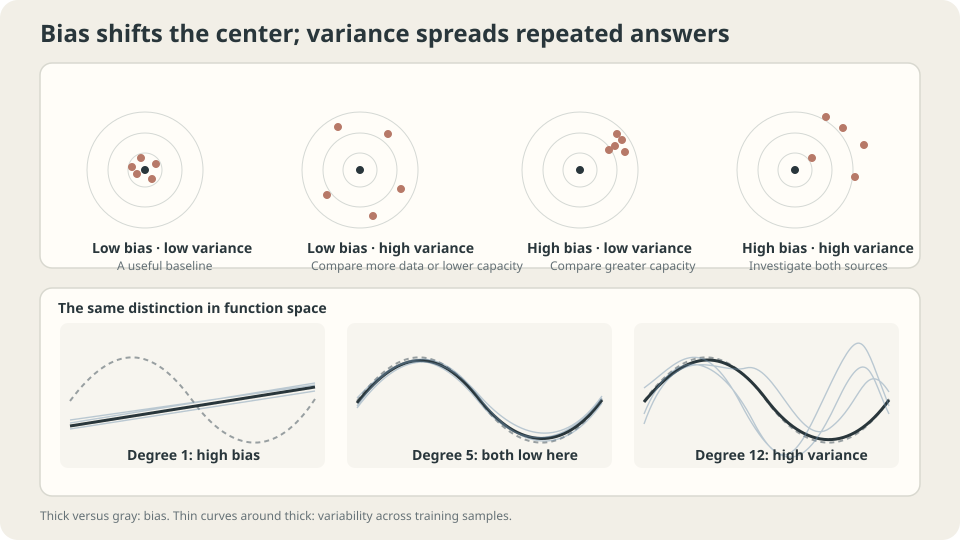

import Objectives from '../../../components/Objectives.astro';
import Ask from '../../../components/Ask.astro';
import Prereq from '../../../components/Prereq.astro';
import Question from '../../../components/Question.astro';
import Answer from '../../../components/Answer.astro';
import QuizBlock from '../../../components/QuizBlock.astro';
import Option from '../../../components/Option.astro';
import Explanation from '../../../components/Explanation.astro';
import VizPlan from '../../../components/VizPlan.astro';
import Remark from '../../../components/Remark.astro';
import Bridge from '../../../components/Bridge.astro';
import UsedBy from '../../../components/UsedBy.astro';
import Ref from '../../../components/Ref.astro';

# Ten Agents, Different Houses: Bias and Variance

<Objectives title="After reading, you can">
- Derive the squared-loss decomposition and specify every source of randomness.
- Measure its components on repeated toy datasets and qualify $\sigma^2k/n$.
- Choose interventions based on bias, variance, and irreducible uncertainty rather than a single score.
</Objectives>

<Prereq items={frontmatter.prereqs} />

## Ten agents estimate the same house

Ten equally skilled agents use the same method but have seen different random samples of a hundred sales from one market.

Ask all ten to estimate the same new house. Their predictions form ten numbers.

**How widely do they vary?** A large spread indicates sensitivity to which training transactions were observed.

**Is their average systematically wrong?** If the mean estimate misses the conditional mean price, recruiting more identical-method agents does not remove that method's average bias.

A method can be stable but biased, or correct on average but highly variable. These are distinct components requiring different investigations.

**Should we measure average displacement or dataset-to-dataset fluctuation?** Fix one query house and separate them.

<Ask>
How different are the agents' predictions?<br />
Is their average estimate biased?<br />
Why are these separate questions?
</Ask>

<Question label="Discussion" id="Q1">
What represents different agents mathematically, and which expectations enter squared prediction risk?

<Answer summary="Show the reasoning">
Each agent represents a different training dataset $D$. The common learning algorithm maps it to a random fitted function $\hat f_D$.

At fixed query $x$, average over training randomness $D$ and a fresh response $Y\mid X=x$, independent of the training sample. Any additional training randomness must also be explicitly included.

Let $\bar f(x)=\mathbb E_D\hat f_D(x)$ and $f^\star(x)=\mathbb E[Y\mid X=x]$. Then

$$
\begin{aligned}
\mathbb E_{D,Y}[(Y-\hat f_D(x))^2]
&=\underbrace{\operatorname{Var}(Y\mid x)}_{\text{irreducible noise}}\\
&\quad+\underbrace{(\bar f(x)-f^\star(x))^2}_{\text{squared bias}}\\
&\quad+\underbrace{\mathbb E_D[(\hat f_D(x)-\bar f(x))^2]}_{\text{prediction variance}}.
\end{aligned}
$$

Bias measures the average prediction's displacement; variance measures fluctuations around that average; irreducible noise describes response variability at the same input. Every component is nonnegative.
</Answer>
</Question>

## Different components respond to different changes

- **Irreducible risk** $\mathbb E[\operatorname{Var}(Y\mid X)]$ is fixed for the chosen features and population. More training data does not change it, though additional informative features can change the prediction problem. Here it equals $0.0225$.
- **Squared bias** belongs to the whole learning procedure at the given sample size. Capacity, regularization, optimization, and finite data can all affect it; it is not simply approximation error.
- **Prediction variance** measures repeated-training fluctuations. It is not a synonym for estimation error. More data often helps, but arbitrary algorithms have no universal monotonic guarantee.

A high test score alone does not identify the dominant component. Investigate modeling and optimization for systematic bias, instability for variance, and improved features or uncertainty reporting when outcome noise dominates.

Averaging predictions can reduce variation when model errors are not perfectly correlated. It retains their common mean prediction, so a shared bias remains. For nonlinear networks, averaging parameters is different from averaging predictions and does not inherit this guarantee automatically.

> **Prediction averaging preserves the mean bias; variance reduction depends on correlation.**



*Bias compares the average fitted curve with truth; variance compares each fit with that average.*

## Derive the decomposition

At fixed $x$, abbreviate $\hat f=\hat f_D(x)$, $\bar f=\mathbb E_D\hat f$, and $f^\star=\mathbb E[Y\mid x]$. Split the error:

$$
Y-\hat f=\underbrace{Y-f^\star}_{\text{centered response}}
+\underbrace{f^\star-\bar f}_{\text{constant}}
+\underbrace{\bar f-\hat f}_{\text{centered estimator}}.
$$

Square and average. Each cross term vanishes: the response residual is centered and independent of training randomness, and the estimator residual is centered over $D$. Hence

$$
\mathbb E\big[(Y-\hat f)^2\big]=\mathrm{Var}(Y\mid x)+(\bar f-f^\star)^2+\mathrm{Var}_D(\hat f).
$$

This repeats the orthogonality trick in <Ref to="math-mse-conditional-expectation" mode="title"/>, now with an extra layer of training-data randomness.

For fixed full-rank linear design, independent homoscedastic noise variance $\sigma^2$, and $k=d+1$ parameters, average fitted-prediction variance at the **training inputs** is

$$
\frac1n\sum_i \mathrm{Var}\big(\hat f(x_i)\big)=\frac{\sigma^2 k}{n}.
$$

Within this setting, increasing parameter count at fixed design raises this average and increasing appropriate design size can reduce it. The formula does not automatically describe every test grid or nonlinear learning procedure.

<Remark label="Caution" summary="This additive decomposition is specific to squared loss">
The clean sum relies on squared-error algebra. Other losses admit different bias–variance frameworks [3], but not this same three-term identity. Under classification loss, variability can sometimes move a biased decision across the correct boundary.

For other metrics, measure their repeated-run mean and spread directly rather than adding squared-loss components. Specify whether randomness comes from data, initialization, or minibatch order; see <Ref to="ml-seeds-and-reporting" mode="title"/>.
</Remark>

## Interventions and their limits

**Widely varying estimates:** compare more relevant data, suitable restrictions, regularization, and prediction ensembling. Their effectiveness depends on the source of variation.

**Consistent systematic error:** inspect missing features and model or optimization restrictions. Averaging more same-law predictions does not change their common mean; more training data can still change the underlying procedure's bias, so its effect needs checking.

**Accurate conditional mean but variable outcomes:** report suitable uncertainty or seek features explaining the remaining variability. A point estimator cannot predict independent residual noise.

Repeated-training estimates need representative resampling and enough replications. Shared or correlated datasets alter uncertainty in the estimates. The formula assumes a fresh independent response and squared loss.

## Measure the components

Fix thirty input locations and resample only response noise, fitting three hundred datasets per degree:

```python
import numpy as np
from numpy.polynomial import Polynomial
from ml_toy import truth, NOISE
xs,ys = truth()
x = np.linspace(0,1,30)
Y = np.sin(2*np.pi*x)+NOISE*np.random.default_rng(0).standard_normal((300,30))
for d in (1,2,3,5,7,9,12):
    P = np.array([Polynomial.fit(x,yy,d)(xs) for yy in Y])
    bias2 = ((P.mean(0)-ys)**2).mean()
    var = P.var(0).mean()
    print(d,'bias squared',bias2,'variance',var,'noise',NOISE**2,'sum',bias2+var+NOISE**2)
```

```
degree  bias²   variance  noise   sum
1       0.2004  0.0016    0.0225  0.2245
2       0.2004  0.0022    0.0225  0.2251
3       0.0048  0.0028    0.0225  0.0301
5       0.0000  0.0041    0.0225  0.0266
7       0.0000  0.0053    0.0225  0.0278
9       0.0000  0.0069    0.0225  0.0294
12      0.0000  0.0095    0.0225  0.0320
```

In this experiment, squared bias falls sharply while variance rises, producing the observed risk minimum near degree five. Values rounded to zero are not a proof of exact zero bias. The decomposition is exact; a U-shaped trend as capacity varies remains a property of the procedure and setting.

Read three features of the table:

- Degrees one and two have similar bias at the displayed precision; the added term helps little here.
- Beyond degree five, small additional approximation gains are outweighed by measured variance in this comparison.
- Outcome noise stays fixed at $0.0225$ because the data-generating problem is unchanged.

**Check the scale:** keep degree nine and vary the fixed input-grid size:

```python
for n in (30,100,300):
    x = np.linspace(0,1,n)
    Y = np.sin(2*np.pi*x)+NOISE*np.random.default_rng(0).standard_normal((300,n))
    P = np.array([Polynomial.fit(x,yy,9)(xs) for yy in Y])
    print(n,'grid variance',P.var(0).mean(),'training-input formula',NOISE**2*10/n)
```

```
n=30:  grid variance 0.0069, training-input formula 0.0075
n=100: grid variance 0.0021, training-input formula 0.0022
n=300: grid variance 0.0008, training-input formula 0.0007
```

The dense-grid average happens to be similar in scale, but its exact conditional variance averages $\sigma^2\phi(x)^\top(V^\top V)^{-1}\phi(x)$ over that grid. Only averaging at the original training inputs gives exactly $\sigma^2k/n$.

> **More data can change the entire estimator; only the irreducible risk of a fixed prediction problem is independent of training size.**

With zero noise and fixed inputs, deterministic fitting has no repeated-noise variance. Resampling input locations introduces design randomness, which can still change predictions without label noise. Whether it causes large fluctuations in this particular toy must be measured, not assumed.

## Explore the components

<iframe loading="lazy" src="/personal_website/notes/research_areas/machine-learning-foundations/l1-generalization/l1-1-2.en.html" class="demo-frame" title="Bias, variance, noise, and repeated fitting" style="height: 835px; width: 100%; border: none;"></iframe>

**Specify the resampling experiment before interpreting how data and capacity change the components.**

## Check your understanding

<QuizBlock id="ml-l1-1-a">
Five seeds yield accuracies 71%, 83%, 76%, 85%, and 74%. What does the spread suggest?
<Option>It uniquely establishes high bias.</Option>
<Option correct>Training randomness matters; report repetitions and uncertainty, and use paired differences when comparing methods.</Option>
<Option>It uniquely establishes irreducible noise.</Option>
<Explanation>Seed variation measures a specified source of training variability, not automatically the dataset-resampling variance above. Reporting only the best run hides it.</Explanation>
</QuizBlock>

<QuizBlock id="ml-l1-1-b">
Several degrees have bias rounded to zero. Should we automatically use the largest degree?
<Option>Yes: bias alone determines risk.</Option>
<Option correct>No: compare the variance and total risk too, while recognizing rounding and finite-replication uncertainty.</Option>
<Option>Always use the smallest degree regardless of bias.</Option>
<Explanation>The displayed larger degrees add variance with little measured bias improvement. That result does not imply every architecture's variance grows monotonically with capacity.</Explanation>
</QuizBlock>

<QuizBlock id="ml-l1-1-c">
What does doubling the sample count guarantee for these components in arbitrary learning algorithms?
<Option>All three halve.</Option>
<Option correct>The fixed problem's irreducible risk stays unchanged; bias and variance depend on the procedure and design.</Option>
<Option>Bias halves and variance stays fixed.</Option>
<Explanation>The $\sigma^2k/n$ statement is a qualified fixed-design linear result at training inputs, not a universal learning curve.</Explanation>
</QuizBlock>

<UsedBy slug={frontmatter.slug} />

<Bridge to="ml-data-splits">
The toy exposes the true conditional mean, letting us measure bias directly. Real datasets rarely provide that answer. Next reserve observations unused in decision-making and distinguish what training, validation, and test sets estimate.
</Bridge>

## References

1. Geman, S., Bienenstock, E., Doursat, R. [*Neural Networks and the Bias/Variance Dilemma.*](https://doi.org/10.1162/neco.1992.4.1.1) Neural Computation 1992.
2. Hastie, T., Tibshirani, R., Friedman, J. [*The Elements of Statistical Learning*](https://hastie.su.domains/ElemStatLearn/), 2nd ed. Springer 2009, Ch. 7.3.
3. Domingos, P. [*A Unified Bias-Variance Decomposition and its Applications.*](https://homes.cs.washington.edu/~pedrod/papers/mlc00a.pdf) ICML 2000.
