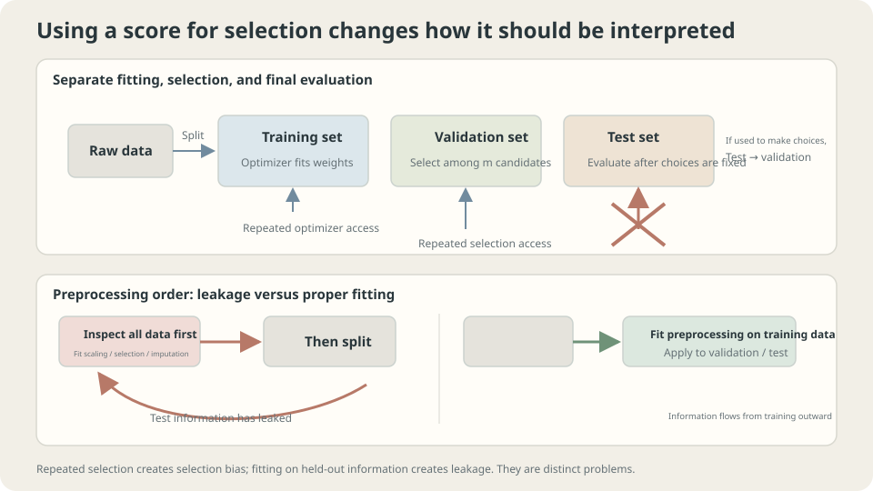

import Objectives from '../../../components/Objectives.astro';
import Ask from '../../../components/Ask.astro';
import Prereq from '../../../components/Prereq.astro';
import Question from '../../../components/Question.astro';
import Answer from '../../../components/Answer.astro';
import QuizBlock from '../../../components/QuizBlock.astro';
import Option from '../../../components/Option.astro';
import Explanation from '../../../components/Explanation.astro';
import VizPlan from '../../../components/VizPlan.astro';
import Details from '../../../components/Details.astro';
import Bridge from '../../../components/Bridge.astro';
import UsedBy from '../../../components/UsedBy.astro';
import Ref from '../../../components/Ref.astro';

# Teaching and Testing with the Same Exam: Why Split Data?

<Objectives title="After reading, you can">
- Explain the distinct roles of training, validation, and test data.
- Derive a fixed-candidate selection bound and state its independence assumptions.
- Detect leakage and reproduce a misleading score on signal-free data.
</Objectives>

<Prereq items={frontmatter.prereqs} />

## Teaching old questions and testing those same questions

A teacher explains past exam questions all semester, then chooses twenty of those questions for the final.

The class averages ninety-two.

That score measures familiar-question performance. It does not establish transferable understanding, nor prove its absence.

In machine learning, similar dependence occurs at several levels:

1. Model parameters use training examples, making training performance optimistic.
2. Hyperparameter selection uses validation examples, making the winning validation score optimistic.
3. Preprocessing can import evaluation information before fitting even begins.

Unlike the toy, real sales data do not expose the true response function. **Can we reserve examples unused in learning decisions to estimate fresh-data performance?**

<Ask>
The toy supplied the true function.<br />
Real projects supply only observations.<br />
How can we estimate performance on unseen data?
</Ask>

<Question label="Discussion" id="Q1">
What questions do the three datasets answer? What changes when a test score influences a new modeling decision?

<Answer summary="Show the reasoning">
Use three roles:

| Set | Question | Decision-maker |
|---|---|---|
| Training | Which parameters fit this configuration? | Optimizer |
| Validation | Which configuration should be selected? | Modeling procedure |
| Test | How well does the frozen final procedure perform? | Evaluation after selection |

For candidates fixed independently of validation, each score can be unbiased while the selected minimum is optimistic. Concavity of minimum gives $\mathbb E[\min_j\widehat R_j]\le\min_j\mathbb E[\widehat R_j]$. Selection favors both genuine quality and favorable evaluation noise.

Reading a test score again does not alter it. **Using it to change the model, training duration, or threshold** makes the subsequent procedure depend on that test data. A final independent assessment is then needed for the revised procedure.

> **Observation alone is not the issue; adapting decisions to the evaluation data is.**

</Answer>
</Question>

## Decisions create dependence

Think of independent evaluation data as a resource whose role changes when used for selection.

- Parameter fitting makes training scores dependent on the fit.
- Comparing configurations creates winner-selection optimism.
- Repeated adaptive experimentation can create additional dependence on validation.

A third set helps only if it stays outside the decisions being evaluated. Reusing it as feedback turns it into another development set.

**Leakage** lets unavailable evaluation information enter training or selection. It can occur even when the final fitting code appears to respect a split.

- **Preprocessing across the split:** fitting scaling, imputation, PCA, or feature selection using held-out information.
- **Related observations across sides:** duplicate documents, augmented copies, or repeated observations from the same evaluation unit.
- **Future information:** training or feature construction uses data unavailable at the intended prediction time.



*Selection and preprocessing leakage create different dependencies that ordinary score plots may not reveal.*

## Candidate count and optimism

Assume $m$ candidates fixed before seeing independent iid validation examples and loss in $[0,1]$. Hoeffding's inequality plus a union bound yields

$$
\mathbb P\Big(\max_{j\le m}\big|\widehat R_{\text{val}}(f_j)-R(f_j)\big|>t\Big)\le 2m\,e^{-2n_{\text{val}}t^2}
\ \Longrightarrow\
t\approx\sqrt{\frac{\log m+\log(2/\delta)}{2\,n_{\text{val}}}}.
$$

The bound grows with $\sqrt{\log m}$ and shrinks with $1/\sqrt{n_{\mathrm{val}}}$. It is an uncertainty bound, not an exact formula for realized optimism.

Count the complete prespecified candidate family. Adaptively inventing candidates from validation results violates the fixed-family premise; inserting the number of adaptive attempts does not automatically restore the bound.

Leakage can break independence entirely. Its magnitude varies, and good-looking scores do not establish a valid evaluation procedure.

<Details label="Details" summary="Jensen and the winning validation score">
For independently fixed candidates, let $Z_j=\widehat R_{\mathrm{val}}(f_j)$ with $\mathbb E Z_j=R(f_j)$. Since minimum is concave,

$$
\mathbb E\big[\min_j Z_j\big]\ \le\ \min_j \mathbb E[Z_j]=\min_j R(f_j).
$$

The expected minimum score is no larger than the best candidate's true risk. The selected model's true risk is itself no smaller than that best risk, giving expected optimism relative to the selected model too.

The amount depends on score variability, candidate correlations, and true-risk differences. Highly correlated evaluation noise can limit selection effects; candidate count alone does not determine the actual gap.
</Details>

## Rules and their reasons

**Fit learned preprocessing inside the training split.** Estimate means, imputation values, feature lists, PCA, and similar transformations on training data, then apply them unchanged to held-out examples. Independently fixed transformations need not be fitted anew.

**Split at the deployment unit.** Keep a patient's images, a user's records, or copies of one source together when the intended task is generalization to new such units.

**Respect temporal availability.** For forecasting, train on earlier data and validate later, with feature construction restricted to information available at prediction time.

**Freeze before final evaluation.** Record the intended model, metric, and analysis before using the test score. Access control and an experiment log can help maintain this separation.

The evaluation population must match the question. Later-time or new-region tests intentionally measure transfer under shift rather than iid performance. Small test sets also have uncertainty; interpret method differences using an appropriate paired analysis rather than an arbitrary percentage cutoff.

## Two experiments

**Selection:** repeatedly split 120 toy observations into 60 training, 30 validation, and 30 test examples, selecting among polynomial/ridge candidates. Representative medians over 600 repetitions are

```
5 candidates:   validation 0.0241  test 0.0250  population 0.0251
20 candidates:  validation 0.0234  test 0.0257  population 0.0261
200 candidates: validation 0.0224  test 0.0251  population 0.0255
```

The test and population values are close here, while selected validation scores are lower. These are medians, whereas unbiasedness is an expectation statement. Three observations do not establish an exact square-root-logarithmic bias law.

The example demonstrates that the winning development score can overstate performance. Neither its relative gap nor monotonic growth is universal; record the full selection procedure and evaluate independently.

**Leakage:** generate independent fair binary labels and a thousand pure-noise features. Expected fresh-data accuracy is 50%, though finite evaluations fluctuate.

```python
import numpy as np
rng = np.random.default_rng(0)
n,p,K,k_sel = 100,1000,5,20
acc_wrong,acc_right = [],[]
for rep in range(50):
    X = rng.standard_normal((n,p))
    y = rng.integers(0,2,n)
    folds = np.array_split(rng.permutation(n),K)
    def cv(select_inside):
        if not select_inside:
            corr = [abs(np.corrcoef(X[:,j],y)[0,1]) for j in range(p)]
            sel_all = np.argsort(-np.array(corr))[:k_sel]
        out = []
        for f in folds:
            te,tr = f,np.setdiff1d(np.arange(n),f)
            if select_inside:
                corr = [abs(np.corrcoef(X[tr,j],y[tr])[0,1]) for j in range(p)]
                sel = np.argsort(-np.array(corr))[:k_sel]
            else:
                sel = sel_all
            A = np.c_[np.ones(len(tr)),X[np.ix_(tr,sel)]]
            w = np.linalg.lstsq(A,y[tr]*2-1,rcond=None)[0]
            B = np.c_[np.ones(len(te)),X[np.ix_(te,sel)]]
            out.append((((B@w)>0).astype(int)==y[te]).mean())
        return np.mean(out)
    acc_wrong.append(cv(False))
    acc_right.append(cv(True))
print('feature selection before CV:',np.mean(acc_wrong))
print('feature selection inside each fold:',np.mean(acc_right))
```

```
feature selection before CV:          0.814
feature selection inside each fold:   0.491
```

**The apparent 81.4% accuracy comes from a dataset with no predictive signal.**

Among many noise features, some happen to correlate with all observed labels. Choosing them globally encodes held-out labels into the feature list. Subsequent cross-validation cannot undo that information path.

In real pipelines, this can be a single misplaced operation:

- Fitting a scaler before the split.
- Learning PCA or an embedding from data the evaluation protocol should keep unseen.
- Selecting important features with all labels before cross-validation.
- Augmenting or oversampling before assigning related copies to splits.

Leakage may leave normal-looking curves. An untouched external set or a carefully designed shuffled-label check can expose problems, though neither is a complete proof of correctness. Rerun the **whole** fitting and selection procedure when testing shuffled labels.

> **Define the evaluation split before fitting data-dependent transformations.**

## Selection count and preprocessing order

<iframe loading="lazy" src="/personal_website/notes/research_areas/machine-learning-foundations/l1-generalization/l1-2-2.en.html" class="demo-frame" title="Selection bias and preprocessing leakage" style="height: 812px; width: 100%; border: none;"></iframe>

**Vary candidate count and validation size to inspect selection effects.**

## Check your understanding

<QuizBlock id="ml-l1-2-a">
After months of adapting ideas to one validation set, a team reports the best of its final three candidates on that same set. What is missing?
<Option>A larger architecture.</Option>
<Option correct>An independent evaluation of the full adaptive selection procedure.</Option>
<Option>Nothing, if the reused set is sufficiently large.</Option>
<Explanation>The final three do not represent the entire adaptive search. A fixed-family bound cannot be invoked merely by counting those final options or all adaptive attempts.</Explanation>
</QuizBlock>

<QuizBlock id="ml-l1-2-b">
Reduce the noise experiment to twenty features while selecting twenty. What should happen to this specific feature-selection leak?
<Option>The apparent 81% must remain unchanged.</Option>
<Option correct>The selection effect can weaken or disappear when all features are retained, but finite scores still fluctuate and the workflow should remain correctly split.</Option>
<Option>Fewer noise candidates necessarily increase optimism.</Option>
<Explanation>The artificial signal came from searching many noise features with held-out labels. Its magnitude depends on what is selected, not merely the existence of a feature-selection function call.</Explanation>
</QuizBlock>

<QuizBlock id="ml-l1-2-c">
Which workflow preserves the held-out role for standardization?
<Option>Fit means and scales on the entire dataset, then split.</Option>
<Option>Create augmented copies first, then randomly distribute related copies.</Option>
<Option correct>Fit scaling on training examples and apply that fixed transformation to validation and test.</Option>
<Explanation>Transformation parameters must come from the allowed training information for the evaluation protocol. Each cross-validation training fold needs its own fitted preprocessing.</Explanation>
</QuizBlock>

<UsedBy slug={frontmatter.slug} />

<Bridge to="ml-cross-validation">
A single split can leave little training data and a noisy validation estimate. Next rotate held-out folds to use observations more efficiently, while checking overlapping-training dependence and why time-structured data need a different split design.
</Bridge>

## References

1. Hastie, T., Tibshirani, R., Friedman, J. [*The Elements of Statistical Learning*](https://hastie.su.domains/ElemStatLearn/), 2nd ed. Springer 2009, Ch. 7.10.2.
2. Kaufman, S., Rosset, S., Perlich, C. [*Leakage in Data Mining: Formulation, Detection, and Avoidance.*](https://doi.org/10.1145/2020408.2020496) KDD 2011.
3. Kapoor, S., Narayanan, A. [*Leakage and the Reproducibility Crisis in ML-based Science.*](https://doi.org/10.1016/j.patter.2023.100804) Patterns 2023.
