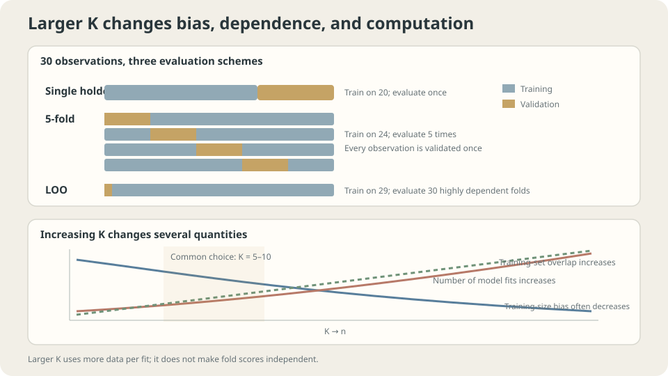

import Objectives from '../../../components/Objectives.astro';
import Ask from '../../../components/Ask.astro';
import Prereq from '../../../components/Prereq.astro';
import Question from '../../../components/Question.astro';
import Answer from '../../../components/Answer.astro';
import QuizBlock from '../../../components/QuizBlock.astro';
import Option from '../../../components/Option.astro';
import Explanation from '../../../components/Explanation.astro';
import VizPlan from '../../../components/VizPlan.astro';
import Remark from '../../../components/Remark.astro';
import Bridge from '../../../components/Bridge.astro';
import UsedBy from '../../../components/UsedBy.astro';
import Ref from '../../../components/Ref.astro';

# Only Thirty Examples: Cross-Validation

<Objectives title="After reading, you can">
- State the target of cross-validation and compare it with a single holdout.
- Explain how fold count affects training size, dependence, and computation.
- Choose splits matching the deployment task and test temporal interpolation versus forecasting.
</Objectives>

<Prereq items={frontmatter.prereqs} />

## Thirty examples and a difficult split

Independent evaluation requires holding some observations out.

With thirty examples, holding out ten leaves only twenty for training. That evaluates a smaller-training-set procedure, while the ten-example score can fluctuate substantially across splits.

More held-out examples improve evaluation precision but leave fewer examples for fitting; fewer held-out examples have the opposite tradeoff.

In **five-fold cross-validation**, split into five groups, train on twenty-four observations each time, and evaluate on the remaining six. Average the scores. This uses every observation for held-out evaluation but requires five fits.

We will compare stability, fold counts, and split validity. The temporal example shows why interpolating between observed neighbors answers a different question from predicting future observations.

<Ask>
Can every example contribute held-out evaluation,<br />
while also being used for training in other fits?<br />
What quantity would that average estimate?
</Ask>

<Question label="Discussion" id="Q1">
Does K-fold estimate the risk of the final full-data model? Why are its fold scores not independent measurements?

<Answer summary="Show the reasoning">
For a fixed learning procedure $\mathcal A$ and dataset $D$, define

$$
\mathrm{CV}_K=\frac1K\sum_{k=1}^K \widehat R_{D_k}\big(\mathcal A(D\setminus D_k)\big).
$$

Each fit uses approximately $n(1-1/K)$ training observations. Under iid sampling and the relevant protocol assumptions, CV estimates expected risk at that training size, rather than the conditional risk of the particular final full-data fit. It can be pessimistic if more training data improves expected risk, but that monotonic improvement is not universal.

Rotating held-out observations reduces dependence on one particular partition. It evaluates different fitted models, not independent losses from one common model, and need not outperform every possible holdout design.

In general, variance of the average includes every fold covariance. Only under the additional illustrative assumptions of equal variances $\sigma^2$ and equal pairwise correlation $\rho$ do we obtain

$$
\mathrm{Var}\Big(\frac1K\sum_k Z_k\Big)=\frac{\sigma^2}{K}+\frac{K-1}{K}\,\rho\,\sigma^2
$$

Training overlap alone does not determine $\rho$. There is no distribution-free unbiased variance estimator from one K-fold result applicable to every setting [2].

> **Do not treat fold standard deviation divided by $\sqrt K$ as a generally valid standard error.**

</Answer>
</Question>

## Allocate a limited data budget

Changing $K$ changes several resources:

- **Small $K$:** smaller training subsets and fewer fits. Training-size mismatch can matter.
- **Large $K$, including leave-one-out:** training subsets approach full size but require more fits. Their strong overlap creates dependence whose effect also depends on algorithm stability and data.

Five or ten folds are common compromises, not universal optima. Choose using data quantity, learning behavior, and compute cost.

Two useful variants are

- **Stratification:** preserve class representation where possible. Extremely rare classes may still limit feasible fold designs.
- **Repeated CV:** repeat partitions to reduce partition-specific fluctuation, at additional cost. This does not create new independent datasets.



*Fold count affects training size, overlapping fits, and computation together.*

## Target, uncertainty, and limitations

Define $\mu(m)=\mathbb E_{D\sim p^m}[R(\mathcal A(D))]$. For equal-sized iid folds and a fixed procedure,

$$
\mathbb E\big[\mathrm{CV}_K\big]=\mu\big(n-n/K\big).
$$

This is an algorithm-level expectation at a specified training size. The particular fitted model's conditional risk is different. The distinction matters for both comparisons and reported performance, especially if selection uses the same CV scores.

Under the equal-variance/equal-correlation illustration,

$$
\mathrm{Var}(\mathrm{CV}_K)=\frac1{K^2}\left(\sum_k\mathrm{Var}(Z_k)+2\sum_{k<l}\mathrm{Cov}(Z_k,Z_l)\right).
$$

Fold spread describes observed variation but does not directly supply a reliable confidence interval. Compare methods on paired folds when appropriate. Repeated partitions still reuse the same observations and do not automatically estimate independent-dataset uncertainty.

Related patients, spatial neighbors, time dependence, duplicates, and leaked preprocessing can all invalidate the intended iid evaluation interpretation.

<Remark label="Supplement" summary="Why leave-one-out is not automatically best">
Leave-one-out minimizes the difference in training count from a full-data fit. That alone neither guarantees the smallest bias in arbitrary procedures nor determines total estimation error.

Its variance depends on stability and data, not just overlapping training sets. The example below reports lower fixed-configuration score spread for LOO than five-fold, but that is one experiment.

Unstable procedures can respond sharply to leaving one point out. LOO still has a defined evaluation target, but its score and selected configuration may vary substantially across datasets.

Five or ten folds often provide useful practical compromises. LOO can be attractive for tiny datasets, stable procedures, or analytic shortcuts such as linear-model hat-matrix formulas.
</Remark>

## When random folds answer the wrong question

**Choose boundaries that reflect what future evaluation units can share with training.**

- **Forecasting:** train on earlier data and evaluate later, using forward or rolling splits with the intended horizon.
- **New groups:** keep each patient's, user's, or source document's related rows together.
- **New spatial regions:** consider blocked splits when nearby points share information unavailable for the target generalization question.

Fit the entire learned preprocessing pipeline inside each training fold. State remaining sampling assumptions and the difference between fold-training and final-training sizes. A split design is valid relative to an intended use, not simply because it has a familiar name.

## Stability and a mismatched temporal task

**First experiment:** repeat sampling thirty toy examples, selecting degrees one through twelve under each evaluation design. Representative results are

```
                     selected-degree SD   selected-risk median   degree-five score SD
single holdout       2.21                 0.0311                 0.4069
five-fold            1.55                 0.0302                 0.0304
leave-one-out        1.70                 0.0306                 0.0190
```

For the fixed degree-five procedure in this experiment, five-fold reduces score spread by roughly thirteen times relative to the particular holdout. That is a measured comparison, not a universal improvement factor.

The median risk of the selected model changes much less because several nearby degrees perform similarly. Greater score stability does not imply equally large predictive improvement.

> **Evaluation can improve the quality of our evidence without comparably improving the model itself.**

LOO's selected degree varies more than five-fold here despite its smaller fixed-degree score spread. Those are different statistics; training overlap alone does not explain their numerical ratio.

**Second experiment:** an AR(1) sequence $y_i=0.97y_{i-1}+\varepsilon_i$ contains temporal predictive information. Random folds may allow observations on both sides of a missing point; forecasting cannot use future neighbors.

```python
import numpy as np
n = 200
idx = np.arange(n)
r = np.random.default_rng(0)
y = np.zeros(n)
for i in range(1,n):
    y[i] = .97*y[i-1]+.1*r.standard_normal()
def predict(tr,te):
    return np.array([y[tr[np.argsort(np.abs(tr-i))[:5]]].mean() for i in te])
folds = np.array_split(r.permutation(n),5)
rand = np.mean([((predict(np.setdiff1d(idx,f),f)-y[f])**2).mean() for f in folds])
fwd = np.mean([((predict(idx[:k*40],idx[k*40:(k+1)*40])-y[k*40:(k+1)*40])**2).mean() for k in range(1,5)])
print('random CV:',rand,'forward blocks:',fwd)
```

A separate outer loop over two hundred generated sequences gives representative means:

```
random five-fold interpolation MSE:  0.0095
forward-block forecasting MSE:       0.1392
training-period-mean forecast MSE:   0.1559
```

These tasks differ in available information and prediction horizon. The code shows one sequence; reproducing the table requires repeated generation. The sequence is not signal-free and is not a pure random walk.

Neighbor averaging interpolates well with nearby past and future values. For the intended future-prediction task, evaluate using past-only information. For genuine missing-value interpolation, another split can be appropriate.

Timestamped data do not make every random split invalid for every task. Specify deployment availability and horizon, then compare a matching temporal evaluation. A score change can reflect leakage, horizon differences, or population changes, rather than proving one cause automatically.

## Split design, fold count, and dependence

<iframe loading="lazy" src="/personal_website/notes/research_areas/machine-learning-foundations/l1-generalization/l1-3-2.en.html" class="demo-frame" title="Cross-validation: fold count, dependence, and deployment-matched splits" style="height: 833px; width: 100%; border: none;"></iframe>

**Compare fold counts and split designs while keeping the target task explicit.**

## Check your understanding

<QuizBlock id="ml-l1-3-a">
A report divides five fold-score standard deviation by $\sqrt5$ to claim a confidence interval. What is missing?
<Option>Nothing.</Option>
<Option correct>Fold dependence and the intended uncertainty target must be addressed.</Option>
<Option>LOO automatically fixes the interval.</Option>
<Explanation>The average's variance contains covariance terms. Neither a new fold count nor ignoring those terms establishes a generally reliable interval.</Explanation>
</QuizBlock>

<QuizBlock id="ml-l1-3-b">
Five-fold score variation remains large after improving over holdout. What follows for a small claimed method improvement?
<Option>Abandon CV entirely.</Option>
<Option correct>Examine paired differences and uncertainty; a single noisy score is insufficient.</Option>
<Option>Return to the less stable holdout automatically.</Option>
<Explanation>Method differences can be more stable than individual scores when paired. Single-method spread alone neither establishes nor excludes every small improvement.</Explanation>
</QuizBlock>

<QuizBlock id="ml-l1-3-c">
Customers have twelve monthly rows each. Random row-wise CV greatly exceeds deployment performance. What should be checked first?
<Option>Only model size.</Option>
<Option correct>Whether shared-customer and future-month information crosses folds; choose group and temporal rules matching deployment.</Option>
<Option>Assume distribution shift without checking the split.</Option>
<Explanation>Regularization cannot repair a mismatched evaluation protocol. Grouping depends on whether deployment targets new customers or future records of known customers; temporal availability remains explicit.</Explanation>
</QuizBlock>

<UsedBy slug={frontmatter.slug} />

<Bridge to="ml-learning-curves">
Once the split matches its intended use, the score has a clear target. Next vary data quantity, capacity, and training duration to decide which additional resource improves performance, rather than guessing from one number.
</Bridge>

## References

1. Hastie, T., Tibshirani, R., Friedman, J. [*The Elements of Statistical Learning*](https://hastie.su.domains/ElemStatLearn/), 2nd ed. Springer 2009, Ch. 7.10.
2. Bengio, Y., Grandvalet, Y. [*No Unbiased Estimator of the Variance of K-Fold Cross-Validation.*](https://www.jmlr.org/papers/v5/grandvalet04a.html) JMLR 2004.
3. Bergmeir, C., Benítez, J. M. [*On the use of cross-validation for time series predictor evaluation.*](https://doi.org/10.1016/j.ins.2011.12.028) Information Sciences 2012.
