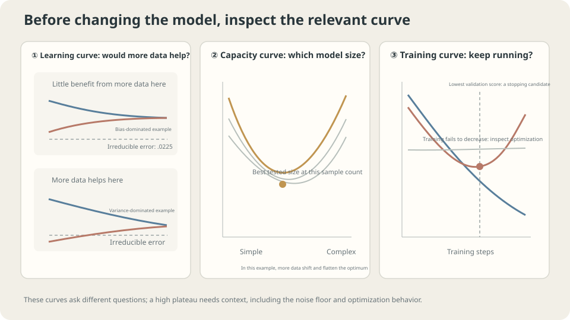

import Objectives from '../../../components/Objectives.astro';
import Ask from '../../../components/Ask.astro';
import Prereq from '../../../components/Prereq.astro';
import Question from '../../../components/Question.astro';
import Answer from '../../../components/Answer.astro';
import QuizBlock from '../../../components/QuizBlock.astro';
import Option from '../../../components/Option.astro';
import Explanation from '../../../components/Explanation.astro';
import VizPlan from '../../../components/VizPlan.astro';
import Remark from '../../../components/Remark.astro';
import Bridge from '../../../components/Bridge.astro';
import UsedBy from '../../../components/UsedBy.astro';
import Ref from '../../../components/Ref.astro';

# More Data, a Different Model, or More Training? Learning Curves

<Objectives title="After reading, you can">
- Draw error against sample count, capacity, and training duration.
- Use curve trends to propose controlled interventions rather than automatic diagnoses.
- Assess validation uncertainty and the assumptions behind extrapolating future gains.
</Objectives>

<Prereq items={frontmatter.prereqs} />

## Three proposals and one budget

Before launch, performance is insufficient and three colleagues propose changes:

- **A:** label ten thousand more examples, taking months and substantial cost.
- **B:** build a model ten times larger, increasing implementation and training costs.
- **C:** train longer, which is useful only if the extra computation improves the goal.

**Can smaller controlled experiments reveal which investment is promising?** Learning curves provide evidence, not guaranteed predictions.

Train on subsets to inspect error versus sample count. Likewise vary capacity and update count, controlling the other choices and recording both training and validation scores.

This closes the generalization unit by turning fitting, bias–variance, splits, and CV into practical comparisons.

<Ask>
Which resource is missing: data, capacity, or training time?<br />
Can a smaller experiment inform the expense?<br />
How uncertain is that evidence?
</Ask>

<Question label="Discussion" id="Q1">
What are the three horizontal axes, and which curve features help assess more data?

<Answer summary="Show the reasoning">
Plot training and independent validation loss against each axis:

| Curve | Horizontal axis | Proposal |
|---|---|---|
| Sample-size curve | Training count $n$ | More data |
| Capacity curve | A specified flexibility setting | Different model |
| Training curve | Update count | More training |

For sample-size curves, inspect

1. **The gap and slope:** a large gap with improving validation can motivate testing more data or regularization; it does not uniquely identify variance.
2. **The apparent plateau:** scores meeting far above a relevant baseline can motivate checking features, capacity, and optimization. A short flat segment does not prove more data can never help.

Use subsets such as $n/8,n/4,n/2,n$, with repetitions and uncertainty, before making a costly extrapolation.

> **Inspect where the curves appear to meet, then test the assumptions behind that interpretation.**

</Answer>
</Question>

## Shapes suggest experiments

Two common sample-size patterns are

- **High similar plateaus:** investigate restricted capacity, weak features, objective mismatch, or insufficient optimization.
- **A substantial gap with improving validation:** compare additional relevant data, regularization, or a more suitable family.

Capacity curves may show the classical tradeoff in <Ref to="ml-overfitting-underfitting" mode="title"/>, but need not be U-shaped universally. Their best configuration can change with sample count.

For training curves, both scores decreasing can motivate more updates. Falling training loss with worsening validation can motivate early stopping. A flat training curve warrants optimization and capacity checks, but can also reflect a sensible optimum or noise floor.

Irreducible population error and strong baselines help interpret plateaus. Repeated measurements and expert agreement can inform that reference with appropriate caveats. Training loss itself has no universal hard noise floor.



*The three axes answer different questions; reference levels and uncertainty make their trends interpretable.*

## Connect the shapes to risk

For squared loss, the repeated-training decomposition gives

$$
\begin{aligned}
\mathbb E[R(\hat f_n)]
&=\underbrace{\mathbb E_X\operatorname{Var}(Y\mid X)}_{\text{irreducible}}\\
&\quad+\underbrace{\mathbb E_X\operatorname{bias}_n(X)^2}_{\text{mean prediction error}}\\
&\quad+\underbrace{\mathbb E_X\operatorname{Var}_D(\hat f_n(X))}_{\text{training variability}}.
\end{aligned}
$$

Both bias and variance may depend on $n$. A stable positive bias plus decreasing variance can produce a plateau, but the identity does not force that pattern. Training–validation gap is not identical to prediction variance or estimation error.

$$
\text{validation loss}\ \searrow\ \sigma^2+\operatorname{bias}^2\ \nwarrow\ \text{training loss}
\qquad\text{(an illustrative pattern, not a general identity)}
$$

Subset curves can suggest diminishing returns or modeling limitations, but do not prove an eventual plateau from a few observations. Power-law fits can summarize empirical scaling regimes [2]; extrapolation outside them is an additional hypothesis.

<Remark label="Caution" summary="Two extrapolation traps">
**Fitting a power law outside its regime:** small-data behavior, changing optimization, or a nonzero floor can bend a log–log curve. Several measured points and held-out checks are stronger evidence than extending a line through two points; there is no magic count that guarantees a valid extrapolation.

**New data are different:** subset curves describe more data drawn like the existing sample. New times, sources, or annotators can change the distribution and labeling process.

Compare performance on a recent representative batch as well. A mismatch motivates checking distribution, labeling, processing, and sampling uncertainty rather than attributing the result solely to quantity.
</Remark>

## Prioritize the proposals

**Check inexpensive explanations first:** inspect optimization progress and useful baselines. More updates are a controlled experiment, not automatically the cheapest option at every scale.

**Run a small-subset fit:** reduce constraints temporarily and inspect gradients, loss, and capacity. Passing validates that limited test, not the entire task or generalization pipeline.

**Then vary sample count:** repeated subset experiments can motivate comparing added data against modeling changes. Estimate gains with uncertainty rather than treating the observed slope as an exact forecast.

State which procedure the curve measures. Holding hyperparameters fixed estimates that fixed configuration; retuning within each subset estimates an adaptively selected procedure and requires nested evaluation. Neither curve is inherently wrong, but they answer different questions. Keep evaluation independent and subsets representative.

## Measured curves

**Sample count:** compare degree two and degree twelve on the shared toy. Representative medians over sixty repetitions are

```
n     d=2 train  d=2 risk   d=12 train  d=12 risk
10    0.1393     0.2904     —           —
20    0.1720     0.2493     0.0071      3.7113
40    0.2007     0.2409     0.0138      0.0458
80    0.2125     0.2275     0.0181      0.0282
160   0.2129     0.2246     0.0205      0.0247
320   0.2162     0.2227     0.0214      0.0235
640   0.2182     0.2213     0.0219      0.0229
```

The two procedures show very different returns from additional examples.

Degree two approaches a risk around 0.22, far above noise 0.0225. Increasing from 160 to 640 brings little improvement. Its restricted family motivates a modeling change rather than assuming another large annotation investment is best.

Degree twelve improves strongly, approaching risk 0.0229 at 640 examples. In this controlled toy, little population MSE remains above the known floor. At twenty examples, its thirteen coefficients are fewer than observations, but estimation is still unstable.

At twenty examples, degree two wins this comparison; at forty, degree twelve wins. Data quantity and useful capacity should therefore be planned together.

**Training duration:** use thirty training and 120 validation examples with a degree-twenty-nine model under fixed-rate full-batch gradient descent:

```
updates     training   validation   population risk
100         0.0713     0.1167       0.1317
1000        0.0516     0.0905       0.1015
10000       0.0302     0.0476       0.0502
100000      0.0196     0.0290       0.0290
1000000     0.0147     0.0324       0.0318
5000000     0.0130     0.0434       0.0458

Selected validation minimum: update 179270, validation 0.0284, population 0.0277.
```

Training loss keeps decreasing while fresh-data risk first improves and later worsens. Optimizing the training objective longer is not equivalent to optimizing population performance.

The architecture, observations, loss, and rate stay fixed. Duration alone changes the fitted function and its sensitivity to the training sample.

> **Training duration can act as a regularization choice.**

Early stopping selects a checkpoint using validation behavior, often with patience or other rules to handle noise. It adds an evaluation and selection cost, even without changing the architecture.

That selection makes the winning validation score optimistic too. Use independent final evaluation. The toy's known population mechanism exposes the difference directly.

**Evaluation uncertainty:** for a fixed model with risk 0.0258, repeated independent validation samples give representative results:

```
validation n=15:  mean 0.0257, SD 0.0092, approximate central width 0.0368
validation n=60:  mean 0.0260, SD 0.0046, approximate central width 0.0185
validation n=240: mean 0.0259, SD 0.0023, approximate central width 0.0094
```

The fixed-model sample means are unbiased under iid evaluation, but their uncertainty can exceed the trend being interpreted. These displayed repeated-sampling summaries are not automatically confidence intervals for every individual realized score.

A curve also invites selecting among many noisy points. Compare paired changes and appropriate uncertainty; overlapping error bars alone are not a general significance test. More evaluation data or a suitable resampling design may improve evidence before changing the model.

## Compare the curves with uncertainty

<iframe loading="lazy" src="/personal_website/notes/research_areas/machine-learning-foundations/l1-generalization/l1-4-2.en.html" class="demo-frame" title="Learning curves across data, capacity, and duration" style="height: 921px; width: 100%; border: none;"></iframe>

**Each axis asks a different resource-allocation question.**

## Check your understanding

<QuizBlock id="ml-l1-4-a">
After checking optimization and scoring, training and validation plateau near 0.20 while population noise is about 0.02. What should be tested before assuming more data is best?
<Option correct>Better features or a more appropriate model, while retaining uncertainty about extrapolated data gains.</Option>
<Option>Automatically keep the family fixed and label ten thousand examples.</Option>
<Option>Assume the plateau alone proves more data can never help.</Option>
<Explanation>A persistent high plateau supports investigating modeling restrictions. Bias and optimization can themselves change with data, so this is evidence for the next experiment rather than a universal guarantee.</Explanation>
</QuizBlock>

<QuizBlock id="ml-l1-4-b">
Training loss decreases after 100,000 updates while population risk worsens. What does this illustrate?
<Option>Gradient descent must be numerically diverging.</Option>
<Option correct>Duration affects generalization, and early stopping can regularize a fixed model.</Option>
<Option>The learning rate must be too small.</Option>
<Explanation>Convergence of the training objective and best fresh-data performance are different goals. Select a checkpoint with development data and assess the selected procedure independently.</Explanation>
</QuizBlock>

<QuizBlock id="ml-l1-4-c">
Degree twelve wins with abundant data but loses at twenty examples. Which conclusion is justified?
<Option>Always choose degree twelve.</Option>
<Option correct>Choose capacity relative to available and expected data, using an appropriate evaluation procedure.</Option>
<Option>Always choose the more stable small family.</Option>
<Explanation>Sample-size and capacity curves are sections of a joint comparison. Their choices interact rather than forming independent decisions.</Explanation>
</QuizBlock>

<UsedBy slug={frontmatter.slug} />

<Bridge to="ml-minibatch-noise">
Learning curves help choose controlled experiments, but full-data gradients can make each update expensive. Next estimate directions from small batches and examine how gradient noise affects training.
</Bridge>

## References

1. Ng, A. [*Machine Learning Yearning*](https://info.deeplearning.ai/machine-learning-yearning-book) 2018, Ch. 20–32.
2. Hestness, J. et al. [*Deep Learning Scaling is Predictable, Empirically.*](https://arxiv.org/abs/1712.00409) arXiv 2017.
3. Prechelt, L. [*Early Stopping — But When?*](https://doi.org/10.1007/3-540-49430-8_3) Neural Networks: Tricks of the Trade, Springer 1998.
