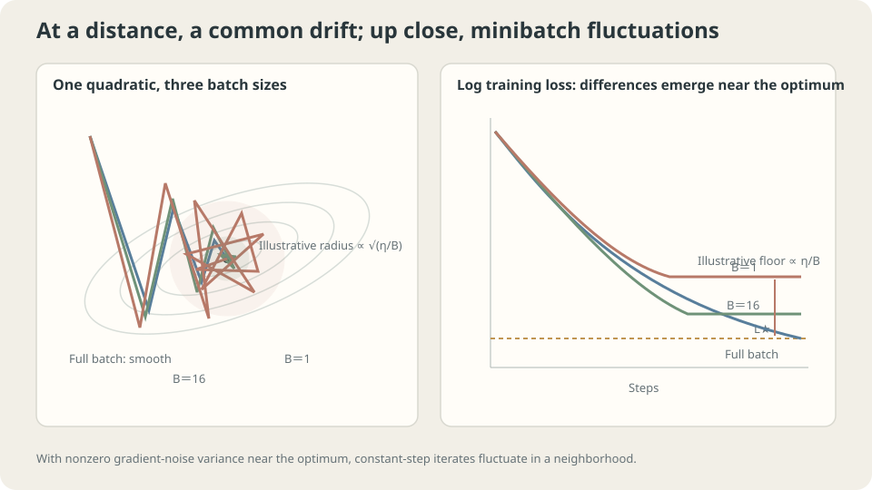

import Objectives from '../../../components/Objectives.astro';
import Ask from '../../../components/Ask.astro';
import Prereq from '../../../components/Prereq.astro';
import Question from '../../../components/Question.astro';
import Answer from '../../../components/Answer.astro';
import QuizBlock from '../../../components/QuizBlock.astro';
import Option from '../../../components/Option.astro';
import Explanation from '../../../components/Explanation.astro';
import VizPlan from '../../../components/VizPlan.astro';
import Remark from '../../../components/Remark.astro';
import Bridge from '../../../components/Bridge.astro';
import UsedBy from '../../../components/UsedBy.astro';
import Ref from '../../../components/Ref.astro';

# Polling a Small Sample: Minibatch Gradients and Noise

<Objectives title="After reading, you can">
- Derive unbiasedness at fixed parameters and $1/B$ gradient variance with its sampling correction.
- Calculate a persistent-noise floor for a stable quadratic update.
- Explain the approximate $\eta/B$ tradeoff and where it fails to describe training.
</Objectives>

<Prereq items={frontmatter.prereqs} />

## Estimate a population by asking a small sample

A poll surveys a thousand people out of millions and reports a proportion with uncertainty.

For ideal iid Bernoulli sampling, the sample mean is unbiased and its conservative normal-approximation margin is about $1.96\sqrt{0.25/1000}\approx3.1\%$. Real surveys also involve sampling and response biases. We borrow only the mathematical idea of estimating an average from a random subset.

A full-data training gradient is another average:

$$
g=\nabla L(\theta)=\frac1n\sum_{i=1}^n \nabla \ell\big(f_\theta(x_i),y_i\big).
$$

When the dataset is huge, repeatedly evaluating every example at every update becomes expensive.

<Ask>
Can a small batch provide a useful gradient?<br />
What uncertainty does it introduce?<br />
Does taking more updates automatically remove that uncertainty?
</Ask>

<Question label="Discussion" id="Q1">
Define the batch estimate. Is its discrepancy bias or variation, and why does moving parameters complicate averaging?

<Answer summary="Show the reasoning">
At fixed parameters, uniformly sample a batch $S$ of size $B$ and average its per-example gradients:

$$
g_B=\frac1B\sum_{i\in S}\nabla \ell\big(f_\theta(x_i),y_i\big).
$$

Uniform sampling makes the expected average equal the full gradient:

$$
\mathbb E[g_B]=g .
$$

Thus $g_B$ is an **unbiased estimate** of the empirical gradient under the stated sampling scheme. It is also an approximation, but one with a precise statistical property.

Let $\sigma_g^2=\mathbb E_i\|\nabla\ell_i-g\|^2$ at this parameter value. For independent sampling with replacement,

$$
\mathbb E\lVert g_B-g\rVert^2=\frac{\sigma_g^2}{B}.
$$

Quadrupling $B$ quarters expected squared error, hence halves its root-mean-square magnitude.

Averaging many batches at one fixed parameter reduces uncertainty. SGD instead moves after every batch, so noise changes the position where the next gradient is evaluated. Persistent noise near a minimizer can therefore sustain a nonzero stationary spread.
</Answer>
</Question>

## Noisy downhill directions

Replace the exact local slope in <Ref to="ml-gradient-descent" mode="title"/> with an instrument whose errors average to zero at the queried position.

Each update contains

- **Gradient drift:** the leading local objective decrease is approximately $\eta\|g\|^2$ for a sufficiently small stable step.
- **Random displacement:** its RMS size is approximately $\eta\sigma_g/\sqrt B$ under replacement sampling.

Far from the solution, drift can dominate. If per-example gradients still disagree at the minimizer, noise persists even as their average vanishes. An SDE can approximate some regimes, but its diffusion is generally state-dependent and anisotropic; it is not universally constant isotropic Brownian noise.



*In a suitable local persistent-noise model, stationary parameter spread scales roughly as $\sqrt{\eta/B}$.*

## Gradient variance and a stationary floor

For one uniformly selected batch without replacement at fixed parameters, the finite-population correction gives

$$
\mathbb E\lVert g_B-g\rVert^2=\frac{\sigma_g^2}{B}\cdot\frac{n-B}{n-1}.
$$

For $B\ll n$, the correction is near one. At $B=n$, it is zero because the entire dataset is the only possible batch.

**A solvable floor model:** assume quadratic curvature $\lambda>0$, $0<\eta\lambda<2$, and conditional centered noise of constant variance $\sigma_g^2/B>0$ at every step. Then

$$
w_{k+1}-w^\star=(1-\eta\lambda)(w_k-w^\star)-\eta\,\xi_k,
\qquad \mathbb E[\xi_k]=0,\ \mathbb E[\xi_k^2]=\frac{\sigma_g^2}{B}.
$$

For $e_k=w_k-w^\star$, the centered cross term vanishes and $\mathbb E[e_{k+1}^2]=(1-\eta\lambda)^2\mathbb E[e_k^2]+\eta^2\sigma_g^2/B$. At stationarity, solve for the second moment:

$$
\mathbb E\big[(w_\infty-w^\star)^2\big]=\frac{\eta^2\sigma_g^2/B}{1-(1-\eta\lambda)^2}\approx\frac{\eta\,\sigma_g^2}{2\lambda B}
\quad\Longrightarrow\quad
\mathbb E[L]-L^\star\approx\frac{\eta\,\sigma_g^2}{4B}.
$$

The small-$\eta\lambda$ excess **objective** is approximately proportional to $\eta/B$. Curvature cancels at leading order for this scalar objective calculation, but the exact finite-step expression still depends on $\eta\lambda$; parameter variance also depends on curvature.

> **A stable quadratic with persistent centered noise can retain an approximately $\eta/B$ excess-loss floor.**

Reducing $\eta$ or increasing $B$ can reduce that floor within this regime. Decreasing-step stochastic approximation uses conditions such as $\sum_k\eta_k=\infty$ and $\sum_k\eta_k^2<\infty$, together with objective, noise, and stability assumptions; those step-size sums alone do not prove arbitrary training converges.

<Remark label="Caution" summary="Possible benefits of noise address another question">
This local model studies spread inside one basin. It does not settle every effect of stochastic training.

In nonconvex landscapes, noise may influence transitions between regions. Basin selection and local stationary spread are distinct effects; see <Ref to="ml-loss-landscape" mode="title"/>.

Generalization effects of batch size depend on task, optimization, and joint tuning. Even the $\eta/B$ floor is a qualified approximation, not a universal theorem for all training settings.
</Remark>

## Sampling assumptions matter

Unbiasedness fixes the current parameters and requires uniform batch selection conditional on them. Fresh independent resampling supports this directly. Random reshuffling followed by sequential batches creates dependence between later batches and current parameters, so per-step conditional unbiasedness is not automatic.

Estimate gradient variability by repeated batches at a fixed checkpoint. This can inform batch comparisons, while remaining local to that checkpoint and sampling scheme.

Estimating a finite empirical gradient does not require dataset rows to be iid; linking that empirical objective to population learning does. Noise may vanish at interpolation solutions, eliminating this particular persistent-noise floor. SGD behavior must be analyzed under the actual assumptions.

## Measure variation and the floor

**Fixed-parameter experiment:** use 120 observations and degree-five features. Repeatedly sample batches without replacement:

```python
import numpy as np
from ml_toy import toy_1d
x,y = toy_1d(n=120,seed=0)
V = np.vander(x,6,increasing=True)
V = V/np.abs(V).max(0)
n = len(x)
w = np.linalg.lstsq(V,y,rcond=None)[0]*.5
g = V.T@(V@w-y)/n
rng = np.random.default_rng(0)
for B in (1,4,16,60,120):
    G = np.array([V[i].T@(V[i]@w-y[i])/B
        for i in (rng.choice(n,B,replace=False) for _ in range(4000))])
    mean_gap = np.linalg.norm(G.mean(0)-g)/np.linalg.norm(g)
    var = ((G-g)**2).sum(1).mean()
    print(B,'relative mean discrepancy',mean_gap,'squared error',var,'B times error',var*B)
```

```
B    relative mean gap   squared error   B times error
1    0.0054              0.22878         0.2288
4    0.0303              0.05433         0.2173
16   0.0172              0.01269         0.2030
60   0.0015              0.00201         0.1207
120  0.0000              0.00000         0.0000
```

Finite Monte Carlo discrepancies fluctuate around the theoretical zero mean difference. The full-data batch agrees exactly. The experiment illustrates unbiasedness; a small discrepancy in one run does not by itself prove it.

Small batches approximately follow $1/B$. At half and full dataset sizes, finite-population correction matters. Compare the measured $B$-scaled values with $\sigma_g^2(n-B)/(n-1)$ rather than a constant alone.

**Stationary behavior:** orthogonalize features so full-batch conditioning is simple. Start at the empirical optimum and average the tail of a long run:

```python
Q = np.linalg.qr(np.vander(x,4,increasing=True))[0]*np.sqrt(n)
L = lambda w:((Q@w-y)**2).mean()
w_opt = np.linalg.lstsq(Q,y,rcond=None)[0]
for eta in (.02,.05,.1):
    for B in (1,4,16):
        rng = np.random.default_rng(1)
        w = w_opt.copy()
        tail = []
        for t in range(60000):
            idx = rng.choice(n,B,replace=False)
            w -= eta*(Q[idx].T@(Q[idx]@w-y[idx]))/B
            if t>=50000: tail.append(L(w))
        delta = np.mean(tail)-L(w_opt)
        print(eta,B,'excess MSE',delta,'scaled',delta/(eta/B))
```

```
eta   B   excess MSE   excess/(eta/B)
.02   1   .00138       .0692
.02   4   .00033       .0660
.02   16  .00007       .0524
.05   1   .00385       .0771
.05   4   .00084       .0673
.05   16  .00018       .0560
.10   1   .00913       .0913
.10   16  .00037       .0596
```

The scaled excess stays within a moderate range, consistent with approximate $\eta/B$ behavior. State-dependent noise, finite-population correction, finite-step effects, and finite tail averaging prevent an exact common coefficient.

Similar ratios can suggest comparable local noise levels, but changing rate and batch together also changes update count, stability, and computation. Linear rate scaling with batch size is an empirical strategy to test within a regime, not an unrestricted equivalence.

With ill-conditioned raw features and a limited run, a larger stable rate can yield lower loss simply by making more progress before stationarity. That transient comparison does not contradict the local floor calculation.

> **A stationary-floor calculation does not describe every point on a still-improving training curve.**

Inspect trajectories and rate-reduction comparisons. A plateau is evidence to investigate, not proof of a noise floor: capacity, saturation, numerical issues, and other optimization effects can also produce one.

## Vary rate and batch size

<iframe loading="lazy" src="/personal_website/notes/research_areas/machine-learning-foundations/l2-optimization-in-practice/l2-0-2.en.html" class="demo-frame" title="Learning rate, batch size, stochastic trajectories, and loss floors" style="height: 1060px; width: 100%; border: none;"></iframe>

**Compare the approximate ratio effect while checking stability and transient progress.**

## Check your understanding

<QuizBlock id="ml-l2-0-a">
Batch size increases eightfold at fixed rate, and loss improves less per epoch. What is one plausible explanation?
<Option>The gradient estimate necessarily became noisier.</Option>
<Option correct>The epoch now contains fewer updates. Compare update count, computation, noise, and stable rate choices.</Option>
<Option>Large batches can never be useful.</Option>
<Explanation>Lower gradient variance does not preserve optimization progress at a fixed number of processed examples. Increasing rate may help within stability limits, but eightfold scaling is not guaranteed safe.</Explanation>
</QuizBlock>

<QuizBlock id="ml-l2-0-b">
Why is gradient sampling variance zero when a batch without replacement contains the entire dataset?
<Option>Repeated sampling has not yet revealed variation.</Option>
<Option correct>There is only one batch, so its gradient is exactly the empirical full-data gradient.</Option>
<Option>The full gradient must be zero.</Option>
<Explanation>This is true at any fixed parameters and follows directly from the finite-population correction.</Explanation>
</QuizBlock>

<QuizBlock id="ml-l2-0-c">
A loss curve has plateaued for many updates. What is a useful controlled test?
<Option>Immediately enlarge the architecture.</Option>
<Option correct>Compare a smaller stable rate; a lower plateau supports a noise-floor explanation, while other causes still need checking.</Option>
<Option>Always shrink the batch to lower its local noise floor.</Option>
<Explanation>Persistent-noise theory suggests a rate or batch intervention, but the curve alone cannot identify the mechanism.</Explanation>
</QuizBlock>

<QuizBlock id="ml-l2-0-d">
Which claim is unjustified in general?
<Option>A uniformly resampled batch gives an unbiased empirical-gradient estimate at fixed parameters.</Option>
<Option>Nonuniform or deterministic batches can change conditional gradient behavior.</Option>
<Option correct>Any fixed-rate SGD will eventually average out its noise and reach the same point as full-batch GD.</Option>
<Explanation>Persistent noise can sustain stationary spread. Conversely, vanishing-noise interpolation can behave differently. Specify noise, objective, stability, and rate assumptions before asserting a limit.</Explanation>
</QuizBlock>

<UsedBy slug={frontmatter.slug} />

<Bridge to="ml-optimizers">
One learning rate must accommodate curvature, finite-budget progress, and stochastic noise. Next examine how momentum and Adam modify updates and which feature-scaling difficulties they can and cannot address.
</Bridge>

## References

1. Robbins, H., Monro, S. [*A Stochastic Approximation Method.*](https://doi.org/10.1214/aoms/1177729586) Annals of Mathematical Statistics 1951.
2. Bottou, L., Curtis, F., Nocedal, J. [*Optimization Methods for Large-Scale Machine Learning.*](https://doi.org/10.1137/16M1080173) SIAM Review 2018.
3. Smith, S., Kindermans, P.-J., Ying, C., Le, Q. [*Don't Decay the Learning Rate, Increase the Batch Size.*](https://openreview.net/forum?id=B1Yy1BxCZ) ICLR 2018.
