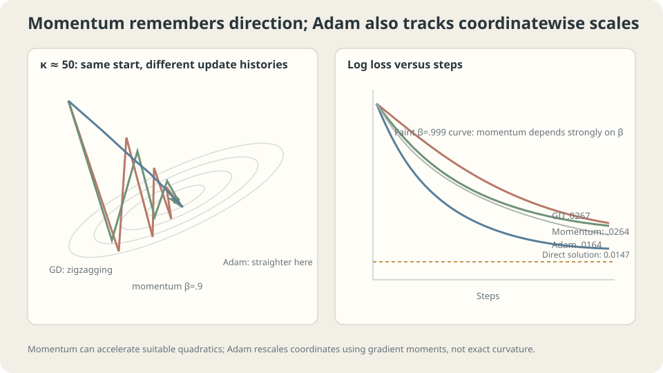

import Objectives from '../../../components/Objectives.astro';
import Ask from '../../../components/Ask.astro';
import Prereq from '../../../components/Prereq.astro';
import Question from '../../../components/Question.astro';
import Answer from '../../../components/Answer.astro';
import QuizBlock from '../../../components/QuizBlock.astro';
import Option from '../../../components/Option.astro';
import Explanation from '../../../components/Explanation.astro';
import VizPlan from '../../../components/VizPlan.astro';
import Remark from '../../../components/Remark.astro';
import Details from '../../../components/Details.astro';
import Bridge from '../../../components/Bridge.astro';
import UsedBy from '../../../components/UsedBy.astro';
import Ref from '../../../components/Ref.astro';

# One Learning Rate Is Not Enough: Momentum and Adam

<Objectives title="After reading, you can">
- Explain gradient memory and the joint heavy-ball rate/momentum setting for quadratics.
- Write Adam, distinguishing second gradient moments from the Hessian.
- Diagnose scaling and finite-budget behavior without assuming optimizer invariance or universal superiority.
</Objectives>

<Prereq items={frontmatter.prereqs} />

## One scalar serves several purposes

So far, the learning rate has had three jobs:

- Respect quadratic stability through $2/\lambda_{\max}$.
- Make useful progress despite poor conditioning.
- Control local stochastic spread under the qualified noise-floor model.

Stability and noise can favor smaller rates while finite-budget progress can favor larger stable rates. Their causes differ: curvature, slow modes, and sampling uncertainty.

In an elongated valley, gradients alternate across the narrow direction but remain consistent along the valley. **Can updates remember directions or coordinate scales instead of using only the latest gradient?**

<Ask>
Can updates adapt to steep and flat directions?<br />
What information would that require?<br />
Does an adaptive optimizer eliminate feature-scaling concerns?
</Ask>

<Question label="Discussion" id="Q1">
What would a curvature-aware step do, and how do momentum and Adam differ from that ideal?

<Answer summary="Show the reasoning">
For a positive-definite local quadratic approximation, the **Newton step** is

$$
\theta_{k+1}=\theta_k-\big[\nabla^2L(\theta_k)\big]^{-1}\nabla L(\theta_k).
$$

The inverse Hessian rescales eigendirections by curvature. For an exact positive-definite quadratic with exact derivatives, a full Newton step reaches the minimizer in one update.

A dense Hessian has quadratic parameter storage, and solving its system is expensive at scale. Nonconvex Hessians can be indefinite, so an unmodified Newton direction need not be a descent direction. Practical Newton variants also use damping and line searches.

Two cheaper mechanisms use different information:

- **Momentum** accumulates gradients over time. Suitable joint settings can accelerate slow quadratic modes without estimating a Hessian.
- **Adam** maintains coordinate-wise first and second gradient moments and scales updates by estimated RMS gradient. A squared gradient is not a Hessian-diagonal estimate.

Their roles overlap in practice: Adam also contains first-moment memory. Neither is generally equivalent to a cheap exact Newton step, and their comparative value requires experiment.
</Answer>
</Question>

## Remember directions and scales

Heavy-ball momentum retains a previous update state:

$$
v_{k+1}=\beta v_k+\nabla L(\theta_k),\qquad \theta_{k+1}=\theta_k-\eta\,v_{k+1}.
$$

The moving-ball intuition suggests cancellation of oscillating gradients and accumulation of consistent ones. Actual acceleration and stability depend jointly on rate, momentum, and the objective spectrum.

With zero initial velocity, $v_{k+1}=\sum_{j=0}^k\beta^j\nabla L(\theta_{k-j})$. This has the exponential memory of <Ref to="math-ema" mode="title"/>, with typical scale $1/(1-\beta)$, but memory length alone is not an acceleration guarantee.

**Adam** keeps coordinate-wise first and second EMA states:

$$
m_k=\beta_1m_{k-1}+(1-\beta_1)g_k,\quad
s_k=\beta_2s_{k-1}+(1-\beta_2)g_k^2,\quad
\theta_{k+1}=\theta_k-\eta\,\frac{\hat m_k}{\sqrt{\hat s_k}+\epsilon}
$$

The hats correct initialization shrinkage. If one coordinate's entire gradient history is large and another's small, RMS division can reduce their update-scale disparity.

Ignoring $\epsilon$, multiplying a coordinate's whole gradient history by a fixed positive factor cancels between numerator and denominator. Feature rescaling also changes parameters and later gradients, so this cancellation does **not** imply reparameterization-invariant trajectories.



*Temporal gradient memory and coordinate-wise scaling are different mechanisms.*

## Quadratic acceleration and adaptive update scale

For a positive-definite quadratic, each heavy-ball eigendirection obeys a second-order recurrence. Optimal worst-case spectral settings are

$$
\begin{aligned}
\beta^\star&=\left(\frac{\sqrt\kappa-1}{\sqrt\kappa+1}\right)^2,\\
\eta^\star&=\frac4{(\sqrt{\lambda_{\max}}+\sqrt{\lambda_{\min}})^2},\\
\rho&=\frac{\sqrt\kappa-1}{\sqrt\kappa+1}.
\end{aligned}
$$

Compared with optimal GD's factor $(\kappa-1)/(\kappa+1)$, this replaces the condition-number dependence by its square root in the quadratic spectral rate. Repeated characteristic roots can add transient polynomial factors; do not interpret this as a universal one-step norm contraction for networks.

For the toy's condition number near $1.6\times10^7$, the theoretical momentum coefficient is about 0.999, rather than necessarily a common fixed default.

> **The quadratic result requires choosing rate and momentum together.**

Expanding gives $\beta^\star=1-4/\sqrt\kappa+O(1/\kappa)$. The gradient-memory scale describes retention, not a universal speedup bound [1].

Adam's update is $\eta$ times a first-moment-to-RMS ratio. Stable same-sign gradients can make its magnitude near $\eta$, but changing signs and magnitudes alter that ratio. Rate tuning remains necessary [2].

<Remark label="Supplement" summary="Bias correction and epsilon">
Starting moment states at zero gives total weights $1-\beta_1^k$ and $1-\beta_2^k$. Ignoring epsilon, omitting correction multiplies the corrected update by

$$
\frac{1-\beta_1^k}{\sqrt{1-\beta_2^k}}.
$$

With coefficients 0.9 and 0.999, this factor is about 3.16 at the first step and 3.24 at step one hundred. It is not a fixed tenfold effect.

Epsilon also limits normalization of tiny second moments. When it dominates the denominator, update scaling becomes closer to a first-moment gradient step. Its effect depends on numerical precision and the actual moment values; it neither guarantees stability nor fixes arbitrary poor parameterizations.
</Remark>

<Details label="Details" summary="Convergence, decoupled decay, and generalization">
Adam has nonconvergent counterexamples under particular convex setups; AMSGrad changes second-moment memory to address relevant issues [4]. The update definition alone does not prove universal convergence.

**AdamW** separates parameter shrinkage from the adaptively scaled loss gradient. Adding an L2 gradient before adaptive scaling and applying direct decay afterward are generally different updates. See <Ref to="ml-regularization" mode="title"/>.

Optimizer formulas alone do not determine test performance. Tune their rates and regularization under a comparable budget and assess the resulting procedures with appropriate held-out data.
</Details>

## Match an intervention to evidence

The following are checks rather than unique diagnoses:

| Observation | Possible checks |
|---|---|
| Nonfinite losses | Inputs, operators, gradients, precision, and smaller stable steps |
| Stable slow progress | Conditioning, momentum/rate combinations, normalization, and adaptive methods |
| Large coordinate-scale disparity | Representation, scaling, and coordinate adaptation |
| A persistent plateau | Noise-floor interventions together with capacity and optimization checks |

Quadratic rates do not transfer unchanged to networks with changing Hessians. Adam's gradient rescaling is not arbitrary parameterization invariance. With minibatches, temporal averaging also changes noise correlations and update magnitudes, so the earlier scalar floor model cannot simply be reused unchanged.

## Compare on one toy problem

Use the earlier thirty-example degree-five regression with raw features. The direct empirical MSE is about 0.01466. The following finite-budget comparisons use several selected stable settings, not an exhaustive optimal tuning procedure:

```python
import numpy as np
from ml_toy import toy_1d

x, y = toy_1d(n=30, seed=0)
V = np.vander(x, 6, increasing=True); n = len(x)

def final(kind, eta, mom=0.9, T=20000):
    w = np.zeros(6); v = np.zeros(6); s = np.zeros(6)
    for t in range(1, T+1):
        g = (V.T @ (V@w - y))/n
        if kind == "gd":       w -= eta*g
        elif kind == "mom":    v = mom*v + g; w -= eta*v
        elif kind == "adam":
            v = 0.9*v + 0.1*g;  s = 0.999*s + 0.001*g*g
            w -= eta*(v/(1-0.9**t))/(np.sqrt(s/(1-0.999**t)) + 1e-8)
    return ((V@w - y)**2).mean()
```

```
After 20000 updates:
GD eta=.3       .03213     momentum beta=.9, eta=.11      .02638
GD eta=.7       .02891     momentum beta=.99, eta=.11     .01668
GD eta=1.05     .02666     momentum beta=.999, eta=.11    .01596
GD eta=1.15     divergent  momentum beta=.9999, eta=.002  .02393
Adam eta=.003   .01647
Adam eta=.01    .01638
Adam eta=.03    .01638
Adam eta=.1     .01646
```

Read these as several distinct observations.

Momentum near 0.999 helps in this comparison, but the theoretical optimal rate was not used jointly, so the table does not directly verify the optimal spectral theorem.

Several Adam rates yield similar final training losses here. That does not prove rate tuning is unnecessary or superiority to every momentum setting.

The best displayed momentum result is slightly below the displayed Adam results. Both improve over the selected GD runs under this budget, with conclusions limited to this experiment.

**Change coordinates:** use $t=100+10x$ before forming polynomial features. The largest Hessian eigenvalue becomes enormous. Does gradient-moment scaling make Adam immune?

```
Poorly scaled basis, representative training MSE:
direct numerical fit: .01867
GD eta=1e-24, 20000 updates: .36383
momentum eta=1e-24, 20000 updates: .36377
Adam eta=.1, 200000 updates: 21547
Adam eta=1e-3, 200000 updates: 7.6e7
Adam eta=1e-6, 200000 updates: 169.56
Adam eta=1e-9, 200000 updates: .21414
Adam eta=1e-12, 200000 updates: .21416
After feature normalization, Adam eta=.01, 20000 updates: .01466
```

None of these particular unnormalized runs reaches the direct-fit score. The normalized representation greatly improves the comparison. Numerical rank and conditioning can also change the reported direct fit, despite equivalence of the polynomial family in exact arithmetic.

Large variation in parameter magnitudes is a useful clue, but does not alone determine the required iterations: Adam's moment ratio also changes each update. The normalization comparison demonstrates that adaptive scaling did not solve every representation issue.

> **Cancellation of gradient-history scaling is not invariance to feature scaling.**

Using Adam does not remove the need to inspect representation and numerical scales. Compare transformations appropriate to the actual features and task.

## Three update rules on one bowl

<iframe loading="lazy" src="/personal_website/notes/research_areas/machine-learning-foundations/l2-optimization-in-practice/l2-1-2.en.html" class="demo-frame" title="Gradient descent, momentum, Adam, and coordinate scales" style="height: 1132px; width: 100%; border: none;"></iframe>

**Compare ordinary coordinates, scaled losses, and poorly scaled features.**

## Check your understanding

<QuizBlock id="ml-l2-1-a">
One run with momentum 0.9 gives little improvement. Does that rule out momentum?
<Option>Yes: it only works for convex losses.</Option>
<Option correct>No: compare jointly chosen rate and momentum settings under the intended budget.</Option>
<Option>Adam has universally replaced momentum.</Option>
<Explanation>A setting is not the whole method. Memory length alone does not determine the quadratic rate or network performance.</Explanation>
</QuizBlock>

<QuizBlock id="ml-l2-1-b">
Does Adam make feature standardization unnecessary?
<Option>Yes, universally.</Option>
<Option correct>No: its gradient normalization does not guarantee invariance to feature rescaling or parameterization.</Option>
<Option>No, because it is always worse than GD.</Option>
<Explanation>Changing a feature's units is more than multiplying a fixed gradient history. Test the representation and optimizer together.</Explanation>
</QuizBlock>

<QuizBlock id="ml-l2-1-c">
Ignoring epsilon, what factor appears if Adam bias correction is omitted?
<Option>All updates become zero.</Option>
<Option correct>$(1-\beta_1^k)/\sqrt{1-\beta_2^k}$ relative to the corrected update.</Option>
<Option>Only the final iterate changes; initial steps are unaffected.</Option>
<Explanation>Both moment initialization factors enter. Their ratio varies with time and the coefficients.</Explanation>
</QuizBlock>

<QuizBlock id="ml-l2-1-d">
Which statement is false?
<Option>Exact Newton solves a positive-definite quadratic in one full step.</Option>
<Option>Appropriately joint-tuned heavy-ball has the stated square-root-condition-number spectral rate for positive-definite quadratics.</Option>
<Option correct>Adam's second gradient moment is a consistent Hessian-diagonal estimate by definition.</Option>
<Explanation>Gradient moments and curvature are different objects. A stochastic second moment may remain positive even where the mean gradient vanishes.</Explanation>
</QuizBlock>

<UsedBy slug={frontmatter.slug} />

<Bridge to="ml-moving-targets-ema">
Gradient memory changes updates. If the model also supplies its own targets, which branch should receive gradients and how fast should the target move? Next distinguish EMA from stop-gradient and examine what neither guarantees alone.
</Bridge>

## References

1. Polyak, B. T. [*Some methods of speeding up the convergence of iteration methods.*](https://doi.org/10.1016/0041-5553(64)90137-5) USSR Computational Mathematics and Mathematical Physics 1964.
2. Kingma, D., Ba, J. [*Adam: A Method for Stochastic Optimization.*](https://arxiv.org/abs/1412.6980) ICLR 2015.
3. Goh, G. [*Why Momentum Really Works.*](https://doi.org/10.23915/distill.00006) Distill 2017.
4. Reddi, S. J., Kale, S., Kumar, S. [*On the Convergence of Adam and Beyond.*](https://arxiv.org/abs/1904.09237) ICLR 2018.
