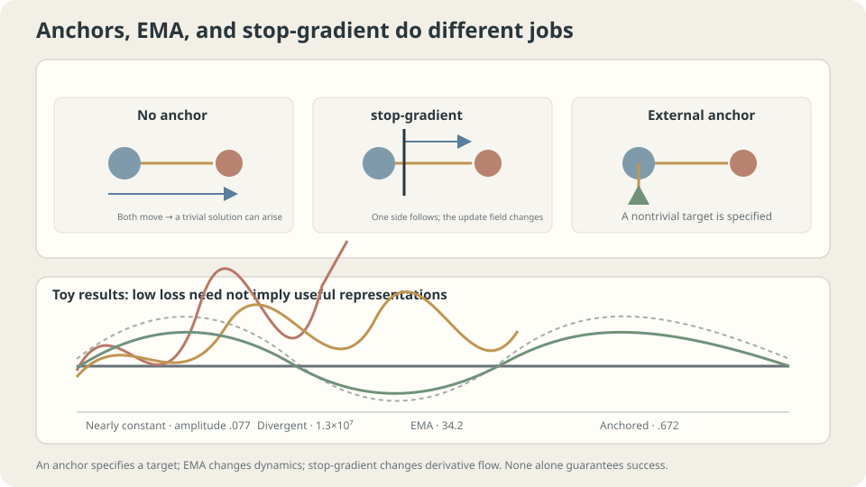

import Objectives from '../../../components/Objectives.astro';
import Ask from '../../../components/Ask.astro';
import Prereq from '../../../components/Prereq.astro';
import Question from '../../../components/Question.astro';
import Answer from '../../../components/Answer.astro';
import QuizBlock from '../../../components/QuizBlock.astro';
import Option from '../../../components/Option.astro';
import Explanation from '../../../components/Explanation.astro';
import VizPlan from '../../../components/VizPlan.astro';
import Remark from '../../../components/Remark.astro';
import Bridge from '../../../components/Bridge.astro';
import UsedBy from '../../../components/UsedBy.astro';
import Ref from '../../../components/Ref.astro';

# When the Model Produces Its Own Targets

<Objectives title="After reading, you can">
- Identify constant solutions of pure consistency objectives and distinguish collapse from divergence.
- Explain how stop-gradient, EMA, and external labels change different parts of training.
- Distinguish a moving teacher from averaged evaluation weights without overextending arithmetic-averaging theory.
</Objectives>

<Prereq items={frontmatter.prereqs} />

## The target moves too

Ordinary labels stay fixed as parameters change. Without enough labels, could a model learn from its own prediction on a related input? Two students agreeing more often does not necessarily mean they become more correct.

Examples of model-defined targets include

- Self-distillation or mean teachers using model predictions as targets.
- Consistency between two views intended to share an answer.
- Bootstrap objectives containing current predictions in part of the target.

A simple consistency objective contains the model twice:

$$
\mathcal L(\theta)=\mathbb E\big[\lVert f_\theta(x)-f_\theta(x')\rVert^2\big]
$$

Every constant function makes it zero, a global minimum of this nonnegative objective. Agreement alone cannot distinguish informative representations from constant ones.

<Ask>
What constrains a self-defined answer?<br />
Which operation changes the loss or its solutions?<br />
Which changes only how training moves?
</Ask>

<Question label="Discussion" id="Q1">
Why is a constant globally optimal here, and which gradient term does stopping the target branch remove?

<Answer summary="Show the reasoning">
If $f_\theta\equiv c$, all paired differences vanish and loss is zero. Every representable constant is therefore a global minimizer of pure consistency.

For scalar residual $r=f_\theta(x)-f_\theta(x')$, the full derivative contains two terms:

$$
\nabla_\theta\mathcal L=2\,\mathbb E\big[r\,\nabla_\theta f_\theta(x)\big]-2\,\mathbb E\big[r\,\nabla_\theta f_\theta(x')\big].
$$

One moves prediction toward target; the other moves target toward prediction. Stop-gradient retains only the first branch's contribution:

$$
g_{\text{sg}}=2\,\mathbb E\big[r\,\nabla_\theta f_\theta(x)\big].
$$

This is generally a **semigradient**, not the full gradient of the displayed shared-parameter loss. Its original small-step descent guarantee cannot simply be retained. Special symmetric settings can have further structure, but not universally.

The forward numerical loss is unchanged, while update dynamics change. A constant remaining a zero-loss solution does not prove training reaches it; changing updates also does not universally avoid it.
</Answer>
</Question>

## Three mechanisms, three roles

**An anchor:** nonconstant external labels or a fixed teacher constrain answers. Constant predictions cannot fit differing labels perfectly, but overall optima still depend on capacity, weighting, and the full objective.

**EMA target:** $\theta^-_{k+1}=\tau\theta^-_k+(1-\tau)\theta_k$ slows the reference's response to single updates. This can reduce rapid chasing, but supplies neither correctness evidence nor universal stability.

**Stop-gradient:** blocks this update's differentiation through the target branch. Its effectiveness interacts with predictors, normalization, view construction, and other constraints; alone it proves no universal noncollapse result.



*The mechanisms act on different parts of the system. External labels are not a requirement of every successful self-supervised method.*

## Objective solutions and training destinations differ

Separate the following questions.

Whether constants minimize the forward objective is a property of the loss and allowed functions. Which solutions training approaches also depends on update dynamics. Stop-gradient can affect the latter without changing forward values.

> **Changing the minimizer set and changing the dynamics are different interventions.**

For a linear update $\theta_{k+1}=(I-\eta A)\theta_k+\eta b$, eigenmode stability requires $|1-\eta\lambda|<1$. A nonsymmetric semigradient matrix can have complex or unstable eigenvalues; even positive symmetric curvature becomes unstable at excessive step sizes.

An EMA teacher adds another state, so analyze the joint online/target system. Slower targets can help in some regimes, but the joint eigenvalues, objective, and rates still determine stability.

<Remark label="Caution" summary="What do BYOL and SimSiam establish?">
BYOL uses online and EMA target networks [3]. SimSiam removes the momentum encoder and experimentally studies stop-gradient [4]. It is therefore incorrect to attribute both methods' behavior simply to EMA.

Predictors and other asymmetries matter. A simple polynomial consistency experiment can disprove a universal single-component guarantee without explaining or refuting the full mechanisms of those systems.
</Remark>

## Choose constraints and monitoring

Ask what limits the answers: true labels, a fixed teacher, view assumptions, predictors, normalization, or other information-preserving constraints. Decreasing consistency loss alone does not establish useful learning.

Choose $\tau$ against the intended target time scale, roughly $1/(1-\tau)$ updates. Values near one slow changes; schedules can adapt that speed during training. An appropriate value depends on the full procedure.

Monitor output variability, feature rank or singular values, and downstream performance. Reduced spread can warn of collapse without needing to shrink monotonically. Large spread alone does not establish usefulness.

Networks can collapse in only some dimensions. Confident pseudo-labels may help learning, but are not independent evidence proving their own correctness.

## Compare mechanisms in one example

Use a degree-five polynomial, nearby pairs $(x,x+0.02)$, and three optional true-label anchors at $0.05,0.5,0.95$. The true sine function has range about two. For a clean comparison, use the full-gradient branch only with shared current parameters; EMA runs below use a stopped teacher:

```python
import numpy as np
from ml_toy import truth
xs,ys = truth()
D = 5
mx = np.abs(np.vander(np.linspace(0,1,60),D+1,increasing=True)).max(0)
B = lambda X:np.vander(X,D+1,increasing=True)/mx
xa = np.array([.05,.5,.95])
ya = np.sin(2*np.pi*xa)
xp = np.linspace(0,1,200)
xq = np.clip(xp+.02,0,1)
Ap,Aq,Aa,As = B(xp),B(xq),B(xa),B(xs)
def train(stopgrad,anchor,tau,eta,T=20000,seed=0):
    if tau is not None and not stopgrad:
        raise ValueError('Use a stopped teacher for the EMA comparison.')
    w = np.random.default_rng(seed).standard_normal(D+1)*.5
    wt = w.copy()
    for k in range(T):
        ref = wt if tau is not None else w
        r = Ap@w-Aq@ref
        g = Ap.T@r/len(xp) if stopgrad else (Ap-Aq).T@r/len(xp)
        if anchor: g += 3.*Aa.T@(Aa@w-ya)/len(xa)
        w -= eta*g
        if tau is not None: wt = tau*wt+(1-tau)*w
        if not np.isfinite(w).all(): return None
    f = As@w
    return np.ptp(f),((f-ys)**2).mean()
```

```
Representative outcomes at eta=.02 after 20000 updates:
full gradient, no anchor:          range .077,       error .5374
stop-gradient, no anchor:          range 13017377,   error 1.13e14
stopped EMA(.99), no anchor:       range 34.187,     error 569.6434
full gradient plus anchors:       range .676,       error .3160
stop-gradient plus anchors:        range .671,       error .3136
stopped EMA plus anchors:          range .672,       error .3141
```

Interpret the rows separately.

**Near collapse:** full-gradient consistency produces a nearly flat range, far below the sine's range. Small agreement loss is compatible with an uninformative output.

**Divergence:** the chosen one-sided semigradient and step produce enormous output, not collapse. Inspect the update matrix to identify its instability rather than assuming every stopped update diverges.

**Slower instability:** EMA reduces the displayed explosion but does not make the result correct. Smaller error than another failed run is not success.

**Anchors:** these rows are closer to truth yet remain too flat. Each objective term is averaged separately; sample-count ratio alone does not determine their relative weights.

The sine values at nearby positions are not exactly equal, so the consistency constraint itself is biased. The three anchors also miss peaks and troughs. Compare weighting, anchor coverage, and convergence before blaming only the target speed.

**Average final weights:** a separate use of EMA records a smoother evaluation model during otherwise unchanged SGD training:

```python
wema = .99*wema+.01*w  # Initialize wema appropriately before the loop.
```

```
Representative population risks; direct fit .02744:
eta   B   final weights   EMA(.99) weights
.05   1   .02908          .02854
.05   8   .02831          .02739
.15   1   .03940          .02934
.15   8   .02893          .02752
```

In the displayed high-noise run, excess risk above the direct-fit reference falls by about 84%. That is one experimental comparison, not a universal reduction factor or proof of exact population optimality.

Polyak–Juditsky theory concerns cumulative averaging under specified asymptotic conditions, rather than every fixed-coefficient EMA [1]. Evaluate EMA separately for the intended model and task.

## Compare anchors, EMA, and stopped gradients

<iframe loading="lazy" src="/personal_website/notes/research_areas/machine-learning-foundations/l2-optimization-in-practice/l2-2-2.en.html" class="demo-frame" title="Consistency training: anchors, EMA targets, and stop-gradient" style="height: 898px; width: 100%; border: none;"></iframe>

**Inspect representation spread and usefulness together with loss.**

## Check your understanding

<QuizBlock id="ml-l2-2-a">
Consistency loss falls smoothly toward zero. What else should be checked?
<Option>Only held-out consistency loss.</Option>
<Option correct>Output variation, feature rank, and downstream utility as well as the loss.</Option>
<Option>Only update speed.</Option>
<Explanation>A constant can minimize consistency on unseen inputs too. Holding out data does not repair an objective that admits uninformative answers.</Explanation>
</QuizBlock>

<QuizBlock id="ml-l2-2-b">
What does stop-gradient change?
<Option>The numerical forward loss and all its minimizers.</Option>
<Option correct>The backward path through the target branch, so the full shared-objective descent guarantee cannot automatically be reused.</Option>
<Option>Only the target update rate.</Option>
<Explanation>Target speed is EMA's role. The stopped update can change training dynamics without changing forward agreement values.</Explanation>
</QuizBlock>

<QuizBlock id="ml-l2-2-c">
Anchored fits still have too little range. What is a reasonable investigation?
<Option>Only increase target momentum.</Option>
<Option correct>Compare consistency weighting, anchor locations, model fit, and convergence.</Option>
<Option>Capacity is the only possible cause.</Option>
<Explanation>The constraint mismatches exact neighboring sine values and the anchors miss extremes. Several explanations remain plausible.</Explanation>
</QuizBlock>

<QuizBlock id="ml-l2-2-d">
Which claim is unjustified?
<Option>EMA evaluation weights can improve a particular noisy run without changing its online updates.</Option>
<Option>EMA teachers and EMA final weights use similar formulas for different purposes.</Option>
<Option correct>A sufficiently slow EMA teacher universally prevents consistency collapse.</Option>
<Explanation>Target smoothing supplies no universal information-preservation or stability guarantee. Analyze the complete loss, architecture, and update system.</Explanation>
</QuizBlock>

<UsedBy slug={frontmatter.slug} />

<Bridge to="ml-regularization">
Stable updates do not guarantee generalization from finite observations. Next compare parameter restrictions, early stopping, and dropout, using linear models to identify where their effects agree and differ.
</Bridge>

## References

1. Polyak, B. T., Juditsky, A. [*Acceleration of Stochastic Approximation by Averaging.*](https://doi.org/10.1137/0330046) SIAM Journal on Control and Optimization 1992.
2. Tarvainen, A., Valpola, H. [*Mean teachers are better role models.*](https://arxiv.org/abs/1703.01780) NeurIPS 2017.
3. Grill, J.-B. et al. [*Bootstrap Your Own Latent.*](https://arxiv.org/abs/2006.07733) NeurIPS 2020.
4. Chen, X., He, K. [*Exploring Simple Siamese Representation Learning.*](https://arxiv.org/abs/2011.10566) CVPR 2021.
