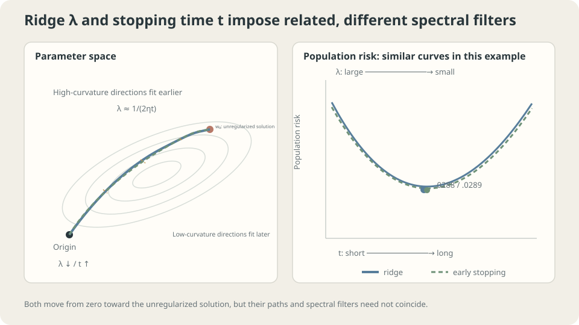

import Objectives from '../../../components/Objectives.astro';
import Ask from '../../../components/Ask.astro';
import Prereq from '../../../components/Prereq.astro';
import Question from '../../../components/Question.astro';
import Answer from '../../../components/Answer.astro';
import QuizBlock from '../../../components/QuizBlock.astro';
import Option from '../../../components/Option.astro';
import Explanation from '../../../components/Explanation.astro';
import VizPlan from '../../../components/VizPlan.astro';
import Remark from '../../../components/Remark.astro';
import Details from '../../../components/Details.astro';
import Bridge from '../../../components/Bridge.astro';
import UsedBy from '../../../components/UsedBy.astro';
import Ref from '../../../components/Ref.astro';

# Limit the Notes or Stop Practicing: Regularization and Early Stopping

<Objectives title="After reading, you can">
- Explain what parameter penalties, early stopping, and dropout change.
- Derive ridge and zero-initialized linear GD filters and their approximate scale relationship.
- Assess regularization through controlled validation rather than assuming universal benefit.
</Objectives>

<Prereq items={frontmatter.prereqs} />

## Two interventions against memorization

Return to the student memorizing old exams in <Ref to="ml-overfitting-underfitting" mode="title"/>.

**Limit the notes:** one handwritten page encourages compact rules rather than storing every answer.

**Limit practice time:** stop before excessive attention to particular question details.

Both restrictions can remove irrelevant detail or prevent useful learning. **Which solutions do they restrict mathematically?** A linear model makes their effects explicit.

<Ask>
How can limiting parameters and limiting time have similar effects?<br />
When do their predictions differ?<br />
How do we decide whether either restriction helps?
</Ask>

<Question label="Discussion" id="Q1">
Write a parameter penalty, derive its solution, and explain when smaller parameters control function variation.

<Answer summary="Show the reasoning">
Add a quadratic parameter penalty to the empirical objective:

$$
\frac{1}{2n}\lVert Vw-y\rVert^2+\frac{\lambda}{2}\lVert w\rVert^2 .
$$

The coefficient $\lambda$ trades training fit for smaller parameter norm. Half factors simplify differentiation. If all coordinates are penalized, increasing the coefficient toward infinity drives parameters toward zero.

For linear least squares with $H=V^\top V/n$, stationarity gives

$$
(H+\lambda I)\,w=\frac1nV^\top y
\quad\Longrightarrow\quad
w_\lambda=(H+\lambda I)^{-1}\tfrac1nV^\top y .
$$

Project onto an eigenvector with eigenvalue $\mu_j$:

$$
w_\lambda^{(j)}=\frac{\mu_j}{\mu_j+\lambda}\cdot w_{0}^{(j)},
$$

Relative to a least-squares solution in positive-curvature directions, the factor $\mu_j/(\mu_j+\lambda)$ strongly suppresses weak directions and preserves strong ones. Null directions require choosing an appropriate least-squares reference.

For fixed differentiable features, $|f_w'(x)|\le\|w\|\|\phi'(x)\|$. Norm control can therefore bound variation in that representation, but depends on feature scales. Small curvature means the training objective changes weakly along a direction, not that all values along it are equally good.

Starting GD at zero also learns stronger-curvature directions earlier under a nonoscillatory stable step. That gives a related filtering effect, though not the same parameter path.
</Answer>
</Question>

## Three kinds of restriction

Compare what each operation changes:

- **Ridge/L2 penalty:** changes the objective and gives the stated linear spectral filter. Direct weight decay equals this update for ordinary GD under matched conventions, not every optimizer.
- **Early stopping:** limits the duration of optimization, yielding filter $1-(1-\eta\mu_j)^t$ in the linear zero-start setting.
- **Dropout:** randomly masks units during training. Particular linear squared-loss settings admit a scale-dependent penalty interpretation; deep-network behavior is more complex than an exact ensemble average.

Such changes can trade bias for lower variation in simple settings. General networks have no universal monotonic tradeoff or guaranteed validation improvement.



*Both can suppress weak feature directions, but their trajectories and filters differ.*

## Compare the filters

In the eigenbasis of fixed $H$, compare the fraction of the least-squares solution retained.

**Ridge:**

$$
q_j^{\mathrm{ridge}}=\frac{\mu_j}{\mu_j+\lambda}.
$$

**GD after $t$ updates from zero:** each error component multiplies by $1-\eta\mu_j$, so

$$
q_j^{\mathrm{GD}}=1-(1-\eta\mu_j)^t\approx1-e^{-\eta\mu_jt}.
$$

For $0<\eta\le1/\mu_{\max}$, these filters increase nonoscillatorily from zero. Small $\eta\mu_j$ permits the exponential approximation. Transition scales are approximately $\mu_j\sim\lambda$ and $\mu_j\sim1/(\eta t)$, giving

$$
\boxed{\ \lambda\approx\frac{1}{\eta t}\ }
$$

> **$\lambda\approx1/(\eta t)$ aligns scales, not every eigendirection exactly.**

Stopping count and rate must be interpreted together. A schedule replaces the constant-rate power by a product of step-specific factors. Explicit penalties and stopping can coexist, but their combined improvement requires validation.

<Details label="Details" summary="Why aligned scales do not imply identical solutions">
For small curvature, the filters behave like μ/λ and ημt. At large curvature, ridge approaches one algebraically while the exponential approximation approaches it exponentially. Matching one transition scale cannot match the whole spectrum.

The example below finds similar best risks for ridge and stopping while their early-trajectory risks differ. This illustrates related filtering without establishing identical parameters.

Other datasets need not have equally close best risks or equally broad good regions. Examine validation sensitivity rather than assuming a universal flat optimum.
</Details>

<Remark label="Caution" summary="Adaptive scaling changes the meaning of decay">
Adding $\lambda w$ to Adam's gradient sends the penalty through its adaptive moment processing. This differs from applying direct parameter shrinkage after the adaptive loss-gradient step.

**AdamW** decouples the two:

$$
w\leftarrow w-\eta\,\frac{\hat m}{\sqrt{\hat s}+\epsilon}-\eta\lambda w .
$$

Consequently the same numerical coefficient does not imply the same effective regularization across optimizers and conventions. See <Ref to="ml-optimizers" mode="title"/>.
</Remark>

## When should restrictions help?

Low training and high validation errors motivate testing restrictions. Two high errors motivate checking capacity, data, objective, and optimization first. Those patterns are clues, not a measured bias–variance decomposition.

Compare a modest range of strengths on the same development protocol. Selecting a stopping point also uses validation data and needs independent final evaluation. Combining restrictions is possible without a universal ordering of optimal strengths.

The spectral derivation assumes linear features, squared loss, and the stated initialization/rate. Nonlinear networks do not inherit its exact filters. L2 also depends on parameterization and feature scale. Intercepts are often excluded from penalties, but that is a modeling choice to specify rather than a mathematical prohibition.

## Compare two regularization paths

Use thirty examples and degree-twenty polynomial features. Maximum-column scaling is not centered unit-variance standardization. Raw normal equations remain ill-conditioned; use stable augmented least squares for the comparison below.

**Ridge sweep:**

```python
import numpy as np
from ml_toy import toy_1d, truth, NOISE
xs,ys = truth()
x,y = toy_1d(n=30,seed=0)
n,D = len(x),20
mx = np.abs(np.vander(np.linspace(0,1,80),D+1,increasing=True)).max(0)
B = lambda X:np.vander(X,D+1,increasing=True)/mx
A,As = B(x),B(xs)
risk = lambda w:((As@w-ys)**2).mean()+NOISE**2
for lam in (0,1e-8,1e-6,1e-4,1e-3,1e-2,.1,1,10):
    aug = np.vstack([A,np.sqrt(lam*n)*np.eye(D+1)])
    target = np.r_[y,np.zeros(D+1)]
    w = np.linalg.lstsq(aug,target,rcond=None)[0]
    print(lam,'training',((A@w-y)**2).mean(),'population',risk(w))
# Stable arithmetic can differ from ill-conditioned normal-equation records below.
```

```
Original normal-equation experiment record:
lambda  training   population
0       .0106      .0321
1e-8    .0129      .0288
1e-6    .0134      .0292
1e-4    .0208      .0406
1e-3    .0578      .0831
.01     .1246      .1709
.1      .1898      .2902
1       .3139      .4439
10      .3929      .5001
```

The selected small penalty helps this record, while larger penalties suppress useful directions. For exact ridge solutions, increasing the coefficient makes parameter norm nonincreasing and unpenalized training loss nondecreasing, allowing ties. Numerical results need solver checks before using those monotonic properties as diagnostics.

**Early stopping:** use the same family with zero explicit penalty.

```python
w = np.zeros(D+1); eta = 1.8/np.linalg.eigvalsh(A.T@A/n)[-1]
for t in range(1, 1000001):
    w -= eta*(A.T@(A@w - y))/n
```

```
updates   training   population
30        .1397      .1896
100       .1265      .1617
300       .1008      .1312
1000      .0546      .0787
3000      .0294      .0526
10000     .0194      .0404
100000    .0137      .0301
1000000   .0134      .0289
```

The best displayed stopped risk is close to the recorded ridge result. These are experimental values, not a theorem equating their minima.

**Related scales:** the following original comparison uses $\lambda=1/(2\eta t)$ with $\eta=0.7634$, an additional factor of two relative to the earlier scale alignment:

```
t=300:    stopped .1312, ridge at 2.18e-3: .1131
t=3000:   stopped .0526, ridge at 2.18e-4: .0493
t=30000:  stopped .0319, ridge at 2.18e-5: .0323
t=300000: stopped .0293, ridge at 2.18e-6: .0294
```

Later risks are close while earlier ones differ more. The filters have different shapes; neither numerical agreement nor a rough transition scale establishes identical predictions or parameter paths.

> **Similar risks do not imply identical regularization paths.**

**Test an already restricted model:** add the same penalty to degree-two regression.

```
  degree  2: λ=0  0.2668   λ=1e-06 0.2668   λ=0.001 0.2673   λ=0.1  0.3456
  degree 20: λ=0  0.0320   λ=1e-06 0.0292   λ=0.001 0.0831   λ=0.1  0.2902
```

The tested strengths do not improve that particular degree-two fit. This does not prove every positive coefficient is harmful; contrast it with the observed small-penalty improvement for the larger family.

The bias–variance picture suggests why excessive restriction can hurt a family already missing the sine pattern: little variation may be removable while systematic error grows. Quantify the components or compare held-out performance rather than assuming this tradeoff for every model.

Regularization is not a universal response to poor performance. Use <Ref to="ml-learning-curves" mode="title"/> and controlled tests before increasing a penalty repeatedly.

## Two filters and their scales

<iframe loading="lazy" src="/personal_website/notes/research_areas/machine-learning-foundations/l2-optimization-in-practice/l2-3-2.en.html" class="demo-frame" title="Ridge and early stopping as different spectral filters" style="height: 880px; width: 100%; border: none;"></iframe>

**Compare filters near the scale $\lambda\approx1/(\eta t)$ without expecting exact agreement.**

## Check your understanding

<QuizBlock id="ml-l2-3-a">
Both training and validation errors greatly exceed the noise level. Should stronger decay be the automatic response?
<Option>Yes: regularization always helps.</Option>
<Option correct>No: inspect capacity, data, and optimization, then compare strengths experimentally.</Option>
<Option>Decay cannot affect validation.</Option>
<Explanation>Stronger restrictions can hurt a capacity-limited fit, while other failure mechanisms can behave differently.</Explanation>
</QuizBlock>

<QuizBlock id="ml-l2-3-b">
Ridge and early stopping yield nearly identical validation scores. What follows?
<Option>They must be unrelated.</Option>
<Option correct>They may impose related spectral restrictions, but scores do not prove equal parameters or predictions.</Option>
<Option>Stopping is always superior because it is cheaper.</Option>
<Explanation>The factors $\mu/(\mu+\lambda)$ and $1-(1-\eta\mu)^t$ are different functions. Compare costs and selected procedures separately.</Explanation>
</QuizBlock>

<QuizBlock id="ml-l2-3-c">
Which directions does ridge suppress most strongly in the stated linear eigenbasis?
<Option>Every direction by the same factor.</Option>
<Option correct>Directions with $\mu_j\ll\lambda$, while strong-curvature directions are relatively preserved.</Option>
<Option>The intercept necessarily more than every other coordinate.</Option>
<Explanation>The filter depends on eigenvalue. Treatment of the intercept is a separate modeling and implementation choice.</Explanation>
</QuizBlock>

<QuizBlock id="ml-l2-3-d">
Which claim is false?
<Option>Exact ridge solutions have nondecreasing training loss as penalty increases.</Option>
<Option>Adaptive-gradient penalties and decoupled decay generally differ.</Option>
<Option correct>A sufficiently small positive penalty is guaranteed harmless for every model and population.</Option>
<Explanation>No positive regularization strength gives universal risk improvement. Exact-solve monotonicity concerns training loss and norm, not population risk.</Explanation>
</QuizBlock>

<UsedBy slug={frontmatter.slug} />

<Bridge to="ml-loss-landscape">
Quadratic models expose update and filtering mechanisms. Network losses need not be single bowls or have unique minima. Next ask how initialization affects a nonconvex training trajectory.
</Bridge>

## References

1. Hoerl, A. E., Kennard, R. W. [*Ridge Regression: Biased Estimation for Nonorthogonal Problems.*](https://doi.org/10.1080/00401706.1970.10488634) Technometrics 1970.
2. Yao, Y., Rosasco, L., Caponnetto, A. [*On Early Stopping in Gradient Descent Learning.*](https://doi.org/10.1007/s00365-006-0663-2) Constructive Approximation 2007.
3. Srivastava, N. et al. [*Dropout: A Simple Way to Prevent Neural Networks from Overfitting.*](https://jmlr.org/papers/v15/srivastava14a.html) JMLR 2014.
